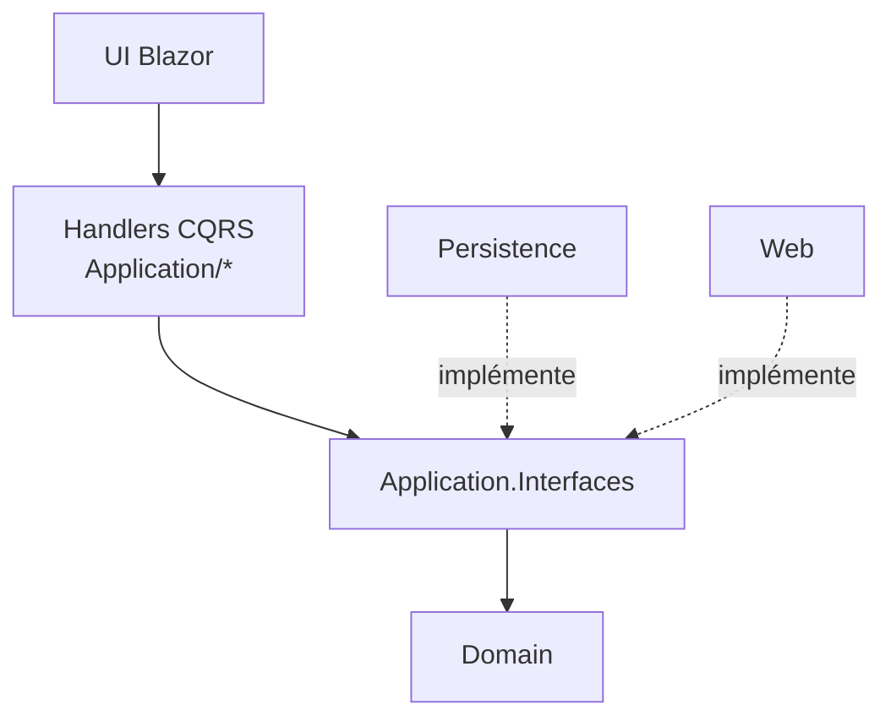
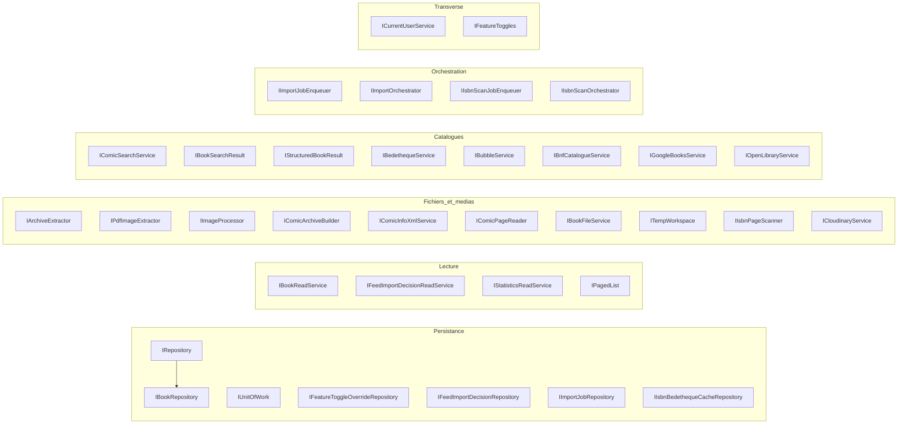
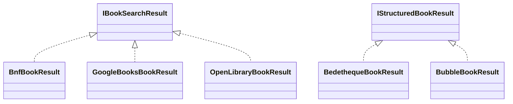
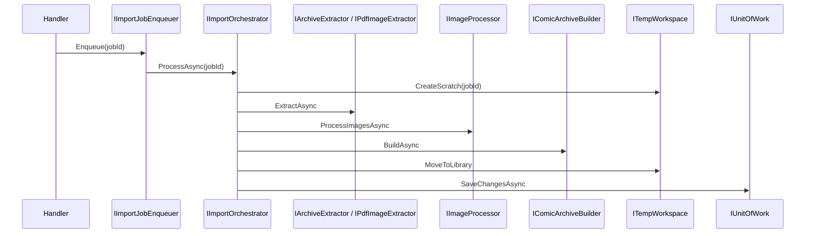

# Interfaces de la couche Application

Le module `Application_Interfaces` regroupe les contrats définis dans `Application/Interfaces/`. Ce sont les ports de la Clean Architecture : la couche Application déclare ce dont elle a besoin (persistance, stockage de fichiers, traitement d'images, catalogues bibliographiques, files de tâches) et les couches `Persistence` et `Web` fournissent les implémentations. Ces interfaces dépendent uniquement de `Domain` (notamment `Result` / `Result<T>`, voir [Domain_Model](../Domain_Model.md)).

Les abstractions de messagerie CQRS (`ICommand`, `IQuery` et leurs handlers) sont documentées dans [Messaging_Abstractions](Messaging_Abstractions.md).

## Vue d'ensemble de l'architecture

Les handlers ne connaissent que les interfaces ; l'injection de dépendances relie les implémentations à la composition root (`Web`).

## Familles d'interfaces

### 1. Persistance (écriture)

| Interface | Rôle |
|---|---|
| `IRepository<TEntity, TEntityId>` | Contrat générique : `GetByIdAsync`, `Add`, `Update`, `Remove`, `ListAsync`, `Count`. |
| `IBookRepository` | Étend `IRepository<Book, Guid>` : recherche par ISBN, listes par bibliothèque / utilisateur, `AddReadingDate`, `ListIdsToScanForIsbnAsync` (livres numériques sans ISBN jamais scannés). |
| `IUnitOfWork` | `SaveChangesAsync` retourne `Result<int>` : l'enregistrement est explicite et les erreurs passent par le pattern `Result`. |
| `IFeatureToggleOverrideRepository` | Surcharges de feature toggles (`FeatureToggleOverride`). |
| `IFeedImportDecisionRepository` | Décisions d'import de flux (par id, par entrée Miniflux, par statut, en attente). |
| `IImportJobRepository` | Jobs d'import de fichiers ; `ExistsActiveForFilePathAsync` évite les doublons. |
| `IIsbnBedethequeCacheRepository` | Cache ISBN → URL Bedetheque. |

Les dépôts ne sauvegardent pas eux-mêmes : les modifications sont validées via `IUnitOfWork`.

### 2. Lecture (CQRS côté requêtes)

- `IBookReadService` : liste paginée par bibliothèque (tri, recherche), identités des livres, localisation des séries de l'utilisateur.
- `IFeedImportDecisionReadService` : pagination, comptages par statut, détection des entrées multi-livres.
- `IStatisticsReadService` : calcule `StatisticsDto`, éventuellement limité à une bibliothèque.
- `IPagedList<T>` : abstraction de pagination (`Items`, `Page`, `TotalCount`, `HasNextPage`…) qui masque les types EF Core.

Voir [Persistence_Read_Services](../Data_Persistence___Queries/Persistence_Read_Services.md) pour les implémentations.

### 3. Fichiers et médias

| Interface | Rôle |
|---|---|
| `IArchiveExtractor` | Extrait images et XML d'archives zip/cbz/rar/cbr (`ArchiveExtractionResult`). |
| `IPdfImageExtractor` | Extrait les images embarquées d'un PDF (`PdfExtractionResult`). |
| `IImageProcessor` | Conversion WebP + redimensionnement, avec callback de progression. |
| `IComicArchiveBuilder` | Construit le CBZ final (`ComicArchiveResult`). |
| `IComicInfoXmlService` | Lecture / écriture de `ComicInfo.xml` (`ComicInfoData`). |
| `IComicPageReader` | Lecture à la demande des pages d'une archive, sans extraction disque (`ComicPage`). |
| `IBookFileService` | Suppression de fichiers de livres. |
| `ITempWorkspace` | Espace de travail temporaire, contrôle d'espace libre, déplacement vers la bibliothèque. |
| `IIsbnPageScanner` | OCR des premières / dernières pages pour trouver un ISBN (`IsbnScanResult`). |
| `ICloudinaryService` | Envoi d'images (URL, fichier, flux) et `PingAsync`. |

Implémentations : [Persistence_File_Services](../File_Storage___Media_Processing/Persistence_File_Services.md) et [Persistence_Local_Storage](../File_Storage___Media_Processing/Persistence_Local_Storage.md).

### 4. Catalogues bibliographiques

Les sources externes renvoient des résultats typés ; `Found` et `Failed` distinguent « inconnu » et « source indisponible ».

- `IBookSearchResult` : titre mêlant série et tome (BnF, Google Books, Open Library).
- `IStructuredBookResult` : série et numéro de volume séparés (Bedetheque, Bubble).
- Chaque service expose `IsEnabled` (configuration ou Settings → Features) et `SearchByIsbnAsync`.
- `IComicSearchService` est la façade : recherche par ISBN, avec couverture locale, `ParseTitleInfo`, `UploadCoverAsync`. `ComicSearchResult.Source` indique le catalogue qui connaissait le livre.

Voir [Comic_Info_Search](../Comic_Info_Search.md).

### 5. Orchestration et tâches d'arrière-plan

- `IImportJobEnqueuer.Enqueue(jobId)` / `IImportOrchestrator.ProcessAsync(jobId)`
- `IIsbnScanJobEnqueuer.Enqueue(libraryId)` / `IIsbnScanOrchestrator.ScanLibraryAsync(libraryId)`

L'enqueuer planifie (Hangfire côté Web), l'orchestrateur exécute. Voir [File_Import_Pipeline](../File_Import_Pipeline.md) et [Book___Library_Use_Cases](../Book___Library_Use_Cases.md).

### 6. Transverse

- `ICurrentUserService.GetCurrentUserIdAsync` : identité de l'utilisateur courant en `Result<Guid>`.
- `IFeatureToggles.IsEnabled(FeatureToggle)` : valeur choisie dans les paramètres, sinon la configuration.

## Flux : import d'un fichier

## Conventions

- Les opérations faillibles retournent `Result` / `Result<T>` plutôt que des exceptions.
- Toutes les opérations asynchrones acceptent un `CancellationToken`.
- Les types de retour (records DTO) sont définis à côté de leur interface.
- Les handlers doivent terminer leurs validations de domaine avant tout effet de bord sur le système de fichiers (`ITempWorkspace`, `ILibraryLocalStorage`).
- Les règles de couches sont vérifiées par `Architecture.Tests` : aucun type EF Core ne doit apparaître dans ces contrats.
