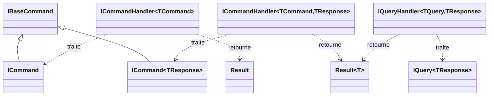
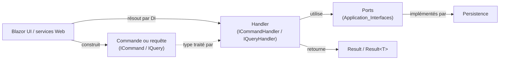
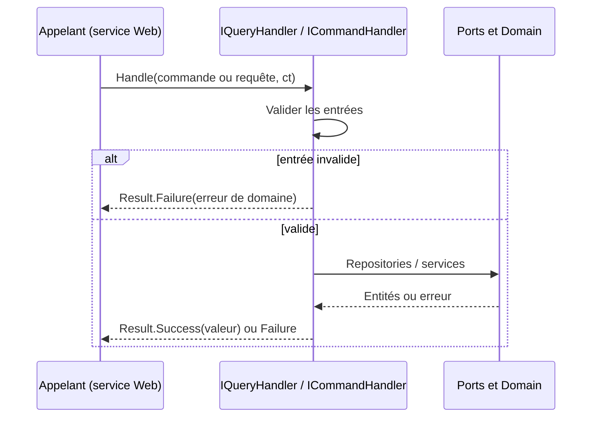

# Abstractions de messagerie (CQRS)

Le module `Messaging_Abstractions` définit, dans le namespace `Application.Abstractions.Messaging`, le socle CQRS de la couche Application : des interfaces de marquage pour les commandes et les requêtes, ainsi que les contrats des handlers correspondants. Aucune implémentation n'y figure : seuls les contrats sont posés, et chaque cas d'usage les implémente.

Il fait partie de [Application_Contracts___CQRS_Foundation](../Application_Contracts___CQRS_Foundation.md), à côté de [Application_Interfaces](Application_Interfaces.md) (ports vers la persistance et les services externes).

## Composants

| Fichier | Types | Rôle |
|---|---|---|
| `ICommand.cs` | `IBaseCommand`, `ICommand`, `ICommand<TResponse>` | Marqueurs de commandes (opérations qui modifient l'état) |
| `ICommandHandler.cs` | `ICommandHandler<TCommand>`, `ICommandHandler<TCommand, TResponse>` | Contrats des handlers de commandes |
| `IQuery.cs` | `IQuery<TResponse>` | Marqueur de requêtes (lecture seule) |
| `IQueryHandler.cs` | `IQueryHandler<TQuery, TResponse>` | Contrat des handlers de requêtes |

### Interfaces de marquage

- `IBaseCommand` : interface vide servant de base commune, utile pour cibler toutes les commandes (enregistrement, règles d'architecture, etc.).
- `ICommand : IBaseCommand` : commande sans valeur de retour.
- `ICommand<TResponse> : IBaseCommand` : commande qui produit une valeur de type `TResponse`.
- `IQuery<TResponse>` : requête produisant un `TResponse`. Il n'existe pas de requête sans réponse.

`TResponse` est un paramètre de type « fantôme » : il n'est pas utilisé dans le corps de l'interface, mais il lie la commande ou la requête à son handler lors de la résolution de type (d'où les `#pragma warning disable S2326` et `CA1040` du code source).

### Contrats des handlers

```csharp
public interface ICommandHandler<in TCommand> where TCommand : ICommand
{ Task<Result> Handle(TCommand command, CancellationToken cancellationToken); }

public interface ICommandHandler<in TCommand, TResponse> where TCommand : ICommand<TResponse>
{ Task<Result<TResponse>> Handle(TCommand command, CancellationToken cancellationToken); }

public interface IQueryHandler<in TQuery, TResponse> where TQuery : IQuery<TResponse>
{ Task<Result<TResponse>> Handle(TQuery query, CancellationToken cancellationToken); }
```

Points clés :

- Tous les handlers sont asynchrones et acceptent un `CancellationToken`.
- Ils retournent toujours `Result` ou `Result<T>` (voir [Domain_Core](../Domain_Model/Domain_Core.md)) : les erreurs métier connues sont portées par la valeur de retour plutôt que par des exceptions.
- `TCommand` / `TQuery` sont contravariants (`in`).

## Architecture



## Place dans le système

La couche Application ne dépend que du Domain. Ce module ne dépend que de `Domain.Primitives` (`Result`, `Result<T>`). Les handlers concrets, qui contiennent la logique métier, vivent dans `Application/{Feature}/{Operation}/` et sont enregistrés automatiquement par Scrutor dans `ApplicationDependencyInjection.cs`.



Les cas d'usage qui implémentent ces contrats sont documentés dans [Book___Library_Use_Cases](../Book___Library_Use_Cases.md), [Feed_Import_Pipeline](../Feed_Import_Pipeline.md) et [File_Import_Pipeline](../File_Import_Pipeline.md). Les services Web ([Web_Application_Services](../Web_Application_Services.md)) invoquent ces handlers.

## Flux d'exécution



## Exemple d'utilisation

```csharp
public record CreateBookCommand(string Serie, string Title, string ISBN) : ICommand<Book>;

public sealed class CreateBookCommandHandler : ICommandHandler<CreateBookCommand, Book>
{
    public async Task<Result<Book>> Handle(CreateBookCommand request, CancellationToken ct)
    {
        // logique métier
        return book;
    }
}
```

## Conventions à respecter

- Un handler valide ses entrées au début de `Handle`, avant tout appel à un repository ou service externe.
- Dans un handler de commande, toutes les validations de domaine précèdent les effets de bord sur le système de fichiers (par ex. `ILibraryLocalStorage.Move`).
- Les requêtes paginées se terminent par une clé de tri unique pour garantir un ordre stable.
- Les règles de dépendance entre couches sont vérifiées par `Architecture.Tests`.
