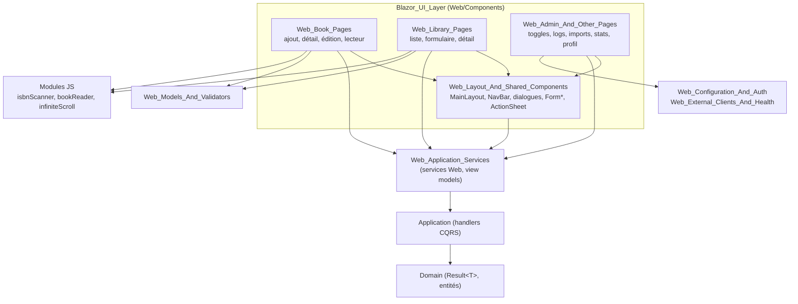

# Couche UI Blazor (Blazor_UI_Layer)

## Objectif

`Blazor_UI_Layer` correspond au dossier `Web/Components`. C'est l'interface utilisateur Blazor Server de MyComicsManager, construite avec MudBlazor. Elle permet de:

- gérer les bibliothèques de bandes dessinées (liste, création, modification, détail avec défilement infini);
- ajouter, consulter, éditer et lire des livres (scan de code-barres ISBN, recherche de métadonnées auprès de plusieurs catalogues, lecteur de pages);
- administrer l'application (feature toggles, niveaux de log, imports de flux, imports de fichiers, statistiques, profil et état de santé).

Cette couche respecte la règle d'architecture du projet: **aucune logique métier dans les composants Razor**. Les composants:

- appellent les services Web (`IBooksService`, `ILibrariesService`, `IFeedImportService`, `IImportService`, etc.);
- manipulent des view models pré-calculés (`BookListItemViewModel`, `LibraryCardViewModel`, etc.);
- affichent les `Result<T>` via `ISnackbar` et `ILogger<T>`.

Les services Web délèguent ensuite aux handlers CQRS de la couche Application.

## Architecture



Les trois groupes de pages dépendent de la bibliothèque de composants partagés. Aucun ne dépend directement de la couche Persistence.

### Flux de données typique

```mermaid
sequenceDiagram
    actor U as Utilisateur
    participant P as Page Razor (code-behind)
    participant S as Service Web
    participant H as Handler CQRS
    U->>P: action (clic, saisie, scroll)
    P->>P: capture des paramètres, validation (FluentValidation)
    P->>S: appel asynchrone
    S->>H: Command / Query
    H-->>S: Result&lt;T&gt;
    S-->>P: Result&lt;T&gt; / view model
    alt succès
        P->>P: mise à jour de l'état local
    else échec
        P->>U: Snackbar + Logger.LogError
    end
```

## Sous-modules

| Module | Contenu | Documentation |
|---|---|---|
| Mise en page et composants partagés | `MainLayout`, `NavBar` (scope DI dédié, badge d'arbitrage), `Login`, `ErrorPage`, dialogues (`ConfirmationDialog`, `MoveBookDialog`), famille `Form*`, `ActionSheet`, `StarRating`, `ImportJobCard`, etc. | [Web_Layout_And_Shared_Components](Blazor_UI_Layer/Web_Layout_And_Shared_Components.md) |
| Pages des livres | `AddBookScan`, `AddBookManual`, `AddBookForm`, `BookDetail`, `EditBook`, `FindBookDetails` (comparaison de 5 sources), `BookReader`, `LibrarySelect` | [Web_Book_Pages](Blazor_UI_Layer/Web_Book_Pages.md) |
| Pages des bibliothèques | `LibrariesList`, `LibraryCard`, `AddLibrary`, `EditLibrary`, `LibraryForm`, `IconChooser`, `LibraryDetailPage`, vues couvertures et liste | [Web_Library_Pages](Blazor_UI_Layer/Web_Library_Pages.md) |
| Administration et autres pages | `FeatureTogglesCard`, `LogLevels`, `FeedImportsPage`, `Import` (polling des jobs), `Statistics`, `UserSettings` | [Web_Admin_And_Other_Pages](Blazor_UI_Layer/Web_Admin_And_Other_Pages.md) |

## Conventions transverses

- **Gestion d'erreur au chargement**: l'état local n'est modifié qu'en cas de succès du `Result`. Un échec affiche un Snackbar et une entrée de log.
- **Résultats périmés**: les paramètres de requête sont capturés avant l'appel asynchrone et vérifiés au retour (`_loadVersion`, `CancellationTokenSource` remplacé puis libéré). Les indicateurs de chargement sont réinitialisés dans des blocs `finally`.
- **Interop JS**: les mutations d'état liées à un appel JS sont faites après son retour. Les `JSException` et `JSDisconnectedException` sont tolérées.
- **Libération des ressources**: `IDisposable` / `IAsyncDisposable` pour les jetons d'annulation, timers, `DotNetObjectReference` et modules JS.
- **Accessibilité**: `aria-label` sur les boutons icône seule, `AriaLabel` obligatoire sur `ActionSheet`, gestion du focus dans les dialogues.
- **Journalisation**: `ILogger<T>` injecté, jamais le `Serilog.Log` statique.
- **Responsive**: bottom sheet sur téléphone et menu ancré sur tablette ou grand écran, colonnes adaptées aux vues de livres.

## Modules liés

- [Web_Book_Services](Web_Application_Services/Web_Book_Services.md) et [Web_Library_And_Statistics_Services](Web_Application_Services/Web_Library_And_Statistics_Services.md): services consommés par les pages.
- [Web_Feed_Import_Services](Feed_Import_Pipeline/Web_Feed_Import_Services.md) et [Web_Import_Services](File_Import_Pipeline/Web_Import_Services.md): services d'import.
- [Web_Models_And_Validators](Web_Platform,_Security___External_Integrations/Web_Models_And_Validators.md): DTO UI, validateurs et `FormErrors`.
- [Web_Configuration_And_Auth](Web_Platform,_Security___External_Integrations/Web_Configuration_And_Auth.md): authentification et `LogLevelSwitches`.
- [Web_External_Clients_And_Health](Web_Platform,_Security___External_Integrations/Web_External_Clients_And_Health.md): contrôles de santé.
- [Domain_Core](Domain_Model/Domain_Core.md): `Result<T>` et erreurs de domaine.