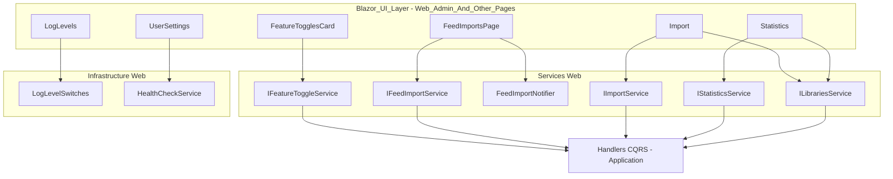
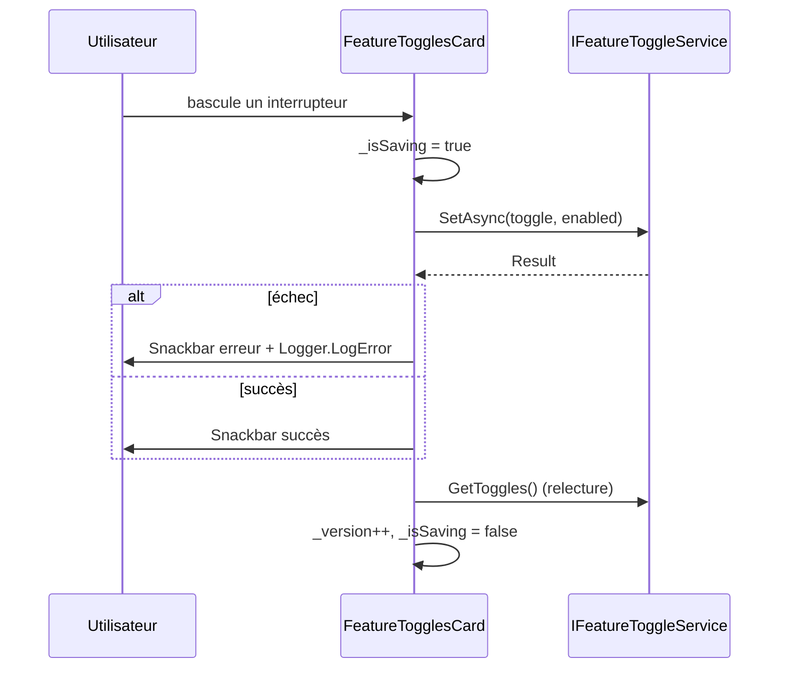
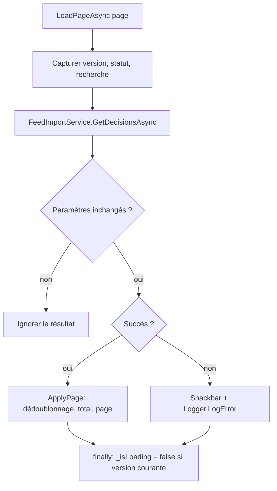
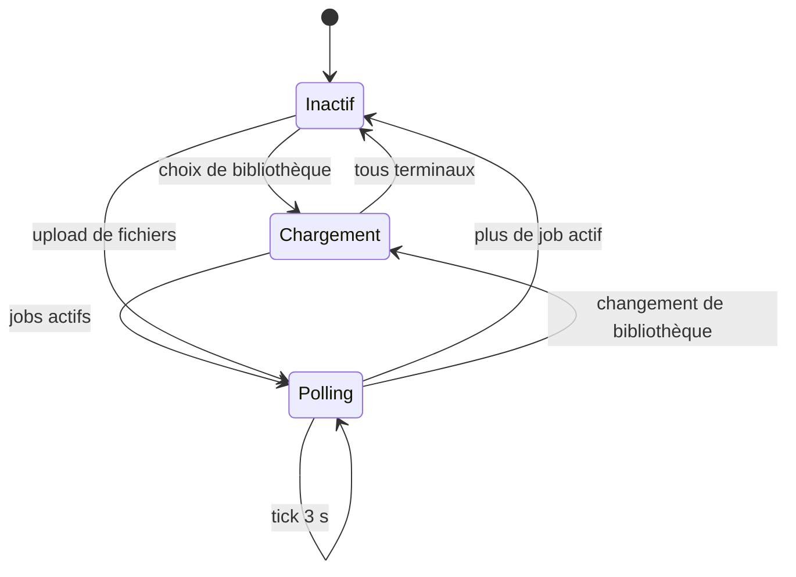

# Pages d'administration et autres pages Blazor

## Introduction

Ce module regroupe les pages Blazor Server « transverses » de l'application, par opposition aux pages dédiées aux livres ([Web_Book_Pages](Web_Book_Pages.md)) et aux bibliothèques ([Web_Library_Pages](Web_Library_Pages.md)). Il couvre :

| Composant | Fichier | Rôle |
|---|---|---|
| `FeatureTogglesCard` | `Web/Components/Pages/Admin/FeatureTogglesCard.razor.cs` | Activation/désactivation des fonctionnalités (feature toggles) |
| `LogLevels` | `Web/Components/Pages/Admin/LogLevels.razor.cs` | Modification à chaud des niveaux de log par logger |
| `FeedImportsPage` / `CorrectionForm` | `Web/Components/Pages/FeedImportsPage.razor.cs` | Revue, arbitrage, correction et suppression des décisions d'import de flux |
| `Import` | `Web/Components/Pages/Import.razor.cs` | Dépôt de fichiers et suivi des jobs d'import dans une bibliothèque numérique |
| `Statistics` | `Web/Components/Pages/Statistics.razor.cs` | Tableau de statistiques global ou par bibliothèque |
| `UserSettings` | `Web/Components/Pages/UserSettings.razor.cs` | Profil de l'utilisateur et état de santé du système |

Conformément aux règles du projet (voir `CLAUDE.md`), ces composants ne contiennent pas de logique métier : ils délèguent aux services de la couche Web ([Web_Application_Services](../Web_Application_Services.md)) qui eux-mêmes appellent les handlers CQRS de la couche Application.

## Architecture générale

Références utiles :
- Services de fonctionnalités et statistiques : [Web_Library_And_Statistics_Services](../Web_Application_Services/Web_Library_And_Statistics_Services.md)
- Services d'import de flux : [Web_Feed_Import_Services](../Feed_Import_Pipeline/Web_Feed_Import_Services.md)
- Services d'import de fichiers : [Web_Import_Services](../File_Import_Pipeline/Web_Import_Services.md)
- `LogLevelSwitches` : [Web_Configuration_And_Auth](../Web_Platform,_Security___External_Integrations/Web_Configuration_And_Auth.md)
- Contrôles de santé : [Web_External_Clients_And_Health](../Web_Platform,_Security___External_Integrations/Web_External_Clients_And_Health.md)
- DTO UI (`LibraryUiDto`) : [Web_Models_And_Validators](../Web_Platform,_Security___External_Integrations/Web_Models_And_Validators.md)
- Composants partagés et dialogues : [Web_Layout_And_Shared_Components](Web_Layout_And_Shared_Components.md)

## Composants

### FeatureTogglesCard

Affiche la liste de `FeatureToggleViewModel` obtenue de `IFeatureToggleService.GetToggles()` et permet de basculer chaque fonctionnalité via `SetAsync(FeatureToggle, bool)`.

Points de conception :
- Un verrou `_isSaving` empêche les écritures concurrentes.
- Dans le `finally`, l'état réel est relu depuis le service et `_version` est incrémenté : en cas d'échec, l'interrupteur revient à sa valeur précédente (rendu forcé par la version).
- Les erreurs sont affichées dans un `Snackbar` et journalisées via `ILogger<FeatureTogglesCard>`.

### LogLevels

Page d'administration des niveaux de log. Elle s'appuie directement sur `LogLevelSwitches` (singleton d'infrastructure) :
- `GetLoggers()` liste les loggers (`LoggerLevel`) ; un filtre texte insensible à la casse (`MatchesFilter`) restreint l'affichage.
- `SetLevel(name, level)` fixe un niveau (`Debug`, `Info`, `Warning`, `Error`, `None` via `LogLevelSwitches.Off`) ou `null` pour hériter.
- `ResetAll()` restaure les niveaux configurés.

Le tableau statique `s_levels` associe chaque option à une classe CSS (`level-debug`, etc.).

### FeedImportsPage

Page la plus riche du module : elle gère les « décisions » d'import issues du flux (Miniflux) — voir [Feed_Import_Pipeline](../Feed_Import_Pipeline.md).

**État principal**

| Champ | Rôle |
|---|---|
| `_items`, `_totalCount`, `_page` | Liste paginée (pages de 20 ajoutées via « Afficher plus ») |
| `_filter`, `_searchTerm` | Filtre de statut (`FeedImportFilter`) et recherche |
| `_counts` | Compteurs par statut (`FeedImportStatusCounts`) |
| `_selectedId` | Décision affichée en détail |
| `_selecting`, `_checkedIds` | Mode sélection multiple pour suppression |
| `_busyDecisionId`, `_isDeleting` | Verrous d'actions |
| `_correction` | `CorrectionForm` en cours d'édition |
| `_loadVersion` | Jeton de version contre les résultats périmés |

**Chargement sans résultats périmés.** `LoadPageAsync` capture version, statut et terme de recherche avant l'appel ; à la réponse, il ignore le résultat si l'un a changé. Une première page incrémente `_loadVersion`, invalidant les chargements en cours. `ApplyPage` écarte les doublons dus aux décisions créées entre-temps et désélectionne une décision disparue. Un `CancellationTokenSource` (`_disposeCts`) annule les appels à la sortie de la page (`IAsyncDisposable`).

**Actions sur une décision.** `ResolveAsync` (arbitrage, `FeedImportArbitrationAction` + index de candidat), `ApplyActionAsync` (`FeedImportDecisionAction`) et `SaveCorrectionAsync` (série, titre, tome) passent par `RunDecisionActionAsync`, qui :
1. refuse si une autre action est en cours (`_busyDecisionId`) ;
2. exécute l'action, puis en cas de succès recharge la liste et appelle `FeedImportNotifier.NotifyChanged()` (pour informer p. ex. la barre de navigation) ;
3. en cas d'échec, affiche l'erreur et journalise.

**Suppression.** `DeleteAsync` (unitaire), `DeleteSelectedAsync` (sélection multiple, ignore les décisions non supprimables `CanDelete`, c.-à-d. en téléchargement) et `DeleteDownloadedAsync` (toutes les décisions téléchargées et importées) demandent confirmation via `DialogService.ShowConfirmationAsync`, puis rapportent le nombre de suppressions/conservations.

**Synchronisation.** `SyncNowAsync` appelle `FeedImportService.TriggerSync()` (déclenchement d'un job Hangfire, voir [Web_Feed_Import_Services](../Feed_Import_Pipeline/Web_Feed_Import_Services.md)) puis recharge.

`CorrectionForm` est une classe privée portant `DecisionId`, `Serie`, `Title`, `Volume` pour l'édition en ligne.

### Import

Page d'import de fichiers vers une bibliothèque **numérique** (`LibraryBookType.Digital`) — voir [File_Import_Pipeline](../File_Import_Pipeline.md).

- Chargement des bibliothèques via `ILibrariesService.FilterBy`, conversion en `LibraryUiDto`, présélection par le paramètre de requête `LibraryId`.
- `OnFilesSelectedAsync` téléverse chaque `IBrowserFile` avec `UploadAndCreateJobAsync`, accumule les erreurs dans `_uploadErrors` et interrompt si la bibliothèque change.
- **Polling** : un `System.Threading.Timer` (3 s) relance `PollJobsAsync` tant qu'un job n'est pas terminal (`IsTerminal`). `_pollRequestId` et la bibliothèque capturée écartent les réponses obsolètes ; le timer s'arrête dès que tous les jobs sont terminés.
- Actions : suppression d'un job, suppression des jobs terminaux, forçage en échec (`ForceFailImportJobAsync`) suivi d'un rafraîchissement.
- `DisposeAsync` annule `_pollingCts` et arrête le timer.

### Statistics

Affiche un `StatisticsViewModel` pour toutes les bibliothèques (`Guid.Empty`) ou une seule. Chaque `LoadStatisticsAsync` annule la charge précédente (`CancellationTokenSource` remplacé après `Dispose()` de l'ancien), vérifie annulation et bibliothèque sélectionnée avant d'appliquer le résultat, et ne remet `_isLoading` à `false` que si elle n'a pas été remplacée. Le modèle est construit par `StatisticsViewModel.From(dto, allLibraries)`.

### UserSettings

- Lit les claims du `AuthenticationState` en cascade : `name`, `email` (`ClaimTypes.Email` ou `email`) et `picture`, cette dernière acceptée uniquement si c'est une URL absolue HTTPS (défense contre les URL non sûres).
- Interroge `HealthCheckService.CheckHealthAsync()` et le transforme en `SystemHealthViewModel.From(...)`, avec valeur par défaut `Unavailable` ; les exceptions (hors annulation) produisent un Snackbar et un log. Le détail est repliable (`ToggleHealthDetail`).

## Conventions transverses

Ces pages appliquent les règles de qualité du projet :
- **Gestion d'erreur au chargement** : branche `else if (result.IsFailure)` avec Snackbar et `Logger.LogError`, l'état local n'étant modifié qu'en cas de succès.
- **Résultats périmés** : capture des paramètres avant l'appel asynchrone, vérification au retour, `try/finally` pour les indicateurs de chargement.
- **Journalisation** via `ILogger<T>` injecté.
- **Libération** : `IAsyncDisposable` avec annulation des tokens (`FeedImportsPage`, `Import`, `Statistics`).
- Le type `Result` provient du [Domain_Core](../Domain_Model/Domain_Core.md).
