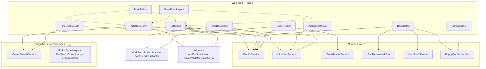
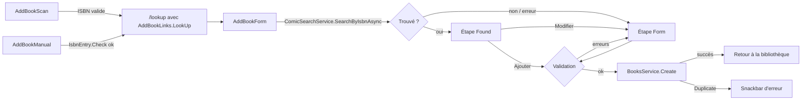
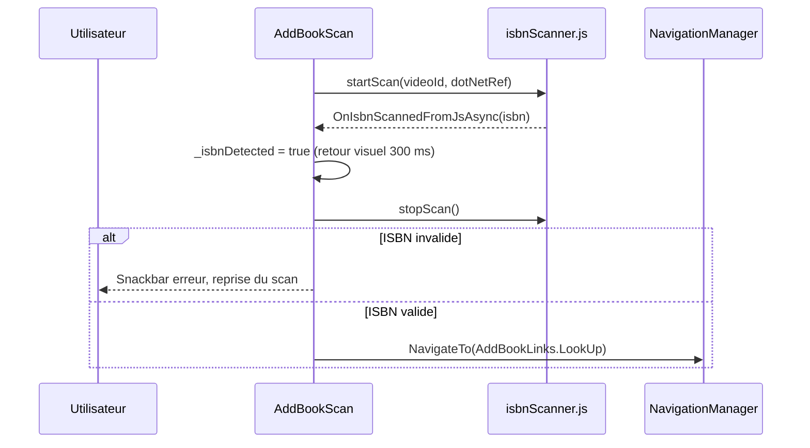
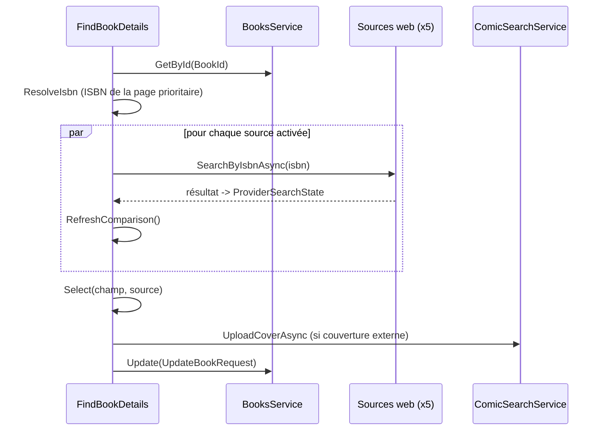
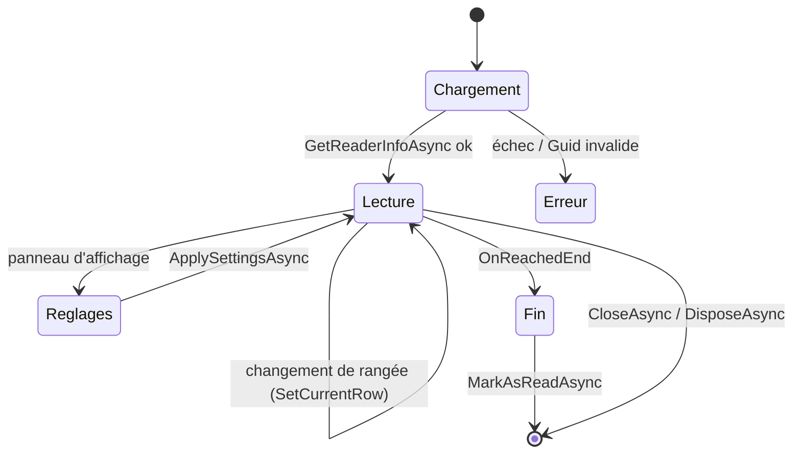

# Pages Blazor des livres (Web_Book_Pages)

Ce module regroupe les composants Razor (code-behind `*.razor.cs`) de `Web/Components/Pages/Books/` : ajout d'un livre (scan de code-barres, saisie manuelle de l'ISBN, formulaire), fiche détail, édition, lecteur de bandes dessinées, recherche de métadonnées auprès de plusieurs catalogues et sélecteur de bibliothèque. Il fait partie de la couche [Blazor_UI_Layer](../Blazor_UI_Layer.md).

Conformément aux règles d'architecture du projet, ces composants ne contiennent pas de logique métier : ils appellent les services Web ([Web_Book_Services](../Web_Application_Services/Web_Book_Services.md), [Web_Library_And_Statistics_Services](../Web_Application_Services/Web_Library_And_Statistics_Services.md)) et les interfaces d'[Application_Interfaces](../Application_Contracts___CQRS_Foundation/Application_Interfaces.md), puis affichent les `Result<T>` (voir [Domain_Core](../Domain_Model/Domain_Core.md)) via `ISnackbar` et `ILogger<T>`.

## Composants

| Composant | Rôle |
|---|---|
| `AddBookScan` | Scanner plein écran de code-barres ISBN (JS `isbnScanner.js`), gestion de la torche et de l'indisponibilité de la caméra. |
| `AddBookManual` | Saisie manuelle de l'ISBN quand le scan échoue (`IsbnEntry.Check`). |
| `AddBookForm` | Deux étapes : « livre trouvé » (ajout en un geste) ou formulaire complet si introuvable / à corriger. |
| `BookDetail` | Fiche du livre : historique de lecture, scan ISBN serveur, actions (déplacer, supprimer). |
| `EditBook` | Édition des métadonnées et suppression de lectures. |
| `FindBookDetails` | Comparaison champ par champ des valeurs courantes et de celles de 5 sources web. |
| `BookReader` | Lecteur de pages (dispositions, défilement, sens de lecture, progression, OCR ISBN). |
| `BookFields`, `BookFormLayout` | Composants de présentation partagés par les formulaires d'ajout et d'édition. |
| `LibrarySelect` | Sélecteur de bibliothèque (champ de formulaire ou pastille compacte) avec popup ancrée. |

## Architecture et dépendances

Les modèles et validateurs (`FormErrors`, `ReaderPageWindow`, `ReaderSpreads`, `BookUiDto`, `AddBookValidator`, `BookValidator`) sont décrits dans [Web_Models_And_Validators](../Web_Platform,_Security___External_Integrations/Web_Models_And_Validators.md). Les composants de formulaire et de mise en page communs sont dans [Web_Layout_And_Shared_Components](Web_Layout_And_Shared_Components.md). Les pages voisines : [Web_Library_Pages](Web_Library_Pages.md), [Web_Admin_And_Other_Pages](Web_Admin_And_Other_Pages.md).

## Parcours d'ajout d'un livre

Points notables d'`AddBookForm` :
- seules les bibliothèques **physiques** sont proposées ; la bibliothèque de la page précédente (`LibraryId`) est présélectionnée, ou l'unique bibliothèque disponible ;
- la validation est refaite à chaque saisie après la première soumission (`Revalidate`) ;
- si la validation échoue sur un livre « trouvé », on bascule vers le formulaire pour montrer les erreurs ;
- un `CancellationTokenSource` (`_disposalCts`) est annulé à la destruction du composant.

## Scanner et interopérabilité JS

`AddBookScan` charge `./js/isbnScanner.js` (via `AppVersion.Versioned`) et expose des méthodes `[JSInvokable]` (`OnIsbnScannedFromJsAsync`, `OnScanErrorFromJs`, `ValidateIsbn`). Toute erreur JS aboutit à un message unique « caméra indisponible » ; la raison technique n'est que journalisée.

## BookDetail et actions

`BookDetail` charge le livre (`BooksService.GetById`) et construit un `BookDetailViewModel` pré-calculé ; le nom de la bibliothèque n'est rechargé que si la bibliothèque a changé. Il orchestre :
- **historique de lecture** : `AddReadingDate` avec note, puis rechargement ;
- **scan d'ISBN serveur** (`IIsbnScanService.ScanBookAsync`) : selon `IsbnScanOutcome` (`Assigned` → navigation vers `find-details`, `WithCandidates`, `WithoutIsbn`, échec) ;
- **menu d'actions** ancré via `PopupAnchorLocator` : déplacement (`IBookMoveWorkflow.ChooseAndMoveAsync`) et suppression avec confirmation (`ShowConfirmationAsync`, voir [Web_Layout_And_Shared_Components](Web_Layout_And_Shared_Components.md)).

Les drapeaux `_isAddingReading`, `_isMoving`, `_isScanningIsbn` empêchent les actions concurrentes et sont réinitialisés dans des blocs `finally`.

## EditBook

Formulaire d'édition (`BookValidator`, `BookUiDto.Convert`) construit avec `BookFields` et `BookFormLayout`. La sauvegarde envoie un `UpdateBookRequest` ; l'erreur `BooksError.Duplicate` produit un message spécifique (ISBN déjà utilisé). La suppression d'une lecture demande confirmation et ne recharge que les lectures, sans perdre les champs en cours d'édition.

## FindBookDetails : comparaison multi-sources

Le composant interroge en parallèle jusqu'à cinq sources (BnF, Bedetheque, Bubble, OpenLibrary, Google Books), chacune pouvant être désactivée via les fonctionnalités (`IsEnabled`, voir [Comic_Info_Search](../Comic_Info_Search.md)). Chaque résultat est appliqué dès son arrivée, de sorte qu'un fournisseur lent ou en échec ne bloque pas les autres.

Éléments clés :
- `_searchedFor` (livre + ISBN) évite de relancer des recherches coûteuses (quotas SerpApi/Google) et ignore les résultats périmés (voir la règle « Async Operations and Stale Results »).
- Pour BnF, OpenLibrary et Google, `ComicSearchService.ParseTitleInfo` sépare titre, série et tome ; Bedetheque et Bubble fournissent ces champs de façon structurée (`IStructuredBookResult`).
- `BookDetailsComparison` / `BookFieldComparison` calculent les différences ; `_selected` retient la source choisie par champ (par défaut `BookSource.Current`).
- L'ISBN lu dans une page compte comme une modification supplémentaire.
- La couverture externe est téléversée vers Cloudinary ; en cas d'échec l'URL d'origine est conservée avec un avertissement.

## BookReader

C'est le composant le plus riche du module.

- **Pagination en rangées** : `ReaderSpreads.Build(pageCount, settings)` regroupe les pages (une ou deux par rangée) ; `ReaderPageWindow` demande le chargement des pages autour de la page courante. Les pages sont servies par `/api/books/{id}/pages/{index}`.
- **Réglages** (`ReaderSettings`) : disposition (`FitWidth`, `SinglePage`, `TwoPages`), défilement (continu / page par page), sens (gauche→droite / droite→gauche, qui inverse les flèches).
- **Interop JS** (`bookReader.js`) : `attach`, `configure`, `scrollToRow`, `toggleFullscreen`, et rappels `[JSInvokable]` (`OnNavigationKey`, `OnVisibleRowChanged`, `OnTurnPage`, `OnReachedEnd`, `OnCenterTap`). Les drapeaux `_pendingConfigure` et `_pendingScroll` retardent les appels JS jusqu'après le rendu, et les mutations d'état liées au JS se font après le retour de l'appel.
- **Progression** : sauvegarde différée de 1 s (`ScheduleProgressSave`, annulation de la précédente), et sauvegarde finale à la fermeture ou à la destruction. Elle est désactivée en mode ISBN.
- **Mode `?mode=isbn`** : le lecteur cherche un ISBN, démarre à la première page, propose des pages rapides (`IsbnScanPages`) et lance un OCR dans le navigateur (`isbnOcr.js`, délai de 2 minutes) ; `TextIsbnExtractor.ExtractAll` extrait les candidats, puis `FetchBookInfoAsync` redirige vers `FindBookDetails`.
- **Nettoyage** : `DisposeAsync` annule les sources de jeton, enregistre la progression, libère les modules JS (`detach`, `terminate`) en tolérant `JSDisconnectedException`.

La logique applicative sous-jacente est décrite dans [Book_Reader_Application](../Book___Library_Use_Cases/Book_Reader_Application.md) et [Isbn_Scan_Application](../Book___Library_Use_Cases/Isbn_Scan_Application.md).

## LibrarySelect, BookFields et BookFormLayout

- `LibrarySelect` : paramètres `Libraries`, `Value`/`ValueChanged`, `Error`, `AllLabel` (option « toutes les bibliothèques » = `Guid.Empty`) et `Compact` (pastille de barre). Le popup est positionné par `PopupAnchorLocator.AnchorOfAsync`.
- `BookFields` : champs du livre liés à un `BookUiDto`, erreurs via `FormErrors` et liaison d'accessibilité `FormFieldIds.DescribedBy` ; notifie le parent par `OnChanged`.
- `BookFormLayout` : mise en page (couverture, colonne latérale `Side`, champs, `Footer` fixe sur mobile) partagée par l'ajout et l'édition.

## Conventions communes

- Injection de `ILogger<T>` dans chaque composant ; erreurs affichées par `Snackbar` et journalisées.
- Les méthodes de chargement ne modifient l'état local qu'en cas de succès du `Result`.
- Les exceptions attrapées sont ciblées (`OperationCanceledException`, `InvalidOperationException`, `HttpRequestException`, `JSException`).
- Les composants possédant des ressources implémentent `IDisposable` / `IAsyncDisposable` (jetons d'annulation, `DotNetObjectReference`, modules JS).
