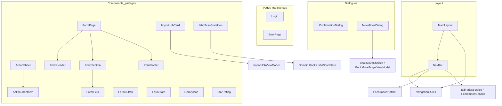
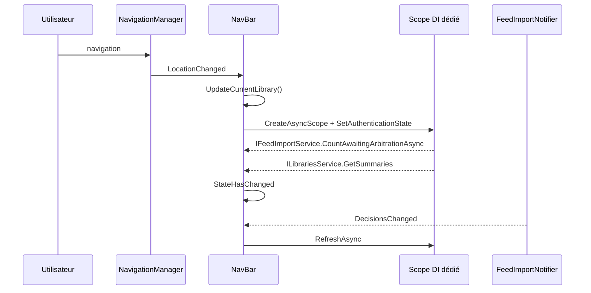
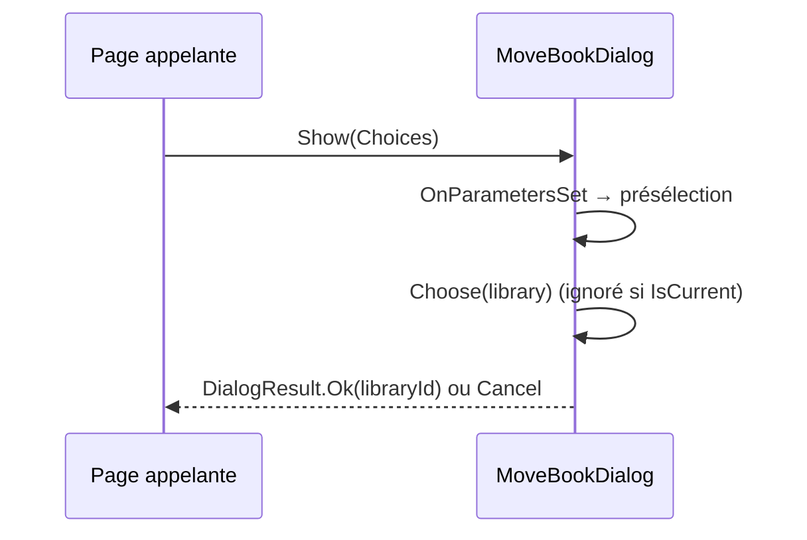
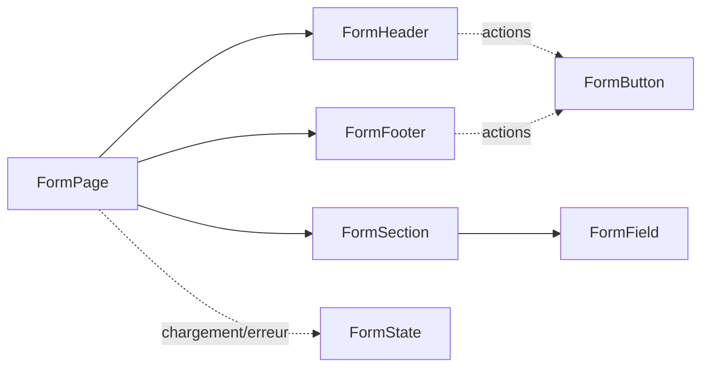
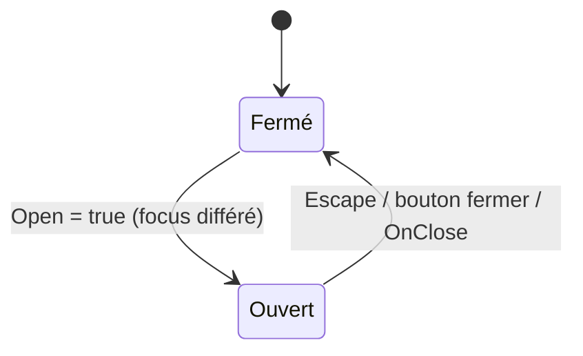

# Mise en page et composants partagés (Web_Layout_And_Shared_Components)

Ce module regroupe la **coquille** de l'interface Blazor Server (layout principal, barre de navigation), les **pages transverses** (connexion, erreur), les **dialogues** réutilisables (confirmation, déplacement d'un livre) et la **bibliothèque de composants partagés** (famille `Form*`, `ActionSheet`, `StarRating`, etc.) utilisée par les pages métier. Il fait partie de la couche [Blazor_UI_Layer](../Blazor_UI_Layer.md).

Conformément aux règles d'architecture, ces composants ne contiennent pas de logique métier : ils consomment les services Web ([Web_Application_Services](../Web_Application_Services.md)) et des view models (`Web.Models`, voir [Web_Models_And_Validators](../Web_Platform,_Security___External_Integrations/Web_Models_And_Validators.md)).

## 1. Vue d'ensemble de l'architecture

## 2. Layout

### MainLayout
Composant de mise en page racine. Il écoute `NavigationManager.LocationChanged` et calcule `_showNavigation` via `NavigationRules.HidesNavigation(chemin relatif)`. Un `StateHasChanged` n'est déclenché (via `InvokeAsync`) que si la visibilité change, ce qui évite des rendus inutiles. Implémente `IDisposable` (pattern Dispose standard) pour se désabonner de l'événement.

### NavBar
Barre latérale/navigation. Responsabilités :
- déterminer la bibliothèque courante (`NavigationRules.CurrentLibraryId`) et l'entrée active (`NavigationRules.IsActive`) ; sur une page de bibliothèque, l'entrée « Libraries » reste marquée `active-parent` ;
- afficher la liste des bibliothèques (`NavLibraryItemViewModel.From`) et le badge du nombre de décisions de flux en attente d'arbitrage ;
- se rafraîchir à chaque changement d'URL et à chaque événement `FeedImportNotifier.DecisionsChanged`.

Points de conception notables :
- **Scope DI dédié** : la NavBar vit à côté de la page dans le même circuit ; elle crée son propre scope (`IServiceScopeFactory`) pour disposer de son propre `DbContext` et éviter des requêtes concurrentes sur celui du circuit. L'état d'authentification en cascade est recopié dans le scope via `IHostEnvironmentAuthenticationStateProvider`.
- **Tolérance aux pannes** : le badge et la liste sont informatifs ; toute erreur est journalisée (`ILogger<NavBar>`) et masque l'élément (compteur à 0, liste vide) sans casser la navigation.
- **Accessibilité** : `aria-current="page"` et libellés ARIA (`FeedsLabel`, `ArbitrationBadgeLabel`).

Voir [Web_Library_And_Statistics_Services](../Web_Application_Services/Web_Library_And_Statistics_Services.md) et [Web_Feed_Import_Services](../Feed_Import_Pipeline/Web_Feed_Import_Services.md) pour les services consommés.

## 3. Pages transverses

| Composant | Rôle |
|---|---|
| `Login` | Page de connexion avec image d'arrière-plan aléatoire choisie parmi `wwwroot/background` (10 fichiers max, extensions png/webp/jpg/jpeg, nom assaini via `Uri.EscapeDataString`). L'image choisie est persistée avec `PersistentComponentState` afin d'être identique entre le prérendu et l'interactivité (pas de « flash »). Erreurs d'E/S journalisées, repli sur aucune image. |
| `ErrorPage` | Page d'erreur ; affiche un `RequestId` issu de `Activity.Current` ou de `HttpContext.TraceIdentifier` (voir [Web_Configuration_And_Auth](../Web_Platform,_Security___External_Integrations/Web_Configuration_And_Auth.md) pour `GlobalExceptionHandler`). |

## 4. Dialogues

Ces composants s'appuient sur MudBlazor (`IMudDialogInstance` reçu en `CascadingParameter`).

- **ConfirmationDialog** : paramètres `ConfirmationMessage`, `ActionText`, `ColorConfirmButton` (`Color.Error` ⇒ action destructrice, `IsDanger`). Des identifiants uniques (`TitleId`, `TextId`) alimentent `aria-labelledby/describedby`. Renvoie `DialogResult.Ok(true)` à la confirmation.
- **MoveBookDialog** : reçoit `BookMoveChoices` (liste de `BookMoveTargetViewModel` + bibliothèque présélectionnée). À l'ouverture (`OnParametersSet`), la bibliothèque suggérée est présélectionnée ; la bibliothèque courante n'est pas sélectionnable. Renvoie l'identifiant de la bibliothèque cible. La logique de déplacement elle-même est dans [Web_Book_Services](../Web_Application_Services/Web_Book_Services.md).

## 5. Composants partagés

### Famille de formulaires `Form*`
Ces composants fournissent une structure de formulaire cohérente, responsive (les actions sont dans l'en-tête dès la tablette, dans `FormFooter` sur téléphone).

| Composant | Paramètres clés |
|---|---|
| `FormPage` | `Class`, `ChildContent` — conteneur de page. |
| `FormHeader` | `Title`, `Subtitle`, `BackHref` (défaut `/libraries/list`) ou `OnBack`, `ChildContent` (actions). |
| `FormSection` | `Id` (étiquette la section), `Title`, `Note`. |
| `FormField` | `Id` de l'entrée, `Label`, `Required`, `Error`, `Help`. |
| `FormFooter` | `ChildContent` — barre d'actions mobile. |
| `FormButton` | `FormButtonVariant` (`Primary`, `Outlined`, `Text`), `Href` (rendu en lien), `Type`, `Form` (soumission depuis l'en-tête), `Icon`, `OnClick`, attributs non mappés (`CaptureUnmatchedValues`). `VariantClass` traduit la variante en classe CSS. |
| `FormState` | État de chargement (spinner) ou vide/erreur (`Icon`, `Title`, `Text`) avec une issue en `ChildContent`. |

### ActionSheet et ActionSheetItem
`ActionSheet` est une *bottom sheet* sur téléphone et un menu ancré (`PopupAnchor`, voir `PopupAnchorLocator` dans [Web_Library_And_Statistics_Services](../Web_Application_Services/Web_Library_And_Statistics_Services.md)) sur tablette/grand écran (ADR-0021). Accessibilité : `AriaLabel` obligatoire, déplacement du focus dans le panneau à l'ouverture (`_focusPending` géré entre `OnParametersSet` et `OnAfterRenderAsync`), fermeture via `Escape`. `AlignEnd` aligne le menu sur le bord droit d'un bouton ou sur le doigt pour un appui long.

`ActionSheetItem` représente une ligne : lien (`Href`) ou bouton (`OnClick`), option sélectionnable (`Selected` : `null` = action, `true/false` = option avec `aria-pressed`), variantes `Danger` et `Disabled`, icône colorée optionnelle.

### Composants d'affichage

| Composant | Rôle |
|---|---|
| `StarRating` | Note 0–5 ; cliquer sur la valeur courante remet à 0 ; mode `ReadOnly` rendu comme une image « Rated N out of 5 ». |
| `LibraryIcon` | Pastille d'icône Material colorée (`Large` : 40 px au lieu de 36 px). |
| `IsbnScanStateIcon` | Icône d'état du scan ISBN (`Domain.Books.IsbnScanState`, `CandidateCount`, `Isbn` en infobulle, `HideWhenKnown`, `OnDarkBackground`). Voir [Isbn_Scan_Application](../Book___Library_Use_Cases/Isbn_Scan_Application.md). |
| `ImportJobCard` | Carte d'un `ImportJobViewModel` ; icône selon `StatusCssClass`, détection d'un job « bloqué » (`IsStuck`: non terminal et non `Pending`), callbacks `OnDelete` / `OnForceFail`. Voir [Web_Import_Services](../File_Import_Pipeline/Web_Import_Services.md). |

## 6. Conventions transverses

- **Accessibilité** : libellés ARIA sur les contrôles icône seule, identifiants uniques par instance de dialogue, gestion du focus.
- **Pas de logique métier** : les composants partagés exposent des `Parameter`/`EventCallback`, la logique reste dans les services et view models.
- **Journalisation** via `ILogger<T>` injecté, jamais `Serilog.Log` statique.
- **Désabonnement systématique** des événements (`MainLayout`, `NavBar`) dans `Dispose`.

## 7. Modules liés

- [Web_Book_Pages](Web_Book_Pages.md), [Web_Library_Pages](Web_Library_Pages.md), [Web_Admin_And_Other_Pages](Web_Admin_And_Other_Pages.md) : pages qui consomment ces composants.
- [Web_Configuration_And_Auth](../Web_Platform,_Security___External_Integrations/Web_Configuration_And_Auth.md) : authentification alimentant l'état en cascade.
