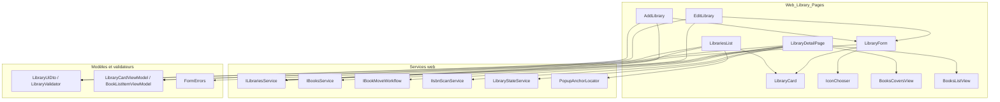
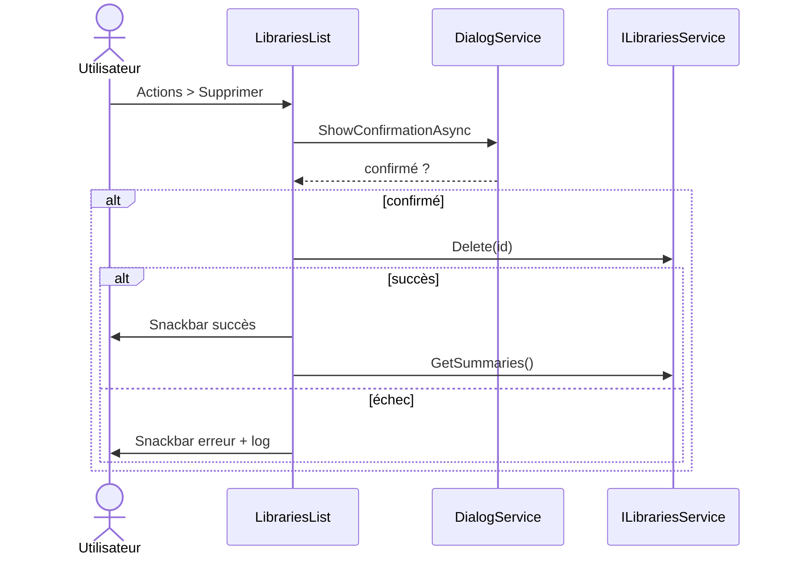
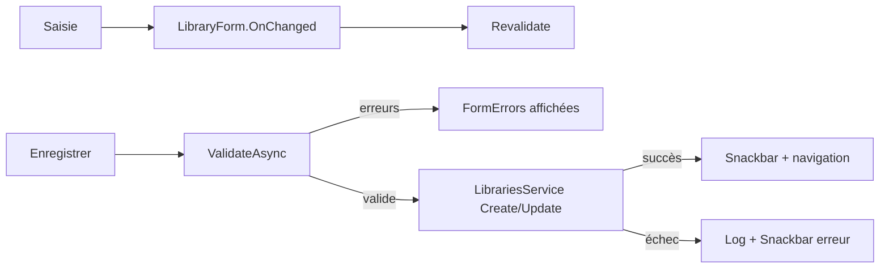
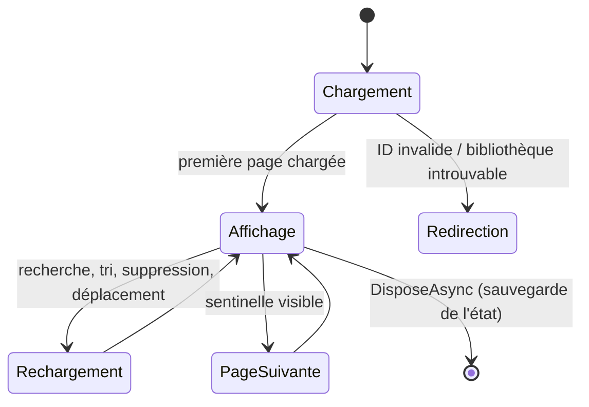
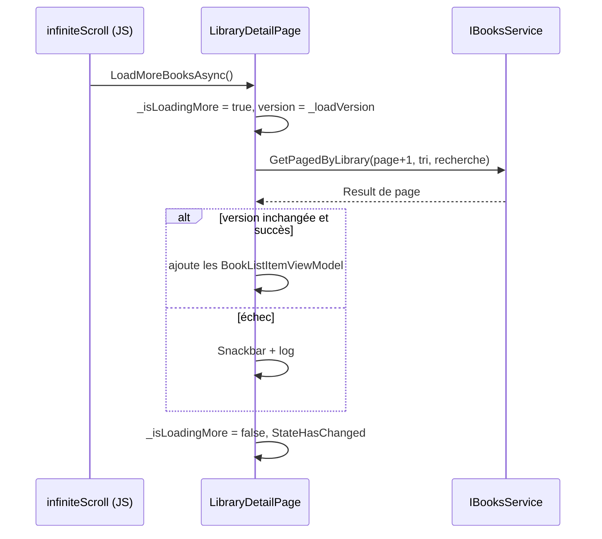

# Pages des bibliothèques (Web_Library_Pages)

## Introduction

Le module `Web_Library_Pages` regroupe les composants Blazor Server (MudBlazor) du dossier `Web/Components/Pages/Libraries/` qui permettent de **lister, créer, modifier, supprimer et consulter les bibliothèques** de bandes dessinées. Il contient aussi les deux vues d'affichage des livres d'une bibliothèque (`Views/`).

Conformément aux règles d'architecture du projet, ces composants ne contiennent pas de logique métier : ils s'appuient sur les services web (`ILibrariesService`, `IBooksService`, `IBookMoveWorkflow`, `IIsbnScanService`, `LibraryStateService`), qui délèguent eux-mêmes aux handlers CQRS de la couche Application.

Il fait partie de [Blazor_UI_Layer](../Blazor_UI_Layer.md). Modules voisins : [Web_Book_Pages](Web_Book_Pages.md), [Web_Layout_And_Shared_Components](Web_Layout_And_Shared_Components.md), [Web_Admin_And_Other_Pages](Web_Admin_And_Other_Pages.md).

## Composants

| Composant | Rôle |
|---|---|
| `LibrariesList` | Page de liste : charge les résumés, ouvre le menu d'actions, supprime avec confirmation |
| `LibraryCard` | Carte d'une bibliothèque (lien optionnel `Href`, fragment `Actions`) |
| `AddLibrary` | Formulaire de création (nom, couleur, icône, type de livres) |
| `EditLibrary` | Formulaire de modification (le type n'est pas modifiable) avec aperçu |
| `LibraryForm` | Formulaire partagé par `AddLibrary` et `EditLibrary` (champs, aperçu, sélection) |
| `IconChooser` | Recherche et choix d'une icône Material |
| `LibraryDetailPage` | Page de détail : livres paginés (défilement infini), recherche, tri, vue, actions |
| `Views/BooksCoversView` | Vue « couvertures » : 3 colonnes (téléphone), 6 (tablette/grand écran) |
| `Views/BooksListView` | Vue « liste » : 1 colonne (téléphone), 2 (tablette), 3 (grand écran) |

## Architecture

Les services web sont détaillés dans [Web_Library_And_Statistics_Services](../Web_Application_Services/Web_Library_And_Statistics_Services.md) et [Web_Book_Services](../Web_Application_Services/Web_Book_Services.md). Les validateurs et `FormErrors` sont décrits dans [Web_Models_And_Validators](../Web_Platform,_Security___External_Integrations/Web_Models_And_Validators.md). Les cas d'usage sous-jacents sont dans [Libraries_Application](../Book___Library_Use_Cases/Libraries_Application.md) et [Books_Management](../Book___Library_Use_Cases/Books_Management.md).

## Liste des bibliothèques : `LibrariesList` et `LibraryCard`

- `OnInitializedAsync` charge `LibrariesService.GetSummaries` et projette chaque résumé en `LibraryCardViewModel.From`.
- En cas d'échec, une branche `else if (result.IsFailure)` journalise l'erreur et affiche un Snackbar, sans modifier l'état local.
- Le bouton d'actions d'une carte utilise `PopupAnchorLocator.AnchorOfAsync` pour positionner le menu (`ActionSheet`, voir [Web_Layout_And_Shared_Components](Web_Layout_And_Shared_Components.md)).
- La suppression passe par `DialogService.ShowConfirmationAsync`, appelle `LibrariesService.Delete`, puis recharge la liste.

## Création et modification : `AddLibrary`, `EditLibrary`, `LibraryForm`, `IconChooser`

`LibraryForm` est un composant de présentation : il reçoit le `LibraryUiDto` (`Model`), les `FormErrors`, l'indicateur `IsNew` (le type de bibliothèque n'est choisissable qu'à la création), et expose `OnChanged` / `OnSubmit`. Il affiche un aperçu `LibraryCardViewModel.Preview` (nombre de livres et couvertures fournis par la page) et délègue le choix d'icône à `IconChooser`, qui s'appuie sur `LibraryIcons.Search` pour filtrer les suggestions.

Les pages parentes partagent le même schéma :

1. Validation à la soumission via `LibraryValidator.ValidateAsync`, puis revalidation à chaque saisie (`Revalidate`) une fois le formulaire soumis.
2. Protection contre la double soumission (`_isSaving`, `try/finally`).
3. Appel de `LibrariesService.Create` / `Update` ; succès → Snackbar + navigation (`/libraries/list` ou `/libraries/{id}`), échec → log + Snackbar (message via `LibraryDisplay.SaveFailed`).
4. Annulation via un `CancellationTokenSource` de destruction, annulé et libéré dans `Dispose`.

`EditLibrary` charge en plus la bibliothèque (`GetById`) puis ses résumés (`GetSummaries`) pour l'aperçu ; l'absence de résumé n'est qu'un avertissement.

## Page de détail : `LibraryDetailPage`

C'est le composant le plus riche du module. Il gère :

- **Chargement initial** : validation du `LibraryId` (GUID, sinon redirection), restauration de l'état mémorisé (`LibraryStateService.Load` : recherche et mode de vue), chargement de la bibliothèque et de la première page de livres (taille `PageSize = 24`).
- **Défilement infini** : un observateur JS (`infiniteScroll.observe`) appelle la méthode `[JSInvokable] LoadMoreBooksAsync`. Un compteur `_loadVersion` rend obsolètes les pages demandées avant un rechargement (tri, recherche, suppression), conformément à la règle de résultats périmés du projet.
- **Recherche** : `SearchTerm` annule le `CancellationTokenSource` précédent (annulé puis libéré) et relance un chargement après 300 ms de pause (anti-rebond).
- **Tri** : `ChooseSortOrderAsync` persiste l'ordre par défaut via `LibrariesService.Update`, puis recharge ; un `CancellationTokenSource` lié remplace le précédent.
- **Vues** : `ViewMode.Covers` → `BooksCoversView`, sinon `BooksListView` ; les deux reçoivent des `BookListItemViewModel` pré-calculés et notifient via `OnActions`.
- **Feuilles d'actions** (`LibrarySheet` : `SortAndView`, `MoreActions`, `BookActions`, `AddBook`) ancrées sur un élément grâce au module JS `libraryPage.js` (`anchorOf`) ; un appui long ou clic droit appelle `OpenBookActionsAt`.
- **Actions sur les livres** : téléchargement (`/api/books/{id}/download`), déplacement (`IBookMoveWorkflow.ChooseAndMoveAsync`), suppression avec confirmation, recherche des ISBN manquants (`IIsbnScanService.StartLibraryScanAsync`, uniquement pour les bibliothèques numériques), ajout / import.
- **Cycle de vie** : `DisposeAsync` annule les jetons, réactive le défilement du corps, libère le module JS, puis sauvegarde l'état de la page dans `LibraryStateService`.

## Points d'attention

- Toutes les opérations de chargement journalisent via `ILogger<T>` injecté et n'altèrent l'état local qu'en cas de succès.
- Les mutations d'état liées à des appels JS (`_observerInitialized`, `_module`) ont lieu après le retour de l'appel ; les `JSException` sont journalisées sans casser le rendu.
- Le tri par défaut de la bibliothèque (`DefaultBookSortOrder`) alimente `_currentSortOrder` au chargement.
- Les boutons à icône seule doivent porter un `aria-label` (règle d'accessibilité du projet).
