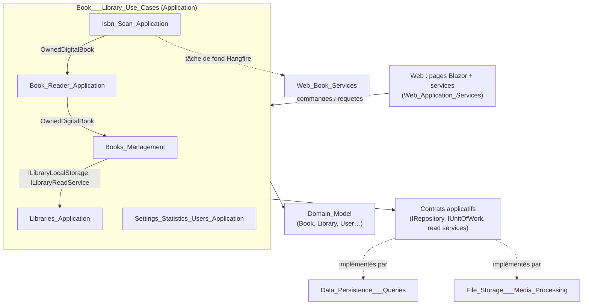
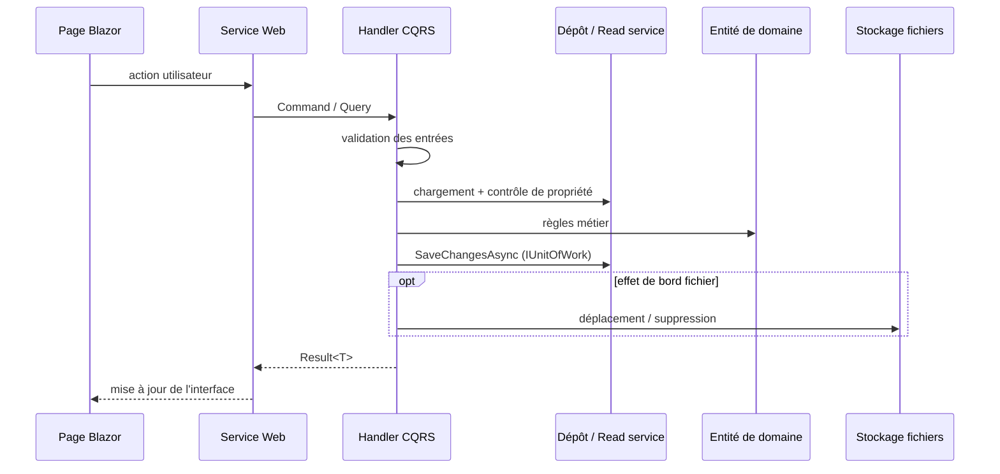

# Cas d'usage Livres et Bibliothèques (Book___Library_Use_Cases)

## Objectif

Ce module regroupe les cas d'usage CQRS de la couche `Application` (Clean Architecture, .NET 10). Ils couvrent le cœur fonctionnel de MyComicsManager :

- gérer le cycle de vie des livres et des bibliothèques ;
- lire les livres numériques ;
- retrouver les ISBN par OCR ;
- gérer les paramètres transverses : feature toggles, statistiques de lecture, création d'utilisateurs.

Tous les handlers suivent les mêmes conventions :

- Ils sont enregistrés automatiquement par Scrutor dans `ApplicationDependencyInjection.cs`.
- Ils renvoient un `Result<T>` (voir [Domain_Core](Domain_Model/Domain_Core.md)) plutôt que de lever des exceptions pour les erreurs connues.
- Ils valident les entrées avant tout accès à un dépôt ou à un service externe.
- Ils vérifient la propriété de la ressource par l'utilisateur. Une ressource appartenant à un autre utilisateur est signalée en `NotFound`, jamais en « interdit », pour ne pas révéler son existence.
- Les validations de domaine précèdent tout effet de bord sur le système de fichiers.

Le module dépend uniquement du domaine ([Domain_Books](Domain_Model/Domain_Books.md)) et des contrats applicatifs ([Messaging_Abstractions](Application_Contracts___CQRS_Foundation/Messaging_Abstractions.md), [Application_Interfaces](Application_Contracts___CQRS_Foundation/Application_Interfaces.md)). Les implémentations sont fournies par la couche Persistence et par la couche Web (composition root).

## Architecture d'ensemble

## Flux de données typique

## Sous-modules

| Sous-module | Périmètre | Documentation |
|---|---|---|
| Books_Management | Création, lecture, liste (simple et paginée), mise à jour, suppression et déplacement de livres, dates de lecture et notes | [Books_Management](Book___Library_Use_Cases/Books_Management.md) |
| Book_Reader_Application | Lecteur de livres numériques : informations, lecture d'une page, progression, réglages d'affichage | [Book_Reader_Application](Book___Library_Use_Cases/Book_Reader_Application.md) |
| Isbn_Scan_Application | Recherche d'ISBN par OCR, soit pour un livre, soit pour une bibliothèque entière en tâche de fond | [Isbn_Scan_Application](Book___Library_Use_Cases/Isbn_Scan_Application.md) |
| Libraries_Application | Création, modification, suppression, liste et résumés des bibliothèques, avec gestion des dossiers | [Libraries_Application](Book___Library_Use_Cases/Libraries_Application.md) |
| Settings_Statistics_Users_Application | Feature toggles, statistiques de lecture sur 12 mois, création d'utilisateurs | [Settings_Statistics_Users_Application](Book___Library_Use_Cases/Settings_Statistics_Users_Application.md) |

## Points d'architecture clés

- **Contrôle d'accès partagé** : le helper `OwnedDigitalBook` (livre trouvé, bibliothèque de l'utilisateur, type numérique) est réutilisé par le lecteur et par le scan d'ISBN.
- **Cohérence base / fichiers** :
  - Pour la suppression d'un livre numérique, la base est modifiée d'abord, puis le fichier est supprimé.
  - Pour le déplacement d'un livre numérique, le fichier est déplacé d'abord, avec compensation (`RestoreFile`) si le domaine ou la sauvegarde échoue.
  - Pour le renommage d'une bibliothèque, le déplacement du dossier de stockage est annulé si celui du dossier d'import échoue.
  - Les handlers de création et de suppression de bibliothèque ne sont pas atomiques entre fichiers et base.
- **Séparation lecture / écriture** : les listes paginées passent par des services de lecture (`IBookReadService`, `ILibraryReadService`, `IStatisticsReadService`) qui renvoient des DTO précalculés pour l'interface (par exemple `BookSummaryDto`). Voir [Persistence_Read_Services](Data_Persistence___Queries/Persistence_Read_Services.md).
- **Travaux de fond** : le scan d'ISBN d'une bibliothèque est mis en file via `IIsbnScanJobEnqueuer`, puis exécuté par un orchestrateur Hangfire côté Web ([Web_Book_Services](Web_Application_Services/Web_Book_Services.md)).
- **Feature toggles** : les surcharges sont lues en mémoire (`FeatureToggles`) et chargées au démarrage. Elles reviennent à la configuration lorsque l'on choisit la valeur par défaut.