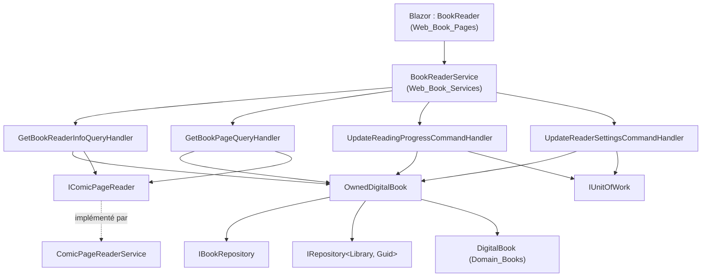
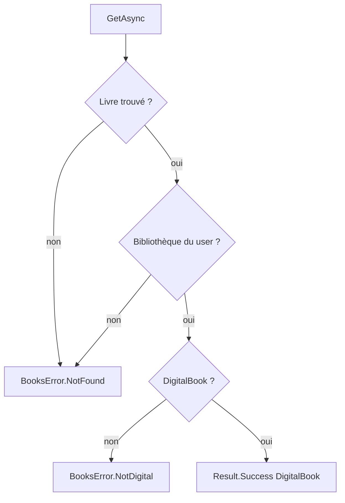
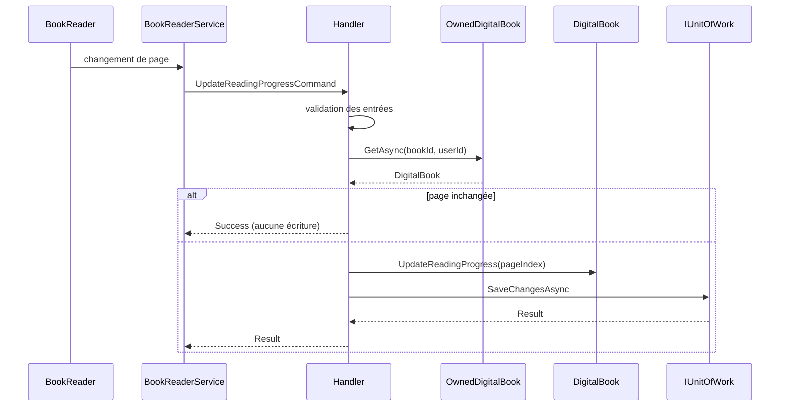

# Application du lecteur de livres

Ce module regroupe les cas d'usage CQRS de la couche `Application` dédiés à la **lecture de livres numériques** (archives de bandes dessinées) : obtention des informations du lecteur, lecture d'une page, sauvegarde de la progression de lecture et sauvegarde des préférences d'affichage. Il fait partie de [Book___Library_Use_Cases](../Book___Library_Use_Cases.md).

## Composants

| Composant | Fichier | Type | Rôle |
|---|---|---|---|
| `GetBookReaderInfoQueryHandler` | `Application/Books/Read/` | `IQueryHandler<GetBookReaderInfoQuery, BookReaderInfoDto>` | Retourne nombre de pages, dernière page lue et réglages du lecteur |
| `GetBookPageQueryHandler` | `Application/Books/Read/` | `IQueryHandler<GetBookPageQuery, ComicPage>` | Retourne le contenu binaire d'une page |
| `UpdateReadingProgressCommandHandler` | `Application/Books/ReadingProgress/` | `ICommandHandler<UpdateReadingProgressCommand>` | Enregistre la dernière page lue |
| `UpdateReaderSettingsCommandHandler` | `Application/Books/ReaderDisplay/` | `ICommandHandler<UpdateReaderSettingsCommand>` | Enregistre `ReaderSettings` (layout, défilement, sens de lecture) |

Un helper interne, `OwnedDigitalBook` (`internal static`, dans `Application/Books/Read/`), est partagé par ces quatre handlers (et par `ScanBookIsbnCommandHandler`, voir [Isbn_Scan_Application](Isbn_Scan_Application.md)).

## Architecture

Les interfaces (`IBookRepository`, `IRepository`, `IComicPageReader`, `IUnitOfWork`) sont définies dans [Application_Interfaces](../Application_Contracts___CQRS_Foundation/Application_Interfaces.md) ; les abstractions de messagerie dans [Messaging_Abstractions](../Application_Contracts___CQRS_Foundation/Messaging_Abstractions.md). L'implémentation de `IComicPageReader` se trouve dans [Persistence_File_Services](../File_Storage___Media_Processing/Persistence_File_Services.md), les dépôts dans [Persistence_Core](../Data_Persistence___Queries/Persistence_Core.md). Le modèle `DigitalBook` est décrit dans [Domain_Books](../Domain_Model/Domain_Books.md). Les appelants côté Web sont dans [Web_Book_Services](../Web_Application_Services/Web_Book_Services.md) et [Web_Book_Pages](../Blazor_UI_Layer/Web_Book_Pages.md).

## Contrôle d'accès : `OwnedDigitalBook`

Toutes les opérations commencent par `OwnedDigitalBook.GetAsync(bookRepository, libraryRepository, bookId, userId)` :

1. Charge le livre ; absent → `BooksError.NotFound`.
2. Charge la bibliothèque du livre ; absente ou `library.UserId != userId` → `BooksError.NotFound` (l'existence d'un livre appartenant à un autre utilisateur n'est volontairement pas divulguée).
3. Si le livre n'est pas un `DigitalBook` → `BooksError.NotDigital`.

## Flux par cas d'usage

### Informations du lecteur (`GetBookReaderInfoQueryHandler`)

- Validation : `BookId` et `UserId` non vides, sinon `BooksError.BadRequest`.
- Compte les pages via `IComicPageReader.CountPagesAsync(book.FilePath)`; un échec est propagé, un compte de 0 donne `BooksError.PageNotFound`.
- La dernière page lue est bornée par `Math.Clamp(LastReadPage, 0, pageCount - 1)` : l'archive a pu être remplacée par une plus courte depuis la sauvegarde de la progression.
- Retourne `BookReaderInfoDto(Id, Serie, Title, VolumeNumber, pageCount, lastReadPage, ReaderSettings)`.

### Lecture d'une page (`GetBookPageQueryHandler`)

- Validation : identifiants non vides (`BadRequest`) ; `PageIndex < 0` → `BooksError.PageNotFound`.
- Après contrôle d'accès, délègue à `IComicPageReader.ReadPageAsync(FilePath, PageIndex)` qui renvoie un `ComicPage(Content, ContentType, LastModifiedUtc)`.

### Progression de lecture (`UpdateReadingProgressCommandHandler`)

- Validation : identifiants non vides et `PageIndex >= 0`.
- Si `LastReadPage` est déjà égal à `PageIndex` → succès sans écriture (idempotent).
- Sinon `book.UpdateReadingProgress(pageIndex)` (règles du domaine), `bookRepository.Update`, puis `IUnitOfWork.SaveChangesAsync`.

### Réglages d'affichage (`UpdateReaderSettingsCommandHandler`)

- Validation : `Settings` non nul et `Settings.IsValid()`.
- Si les réglages sont identiques (égalité du `record ReaderSettings`) → succès sans écriture.
- Sinon `book.UpdateReaderSettings`, `Update`, `SaveChangesAsync`.

## Conventions et points d'attention

- **Result pattern** : aucun handler ne lève d'exception pour les cas connus ; les erreurs sont des `BooksError` (`BadRequest`, `NotFound`, `NotDigital`, `PageNotFound`) enveloppées dans `Result<T>` / `Result` (voir [Domain_Core](../Domain_Model/Domain_Core.md)).
- **Validation d'abord** : les paramètres sont validés avant tout appel à un dépôt ou à un service externe.
- **Pas d'effet de bord disque** : ce module ne modifie aucun fichier ; seul l'état du livre est persisté.
- **Écritures évitées** : progression et réglages inchangés ne déclenchent pas `SaveChangesAsync`, ce qui limite la charge due aux appels fréquents du lecteur.
- **Enregistrement** : les handlers sont enregistrés automatiquement par Scrutor dans `ApplicationDependencyInjection.cs`.
