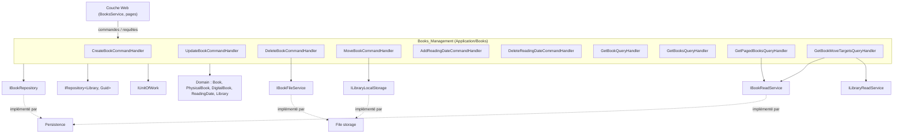
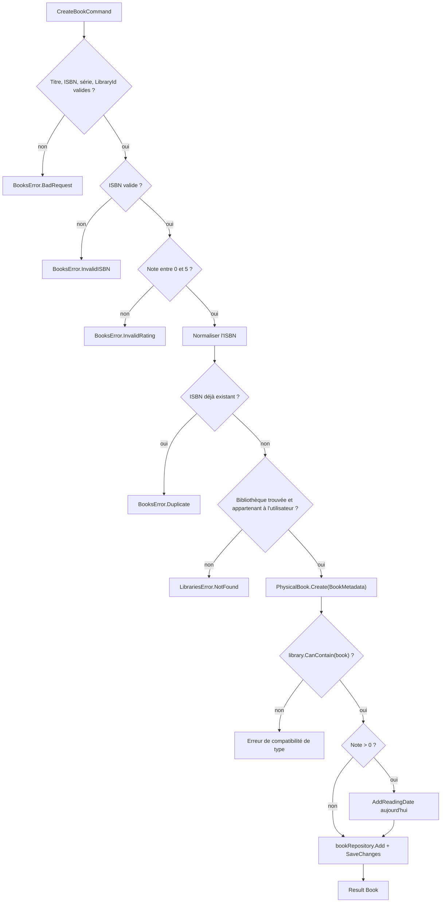
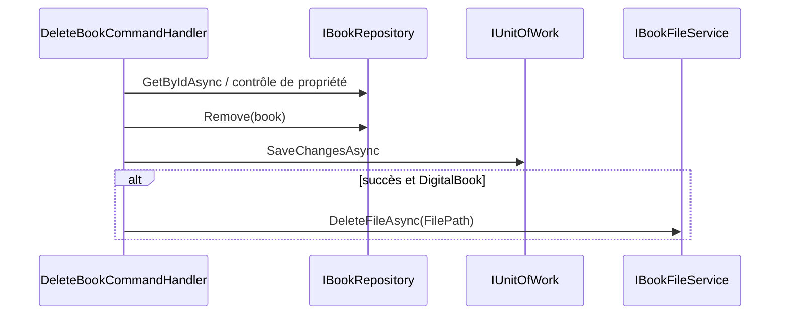
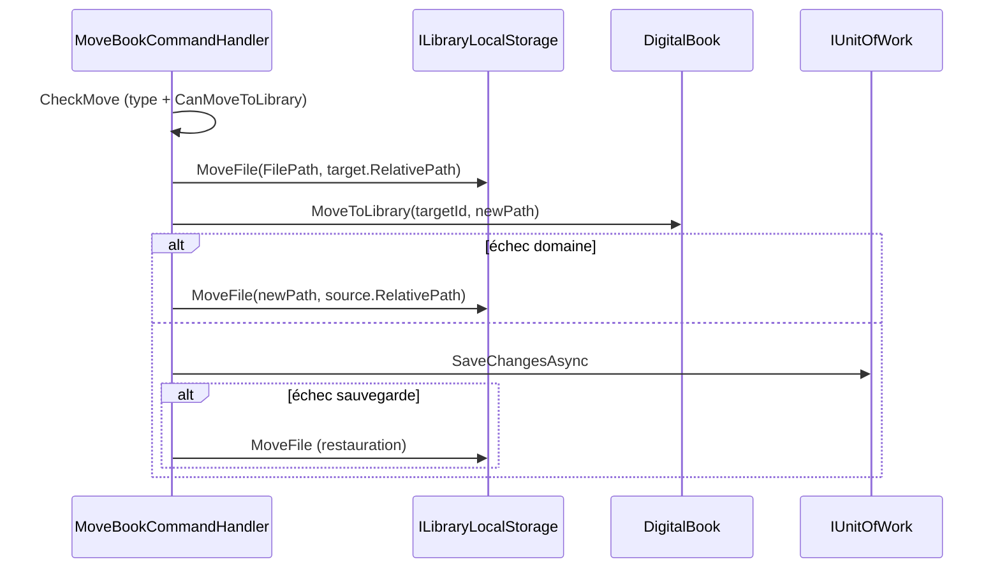
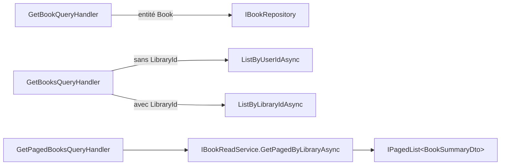

# Gestion des livres (Books_Management)

## Introduction

Le module **Books_Management** regroupe les cas d'usage CQRS de la couche `Application` qui gèrent le cycle de vie d'un livre : création, consultation, listage (simple et paginé), mise à jour, suppression, déplacement entre bibliothèques et gestion des dates de lecture (avec note). Il appartient au module parent [Book___Library_Use_Cases](../Book___Library_Use_Cases.md).

Tous les handlers suivent la même convention (voir [Messaging_Abstractions](../Application_Contracts___CQRS_Foundation/Messaging_Abstractions.md)) : ils reçoivent une commande ou une requête, valident les entrées, vérifient la propriété du livre par l'utilisateur via sa bibliothèque, délèguent la logique métier à l'entité de domaine (voir [Domain_Books](../Domain_Model/Domain_Books.md)) et retournent un `Result<T>` (voir [Domain_Core](../Domain_Model/Domain_Core.md)) au lieu de lever des exceptions.

## Composants

| Composant | Type | Rôle |
|---|---|---|
| `CreateBookCommandHandler` | Commande | Crée un `PhysicalBook` dans une bibliothèque de l'utilisateur |
| `UpdateBookCommandHandler` | Commande | Met à jour les métadonnées (`BookMetadata`) d'un livre |
| `DeleteBookCommandHandler` | Commande | Supprime un livre ; supprime aussi le fichier d'un `DigitalBook` |
| `MoveBookCommandHandler` | Commande | Déplace un livre vers une autre bibliothèque de même type |
| `AddReadingDateCommandHandler` | Commande | Ajoute une date de lecture datée du jour avec une note (1 à 5) |
| `DeleteReadingDateCommandHandler` | Commande | Retire une date de lecture |
| `GetBookQueryHandler` | Requête | Retourne un livre par identifiant |
| `GetBooksQueryHandler` | Requête | Liste les livres d'un utilisateur ou d'une bibliothèque |
| `GetPagedBooksQueryHandler` | Requête | Liste paginée de `BookSummaryDto` (tri, recherche) |
| `GetBookMoveTargetsQueryHandler` | Requête | Calcule les bibliothèques cibles possibles pour un déplacement |
| `BookSummaryDto` | DTO | Projection de lecture d'un livre pour les listes |

## Architecture et dépendances

Les interfaces utilisées sont décrites dans [Application_Interfaces](../Application_Contracts___CQRS_Foundation/Application_Interfaces.md). Leurs implémentations se trouvent dans [Data_Persistence___Queries](../Data_Persistence___Queries.md) et [File_Storage___Media_Processing](../File_Storage___Media_Processing.md). `ILibraryLocalStorage` et `ILibraryReadService` sont définis dans [Libraries_Application](Libraries_Application.md). Côté Web, les handlers sont consommés par les services décrits dans [Web_Book_Services](../Web_Application_Services/Web_Book_Services.md).

## Règles communes

1. **Validation d'entrée d'abord** : identifiants vides, chaînes vides, plage de note, page/taille de page ≤ 0 renvoient `BooksError.BadRequest` ou une erreur précise avant tout accès aux dépôts.
2. **Contrôle de propriété** : le livre est chargé, puis sa bibliothèque ; si la bibliothèque est absente ou si `library.UserId != request.UserId`, le handler renvoie `NotFound` (jamais « interdit »), pour ne pas révéler l'existence de ressources d'autres utilisateurs.
3. **Persistance atomique** : modification des dépôts puis un seul `unitOfWork.SaveChangesAsync`; un échec est propagé comme `Result` en échec.
4. **Effets de bord sur fichiers après validation** : conformément aux règles du projet, aucun déplacement de fichier n'a lieu avant que les validations de domaine aient réussi.

## Flux détaillés

### Création d'un livre

Particularités : l'unicité de l'ISBN est vérifiée globalement via `GetByIsbnAsync` ; une note supérieure à 0 signifie que le livre a été lu, une date de lecture du jour est alors créée automatiquement. Seuls des `PhysicalBook` sont créés ici (les livres numériques viennent des pipelines d'import : [File_Import_Pipeline](../File_Import_Pipeline.md), [Feed_Import_Pipeline](../Feed_Import_Pipeline.md)).

### Mise à jour

`UpdateBookCommandHandler` valide titre et série, normalise l'ISBN s'il est fourni (facultatif ici), contrôle la propriété, vérifie qu'aucun *autre* livre ne porte le même ISBN (`existingBook.Id != request.Id`), puis délègue à `book.Update(BookMetadata)` qui applique les règles du domaine.

### Suppression

L'ordre est volontaire : la base est modifiée d'abord, le fichier n'est supprimé qu'après un enregistrement réussi, ce qui évite un livre en base pointant vers un fichier disparu.

### Déplacement entre bibliothèques

`MoveBookCommandHandler` vérifie que la bibliothèque cible appartient à l'utilisateur, que son `BookType` correspond au type du livre (`LibrariesError.BookTypeMismatch` sinon) et que `book.CanMoveToLibrary` l'autorise. Ensuite :

- **Livre physique** : `MoveToLibrary`, mise à jour, sauvegarde.
- **Livre numérique** : le fichier est d'abord déplacé via `ILibraryLocalStorage.MoveFile`, puis l'entité est mise à jour avec le nouveau chemin ; si le domaine ou la sauvegarde échoue, une **compensation** (`RestoreFile`) remet le fichier dans la bibliothèque source ; un échec de restauration est journalisé.

### Cibles de déplacement

`GetBookMoveTargetsQueryHandler` produit un `BookMoveTargets` : la bibliothèque courante, les bibliothèques candidates (même `BookType`, hors source) avec leur nombre de livres, et une cible **suggérée** : celle qui contient le plus de livres de la même série (comparaison normalisée via `SerieMatcher.Normalize` : casse, accents, ponctuation et article initial ignorés), à égalité départagée par le nom. Les localisations de séries proviennent de `IBookReadService.ListSerieLocationsAsync`.

### Dates de lecture

- `AddReadingDateCommandHandler` : rejette les identifiants vides et toute note hors de 1 à 5 (contrairement à la création où 0 signifie « non noté »), appelle `book.AddReadingDate(DateTime.UtcNow, rating)` puis enregistre via `bookRepository.AddReadingDate`.
- `DeleteReadingDateCommandHandler` : appelle `book.RemoveReadingDate(readingDateId)`.

### Lectures et listes

`GetPagedBooksQueryHandler` passe par le service de lecture (CQRS côté lecture) et renvoie des `BookSummaryDto` ; ce dernier expose notamment `LastRead`, `LastRating`, `ReadCount` et un état de scan ISBN calculé (`IsbnScanState` via `IsbnScanStates.Of`), utilisé par le composant `IsbnScanStateIcon` (voir [Isbn_Scan_Application](Isbn_Scan_Application.md)). Les valeurs dérivées sont ainsi précalculées pour l'interface plutôt que recalculées dans les templates Razor. La pagination doit rester déterministe (clé de départage unique côté [Persistence_Read_Services](../Data_Persistence___Queries/Persistence_Read_Services.md)).

## Gestion des erreurs

| Erreur | Situation |
|---|---|
| `BooksError.BadRequest` | Paramètres manquants ou invalides |
| `BooksError.InvalidISBN` | Format d'ISBN invalide |
| `BooksError.InvalidRating` | Note hors plage |
| `BooksError.Duplicate` | ISBN déjà utilisé |
| `BooksError.NotFound` | Livre inexistant ou non possédé |
| `LibrariesError.NotFound` | Bibliothèque inexistante ou non possédée |
| `LibrariesError.BookTypeMismatch` | Déplacement vers une bibliothèque de type différent |

## Modules liés

- [Domain_Books](../Domain_Model/Domain_Books.md) : entités `PhysicalBook`, `DigitalBook`, `ReadingDate`.
- [Book_Reader_Application](Book_Reader_Application.md) : lecture de pages et progression.
- [Isbn_Scan_Application](Isbn_Scan_Application.md) : scan OCR des ISBN.
- [Libraries_Application](Libraries_Application.md) : gestion des bibliothèques.
- [Web_Book_Services](../Web_Application_Services/Web_Book_Services.md) et [Web_Book_Pages](../Blazor_UI_Layer/Web_Book_Pages.md) : consommation côté Web.
