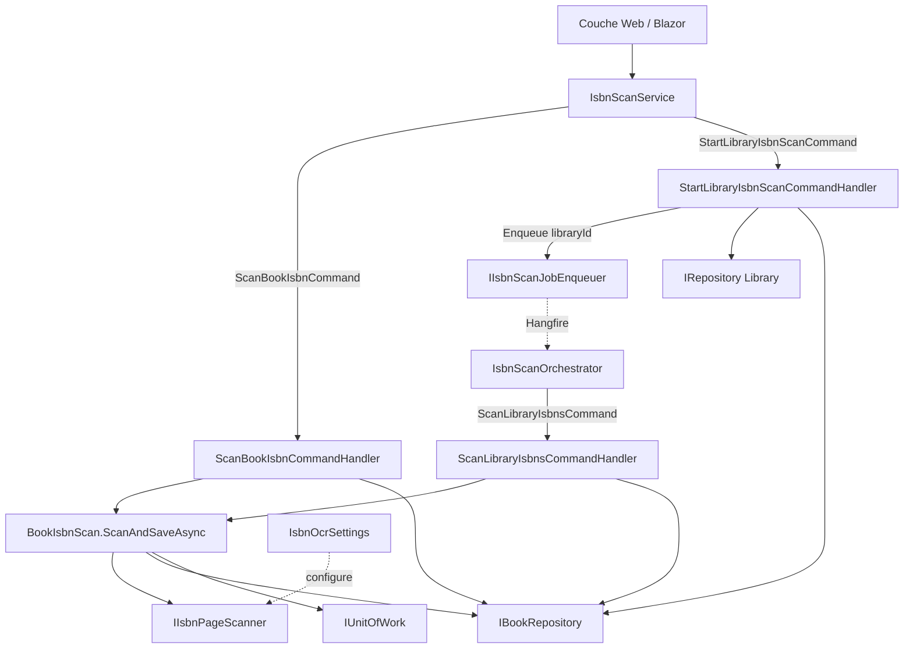
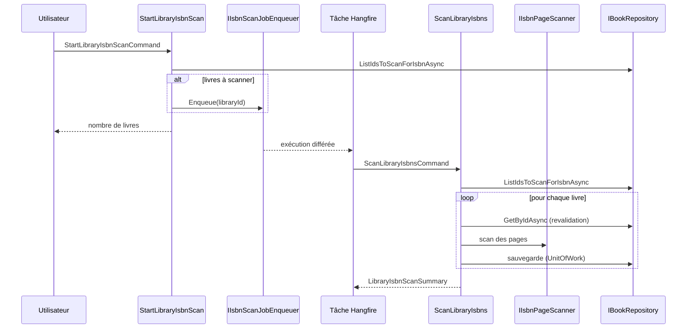

# Application du scan d'ISBN

## Introduction

Le module `Isbn_Scan_Application` regroupe les cas d'usage CQRS qui retrouvent l'ISBN imprimé dans les pages des livres numériques (`DigitalBook`) lorsque celui-ci n'est pas renseigné. La lecture des pages est déléguée à `IIsbnPageScanner` (OCR Tesseract côté serveur, voir [File_Storage___Media_Processing](../File_Storage___Media_Processing.md)). Le module orchestre la sélection des livres, la vérification des droits, la mise en file du travail et la sauvegarde du résultat.

Composants principaux :

| Composant | Rôle |
|---|---|
| `IsbnOcrSettings` | Options de configuration de l'OCR |
| `ScanBookIsbnCommandHandler` | Scan d'un seul livre, de façon synchrone |
| `StartLibraryIsbnScanCommandHandler` | Démarre un scan de bibliothèque en tâche de fond |
| `ScanLibraryIsbnsCommandHandler` | Exécute le scan de tous les livres éligibles d'une bibliothèque |

## Architecture

Le module dépend uniquement d'abstractions de l'Application ([Application_Interfaces](../Application_Contracts___CQRS_Foundation/Application_Interfaces.md), [Messaging_Abstractions](../Application_Contracts___CQRS_Foundation/Messaging_Abstractions.md)) et du domaine ([Domain_Books](../Domain_Model/Domain_Books.md), [Domain_Core](../Domain_Model/Domain_Core.md)). Les implémentations (`IsbnPageScanner`, dépôts) sont dans la couche Persistence ; les adaptateurs Hangfire (`HangfireIsbnScanJobEnqueuer`, `IsbnScanOrchestrator`) sont décrits dans [Web_Book_Services](../Web_Application_Services/Web_Book_Services.md).

## Composants

### IsbnOcrSettings

Classe d'options pour l'OCR :

| Propriété | Défaut | Description |
|---|---|---|
| `Enabled` | `true` | Active ou désactive l'OCR |
| `TesseractPath` | `"tesseract"` | Ligne de commande Tesseract (installée dans l'image Docker) |
| `Language` | `"eng"` | Langue de reconnaissance |
| `PagesFromEachEnd` | `IsbnScanPages.DefaultPagesFromEachEnd` | Nombre de pages analysées au début et à la fin du livre |
| `PageTimeoutSeconds` | `30` | Délai maximal par page |

### ScanBookIsbnCommandHandler

Commande `ScanBookIsbnCommand(BookId, UserId)` → `Result<IsbnScanOutcome>`.

1. Valide les entrées (`BookId`, `UserId` non vides), sinon `BooksError.BadRequest`.
2. Charge le livre via `OwnedDigitalBook.GetAsync` (vérifie l'appartenance à l'utilisateur et le type numérique) ; propage l'erreur sinon.
3. Refuse (`BadRequest`) si le livre a déjà un ISBN.
4. Délègue à `BookIsbnScan.ScanAndSaveAsync` (scan + persistance).

### StartLibraryIsbnScanCommandHandler

Commande `StartLibraryIsbnScanCommand(LibraryId, UserId)` → `Result<int>` (nombre de livres à scanner).

- Validation des entrées (`LibrariesError.BadRequest`).
- Une bibliothèque d'un autre utilisateur est signalée `NotFound` pour ne pas révéler son existence.
- Une bibliothèque non `Digital` renvoie `LibrariesError.BookTypeMismatch`.
- Liste les livres à scanner (`ListIdsToScanForIsbnAsync`) ; s'il y en a, appelle `IIsbnScanJobEnqueuer.Enqueue(library.Id)`.

### ScanLibraryIsbnsCommandHandler

Commande `ScanLibraryIsbnsCommand(LibraryId)` → `Result<LibraryIsbnScanSummary>`, exécutée par la tâche de fond.

- Parcourt séquentiellement les identifiants éligibles.
- Pour chaque livre, relit l'entité : si elle a été supprimée, modifiée, scannée entre-temps (`IsbnScannedAt` non nul) ou dotée d'un ISBN, le résultat est `NotScanned`.
- Chaque livre est sauvegardé individuellement : un scan interrompu conserve ce qui a été trouvé.
- En cas d'échec de sauvegarde, l'erreur est journalisée (`ILogger`) et le livre compte comme `NotScanned`.
- Le résumé agrège les `IsbnScanOutcome` : `Assigned`, `WithCandidates`, `WithoutIsbn`, `NotScanned`.

## Flux de traitement

## Règles et choix de conception

- **Validation avant effets de bord** : toutes les entrées et droits sont vérifiés avant tout appel au scanner ou au dépôt, conformément aux règles des handlers CQRS.
- **Idempotence** : un livre déjà scanné (`IsbnScannedAt`) ou ayant un ISBN n'est jamais rescanné.
- **Confidentialité** : l'accès à une bibliothèque tierce est masqué en `NotFound`.
- **Résilience** : sauvegarde livre par livre et revalidation avant chaque scan, car la liste peut être périmée.
- **Gestion d'erreurs** : usage du pattern `Result<T>` (voir [Domain_Core](../Domain_Model/Domain_Core.md)).

## Voir aussi

- [Books_Management](Books_Management.md) : gestion des livres, dont le champ ISBN.
- [Libraries_Application](Libraries_Application.md) : cas d'usage sur les bibliothèques.
- [Web_Book_Services](../Web_Application_Services/Web_Book_Services.md) : `IsbnScanService`, orchestrateur et file Hangfire.
- [Persistence_File_Services](../File_Storage___Media_Processing/Persistence_File_Services.md) : `IsbnPageScanner` et `TesseractPageTextRecognizer`.
- [Persistence_Core](../Data_Persistence___Queries/Persistence_Core.md) : `BookRepository`.
