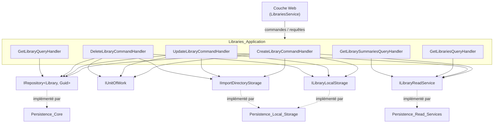
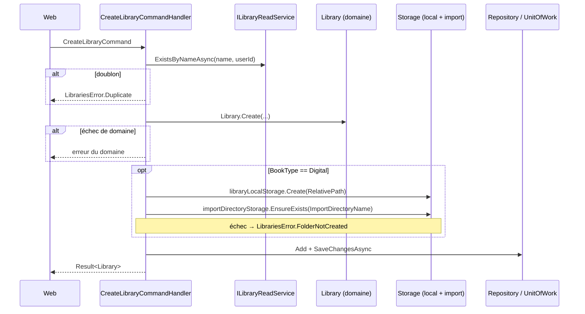
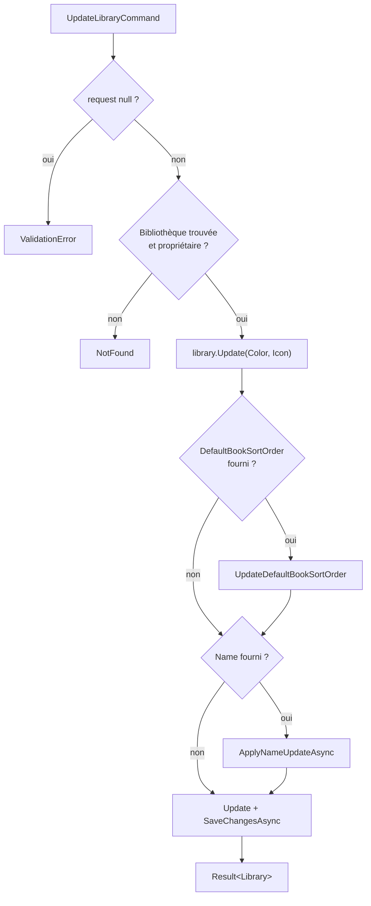
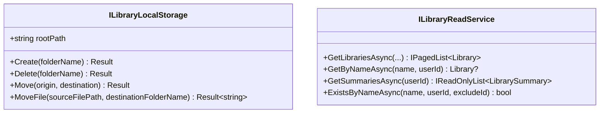

# Application des bibliothèques (Libraries_Application)

## Introduction

Le module `Libraries_Application` regroupe les cas d'usage CQRS liés aux **bibliothèques** (`Library`) : création, modification, suppression, consultation unitaire, liste paginée et résumés (nombre de livres et dernières couvertures). Il se situe dans la couche `Application/Libraries/` et ne dépend que du [modèle de domaine](../Domain_Model.md) et des [contrats applicatifs](../Application_Contracts___CQRS_Foundation.md). Il fait partie du module parent [Book___Library_Use_Cases](../Book___Library_Use_Cases.md).

Chaque handler renvoie un `Result` / `Result<T>` (voir [Domain_Core](../Domain_Model/Domain_Core.md)) au lieu de lever des exceptions pour les erreurs connues (`LibrariesError.*`).

## Composants

| Composant | Type | Rôle |
|---|---|---|
| `CreateLibraryCommandHandler` | `ICommandHandler<CreateLibraryCommand, Library>` | Crée une bibliothèque, ainsi que ses dossiers pour les bibliothèques numériques |
| `UpdateLibraryCommandHandler` | `ICommandHandler<UpdateLibraryCommand, Library>` | Modifie couleur, icône, ordre de tri par défaut et nom (avec déplacement des dossiers) |
| `DeleteLibraryCommandHandler` | `ICommandHandler<DeleteLibraryCommand>` | Supprime la bibliothèque et ses dossiers (numérique uniquement) |
| `GetLibraryQueryHandler` | `IQueryHandler<GetLibraryQuery, Library>` | Lit une bibliothèque appartenant à l'utilisateur |
| `GetLibrariesQueryHandler` | `IQueryHandler<GetLibrariesQuery, IPagedList<Library>>` | Liste paginée, filtrée et triée |
| `GetLibrarySummariesQueryHandler` | `IQueryHandler<GetLibrarySummariesQuery, IReadOnlyList<LibrarySummary>>` | Résumés pour l'affichage en cartes |
| `ILibraryLocalStorage` | Interface | Port d'accès au système de fichiers de la bibliothèque (`Create`, `Delete`, `Move`, `MoveFile`) |
| `ILibraryReadService` | Interface | Port de lecture (liste, recherche par nom, résumés, test d'existence) |

## Architecture et dépendances

Les implémentations sont fournies par la couche Persistence : [Persistence_Core](../Data_Persistence___Queries/Persistence_Core.md), [Persistence_Read_Services](../Data_Persistence___Queries/Persistence_Read_Services.md) et [Persistence_Local_Storage](../File_Storage___Media_Processing/Persistence_Local_Storage.md). `IImportDirectoryStorage` appartient au module [Import_Jobs_Application](../File_Import_Pipeline/Import_Jobs_Application.md). Les abstractions de messagerie sont décrites dans [Messaging_Abstractions](../Application_Contracts___CQRS_Foundation/Messaging_Abstractions.md). Côté interface, voir [Web_Library_And_Statistics_Services](../Web_Application_Services/Web_Library_And_Statistics_Services.md) et [Web_Library_Pages](../Blazor_UI_Layer/Web_Library_Pages.md).

## Règles métier clés

- **Isolation par utilisateur** : toute lecture, modification ou suppression vérifie `library.UserId == request.UserId`. En cas d'écart, le handler renvoie `LibrariesError.NotFound` (et non un refus d'accès) afin de ne pas révéler l'existence de la ressource.
- **Unicité du nom** par utilisateur, via `ILibraryReadService.ExistsByNameAsync` (avec `excludeId` en modification) → `LibrariesError.Duplicate`.
- **Dossiers uniquement pour `LibraryBookType.Digital`** : les bibliothèques physiques n'ont aucun effet de bord sur le système de fichiers. Deux répertoires sont gérés : le dossier de stockage (`RelativePath`) et le dossier d'import (`ImportDirectoryName`).
- **Validation d'abord, effets de bord ensuite** (règle du projet) : les validations de domaine précèdent tout appel à `ILibraryLocalStorage`.
- **Validation des entrées** : `request is null` → `LibrariesError.ValidationError` ; pour les résumés, `UserId == Guid.Empty` est aussi rejeté.

## Flux de traitement

### Création

Remarque : les dossiers sont créés avant la sauvegarde en base ; si `SaveChangesAsync` échoue, les dossiers restent en place (pas de compensation).

### Modification

`ApplyNameUpdateAsync` vérifie l'unicité, applique `library.UpdateName`, puis, pour une bibliothèque numérique, déplace le dossier de stockage puis le dossier d'import. Si le déplacement du dossier d'import échoue, le déplacement du dossier de stockage est **annulé** (`Move` inverse) avant de renvoyer `LibrariesError.FolderNotMoved`. Les modifications de couleur, d'icône et de tri sont validées avant tout déplacement de fichiers.

### Suppression

`DeleteLibraryCommandHandler` charge la bibliothèque, vérifie le propriétaire, puis, pour une bibliothèque numérique, supprime le dossier de stockage (`LibrariesError.FolderNotDeleted` en cas d'échec) et le dossier d'import. Elle retire ensuite l'entité et sauvegarde. Le résultat de `importDirectoryStorage.Delete` n'est pas contrôlé.

### Requêtes

- `GetLibraryQueryHandler` : lecture via `IRepository<Library, Guid>`, `NotFound` si l'identifiant est inconnu ou si la bibliothèque est celle d'un autre utilisateur.
- `GetLibrariesQueryHandler` : délègue à `ILibraryReadService.GetLibrariesAsync` (`searchTerm`, `sortColumn`, `sortOrder`, `page`, `pageSize`, `UserId`) et renvoie un `IPagedList<Library>`. Le tri paginé doit rester déterministe côté Persistence.
- `GetLibrarySummariesQueryHandler` : délègue à `GetSummariesAsync`, qui renvoie toutes les bibliothèques de l'utilisateur triées par nom avec nombre de livres et dernières couvertures (`LibrarySummary`).

## Contrats de port

`ILibraryLocalStorage.MoveFile` n'est pas utilisé par ce module : il sert au déplacement d'un livre vers une autre bibliothèque (voir [Books_Management](Books_Management.md)).

## Points d'attention

- Les handlers de création et de suppression ne sont pas atomiques entre système de fichiers et base de données ; seul le renommage prévoit une compensation partielle.
- `DeleteLibraryCommandHandler` ne supprime pas explicitement les livres : la cascade dépend du mapping de [Persistence_Core](../Data_Persistence___Queries/Persistence_Core.md).
- Les handlers sont enregistrés automatiquement par Scrutor dans `ApplicationDependencyInjection.cs`.
