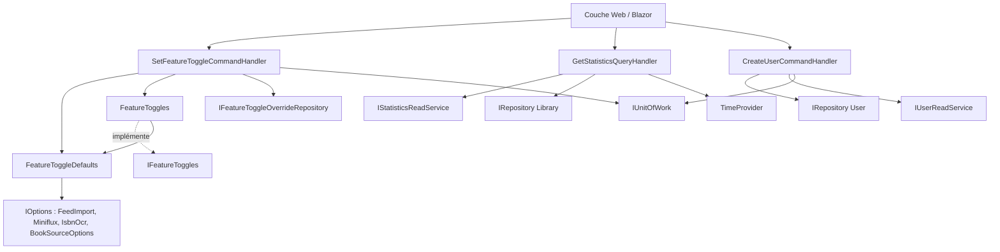
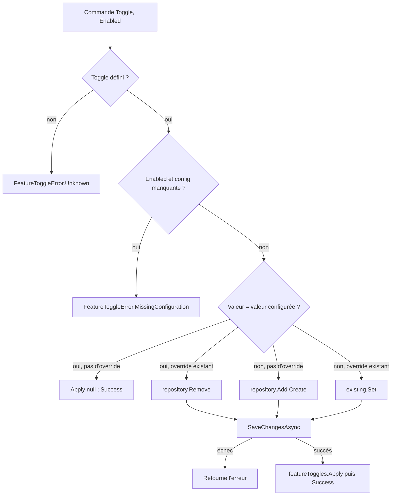
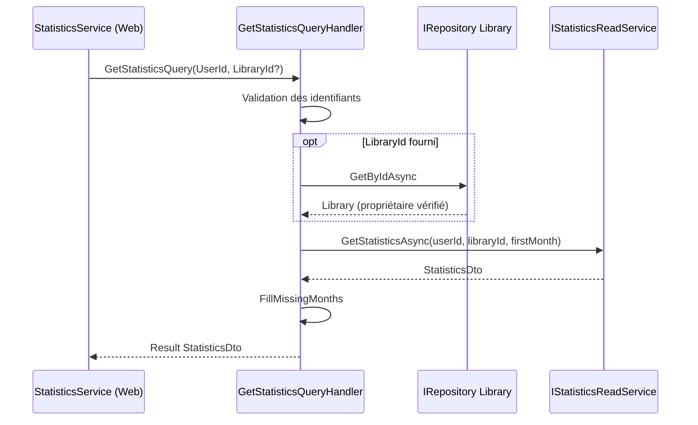

# Application : paramètres, statistiques et utilisateurs

Ce module regroupe trois cas d'usage transverses de la couche `Application` : la gestion des **feature toggles** (`Application/Settings`), le calcul des **statistiques de lecture** (`Application/Statistics`) et la **création d'utilisateurs** (`Application/Users`). Il suit le pattern CQRS décrit dans [Messaging_Abstractions](../Application_Contracts___CQRS_Foundation/Messaging_Abstractions.md) et renvoie des `Result<T>` (voir [Domain_Core](../Domain_Model/Domain_Core.md)) plutôt que de lever des exceptions.

## Composants

| Composant | Rôle |
|---|---|
| `FeatureToggleDefaults` | Lit la configuration (`appsettings`, variables d'environnement) pour dire si une fonctionnalité est activée par défaut, et vérifie la configuration manquante avant activation. |
| `FeatureToggles` | Singleton implémentant `IFeatureToggles` ; conserve en mémoire les surcharges (overrides) issues de la base. |
| `SetFeatureToggleCommandHandler` | Enregistre le choix fait dans la page Paramètres et met à jour `FeatureToggles`. |
| `GetStatisticsQueryHandler` | Produit le `StatisticsDto` d'un utilisateur, éventuellement restreint à une bibliothèque. |
| `CreateUserCommandHandler` | Crée un `User` à partir d'un e-mail et d'un identifiant Auth0. |
| `IUserReadService` | Contrat de lecture des utilisateurs (pagination, recherche par e-mail / AuthId). |

## Architecture

Les interfaces sont définies dans [Application_Interfaces](../Application_Contracts___CQRS_Foundation/Application_Interfaces.md) et implémentées par la couche [Data_Persistence___Queries](../Data_Persistence___Queries.md) (notamment `StatisticsReadService` et `UserReadService`, voir [Persistence_Read_Services](../Data_Persistence___Queries/Persistence_Read_Services.md)). Les entités `User` et `FeatureToggleOverride` proviennent de [Domain_Core](../Domain_Model/Domain_Core.md).

## Feature toggles

### Résolution de la valeur d'un toggle

`FeatureToggles.IsEnabled` consulte d'abord le dictionnaire d'overrides (`ConcurrentDictionary`), puis retombe sur `FeatureToggleDefaults.IsConfiguredOn`. Aucune lecture en base n'a lieu à la consultation : les overrides sont chargés au démarrage via `Load`, puis maintenus par `Apply`.

Valeurs par défaut par fonctionnalité :

| `FeatureToggle` | Source de la valeur configurée |
|---|---|
| `FeedImport` | `FeedImportSettings.Enabled` |
| `IsbnOcr` | `IsbnOcrSettings.Enabled` |
| `Bedetheque`, `Bnf`, `GoogleBooks`, `OpenLibrary` | `Enabled` de chaque source dans `BookSourceOptions` |
| `Bubble` | `Enabled` **et** présence de la clé d'API (`HasApiKey`) |

`GetStates()` renvoie pour chaque toggle l'état effectif et l'état configuré (`FeatureToggleState`), ce qui permet à l'interface admin d'afficher l'écart (voir [Web_Admin_And_Other_Pages](../Blazor_UI_Layer/Web_Admin_And_Other_Pages.md)).

### Validation de la configuration

Avant d'activer une fonctionnalité, `GetMissingConfiguration` renvoie un message si la configuration est incomplète :

- `FeedImport` : `FeedImport:UserEmail`, `Miniflux:BaseUrl` (URL http(s) absolue), `Miniflux:ApiKey`, `Miniflux:CategoryName` ;
- `IsbnOcr` : `IsbnOcr:TesseractPath` ;
- `Bubble` : `Bubble:ApiKey` et `Bubble:ApplicationId`.

### Flux de `SetFeatureToggleCommandHandler`

Points notables :

- Choisir la valeur configurée **supprime** l'override : la fonctionnalité suit à nouveau la configuration.
- Le cache mémoire n'est mis à jour **qu'après** la réussite de la sauvegarde, pour rester cohérent avec la base.
- Limite connue (commentaire `ponytail`) : le cache étant en mémoire, un déploiement à plusieurs réplicas ne propagerait pas les changements.

## Statistiques

`GetStatisticsQueryHandler` :

1. Valide la requête (`UserId` / `LibraryId` non vides, sinon `StatisticsError.BadRequest`).
2. Si une bibliothèque est ciblée, vérifie qu'elle existe et appartient à l'utilisateur (sinon `LibrariesError.NotFound`).
3. Calcule le premier mois de la fenêtre : `MonthsInReadingHistory` = 12 mois glissants, à partir de `TimeProvider`.
4. Délègue l'agrégation à `IStatisticsReadService.GetStatisticsAsync`.
5. Complète `ReadingsPerMonth` avec des mois à zéro (`FillMissingMonths`) pour garantir une série continue de 12 points.

Voir [Web_Library_And_Statistics_Services](../Web_Application_Services/Web_Library_And_Statistics_Services.md) pour le consommateur côté Web.

## Utilisateurs

`CreateUserCommandHandler` valide d'abord les entrées (commande non nulle, `email` et `authId` non vides → `UsersError.BadRequest`), vérifie via `IUserReadService.GetUserByAuthIdAndEmail` qu'aucun utilisateur identique n'existe (`UsersError.Duplicate`), puis crée l'entité avec `User.Create`, l'ajoute au dépôt et sauvegarde via `IUnitOfWork`.

`IUserReadService` expose : `GetUsersAsync` (recherche, tri par `UsersColumn`/`SortOrder`, pagination `IPagedList<User>`), `GetUserByEmail`, `GetUserByAuthIdAndEmail` et `GetUserByAuthId`.

> Remarque : le handler teste `user is not null` sur un `Result<User>`. Le résultat de la lecture étant lui-même un objet non nul, il convient de vérifier dans l'implémentation (`UserReadService`) le comportement exact attendu pour « utilisateur introuvable ».

L'authentification (Auth0) et le provisionnement de l'utilisateur courant sont décrits dans [Web_Configuration_And_Auth](../Web_Platform,_Security___External_Integrations/Web_Configuration_And_Auth.md).

## Voir aussi

- [Book___Library_Use_Cases](../Book___Library_Use_Cases.md) — module parent
- [Libraries_Application](Libraries_Application.md) — cas d'usage des bibliothèques, sollicités par les statistiques
