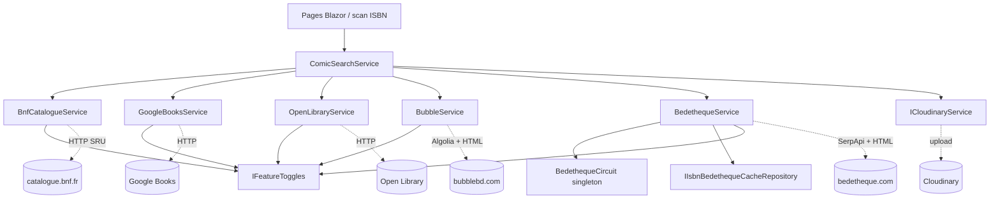
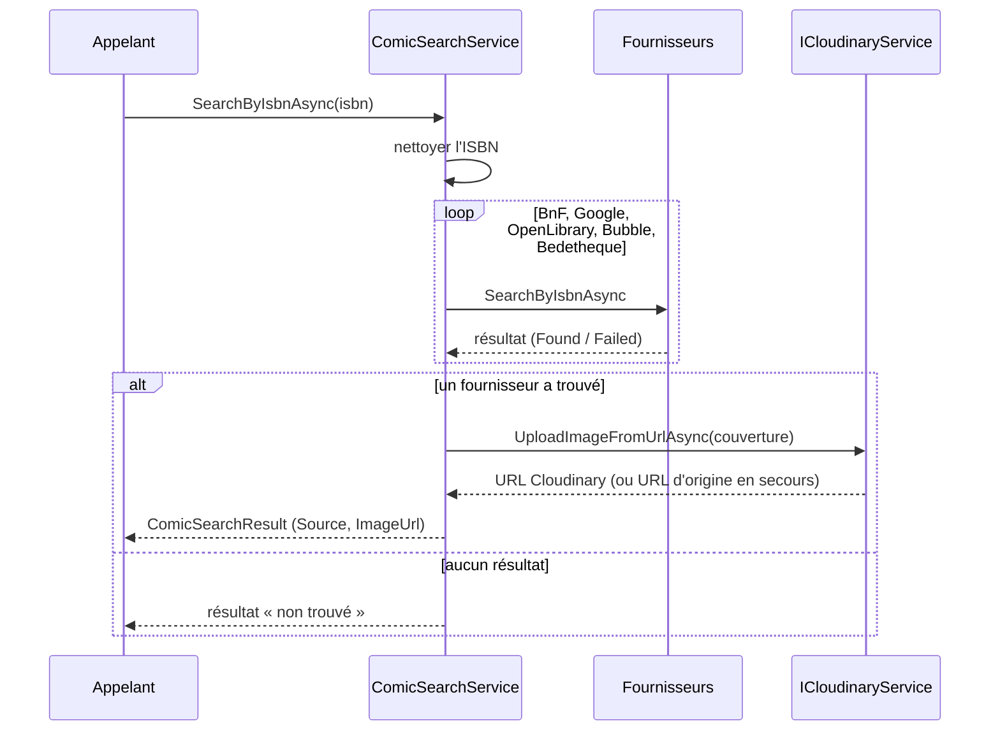
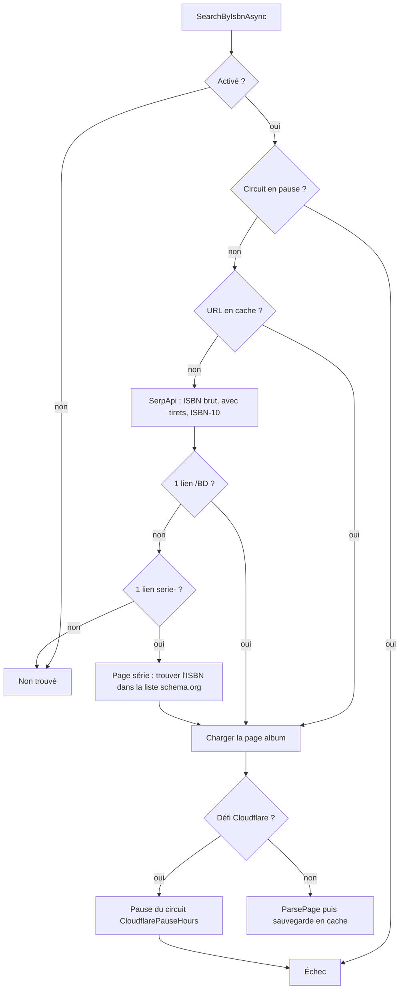

# Recherche d'informations de bandes dessinées (Comic_Info_Search)

## Introduction

Le module `Comic_Info_Search` (espace de noms `Application.ComicInfoSearch`) retrouve les métadonnées d'un album à partir de son ISBN : titre, série, numéro de tome, auteurs, éditeurs, date de parution, nombre de pages et couverture. Il agrège plusieurs sources externes (BnF, Google Books, Open Library, Bubble, Bedetheque), les interroge selon un ordre de priorité fixe, puis téléverse la couverture sur Cloudinary.

Il implémente des interfaces déclarées dans [Application_Interfaces](Application_Contracts___CQRS_Foundation/Application_Interfaces.md) (`IComicSearchService`, `IBnfCatalogueService`, `IGoogleBooksService`, `IOpenLibraryService`, `IBubbleService`, `IBedethequeService`, `IStructuredBookResult`, `IBookSearchResult`). Les consommateurs sont notamment les écrans d'ajout de livre ([Web_Book_Pages](Blazor_UI_Layer/Web_Book_Pages.md)) et le scan ISBN ([Isbn_Scan_Application](Book___Library_Use_Cases/Isbn_Scan_Application.md)).

## Composants

| Composant | Rôle | Source / mécanisme |
|---|---|---|
| `ComicSearchService` | Orchestrateur : enchaîne les fournisseurs, mappe vers `ComicSearchResult`, téléverse la couverture | Façade `IComicSearchService` |
| `BnfCatalogueService` | Recherche SRU (Dublin Core XML) dans le catalogue de la BnF | HTTP + `XDocument` |
| `GoogleBooksService` | API Google Books, avec récupération détaillée via `selfLink` | JSON |
| `OpenLibraryService` | API Open Library (édition, puis auteurs un par un) | JSON |
| `BubbleService` | Index Algolia de bubblebd.com, puis lecture de la page album (schema.org, « Caractéristiques ») | JSON + HtmlAgilityPack |
| `BedethequeService` | SerpApi (Google) pour trouver l'URL, puis scraping HTML de Bedetheque | JSON + HTML, cache en base |
| `BedethequeCircuit` | Disjoncteur singleton suspendant Bedetheque après un défi Cloudflare | `Interlocked`, `TimeProvider` |
| `*Settings` | Options liées à la configuration (URL, clés, activation) | `IOptions<T>` |

### Paramétrages

- `BnfCatalogueSettings` : `BaseUrl`, `Enabled`.
- `GoogleBooksSettings` : `BaseUrl`, `ApiKey` (sans clé, le quota anonyme est souvent épuisé), `Enabled`.
- `OpenLibrarySettings` : `BaseUrl`, `CoversBaseUrl`, `Enabled`.
- `BubbleSettings` : `BaseUrl`, `AlgoliaBaseUrl`, `ApplicationId`, `ApiKey`, `Enabled`, propriété calculée `HasApiKey`.
- `BedethequeSettings` : `BaseUrl`, `SerpApiBaseUrl`, `SerpApiKey`, `Enabled`, `CloudflarePauseHours` (24 par défaut).
- `CloudinarySettings` : `CloudName`, `ApiKey`, `ApiSecret`, `Folder` (« covers » par défaut).

Chaque source expose `IsEnabled`, évalué via `IFeatureToggles` (voir [Settings_Statistics_Users_Application](Book___Library_Use_Cases/Settings_Statistics_Users_Application.md) et `FeatureToggleOverride` dans [Domain_Core](Domain_Model/Domain_Core.md)). Le drapeau peut donc être coupé à l'exécution depuis Paramètres → Fonctionnalités. `BubbleService` exige en plus une clé Algolia configurée.

## Architecture

Les implémentations de `ICloudinaryService` et de `IIsbnBedethequeCacheRepository` se trouvent respectivement dans [Persistence_File_Services](File_Storage___Media_Processing/Persistence_File_Services.md) et [Persistence_Core](Data_Persistence___Queries/Persistence_Core.md).

## Flux de recherche par ISBN

`ComicSearchService.SearchByIsbnAsync` normalise l'ISBN, puis appelle `FindFirstAsync` qui s'arrête à la première source ayant trouvé le livre. L'ordre reflète la fiabilité et le coût :

1. **BnF** : couvre presque toute la BD française (dépôt légal), mais n'a pas de couverture ; `FindCoverAsync` en cherche une chez Google Books, Open Library, puis Bubble.
2. **Google Books**.
3. **Open Library**.
4. **Bubble**.
5. **Bedetheque** en dernier : souvent bloqué par Cloudflare et consomme des appels SerpApi.

### Mappage des résultats

- Les sources « livre » (`IBookSearchResult` : BnF, Google Books, Open Library) fournissent un titre brut et un sous-titre. `ParseTitleInfo` extrait série et tome par une série d'expressions régulières (« Soda, tome 1 », « Soda - vol. 1 », « Soda #1 », etc.) ; si un sous-titre existe, il devient le titre.
- Les sources « structurées » (`IStructuredBookResult` : Bubble, Bedetheque) fournissent directement série, tome et titre.
- Le champ `Source` indique le fournisseur retenu.

### Couvertures

- `UploadCoverAsync` / `UploadCoverToCloudinaryAsync` : téléversement depuis une URL ; en cas d'échec, l'URL d'origine est renvoyée.
- `SearchByIsbnWithLocalCoverAsync` : priorité à un flux local fourni (livre numérique), avec un `publicId` fondé sur l'ISBN ou un GUID (`digital-…`) s'il n'y a pas d'ISBN.

## Gestion des erreurs

Chaque fournisseur renvoie un enregistrement avec les drapeaux `Found` et `Failed` plutôt que de lever une exception (même philosophie que le [Result](Domain_Model/Domain_Core.md) du domaine) :

- source désactivée ou introuvable : `CreateNotFoundResult()` ;
- erreur HTTP, JSON/XML invalide, timeout (non demandé par l'appelant) : `CreateFailedResult()` (`Failed = true`) ;
- Open Library traduit un 404 en « non trouvé » et les autres codes en échec.

Dans `ComicSearchService`, `IsUnexpectedException` distingue une annulation réellement demandée (qui se propage) d'un timeout interne (dégradé en « non trouvé »).

## Spécificités de Bedetheque

Bedetheque n'a pas d'API : le service résout l'URL de l'album puis analyse la page HTML.

- **`BedethequeCircuit`** est un singleton partagé par toutes les requêtes. `Pause(duration)` écrit un horodatage UTC via `Interlocked.Exchange` ; `PausedUntil` le relit via `Interlocked.Read` et renvoie `null` une fois l'échéance passée. L'horloge est injectée (`TimeProvider`) pour les tests.
- La détection Cloudflare repose sur l'en-tête `cf-mitigated` ou la page « Just a moment… ».
- Les URL trouvées sont mises en cache par ISBN (`IIsbnBedethequeCacheRepository`) pour éviter de nouveaux appels SerpApi.
- L'extraction (titre, série, tome, auteurs scénario + dessin, éditeur, pages, date de parution en deux stratégies, couverture déduite de l'identifiant de la page) utilise XPath sur les `ul.infos-albums` et des regex générées avec délai d'expiration de 1 s.

## Spécificités de Bubble

1. Requête POST sur l'index Algolia `Albums` (5 résultats maximum) ; seul le hit dont les EAN contiennent l'ISBN est retenu (la recherche est plein texte).
2. Construction de l'URL de l'album, après validation des segments par regex pour éviter toute injection.
3. Lecture de la page : JSON-LD schema.org `Book` (éditeur, pages, image) et blocs « Auteurs » / « Date de parution ».
4. Si la page est illisible, le résultat Algolia seul est conservé. `ParseReleaseDate` gère « 07 mai 2021 », « mai 2021 » et « 2021 » (convention : mois seul = 1er du mois, année seule = 1er janvier).

## Spécificités de la BnF

La requête SRU `bib.fuzzyISBN all "<isbn>"` renvoie un enregistrement Dublin Core. Les fonctions internes `ParseTitle` (« Titre : sous-titre / Auteur »), `ToPersonName` (« Wagner, Céline (1975-….) » → « Céline Wagner ») et `StripTrailingPlace` normalisent les champs ; l'année seule devient le 1er janvier.

## Intégration dans le système

- Les services HTTP typés sont enregistrés dans l'injection de dépendances ; Bedetheque et SerpApi utilisent des clients nommés (`"Bedetheque"`, `"SerpApi"`) via `IHttpClientFactory`. La protection SSRF des clients sortants est décrite dans [Web_External_Clients_And_Health](Web_Platform,_Security___External_Integrations/Web_External_Clients_And_Health.md).
- `ComicSearchService` reçoit les cinq fournisseurs groupés dans un objet `BookCatalogues`.
- Utilitaires partagés (`Application.Helpers`) : `IsbnHelper` (normalisation, formes avec tirets et ISBN-10) et `PublishDateHelper` (analyse des dates).
- La couche Application ne dépend que d'abstractions : l'envoi vers Cloudinary est délégué à `ICloudinaryService`, implémenté côté Persistence.
