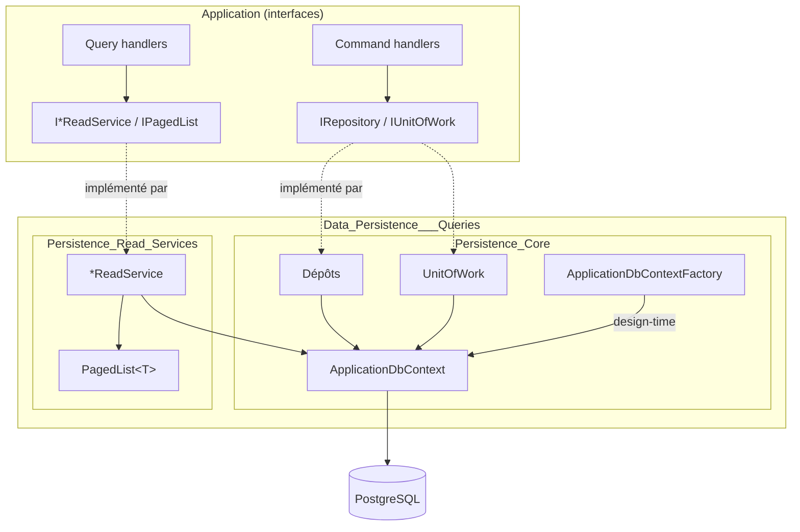
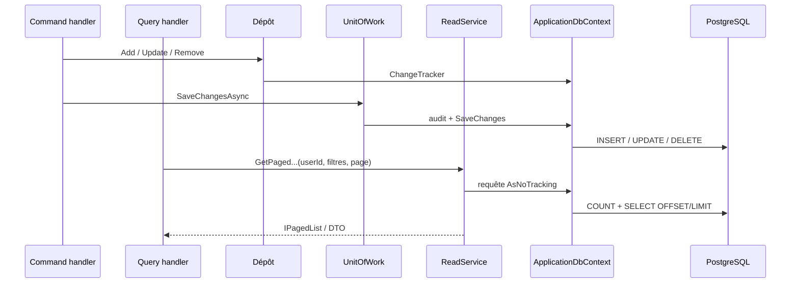

# Persistance des données et requêtes (Data_Persistence___Queries)

## Objectif

Le module `Data_Persistence___Queries` correspond au dossier `Persistence` de MyComicsManager. Il implémente avec EF Core et PostgreSQL (Npgsql) les contrats de données déclarés dans la couche Application. Le module respecte la séparation CQRS et la Clean Architecture : aucun type EF Core ne remonte vers les handlers.

Il se divise en deux sous-modules :

- **Écriture et modèle** : [Persistence_Core](Data_Persistence___Queries/Persistence_Core.md) contient `ApplicationDbContext`, `ApplicationDbContextFactory`, `UnitOfWork` et les dépôts. Les dépôts modifient uniquement le `ChangeTracker`. `UnitOfWork.SaveChangesAsync` valide ensuite les changements, renseigne les champs d'audit et renvoie un `Result<int>`.
- **Lecture** : [Persistence_Read_Services](Data_Persistence___Queries/Persistence_Read_Services.md) contient les services `*ReadService` et `PagedList<T>`. Ils font des requêtes `AsNoTracking`, projettent vers des DTO, paginent et filtrent par utilisateur.

## Architecture d'ensemble

## Flux de données

## Principes communs

- **Un seul `ApplicationDbContext`** est partagé par les dépôts, le `UnitOfWork` et les services de lecture.
- **Séparation écriture / lecture** : les entités suivies passent par les dépôts. Les projections en lecture seule passent par les services de lecture.
- **Tri déterministe** : toute requête paginée se termine par une clé unique, par exemple `Id`.
- **Isolation par utilisateur** : les requêtes de lecture sont restreintes au `userId`.
- **Intégrité** : les jetons de concurrence `xmin`, les index uniques et le mapping TPT de `Book` sont détaillés dans [Persistence_Core](Data_Persistence___Queries/Persistence_Core.md).
- **Migrations** : elles se gèrent avec `dotnet ef ... --project Persistence`.

## Références

| Composant | Documentation |
|---|---|
| Contexte EF Core, unité de travail, dépôts, migrations | [Persistence_Core](Data_Persistence___Queries/Persistence_Core.md) |
| Services de lecture, pagination, statistiques | [Persistence_Read_Services](Data_Persistence___Queries/Persistence_Read_Services.md) |