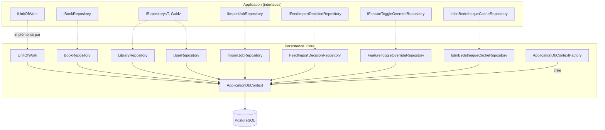
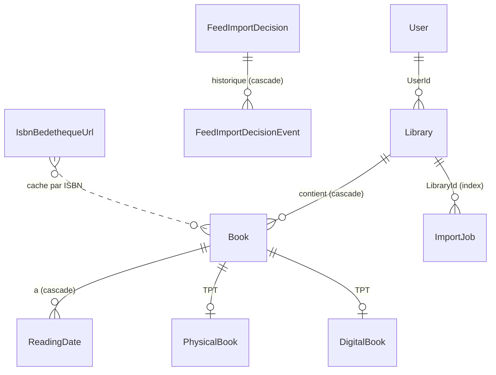
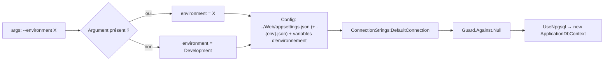
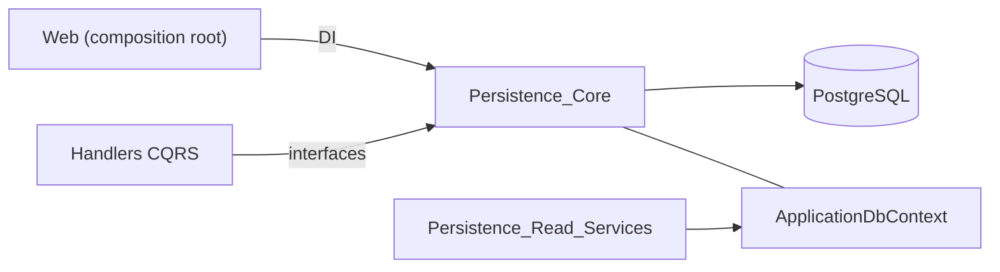

# Persistence_Core : contexte EF Core, unité de travail et dépôts

## Introduction

Le module `Persistence_Core` constitue le cœur de l'accès aux données de MyComicsManager. Il implémente, à l'aide d'EF Core et de PostgreSQL (Npgsql), les interfaces de persistance déclarées dans la couche Application (voir [Application_Interfaces](../Application_Contracts___CQRS_Foundation/Application_Interfaces.md)) pour les entités du [Domain_Model](../Domain_Model.md). Il regroupe :

- `ApplicationDbContext` : le `DbContext` et la configuration du modèle relationnel ;
- `ApplicationDbContextFactory` : la fabrique « design-time » utilisée par `dotnet ef` ;
- `UnitOfWork` : la validation des changements et le renseignement automatique des champs d'audit ;
- les dépôts (`Persistence/Repositories`) : `BookRepository`, `LibraryRepository`, `UserRepository`, `ImportJobRepository`, `FeedImportDecisionRepository`, `FeatureToggleOverrideRepository`, `IsbnBedethequeCacheRepository`.

Les requêtes de lecture optimisées (projections, pagination, statistiques) sont documentées dans [Persistence_Read_Services](Persistence_Read_Services.md). Le module parent est [Data_Persistence___Queries](../Data_Persistence___Queries.md).

## Architecture



Le principe de la Clean Architecture est respecté : la couche Application ne connaît que les interfaces ; aucun type EF Core ne remonte vers les handlers CQRS. Les dépôts exposent des opérations *non transactionnelles* (`Add`, `Update`, `Remove` ne font que modifier le `ChangeTracker`) ; la validation est déléguée à `IUnitOfWork.SaveChangesAsync`.

## ApplicationDbContext

`ApplicationDbContext` hérite de `DbContext` et implémente `IDataProtectionKeyContext` : le *key ring* d'ASP.NET Core Data Protection est stocké en base afin que les cookies d'authentification survivent à un redéploiement.

### DbSet exposés

| DbSet | Entité | Table |
|---|---|---|
| `Libraries` | `Library` | `Libraries` |
| `Users` | `User` | `Users` |
| `Books` | `Book` | `Books` |
| `PhysicalBooks` / `DigitalBooks` | `PhysicalBook` / `DigitalBook` | `PhysicalBooks` / `DigitalBooks` |
| `ReadingDates` | `ReadingDate` | `ReadingDates` |
| `IsbnBedethequeUrls` | `IsbnBedethequeUrl` | `IsbnBedethequeUrls` |
| `ImportJobs` | `ImportJob` | `ImportJobs` |
| `FeedImportDecisions` / `FeedImportDecisionEvents` | `FeedImportDecision` / `FeedImportDecisionEvent` | idem |
| `FeatureToggleOverrides` | `FeatureToggleOverride` | `FeatureToggleOverrides` |
| `DataProtectionKeys` | `DataProtectionKey` | clés Data Protection |

Voir [Domain_Core](../Domain_Model/Domain_Core.md), [Domain_Books](../Domain_Model/Domain_Books.md) et [Domain_FeedImports](../Domain_Model/Domain_FeedImports.md) pour les entités.

### Modèle relationnel



### Choix de mapping notables

- **Hiérarchie `Book` en TPT** (Table Per Type) : `Books` + `PhysicalBooks` / `DigitalBooks`.
- **Longueurs maximales** issues des constantes du domaine (`BookConstants`, `LibraryConstants`, `ImportJobConstants`, `FeedImportConstants`).
- **`DigitalBook.IsbnCandidates`** : collection primitive mappée sur le champ privé `_isbnCandidates` (`PropertyAccessMode.Field`).
- **`Library.RelativePath`** est ignorée (propriété calculée).
- **Concurrence optimiste** : `ImportJob` et `FeedImportDecision` utilisent la colonne système PostgreSQL `xmin` (type `xid`) comme *concurrency token*.
- **Index unique filtré** sur `ImportJob.OriginalFilePath` (`"Status" NOT IN (6, 7)`), garantissant un seul job actif par fichier. Le filtre dépend des ordinaux numériques de `Completed` (6) et `Failed` (7) : à mettre à jour si l'énumération est réordonnée.
- **`FeedImportDecision`** : `Links` en `jsonb`, index uniques sur `(UserId, MinifluxEntryId, ItemIndex)` et index sur `(UserId, Status)`. Les événements ont une clé générée côté client (`ValueGeneratedNever`) pour qu'un événement ajouté à une décision suivie soit inséré (INSERT) et non mis à jour.
- **`IsbnBedethequeUrl`** : index unique sur `ISBN`.
- **`FeatureToggleOverride`** : l'énumération `Toggle` est stockée en chaîne (64 car. max) avec un index unique.

## ApplicationDbContextFactory

Implémente `IDesignTimeDbContextFactory<ApplicationDbContext>` pour les commandes `dotnet ef migrations` / `database update`.



## UnitOfWork

`UnitOfWork` implémente `IUnitOfWork` et renvoie un `Result<int>` (voir [Domain_Core](../Domain_Model/Domain_Core.md)) plutôt que de lever des exceptions pour les erreurs connues.

```mermaid
sequenceDiagram
    participant H as CommandHandler
    participant R as Repository
    participant U as UnitOfWork
    participant C as ApplicationDbContext
    participant DB as PostgreSQL

    H->>R: Add / Update / Remove
    R->>C: modifie le ChangeTracker
    H->>U: SaveChangesAsync(ct)
    U->>C: Entries&lt;IAuditable&gt;()
    Note over U,C: Added → CreatedOnUtc = UtcNow<br/>Modified → ModifiedOnUtc = UtcNow
    U->>C: SaveChangesAsync(ct)
    C->>DB: INSERT / UPDATE / DELETE
    alt succès
        U-->>H: Result&lt;int&gt; (nb de changements)
    else DbUpdateException
        U-->>H: TError("DB_UPDATE_ERROR", message)
    end
```

Seule `DbUpdateException` est capturée ; les autres exceptions (par exemple `DbUpdateConcurrencyException` liée au jeton `xmin`) se propagent.

## Dépôts

| Dépôt | Interface | Particularités |
|---|---|---|
| `BookRepository` | `IBookRepository` | `Include(ReadingDates)` + `AsSplitQuery()` pour les listes ; `GetByIdAsync` protégé par `Guard.Against.Default` ; `ListIdsToScanForIsbnAsync` (livres numériques sans ISBN et jamais scannés, tri par `Id`) ; `GetByIsbnAsync` normalise l'ISBN via `IsbnHelper.NormalizeIsbn` ; `ListByUserIdAsync` filtre via `Library.UserId`. |
| `LibraryRepository` | `IRepository<Library, Guid>` | CRUD simple. |
| `UserRepository` | `IRepository<User, Guid>` | CRUD simple. |
| `ImportJobRepository` | `IImportJobRepository` | Requêtes `AsNoTracking` en lecture ; `GetPendingAsync` (suivi, ordre de création) ; `ExistsActiveForFilePathAsync` (cohérent avec l'index unique filtré). |
| `FeedImportDecisionRepository` | `IFeedImportDecisionRepository` | Décisions par utilisateur/statut ; `ItemIndex == 0` désigne la décision principale d'une entrée Miniflux. |
| `FeatureToggleOverrideRepository` | `IFeatureToggleOverrideRepository` | `GetAllAsync` en `AsNoTracking`. |
| `IsbnBedethequeCacheRepository` | `IIsbnBedethequeCacheRepository` | `SaveAsync` sauvegarde immédiatement et ignore la violation d'unicité PostgreSQL `23505` (requête concurrente) en détachant l'entité. |

### Conventions

- **Pagination/ordre déterministe** : les requêtes ordonnées se terminent par une clé unique (`ThenBy(x => x.Id)`), ex. `GetPendingIdsAsync`, `GetByLibraryIdAsync`, `GetIdsByStatusAsync`.
- **Lecture seule** : `AsNoTracking()` quand les entités ne seront pas modifiées ; les méthodes destinées à une modification (`GetByIdAsync`, `GetPendingAsync`, `GetByStatusAsync`) restent suivies.
- **Pas de transaction implicite** : sauf `IsbnBedethequeCacheRepository`, qui est un cache autonome et appelle directement `SaveChangesAsync`.
- **Mise à jour** : `BookRepository.Update` force `EntityState.Modified`, tandis que les autres utilisent `Update(...)` du `DbSet`.

## Intégration dans le système



- Les handlers (voir [Book___Library_Use_Cases](../Book___Library_Use_Cases.md), [File_Import_Pipeline](../File_Import_Pipeline.md), [Feed_Import_Pipeline](../Feed_Import_Pipeline.md)) dépendent uniquement des interfaces.
- Les services en lecture partagent le même `ApplicationDbContext` : voir [Persistence_Read_Services](Persistence_Read_Services.md).
- Les migrations sont gérées avec `dotnet ef migrations add <Nom> --project Persistence` et `dotnet ef database update --project Persistence`.
- Les tests d'intégration (`Persistence.Integration.Tests`) s'exécutent sur une vraie base PostgreSQL (variable `ConnectionStrings__NeonConnectionUnitTests`).
