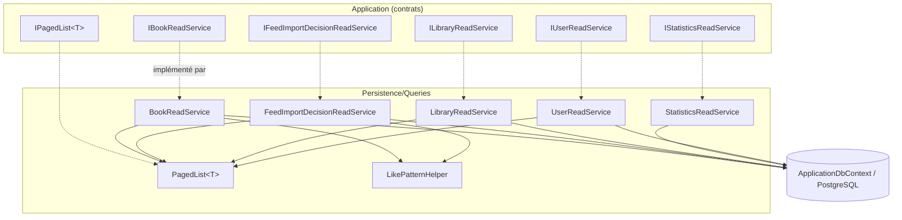
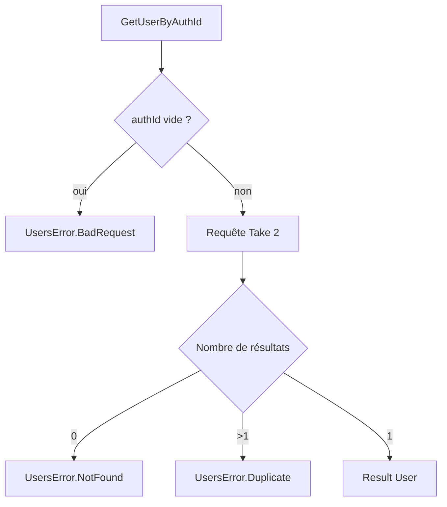

# Services de lecture de la persistance (Persistence_Read_Services)

## Introduction

Le module `Persistence_Read_Services` constitue le **côté « Query » du CQRS** de la couche `Persistence`. Il regroupe les implémentations EF Core (PostgreSQL) des interfaces de lecture déclarées dans la couche Application (voir [Application_Interfaces](../Application_Contracts___CQRS_Foundation/Application_Interfaces.md)). Ces services :

- n'effectuent **aucune écriture** : toutes les requêtes utilisent `AsNoTracking()` ;
- projettent directement vers des DTO / entités de lecture, sans exposer de types EF Core à la couche supérieure ;
- fournissent une pagination uniforme via `PagedList<T>` ;
- appliquent systématiquement le **filtrage par utilisateur** (`UserId`) pour cloisonner les données.

Les écritures (repositories, `UnitOfWork`, `ApplicationDbContext`) sont documentées dans [Persistence_Core](Persistence_Core.md).

## Composants

| Composant | Interface implémentée | Rôle |
|---|---|---|
| `BookReadService` | `IBookReadService` | Liste paginée des livres d'une bibliothèque, identités et emplacements de séries |
| `FeedImportDecisionReadService` | `IFeedImportDecisionReadService` | Liste paginée des décisions d'import de flux, compteurs par statut |
| `LibraryReadService` | `ILibraryReadService` | Liste paginée, recherche par nom, résumés avec couvertures |
| `StatisticsReadService` | `IStatisticsReadService` | Agrégats statistiques (livres, séries, lectures, stockage) |
| `UserReadService` | `IUserReadService` | Liste paginée et recherche d'utilisateurs, retour via `Result<User>` |
| `PagedList<T>` | `IPagedList<T>` | Helper de pagination (comptage + `Skip/Take`) |

## Architecture



Chaque service reçoit `ApplicationDbContext` par injection de constructeur (voir [Persistence_Core](Persistence_Core.md)). Les entités manipulées proviennent de [Domain_Books](../Domain_Model/Domain_Books.md), [Domain_Core](../Domain_Model/Domain_Core.md) et [Domain_FeedImports](../Domain_Model/Domain_FeedImports.md). Les services sont consommés par les handlers de requêtes décrits dans [Book___Library_Use_Cases](../Book___Library_Use_Cases.md) et [Feed_Import_Pipeline](../Feed_Import_Pipeline.md).

## PagedList&lt;T&gt;

`PagedList<T>` encapsule un `IQueryable<T>` et expose `Items`, `Page`, `PageSize`, `TotalCount`, `HasNextPage` et `HasPreviousPage`. La méthode `ExecuteQueryAsync(page, pageSize)` :

1. mémorise la page et la taille ;
2. exécute `CountAsync` (total) ;
3. exécute `Skip((page - 1) * pageSize).Take(pageSize).ToListAsync()`.

Avant exécution, les propriétés valent `-1` / `null`, et `HasNextPage`/`HasPreviousPage` retournent `false`.

```mermaid
sequenceDiagram
    participant H as Handler (Application)
    participant S as XxxReadService
    participant P as PagedList&lt;T&gt;
    participant DB as PostgreSQL
    H->>S: GetPaged...(filtres, page, pageSize)
    S->>S: Where(userId) + recherche + tri déterministe
    S->>P: new PagedList(query)
    S->>P: ExecuteQueryAsync(page, pageSize)
    P->>DB: SELECT COUNT(*)
    P->>DB: SELECT ... OFFSET/LIMIT
    P-->>S: IPagedList (this)
    S-->>H: IPagedList
```

## Détail des services

### BookReadService

- **`GetPagedByLibraryAsync`** : filtre sur `LibraryId` et `Library.UserId`, recherche optionnelle `ILIKE` sur `Title` et `Serie` (caractères spéciaux échappés via `LikePatternHelper`, échappement `\`). Tris : `IdAsc`, `SerieAndVolumeAsc` (Serie → VolumeNumber → Id) ou, par défaut, `Id` décroissant. Chaque tri se termine par `Id` (clé de départage unique, règle de pagination déterministe). La projection vers `BookSummaryDto` calcule en SQL `ReadCount`, `LastRead`, `LastRating`, ainsi que `IsbnCandidateCount` et `IsbnScannedAt` via un cast vers `DigitalBook` (nul pour un livre physique).
- **`ListIdentitiesByUserAsync`** : retourne des `BookIdentityDto` (id, série, titre, tome, ISBN, nom de bibliothèque) pour tous les livres de l'utilisateur.
- **`ListSerieLocationsAsync`** : retourne des `BookSerieLocationDto` (bibliothèque, série), utile pour proposer des cibles de déplacement (voir [Books_Management](../Book___Library_Use_Cases/Books_Management.md)).

### FeedImportDecisionReadService

- **`GetPagedAsync`** : filtre par utilisateur, statut optionnel et recherche `ILIKE` sur `EntryTitle`, `Reason` et `ParsedSerie`. Les `Events` sont chargés par `Include` ordonné avec `AsSplitQuery()` pour éviter l'explosion cartésienne. Tri : `CreatedAt` desc → `MinifluxEntryId` desc → `ItemIndex` → `Id` (articles récents d'abord, livres d'un même article regroupés dans l'ordre).
- **`GetMultiBookEntryIdsAsync`** : parmi des identifiants d'entrées Miniflux, retourne ceux ayant au moins une décision avec `ItemIndex > 0` (articles multi-livres) ; retourne un ensemble vide si l'entrée est vide.
- **`CountByStatusAsync`** / **`CountPerStatusAsync`** : compteurs (un statut, ou dictionnaire via `GroupBy`).

### LibraryReadService

- **`GetLibrariesAsync`** : filtre utilisateur, recherche `Contains` sur `Name`, tri par `Id` ou `Name` (croissant par défaut).
- **`GetByNameAsync`** / **`ExistsByNameAsync`** : comparaison insensible à la casse via `ToUpper()` côté SQL (nom normalisé par `Trim().ToUpperInvariant()`) ; `ExistsByNameAsync` accepte un `excludeId` pour les mises à jour.
- **`GetSummariesAsync`** : produit des `LibrarySummary` triés par `Name` puis `Id`, avec le nombre de livres et jusqu'à `LibrarySummary.MaxCovers` couvertures (les plus récentes, `ImageLink` non vide). Voir [Libraries_Application](../Book___Library_Use_Cases/Libraries_Application.md).

### StatisticsReadService

`GetStatisticsAsync(userId, libraryId?, readingsFromUtc)` construit un `StatisticsDto` à partir de plusieurs requêtes d'agrégation (la méthode privée générique `FilterBooks` applique le filtre utilisateur/bibliothèque aux `Book` et `DigitalBook`) : total de livres, de séries distinctes, de bibliothèques, livres lus, nombre de lectures, note moyenne, pages totales, octets de stockage numérique et lectures par mois (`MonthlyReadingCountDto`) depuis `readingsFromUtc`.

### UserReadService

- **`GetUsersAsync`** : pagination avec recherche `Contains` sur `Email` et tri par `Id`, `Email` ou `AuthId`.
- **`GetUserByAuthIdAndEmail`**, **`GetUserByEmail`**, **`GetUserByAuthId`** : retournent `Result<User>` (pattern `Result` du domaine, voir [Domain_Core](../Domain_Model/Domain_Core.md)). Entrée vide → `UsersError.BadRequest` ; absent → `UsersError.NotFound`. `GetUserByAuthId` lit au plus 2 lignes pour détecter un doublon → `UsersError.Duplicate`.



## Conventions et points d'attention

- **Lecture seule** : `AsNoTracking()` partout, aucun `SaveChanges`.
- **Tri déterministe** : toute requête paginée se termine par une clé unique (`Id`) pour éviter doublons et trous entre pages.
- **Recherche sûre** : `LikePatternHelper.EscapeLikeSpecialChars` neutralise `%`, `_` et `\` dans les termes saisis.
- **Isolation par utilisateur** : chaque requête est restreinte à `userId`.
- **Traduction SQL** : certains avertissements d'analyseur (`CA1826`, `CA1862`, `CA1304`, `CA1311`) sont volontairement supprimés, car les expressions doivent rester traduisibles par EF Core.
- **Pas de fuite EF Core** : seuls `IPagedList<T>`, des DTO ou des entités du domaine sont retournés.
