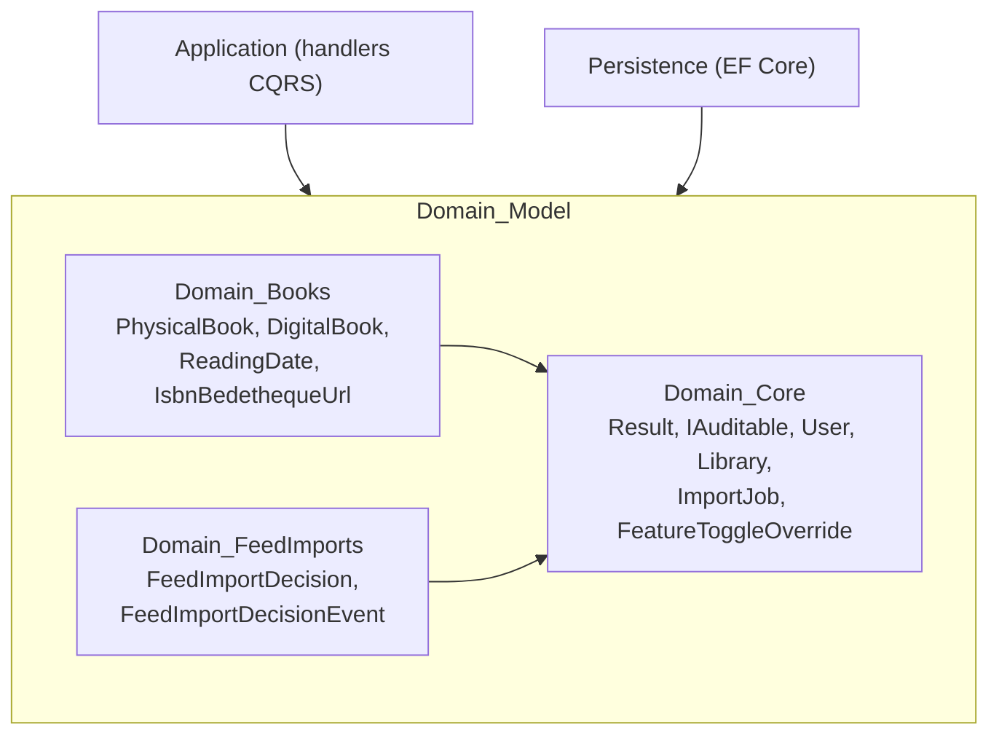
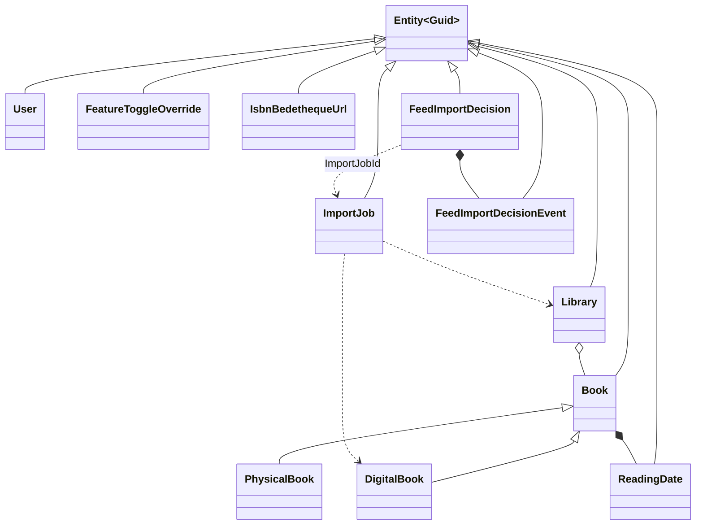
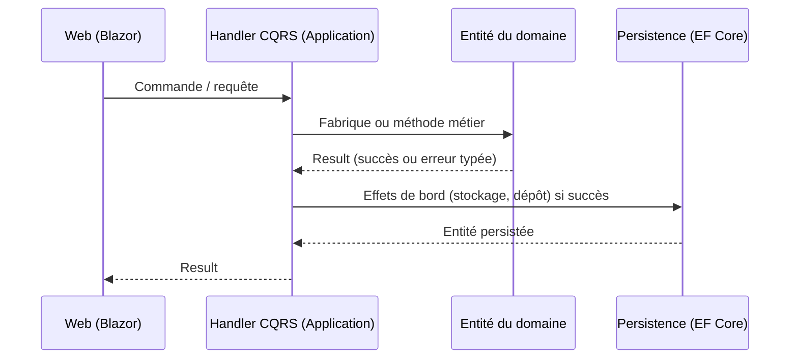

# Modèle de domaine (Domain_Model)

## Objectif

Le module `Domain_Model` correspond à la couche `Domain` de l'application. C'est le cœur métier de la Clean Architecture. Il contient les entités, les value objects, les erreurs métier et le motif `Result`. Il n'a aucune dépendance externe. `Architecture.Tests` vérifie cette règle. Les autres couches en dépendent : `Application` consomme le domaine et `Persistence` le mappe avec EF Core. Aucun type EF Core ne remonte dans le domaine.

Principes communs à tout le module :

- **Erreurs sans exception** : les cas d'erreur connus renvoient un `Result` / `Result<T>`, avec des erreurs typées (`LibrariesError`, `BooksError`, `ImportJobError`, `FeedImportError`).
- **Encapsulation** : les constructeurs sont privés ou protégés, et la création passe par des fabriques statiques `Create` qui valident les entrées. Les collections sont exposées en lecture seule.
- **Identité** : toutes les entités héritent de `Entity<Guid>`, avec des identifiants `Guid.CreateVersion7()` triables chronologiquement.
- **Invariants dans les entités** : les validations métier se trouvent dans le domaine. Les handlers CQRS les appellent avant tout effet de bord sur le système de fichiers.

## Architecture

## Sous-modules

| Sous-module | Contenu | Points clés |
|---|---|---|
| [Domain_Core](Domain_Model/Domain_Core.md) | Motif `Result`, `IAuditable`, `User`, `Library`, `ImportJob`, `FeatureToggleOverride` | `Library.CanContain` garantit la cohérence entre le type de bibliothèque et celui du livre. `ImportJob` est une machine à états séquentielle (`Pending` → … → `Completed` / `Failed`). |
| [Domain_Books](Domain_Model/Domain_Books.md) | `PhysicalBook`, `DigitalBook`, `ReadingDate`, `IsbnBedethequeUrl` | L'ISBN est obligatoire pour un livre physique. Un livre numérique gère la progression de lecture, les réglages du lecteur et le scan d'ISBN. `CanMoveToLibrary` est vérifié avant tout déplacement de fichier. |
| [Domain_FeedImports](Domain_Model/Domain_FeedImports.md) | `FeedImportDecision` (agrégat racine) et `FeedImportDecisionEvent` (historique append-only) | Machine à états de décision d'import depuis Miniflux. Toute transition passe par `Transition`, qui ajoute un événement. |

## Flux de données

## Relations avec les autres modules

- Les cas d'usage qui manipulent ces entités sont dans [Application_Contracts___CQRS_Foundation](Application_Contracts___CQRS_Foundation.md), [Book___Library_Use_Cases](Book___Library_Use_Cases.md), [Feed_Import_Pipeline](Feed_Import_Pipeline.md) et [File_Import_Pipeline](File_Import_Pipeline.md).
- La persistance et les lectures sont dans [Data_Persistence___Queries](Data_Persistence___Queries.md). Les fichiers des livres numériques sont gérés par [File_Storage___Media_Processing](File_Storage___Media_Processing.md).