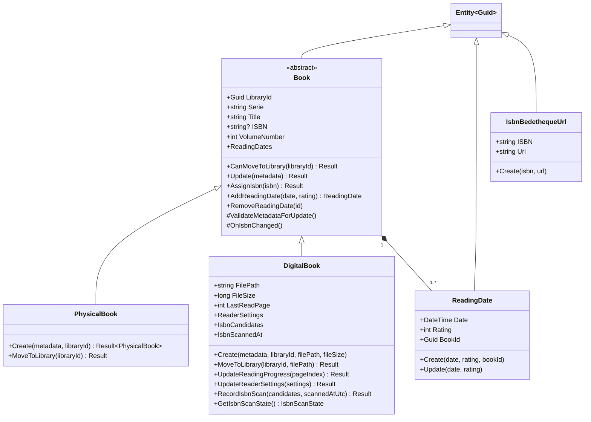
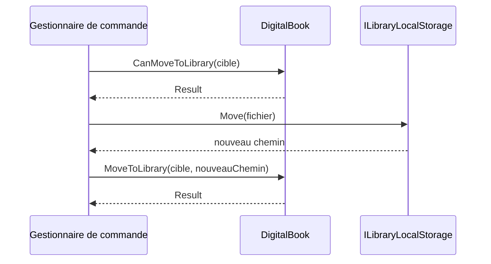
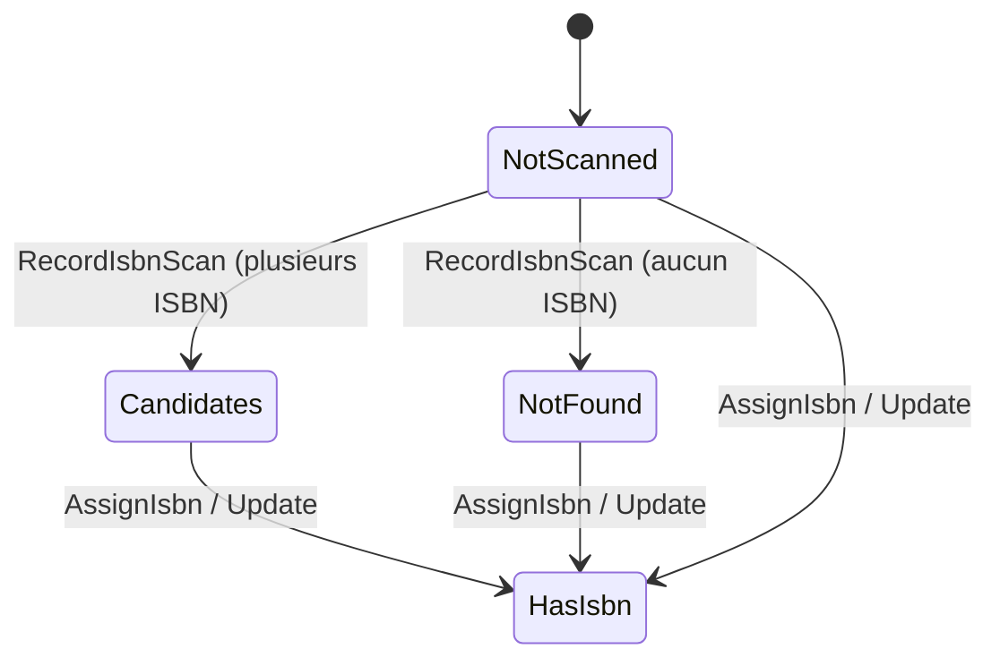
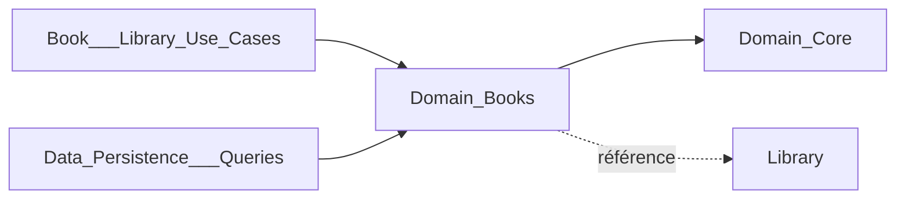

# Domaine des livres (Domain_Books)

Le module `Domain_Books` regroupe les entités du domaine liées aux livres : les livres physiques et numériques (`PhysicalBook`, `DigitalBook`), les dates de lecture (`ReadingDate`) et le cache d'URL Bédéthèque par ISBN (`IsbnBedethequeUrl`). Il fait partie du [Domain_Model](../Domain_Model.md), ne dépend d'aucune couche externe et s'appuie sur les primitives (`Entity<Guid>`, `Result`, `Result<T>`) décrites dans [Domain_Core](Domain_Core.md).

Les entités ne lèvent pas d'exception pour les cas d'erreur connus : elles renvoient un `Result` portant une erreur `BooksError`.

## Composants

| Composant | Fichier | Rôle |
|---|---|---|
| `Book` (classe abstraite, hors périmètre) | `Domain/Books/Book.cs` | Racine commune : métadonnées, bibliothèque, dates de lecture |
| `PhysicalBook` | `Domain/Books/PhysicalBook.cs` | Livre papier ; l'ISBN est obligatoire |
| `DigitalBook` | `Domain/Books/DigitalBook.cs` | Livre fichier : chemin, taille, progression, réglages du lecteur, scan d'ISBN |
| `ReadingDate` | `Domain/Books/ReadingDate.cs` | Une lecture (date + note) d'un livre |
| `IsbnBedethequeUrl` | `Domain/Books/IsbnBedethequeUrl.cs` | Association ISBN → URL Bédéthèque (cache) |

Types associés : `BookMetadata`, `BooksError`, `BookConstants`, `ReaderSettings`, `IsbnScanState`/`IsbnScanStates`.

## Architecture

Les constructeurs sont privés : la création passe par les fabriques statiques `Create`, qui valident les entrées et génèrent un identifiant `Guid.CreateVersion7()`.

## Comportement des livres

### Création et invariants

| Type | Champs obligatoires | Erreur |
|---|---|---|
| `PhysicalBook.Create` | `Serie`, `Title`, `ISBN`, `libraryId` non vide | `BooksError.BadRequest` |
| `DigitalBook.Create` | `Serie`, `Title`, `filePath`, `libraryId` non vide, `fileSize > 0` (ISBN facultatif) | `BooksError.BadRequest` |

`PhysicalBook` surcharge `ValidateMetadataForUpdate` pour refuser une mise à jour sans ISBN ; un `DigitalBook` peut au contraire en être dépourvu.

### Déplacement entre bibliothèques

`Book.CanMoveToLibrary` rejette un identifiant vide (`BadRequest`) ou la bibliothèque courante (`AlreadyInLibrary`). Cette vérification est publique pour que les gestionnaires de commandes valident **avant** tout déplacement de fichier, afin d'éviter une divergence entre stockage et base de données (voir [Book___Library_Use_Cases](../Book___Library_Use_Cases.md)). `DigitalBook.MoveToLibrary` n'est appelé qu'une fois le fichier déplacé et met alors à jour `FilePath`.

### Scan d'ISBN (`DigitalBook`)

Un livre numérique sans ISBN peut être analysé page par page ; les candidats et la date du scan sont conservés. `IsbnScanStates.Of` en déduit l'état :

- `RecordIsbnScan` remplace les candidats (dédoublonnés, comparaison ordinale) et fixe `IsbnScannedAt` ; une liste nulle ou contenant une valeur vide donne `InvalidISBN`.
- `OnIsbnChanged` (point d'extension de `Book`, appelé par `Update` et `AssignIsbn`) vide les candidats dès que l'ISBN est renseigné.
- `AssignIsbn` refuse un ISBN vide ou plus long que `BookConstants.MaxIsbnLength`.

Voir [Isbn_Scan_Application](../Book___Library_Use_Cases/Isbn_Scan_Application.md) pour les cas d'usage.

### Lecteur (`DigitalBook`)

- `UpdateReadingProgress(pageIndex)` : index de page à base zéro, `BadRequest` si négatif.
- `UpdateReaderSettings(settings)` : applique `ReaderLayout`, `ReaderScrolling` et `ReadingDirection` si `ReaderSettings.IsValid()` ; la propriété `ReaderSettings` recompose le value object à la lecture.

Voir [Book_Reader_Application](../Book___Library_Use_Cases/Book_Reader_Application.md).

## Dates de lecture

`Book` possède la collection `_readingDates`, exposée en lecture seule. `AddReadingDate` crée un `ReadingDate` lié à `Id` ; `RemoveReadingDate` supprime silencieusement si l'identifiant est inconnu. `ReadingDate.Update` modifie date et note. Aucune validation de la note n'est faite dans l'entité. Cas d'usage : [Books_Management](../Book___Library_Use_Cases/Books_Management.md).

## IsbnBedethequeUrl

Entité simple (`ISBN`, `Url`, `CreatedOnUtc`) créée par `IsbnBedethequeUrl.Create`. Elle est persistée via `IIsbnBedethequeCacheRepository` (voir [Application_Interfaces](../Application_Contracts___CQRS_Foundation/Application_Interfaces.md)) pour éviter de relancer la recherche Bédéthèque ([Comic_Info_Search](../Comic_Info_Search.md)). L'URL est stockée en `string` (avertissements CA1054/CA1056 désactivés).

## Relations avec le reste du système

- Dépend de [Domain_Core](Domain_Core.md) : `Entity<Guid>`, `Result`, `Library`.
- Utilisé par les gestionnaires CQRS ([Book___Library_Use_Cases](../Book___Library_Use_Cases.md)) et mappé par EF Core dans [Data_Persistence___Queries](../Data_Persistence___Queries.md).
- Les fichiers des livres numériques sont gérés par [File_Storage___Media_Processing](../File_Storage___Media_Processing.md).
