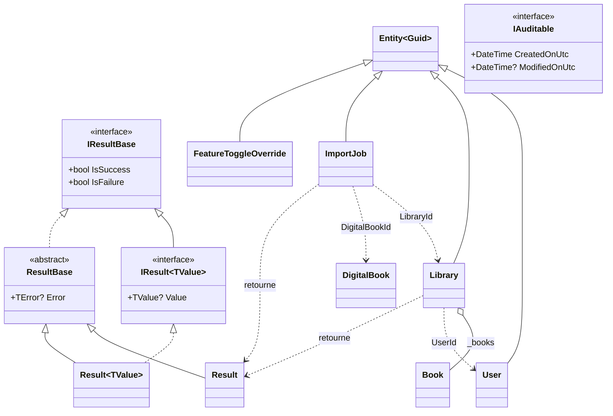
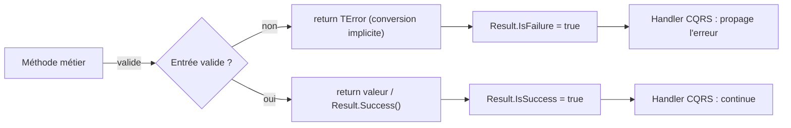
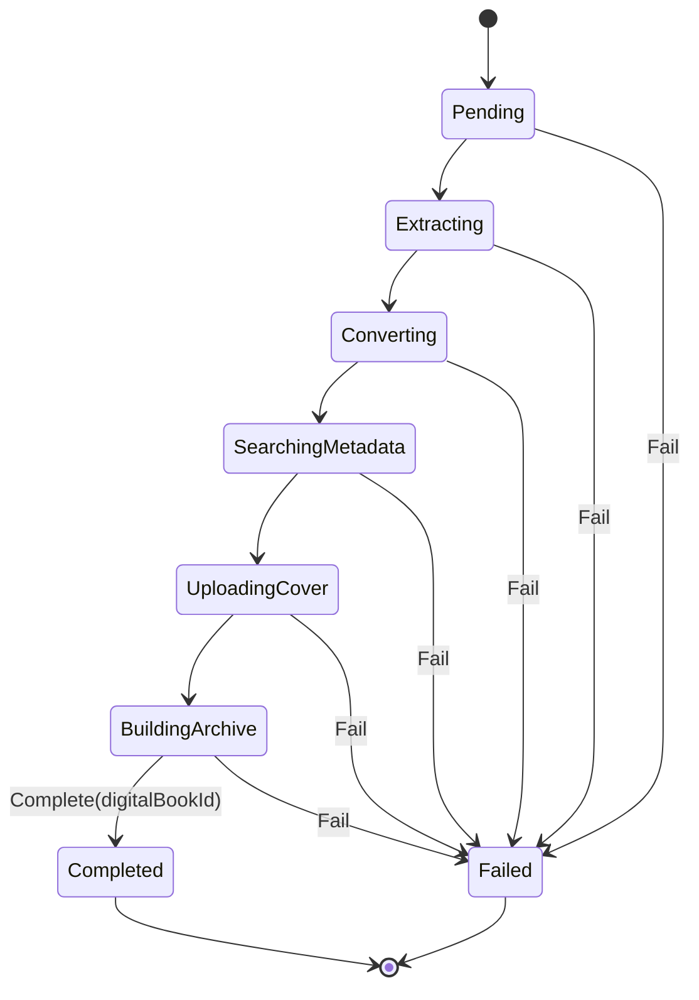
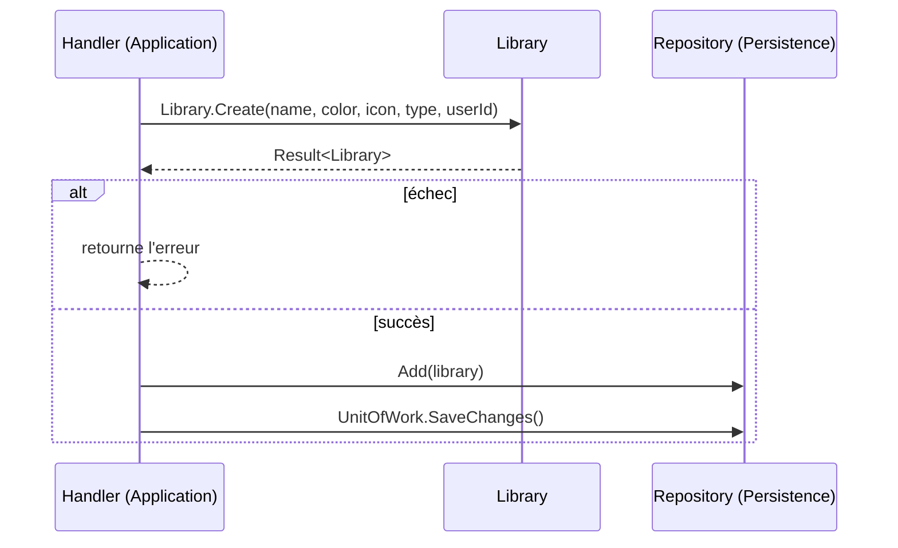

# Noyau du domaine (Domain_Core)

Le module `Domain_Core` regroupe les briques fondamentales de la couche `Domain` : le motif `Result` (gestion des erreurs sans exception), l'interface d'audit `IAuditable`, ainsi que les entités transverses `User`, `Library`, `ImportJob` et `FeatureToggleOverride`. Il ne dépend d'aucune autre couche (règle imposée par `Architecture.Tests`).

Les entités liées aux livres et aux imports de flux sont documentées dans [Domain_Books](Domain_Books.md) et [Domain_FeedImports](Domain_FeedImports.md). Vue d'ensemble : [Domain_Model](../Domain_Model.md).

## Composants

| Composant | Fichier | Rôle |
|---|---|---|
| `Result`, `Result<TValue>` | `Domain/Primitives/Result.cs` | Résultat d'une opération : succès (avec valeur) ou échec (avec `TError`) |
| `IResultBase`, `IResult<TValue>`, `ResultBase` | `Domain/Primitives/ResultBase.cs` | Contrats et classe de base portant `IsSuccess`, `IsFailure`, `Error` |
| `IAuditable` | `Domain/Interfaces/IAuditable.cs` | Contrat d'horodatage (`CreatedOnUtc`, `ModifiedOnUtc`) |
| `User` | `Domain/Users/User.cs` | Utilisateur lié à un identifiant d'authentification (Auth0) |
| `Library` | `Domain/Libraries/Library.cs` | Bibliothèque (physique ou numérique) contenant des livres |
| `ImportJob` | `Domain/ImportJobs/ImportJob.cs` | Machine à états d'un import de fichier |
| `FeatureToggleOverride` | `Domain/Settings/FeatureToggleOverride.cs` | Valeur de feature toggle choisie dans l'interface, qui remplace la configuration |

## Architecture

`Entity<Guid>` (classe de base du domaine, définie dans `Domain/Primitives`) fournit l'identité et les champs d'audit ; `FeatureToggleOverride` renseigne `CreatedOnUtc`, ce qui indique que l'audit est porté par cette base. Les identifiants sont des GUID version 7 (`Guid.CreateVersion7()`), triables chronologiquement.

## Le motif Result

`Result` et `Result<TValue>` remplacent les exceptions pour les cas d'erreur connus. Les constructeurs sont privés : on passe par `Success(...)` / `Failure(error)`. Des conversions implicites permettent d'écrire directement `return LibrariesError.BadRequest;` ou `return library;` dans une méthode retournant `Result<Library>`.

Ces résultats sont consommés par les handlers décrits dans [Application_Contracts___CQRS_Foundation](../Application_Contracts___CQRS_Foundation.md) et [Book___Library_Use_Cases](../Book___Library_Use_Cases.md).

## Entités

### User
Créé via `User.Create(email, authId)` ; `Update(email, authId)` met à jour les deux champs. `AuthId` relie l'utilisateur au fournisseur d'identité.

### Library
- Propriétés : `Name`, `Color`, `Icon`, `BookType` (`Physical`/`Digital`), `UserId`, `DefaultBookSortOrder` (défaut `IdDesc`).
- Propriétés dérivées : `RelativePath` (nom sans diacritiques en majuscules) et `ImportDirectoryName` (`{RelativePath}_{Id}`) servent à nommer les répertoires de stockage.
- `Create` valide le type de livre, la longueur et la non-vacuité du nom, de la couleur et de l'icône (bornes dans `LibraryConstants`), et que `userId` n'est pas vide ; sinon `LibrariesError.BadRequest`.
- `Update`, `UpdateName`, `UpdateDefaultBookSortOrder` appliquent les mêmes validations.
- `CanContain(Book)` garantit la cohérence : une bibliothèque physique n'accepte que des `PhysicalBook`, une numérique que des `DigitalBook` (sinon `LibrariesError.BookTypeMismatch`). Voir [Domain_Books](Domain_Books.md).
- La collection `Books` est exposée en lecture seule.

### ImportJob
Représente le suivi d'un import de fichier. Les statuts suivent une séquence stricte :

- `Create` refuse un nom/chemin vide, une taille ≤ 0 ou une bibliothèque vide (`ImportJobError.BadRequest`).
- `Advance` n'autorise que l'étape immédiatement suivante (`InvalidStatusTransition` sinon) et refuse tout changement depuis un état terminal (`AlreadyCompleted`, `AlreadyFailed`).
- `Fail(step, message)` enregistre `ErrorStep` et `ErrorMessage`.
- `Complete` n'est possible que depuis `BuildingArchive` ; il associe le `DigitalBookId` et fixe `CompletedAt`.
- `UpdateConversionProgress` suit `ConvertedImagesCount` / `TotalImagesToConvert`.

Le traitement est orchestré dans [File_Import_Pipeline](../File_Import_Pipeline.md).

### FeatureToggleOverride
Entité scellée associant un `FeatureToggle` à un booléen `Enabled`. Elle remplace la valeur issue de la configuration (appsettings / variables d'environnement) tant qu'elle n'est pas supprimée. `Create` génère l'identifiant et la date de création, `Set(enabled)` modifie la valeur. Voir [Settings_Statistics_Users_Application](../Book___Library_Use_Cases/Settings_Statistics_Users_Application.md).

## Flux d'utilisation typique

Les entités sont persistées par [Data_Persistence___Queries](../Data_Persistence___Queries.md) sans que les types EF Core ne remontent dans le domaine (constructeurs protégés/privés réservés au mapping).
