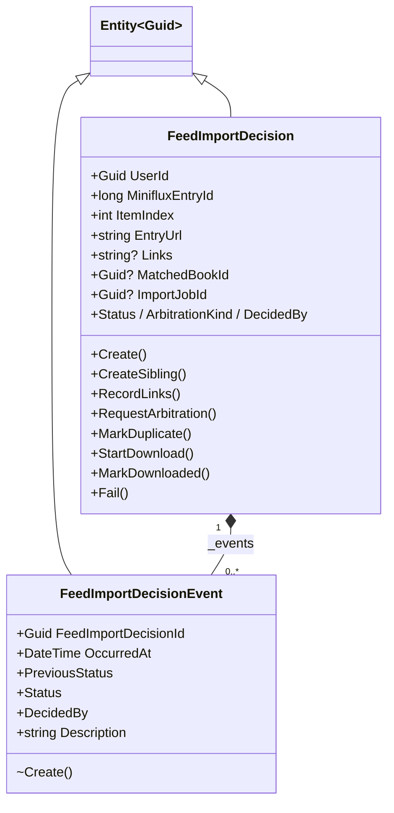
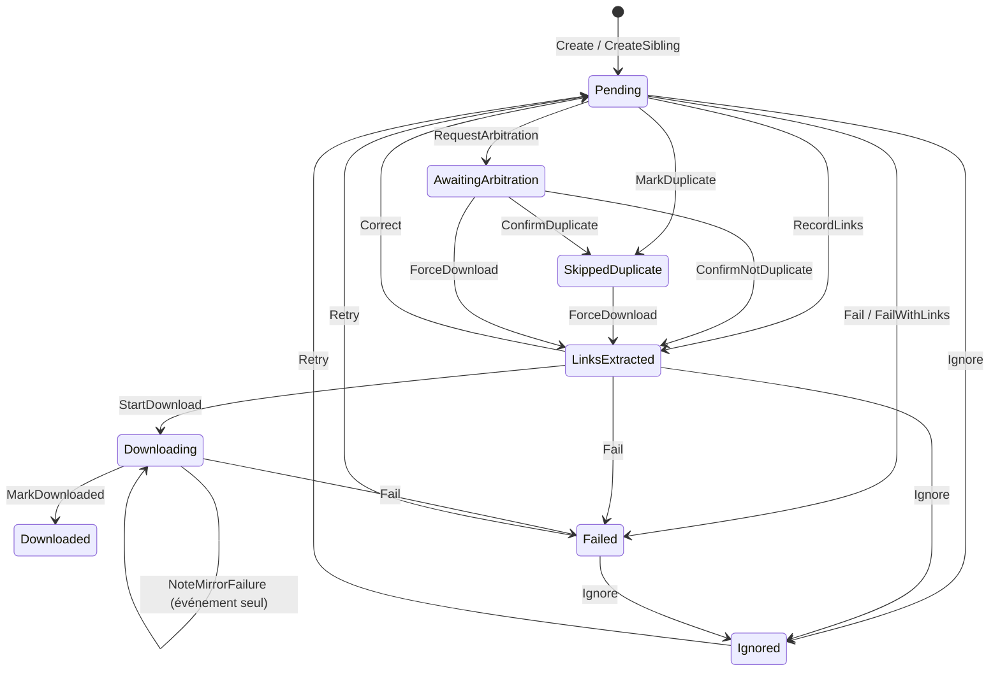
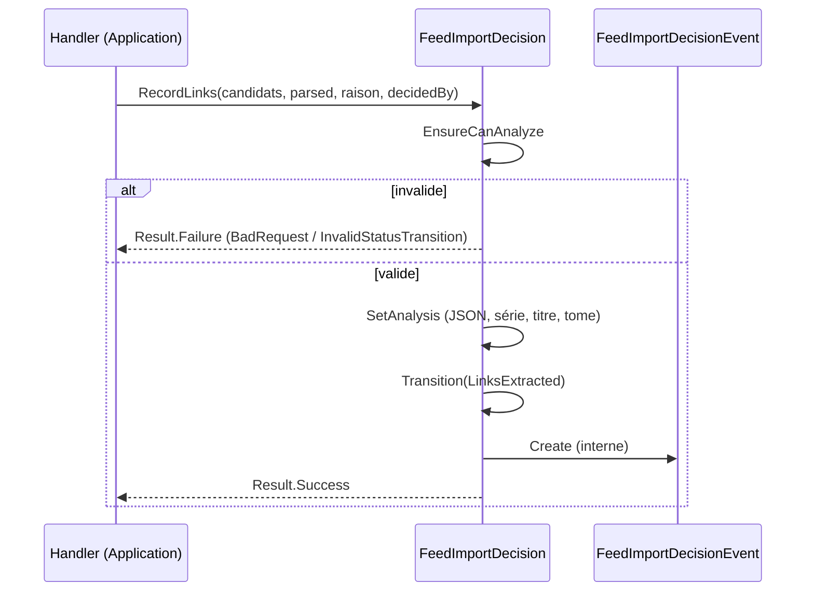
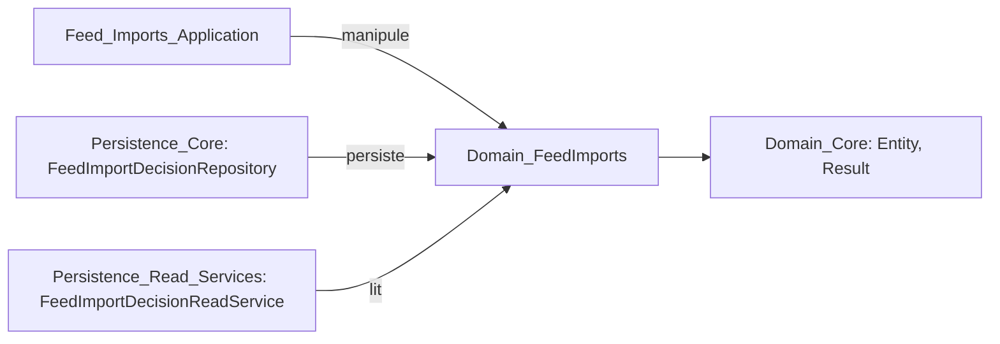

# Domain_FeedImports : décisions d'import de flux

Ce module regroupe la partie du domaine qui modélise l'import automatique de bandes dessinées depuis un flux Miniflux. Il contient deux entités :

- `FeedImportDecision` : agrégat racine, il représente la décision prise pour **un livre** trouvé dans un article de flux. Il porte une machine à états (`FeedImportDecisionStatus`) et les règles de transition.
- `FeedImportDecisionEvent` : entité enfant, un historique immuable (append-only) de chaque changement d'état.

Le module appartient à [Domain_Model](../Domain_Model.md) et n'a aucune dépendance externe, conformément aux règles de la Clean Architecture. Il s'appuie sur `Entity<Guid>` et `Result` de [Domain_Core](Domain_Core.md). Les types `FeedImportDecisionStatus`, `FeedImportArbitrationKind`, `FeedImportDecidedBy`, `FeedImportError`, `FeedImportConstants`, `DownloadCandidate` et `ParsedComicTitle` sont référencés, mais définis dans d'autres fichiers du namespace `Domain.FeedImports`.

## Architecture

Points de conception :

- **Constructeurs protégés, setters privés** : l'état n'est modifiable que par les méthodes métier ; les constructeurs protégés servent à EF Core.
- **Fabrique `internal`** : `FeedImportDecisionEvent.Create` n'est appelable que depuis l'agrégat, ce qui garantit qu'aucun événement n'est créé hors d'une transition.
- **Identifiants `Guid.CreateVersion7()`** : triables chronologiquement.
- **`Result` plutôt qu'exceptions** : les erreurs connues sont `FeedImportError.BadRequest` et `FeedImportError.InvalidStatusTransition`.
- **Liens en JSON** : `Links` stocke en `string` la liste sérialisée de `DownloadCandidate` (options `JsonSerializerDefaults.Web`). `GetCandidates()` la désérialise et renvoie une liste vide si le JSON est invalide ou absent.
- **Troncature défensive** : les textes (titre, raison, erreur, miroir…) sont tronqués selon `FeedImportConstants` au lieu d'être rejetés.

## Cycle de vie : machine à états

Les états finaux (`SkippedDuplicate`, `Downloaded`, `Imported`, `Ignored`, `Failed`) interdisent `Fail`. `Downloaded` est final pour ce module : la suite de l'import (voir `ImportJob` dans [Domain_Core](Domain_Core.md)) est suivie par `ImportJobId`.

## Responsabilités par groupe de méthodes

| Groupe | Méthodes | Rôle |
|---|---|---|
| Création | `Create`, `CreateSibling` | `Create` valide l'utilisateur, l'identifiant d'entrée Miniflux et l'URL (absolue, http/https, longueur max). `CreateSibling` (réservé à l'élément d'index 0, en `Pending`) crée une décision par livre supplémentaire d'un même article, avec le même `CreatedAt`. |
| Analyse | `RecordLinks`, `RequestArbitration`, `MarkDuplicate`, `FailWithLinks` | Chacune passe par `EnsureCanAnalyze` (candidats non vides, miroirs présents, statut `Pending` ou `AwaitingArbitration`) puis `SetAnalysis` (liens JSON, série, titre, tome). |
| Arbitrage | `ConfirmDuplicate`, `ConfirmNotDuplicate` | Résolution utilisateur d'un doublon probable (`ArbitrationKind.ProbableDuplicate`). |
| Téléchargement | `StartDownload`, `NoteMirrorFailure`, `MarkDownloaded` | Suivi du téléchargement via Debrid-Link ; un échec de miroir est tracé sans changer le statut. |
| Actions manuelles | `Ignore`, `ForceDownload`, `Retry`, `Correct` | Gardées par `CanIgnore`, `CanForceDownload`, `CanRetry`, `CanCorrect`. `Retry` et `Correct` repassent par `Reopen` (retour à `Pending`, efface erreur et correspondance). |
| Échec | `Fail` | Enregistre `ErrorStep` et `ErrorMessage` (tronqués). |
| Gardes d'UI | `CanDelete`, `CanRetry(utcNow)` | Un téléchargement n'est « en cours » que s'il a été mis à jour depuis moins de `FeedImportConstants.StaleDownloadDelay` ; au-delà il est considéré comme interrompu. |

Toute transition passe par la méthode privée `Transition`, qui met à jour `Status`, `Reason`, `DecidedBy`, `UpdatedAt` et ajoute un `FeedImportDecisionEvent`.

## Flux d'une transition

## Intégration dans le système

- Les handlers CQRS (analyse, arbitrage, téléchargement, correction, suppression, synchronisation) sont décrits dans [Feed_Imports_Application](../Feed_Import_Pipeline/Feed_Imports_Application.md) ; l'extraction des liens dans [Feed_Link_Extraction](../Feed_Import_Pipeline/Feed_Link_Extraction.md).
- La persistance est couverte par [Persistence_Core](../Data_Persistence___Queries/Persistence_Core.md) et [Persistence_Read_Services](../Data_Persistence___Queries/Persistence_Read_Services.md).
- L'affichage et les actions utilisateur se trouvent dans [Web_Admin_And_Other_Pages](../Blazor_UI_Layer/Web_Admin_And_Other_Pages.md) (`FeedImportsPage`).

## Remarques pour les mainteneurs

- Respecter la règle des handlers : valider via l'agrégat **avant** tout effet de bord sur le système de fichiers.
- Ajouter une transition = ajouter une méthode qui appelle `Transition` ; ne jamais modifier `Status` directement.
- Les pages de listes paginées doivent trier de façon déterministe (par exemple par `CreatedAt` puis `ItemIndex`, puis `Id`).
- Le suppresseur `CA1054/CA1056` est volontaire : l'URL est stockée en `string` en base.
