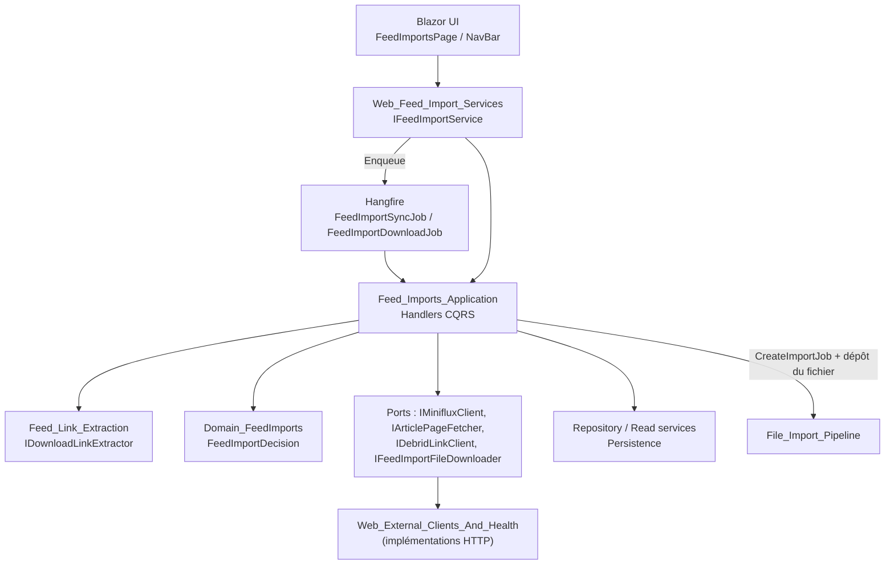
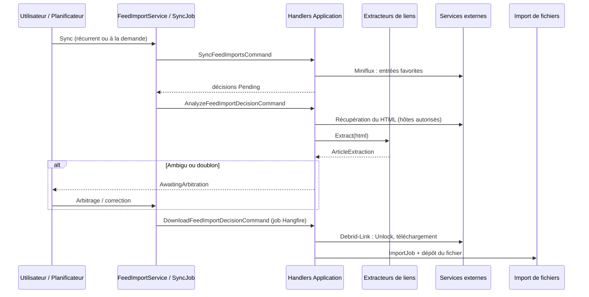

# Pipeline d'import de flux (Feed_Import_Pipeline)

## Objectif

Le module **Feed_Import_Pipeline** automatise l'import de bandes dessinées à partir d'un flux RSS (Miniflux). Il suit le cycle suivant :

1. Les articles marqués en favoris dans Miniflux sont synchronisés. Chacun devient une `FeedImportDecision`.
2. La page de l'article est analysée pour en extraire les liens de téléchargement et détecter les doublons.
3. Les cas ambigus (doublon possible, liens multiples) passent par un arbitrage de l'utilisateur.
4. Le fichier est débridé via Debrid-Link puis téléchargé.
5. Le fichier est déposé dans le répertoire d'import d'une bibliothèque numérique, où un `ImportJob` prend le relais (voir `Import_Jobs_Application` dans le pipeline d'import de fichiers).

Le module se répartit sur trois couches de la Clean Architecture :

| Sous-module | Couche | Rôle |
|---|---|---|
| [Feed_Link_Extraction](Feed_Import_Pipeline/Feed_Link_Extraction.md) | Application (`Application/FeedImports/Analysis`) | Extraction pure, sans entrée/sortie, des liens de téléchargement depuis le HTML d'un article (extracteur générique et extracteurs DataLife Engine spécifiques à un site). |
| [Feed_Imports_Application](Feed_Import_Pipeline/Feed_Imports_Application.md) | Application (`Application/FeedImports`) | Handlers CQRS (sync, analyse, arbitrage, téléchargement, gestion, suppression, requête paginée), options de configuration et ports vers les services externes. |
| [Web_Feed_Import_Services](Feed_Import_Pipeline/Web_Feed_Import_Services.md) | Web (`Web/Services`) | Façade `IFeedImportService` pour l'UI Blazor, jobs Hangfire (`FeedImportSyncJob`, `FeedImportDownloadJob`) et `FeedImportNotifier`. |

## Architecture d'ensemble

L'application respecte les règles de couches. Les handlers ne dépendent que d'interfaces. Les clients HTTP (Miniflux, Debrid-Link, récupération de page, téléchargement) sont implémentés dans la couche Web. La persistance passe par `IFeedImportDecisionRepository` et `IFeedImportDecisionReadService`.

## Flux de bout en bout

## Points d'architecture clés

- **Cycle de vie par décision.** Les statuts sont `Pending`, `LinksExtracted`, `AwaitingArbitration`, `SkippedDuplicate`, `Downloading`, `Downloaded` et `Failed`. Les transitions sont portées par l'agrégat de domaine.
- **Séparation des responsabilités.** Le module Web orchestre sans logique métier. Il résout l'utilisateur, appelle les handlers et planifie les jobs. L'Application porte les règles. L'extraction de liens reste pure et testable.
- **Robustesse des effets de bord.** Les validations de domaine précèdent tout effet sur le système de fichiers. L'`ImportJob` est créé avant le dépôt du fichier pour éviter un doublon avec le `FileWatcher`. Les échecs sont enregistrés sur la décision.
- **Sécurité.** Des listes blanches d'hôtes (`AllowedSourceHosts`, `AllowedDownloadHosts`) s'appliquent, HTTPS est imposé et les données sont isolées par utilisateur.
- **Exécution d'arrière-plan.** Hangfire fournit une synchro récurrente sans exécution concurrente et un job de téléchargement par décision. Chaque unité de travail utilise son propre scope d'injection de dépendances.
- **Extensibilité.** Un nouveau site se gère en ajoutant un `IDownloadLinkExtractor`. L'extracteur générique sert de repli.

## Documentation des composants

- [Feed_Link_Extraction](Feed_Import_Pipeline/Feed_Link_Extraction.md) : extracteurs, sélection et ajout d'un site.
- [Feed_Imports_Application](Feed_Import_Pipeline/Feed_Imports_Application.md) : handlers, cycle de vie, configuration et ports.
- [Web_Feed_Import_Services](Feed_Import_Pipeline/Web_Feed_Import_Services.md) : façade UI, jobs Hangfire et notifications.