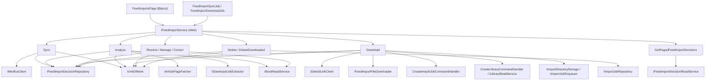
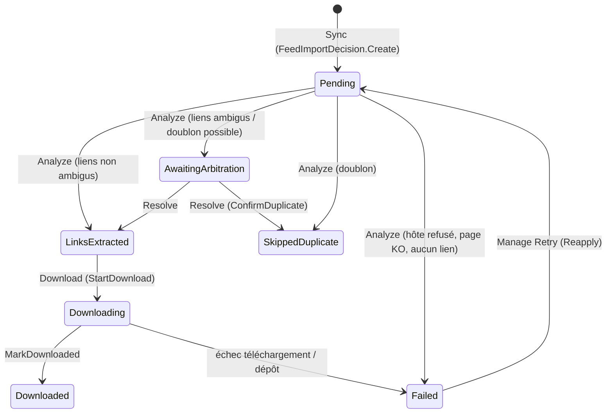
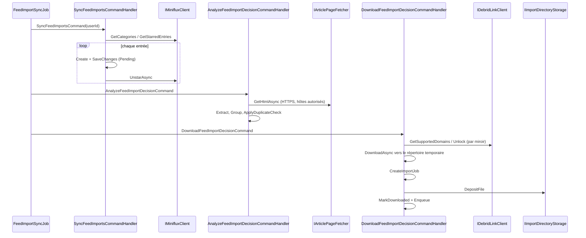
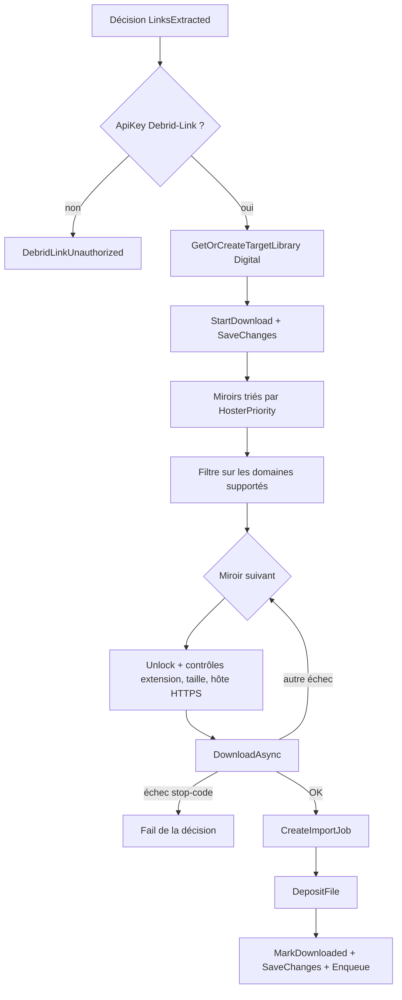

# Feed Imports – Couche Application

Ce module regroupe les **cas d'usage CQRS** et les **contrats d'infrastructure** de l'import automatique de BD depuis un flux RSS (Miniflux). Il orchestre le cycle de vie d'une `FeedImportDecision` : synchronisation des articles favoris, analyse de la page, arbitrage, téléchargement via Debrid-Link, puis dépôt du fichier dans le répertoire d'import d'une bibliothèque numérique.

Il se situe dans la couche `Application` (dépend uniquement du [Domain](../Domain_Model/Domain_FeedImports.md)) ; les implémentations concrètes des clients HTTP sont dans [Web_External_Clients_And_Health](../Web_Platform,_Security___External_Integrations/Web_External_Clients_And_Health.md) et l'exécution planifiée dans [Web_Feed_Import_Services](Web_Feed_Import_Services.md). L'extraction des liens est détaillée dans [Feed_Link_Extraction](Feed_Link_Extraction.md).

## Composants

| Catégorie | Composant | Rôle |
|---|---|---|
| Commande | `SyncFeedImportsCommandHandler` | Lit les entrées favorites Miniflux et crée les décisions |
| Commande | `AnalyzeFeedImportDecisionCommandHandler` | Récupère la page, extrait/groupe les liens, vérifie les doublons |
| Commande | `ResolveFeedImportArbitrationCommandHandler` | Résout un arbitrage (doublon ou liens ambigus) |
| Commande | `DownloadFeedImportDecisionCommandHandler` | Débride, télécharge, dépose le fichier et crée l'`ImportJob` |
| Commande | `ManageFeedImportDecisionCommandHandler` | Actions utilisateur : `ForceDownload`, `Ignore`, `Retry` |
| Commande | `CorrectFeedImportDecisionCommandHandler` | Correction manuelle série/titre/tome puis ré-analyse |
| Commande | `DeleteFeedImportDecisionCommandHandler` | Suppression d'une décision |
| Commande | `DeleteDownloadedFeedImportDecisionsCommandHandler` | Purge des décisions `Downloaded` dont l'import a réussi |
| Requête | `GetPagedFeedImportDecisionsQueryHandler` | Liste paginée filtrable |
| Configuration | `FeedImportSettings`, `MinifluxSettings`, `DebridLinkSettings` | Options liées via `IOptions<T>` |
| Port | `IMinifluxClient`, `IArticlePageFetcher`, `IDebridLinkClient`, `IFeedImportFileDownloader` | Abstractions vers les services externes |

## Architecture

Les handlers n'utilisent que des interfaces ([Application_Interfaces](../Application_Contracts___CQRS_Foundation/Application_Interfaces.md)) ; les implémentations proviennent de [Persistence_Core](../Data_Persistence___Queries/Persistence_Core.md), [Persistence_Read_Services](../Data_Persistence___Queries/Persistence_Read_Services.md) et de la couche Web. Les abstractions `ICommand`/`IQuery` sont décrites dans [Messaging_Abstractions](../Application_Contracts___CQRS_Foundation/Messaging_Abstractions.md).

## Cycle de vie d'une décision

Vue simplifiée des statuts visibles dans le code des handlers (les transitions exactes sont portées par l'agrégat, voir [Domain_FeedImports](../Domain_Model/Domain_FeedImports.md) ; les handlers renvoient `FeedImportError.InvalidStatusTransition` en cas de transition interdite) :

`Manage` permet aussi `ForceDownload` et `Ignore` ; `Correct` modifie le titre analysé puis rejoue les règles d'analyse.

## Flux principal

## Détail des handlers

### Synchronisation (`SyncFeedImportsCommandHandler`)
- Valide `UserId` et `MinifluxSettings.CategoryName`, retrouve la catégorie (insensible à la casse), puis liste les entrées favorites.
- Pour chaque entrée (`ProcessEntryAsync`) : recherche par `MinifluxEntryId` ; si absente, crée et **persiste** la décision avant de retirer l'étoile. Si le « unstar » échoue, la prochaine synchronisation retrouve l'entrée connue et ne retente que le « unstar » (idempotence).
- Une entrée rejetée (URL invalide, échec de sauvegarde) reste favorite pour être reprise ; la décision non sauvée est détachée pour ne pas polluer le `SaveChanges` suivant.
- Retourne un `SyncFeedImportsResult` (total, créées, déjà connues, rejetées, échecs de « unstar »).

### Analyse (`AnalyzeFeedImportDecisionCommandHandler`)
Ne télécharge jamais rien. Ignore silencieusement les décisions non `Pending` ou dont `ItemIndex != 0` (les livres frères sont traités avec l'article d'origine).

1. Contrôle de l'hôte source contre `FeedImportSettings.AllowedSourceHosts` (étape `Source`).
2. Passage forcé en HTTPS puis récupération du HTML (étape `Page fetch`).
3. Choix de l'extracteur : premier `IDownloadLinkExtractor` non-fallback acceptant l'URI, sinon le fallback (voir [Feed_Link_Extraction](Feed_Link_Extraction.md)).
4. Les liens vers des hôtes non autorisés alimentent `GroupUnsupportedLinks` ; sans aucun lien, la décision passe `Failed` (étape `Link extraction`).
5. `DownloadLinkGrouper.Group` produit des candidats (un par livre). Si le groupement est ambigu, une seule décision passe en `AwaitingArbitration` (`AmbiguousLinks`). Sinon `CreateSibling(i)` crée une décision par livre supplémentaire.
6. `FeedImportAnalysisRules.ParseCandidate` et `ApplyDuplicateCheck` comparent aux livres de l'utilisateur (`IBookReadService.ListIdentitiesByUserAsync`). L'ISBN de la page n'est utilisé que si l'article ne contient qu'un seul livre.
7. Les fichiers uniquement offerts sur des hôtes non supportés deviennent des décisions `Failed` conservant leurs liens (`FailWithLinks`) pour un téléchargement manuel.

### Arbitrage (`ResolveFeedImportArbitrationCommandHandler`)
Actions `NotDuplicate` et `ConfirmDuplicate` (arbitrage de doublon), ou résolution de liens ambigus : `KeepCandidate` (index validé) ou fusion de tous les miroirs (`DistinctBy` sur l'URL). Le résultat repasse par `ApplyDuplicateCheck` avec `DecidedBy.User`. La propriété est vérifiée via `decision.UserId`.

### Téléchargement (`DownloadFeedImportDecisionCommandHandler`)

Points notables :
- **Ordre des effets de bord** : l'`ImportJob` est créé *avant* le dépôt du fichier, pour que le `FileWatcher` trouve un job actif sur ce chemin et n'en crée pas un second (voir [Import_Jobs_Application](../File_Import_Pipeline/Import_Jobs_Application.md)). En cas d'échec, le fichier temporaire est supprimé (`Discard`).
- **Codes d'arrêt** (`s_stopCodes`) : `DebridLinkUnauthorized`, `DebridLinkQuotaReached`, `FileTooLarge`, `UnsupportedFileType` – essayer un autre miroir ne ferait que consommer le quota.
- La bibliothèque cible (`TargetLibraryName`, par défaut « À trier ») est créée si besoin via `CreateLibraryCommandHandler` (type `Digital`) ; voir [Libraries_Application](../Book___Library_Use_Cases/Libraries_Application.md).
- Les échecs sont **enregistrés sur la décision** (`FailAsync`) : la commande elle-même renvoie `Success`.
- Les dépendances sont regroupées en objets de services (`FeedImportDownloadServices`, `FeedImportDepositServices`, `FeedImportDownloadOptions`) pour limiter la taille du constructeur.

### Gestion (`Manage`, `Correct`)
- `ManageFeedImportDecisionCommandHandler` : `ForceDownload`, `Ignore` ou `Retry` (qui rejoue `FeedImportAnalysisRules.Reapply`). Retourne le nouveau `FeedImportDecisionStatus`.
- `CorrectFeedImportDecisionCommandHandler` : valide série (non vide, longueur max), titre et tome (≥ 0), applique `decision.Correct(ParsedComicTitle)` puis `Reapply` pour refaire le contrôle de doublon.

### Suppression
- `DeleteFeedImportDecisionCommandHandler` : refuse (`DeleteInProgress`) si `CanDelete` est faux ou si l'`ImportJob` associé n'est ni `Completed` ni `Failed` ; un job supprimé ne bloque plus. Le livre importé n'est jamais touché ; les événements partent en cascade.
- `DeleteDownloadedFeedImportDecisionsCommandHandler` : supprime les décisions `Downloaded` dont l'import est `Completed` ou dont le job a disparu ; conserve celles dont l'import est en cours ou en échec. Retourne (supprimées, conservées).

### Requête (`GetPagedFeedImportDecisionsQueryHandler`)
Valide `UserId`, `Page ≥ 1`, `PageSize` dans `[1, 100]` (`MaxPageSize`) et le statut, puis appelle `IFeedImportDecisionReadService.GetPagedAsync` et `GetMultiBookEntryIdsAsync` pour repérer les articles multi-livres. Renvoie un `FeedImportDecisionPage`.

## Configuration

| Classe | Propriétés clés |
|---|---|
| `FeedImportSettings` | `Enabled`, `SyncIntervalMinutes` (30), `UserEmail`, `TargetLibraryName`, `AllowedSourceHosts`, `AllowedDownloadHosts` |
| `MinifluxSettings` | `BaseUrl`, `ApiKey`, `CategoryName` (« BD ») |
| `DebridLinkSettings` | `BaseUrl`, `ApiKey` (vide = téléchargements désactivés), `HosterPriority`, `DownloadHosts` |

## Ports vers l'infrastructure

| Interface | Responsabilité | Implémentation |
|---|---|---|
| `IMinifluxClient` | Catégories, entrées favorites, « unstar » (vérifie l'état avant de basculer) | `MinifluxClient` |
| `IArticlePageFetcher` | HTML d'une page, limité aux `AllowedSourceHosts` | `ArticlePageFetcher` |
| `IDebridLinkClient` | Domaines supportés, état du compte, déblocage d'un lien | `DebridLinkClient` |
| `IFeedImportFileDownloader` | Streaming vers `Import:TempDirectory` avec limite de taille, `Discard` | `FeedImportFileDownloader` |

Les implémentations sont documentées dans [Web_External_Clients_And_Health](../Web_Platform,_Security___External_Integrations/Web_External_Clients_And_Health.md).

## Conventions transverses

- **Result pattern** : les handlers renvoient `Result`/`Result<T>` avec des `FeedImportError` (`BadRequest`, `NotFound`, `InvalidStatusTransition`…), sans exception pour les erreurs connues.
- **Validation d'entrée en tête de `Handle`** (GUID vides, énumérations non définies, bornes de pagination) avant tout appel au dépôt.
- **Isolation par utilisateur** : les commandes de gestion comparent `decision.UserId` à `command.UserId` et renvoient `NotFound` sinon.
- **Sécurité** : listes blanches d'hôtes source et de téléchargement, HTTPS imposé pour les pages et les URL débridées.
- **Persistance** : `IUnitOfWork.SaveChangesAsync` n'est appelé qu'après la réussite des validations du domaine.
