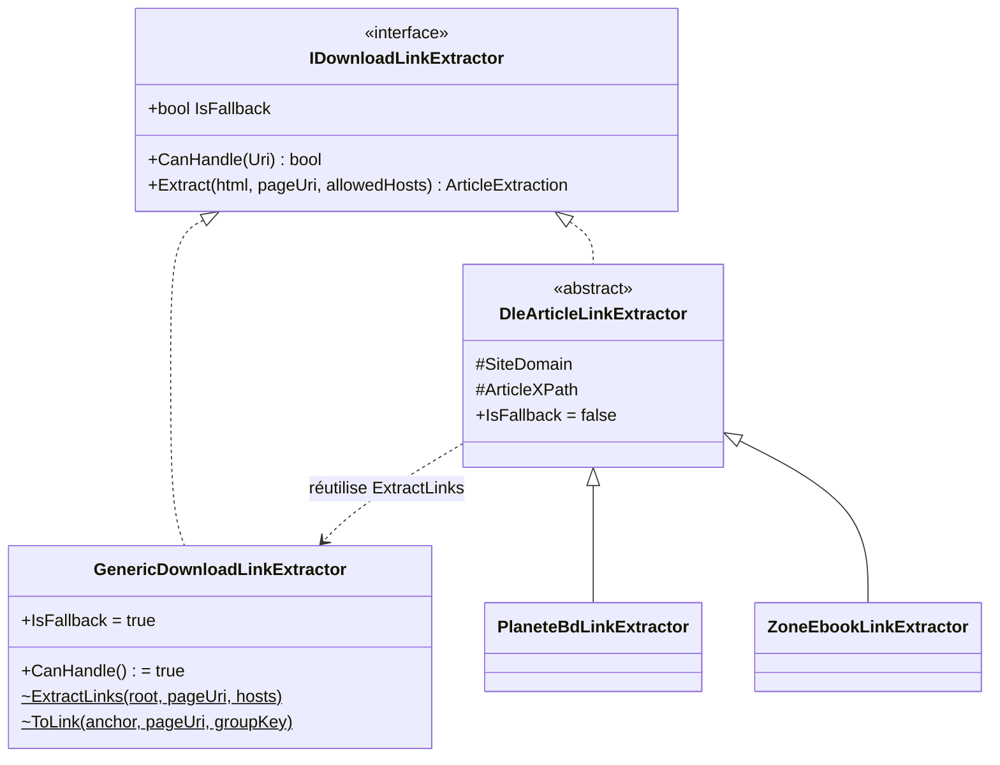
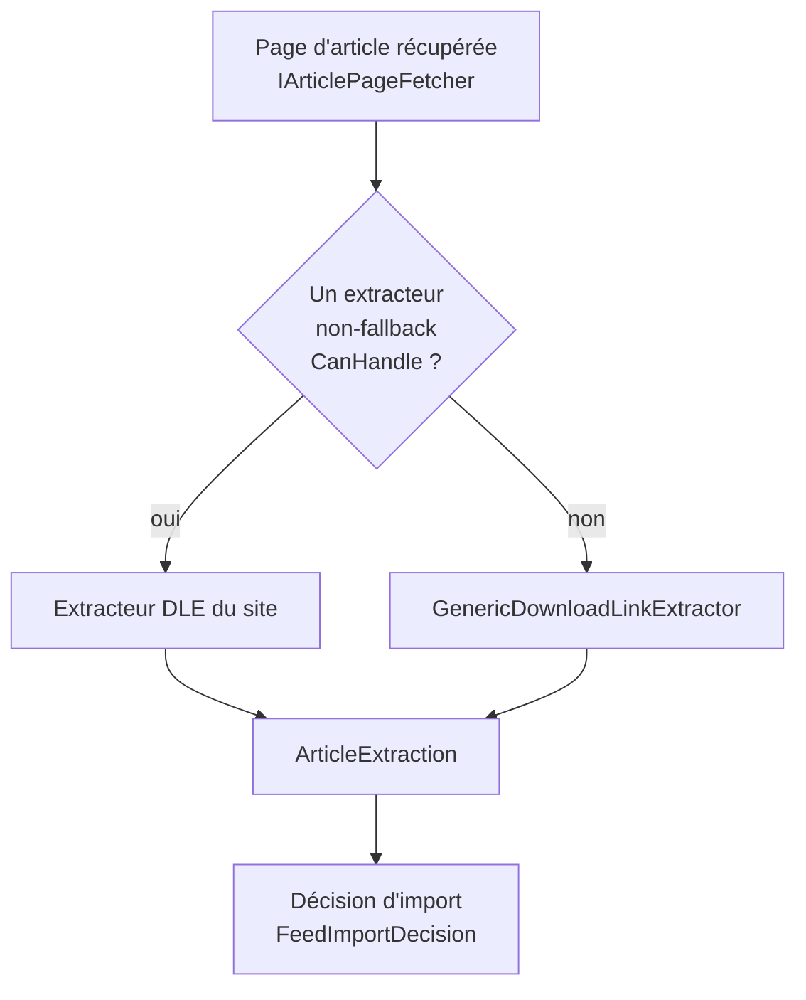
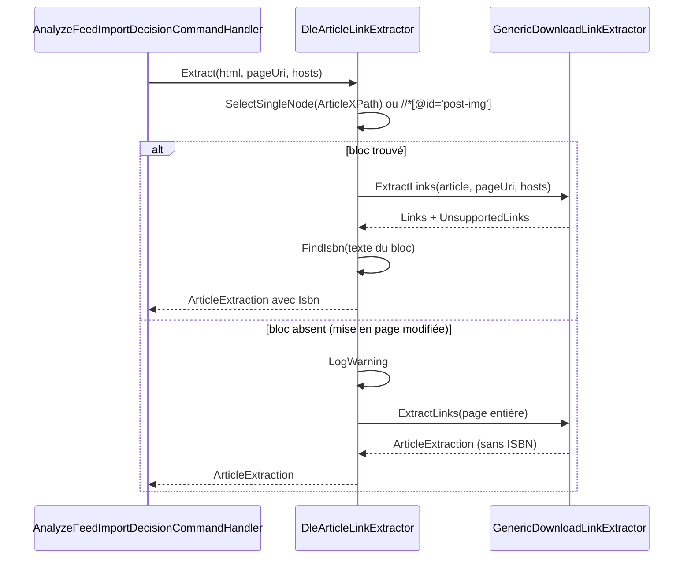

# Extraction des liens de téléchargement (Feed_Link_Extraction)

## Introduction

Le module **Feed_Link_Extraction** analyse le HTML d'une page d'article issue d'un flux RSS (via Miniflux) et en extrait les liens de téléchargement de fichiers (CBZ, PDF…). Il vit dans `Application/FeedImports/Analysis/` et ne fait aucune entrée/sortie : il reçoit du HTML déjà récupéré et renvoie un `ArticleExtraction`. Le parsing n'exécute jamais le contenu de la page (HtmlAgilityPack uniquement).

Il appartient au pipeline décrit dans [Feed_Import_Pipeline](../Feed_Import_Pipeline.md) et est consommé par `AnalyzeFeedImportDecisionCommandHandler` (voir [Feed_Imports_Application](Feed_Imports_Application.md)).

## Composants

| Composant | Rôle |
|---|---|
| `IDownloadLinkExtractor` | Contrat : `IsFallback`, `CanHandle(Uri)`, `Extract(html, pageUri, allowedDownloadHosts)` |
| `GenericDownloadLinkExtractor` | Extracteur de repli : tous les `<a href>` vers un hébergeur autorisé, dans l'ordre de la page |
| `DleArticleLinkExtractor` (classe abstraite, hors composants cœur) | Base commune des sites DataLife Engine : ne lit que le bloc d'article, extrait aussi l'ISBN |
| `PlaneteBdLinkExtractor` | Site `planete-bd.org`, bloc `div.post-content` |
| `ZoneEbookLinkExtractor` | Site `zone-ebook.com`, bloc `div.maincont` |

Types de données associés (même dossier) : `ArticleExtraction(Links, UnsupportedLinks, Isbn)` et `ExtractedLink(Url, Host, Text, FileName, SizeBytes, GroupKey)`. `LinkMetadataParser` déduit le nom de fichier et la taille depuis le texte de l'ancre.

## Architecture

## Sélection de l'extracteur

L'`AnalyzeFeedImportDecisionCommandHandler` reçoit `IEnumerable<IDownloadLinkExtractor>` (enregistrés dans `ApplicationDependencyInjection.cs`). Un extracteur spécifique dont `CanHandle` est vrai est préféré ; sinon l'extracteur avec `IsFallback = true` (le générique) est utilisé. Pour les sites DLE, `CanHandle` compare l'hôte de la page à `SiteDomain` (domaine exact ou sous-domaine, via `IsSameOrSubdomainOf`).

## Fonctionnement détaillé

### Extracteur générique

1. Retourne `ArticleExtraction.Empty` si le HTML est vide ou si la liste des hôtes autorisés est vide.
2. Charge le HTML et sélectionne `.//a[@href]`.
3. Pour chaque ancre, `ToLink` :
   - déséchappe et nettoie le `href`, le résout par rapport à `pageUri` ; seuls `http`/`https` sont acceptés ;
   - écarte les pages de profil d'hébergeur (premier segment `users`, `user`, `folder`, `folders`, `profile`) ;
   - calcule `FileName` et `SizeBytes` à partir du texte de l'ancre (la taille peut aussi venir du texte du parent).
4. Dédoublonne par URL absolue (comparaison ordinale), en conservant l'ordre du document.
5. Classement :
   - hôte autorisé (sous-domaines inclus) → `Links` ;
   - sinon, si l'ancre nomme un fichier et que l'hôte n'est pas celui de la page → `UnsupportedLinks` (signalés pour téléchargement manuel).

### Extracteurs DataLife Engine

`planete-bd.org` et `zone-ebook.com` partagent la même mise en page : un bloc d'article avec les métadonnées (genre, tomes, parfois l'ISBN) puis, après « Lien(s) de téléchargement », une ancre par fichier du type `File.Name.cbz - 101.5 MB`.

Points clés :
- Restreindre la lecture au bloc d'article évite les liens de la barre latérale, des boutons de partage et des publicités.
- `ClassXPath(element, cssClass)` construit un XPath tolérant aux classes multiples (`contains(concat(' ', normalize-space(@class), ' '), ' cls ')`).
- L'ISBN est détecté par l'expression `ISBN\D{0,12}(…)`, normalisé puis validé avec `IsbnHelper` (`Application.Helpers`) ; un ISBN invalide donne `null`.
- Si le bloc est absent, un avertissement est journalisé via `ILogger` et l'extraction générique sur la page entière sert de filet de sécurité.

## Ajouter un nouveau site

- Site DLE : créer une classe `sealed` dérivant de `DleArticleLinkExtractor`, définir `SiteDomain` et `ArticleXPath` (avec `ClassXPath`), puis l'enregistrer comme `IDownloadLinkExtractor`.
- Autre type de site : implémenter `IDownloadLinkExtractor` avec `IsFallback = false` ; `ExtractedLink.GroupKey` permet d'indiquer les liens appartenant au même livre (par ex. un bloc « Tome 3 »).

## Dépendances

- Appelant : [Feed_Imports_Application](Feed_Imports_Application.md) ; les hôtes autorisés viennent de `FeedImportSettings` (`FeedImport:AllowedDownloadHosts`).
- Récupération HTML : `IArticlePageFetcher`, implémenté dans [Web_External_Clients_And_Health](../Web_Platform,_Security___External_Integrations/Web_External_Clients_And_Health.md).
- Modèle des décisions d'import : [Domain_FeedImports](../Domain_Model/Domain_FeedImports.md).
- Bibliothèques : HtmlAgilityPack, `Domain.Extensions` (`IsSameOrSubdomainOf`), `Application.Helpers.IsbnHelper`.
