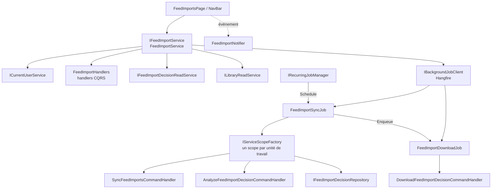
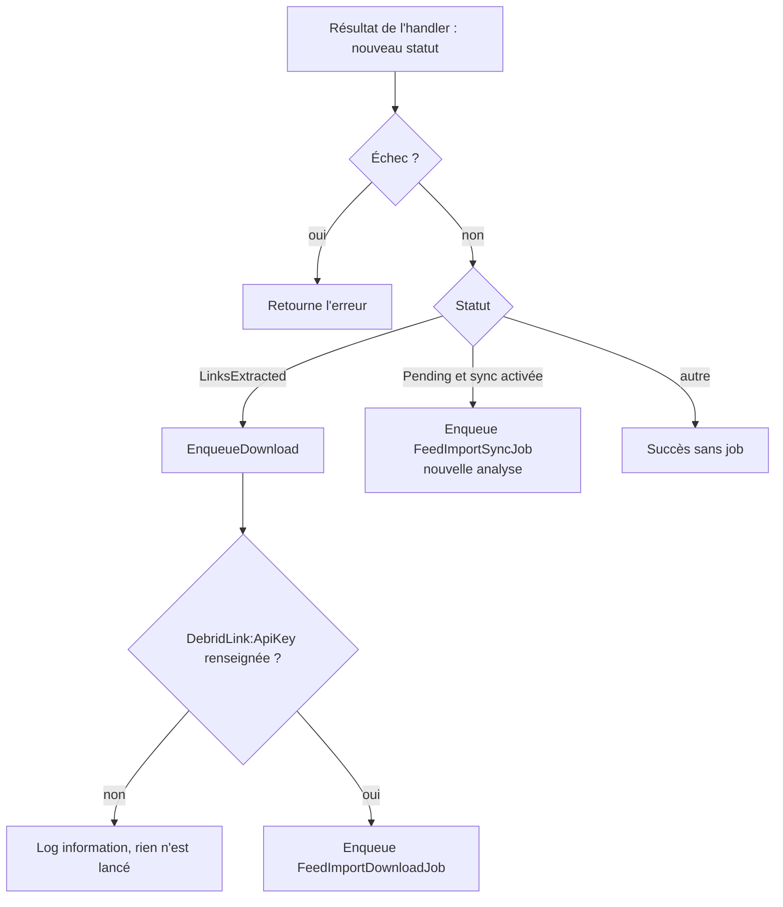
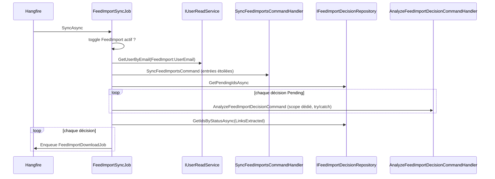
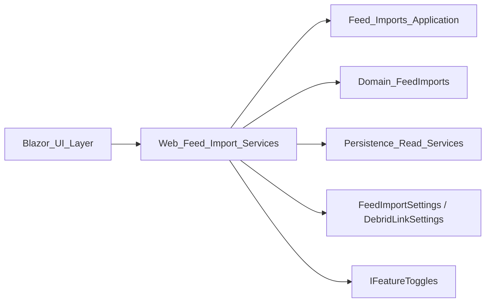

# Services Web d'import de flux (Web_Feed_Import_Services)

## Introduction

Le module `Web_Feed_Import_Services` est la couche d'orchestration côté `Web/Services` du pipeline d'import de flux. Il fait le lien entre l'interface Blazor (page des flux, barre de navigation), les gestionnaires CQRS de la couche Application et le moteur de tâches d'arrière-plan **Hangfire**. Il ne contient pas de logique métier : il résout l'utilisateur courant, appelle les handlers, convertit les résultats en view models et déclenche les étapes suivantes (synchronisation, téléchargement) sous forme de jobs.

Composants :

| Composant | Rôle |
|---|---|
| `IFeedImportService` / `FeedImportService` | Façade utilisée par l'UI : liste, arbitrage, actions, correction, suppression, compteurs. |
| `FeedImportSyncJob` | Job Hangfire de synchronisation (récurrent ou à la demande) : Miniflux → analyse → mise en file des téléchargements. |
| `FeedImportDownloadJob` | Job Hangfire unitaire : télécharge une décision. |
| `FeedImportNotifier` | Signal par circuit Blazor pour rafraîchir le badge de navigation. |

Les handlers, entités et clients externes sont documentés dans : [Feed_Imports_Application](Feed_Imports_Application.md), [Feed_Link_Extraction](Feed_Link_Extraction.md), [Domain_FeedImports](../Domain_Model/Domain_FeedImports.md), [Persistence_Read_Services](../Data_Persistence___Queries/Persistence_Read_Services.md), [Web_External_Clients_And_Health](../Web_Platform,_Security___External_Integrations/Web_External_Clients_And_Health.md) et la page UI [Web_Admin_And_Other_Pages](../Blazor_UI_Layer/Web_Admin_And_Other_Pages.md).

## Architecture

## FeedImportService

Implémente `IFeedImportService`. Chaque méthode commence par `ICurrentUserService.GetCurrentUserIdAsync` et renvoie l'erreur telle quelle en cas d'échec (pattern `Result<T>`).

- **`IsSyncEnabled`** : lit le feature toggle `FeatureToggle.FeedImport`.
- **`GetDecisionsAsync`** : interroge `GetPagedFeedImportDecisionsQuery`, puis construit des `FeedImportDecisionViewModel`. Si au moins une décision est `Downloaded`, la bibliothèque cible (`FeedImportSettings.TargetLibraryName`) est recherchée pour permettre le lien vers la page Import filtrée. Les entrées multi-livres (`MultiBookEntryIds`) sont signalées.
- **`TriggerSync`** : renvoie `FeedImportError.Disabled` si le toggle est coupé, sinon met en file `FeedImportSyncJob.SyncAsync`.
- **`ResolveArbitrationAsync`** : exécute `ResolveFeedImportArbitrationCommand` ; en cas de succès, tente de lancer le téléchargement.
- **`ApplyActionAsync` / `CorrectAsync`** : exécutent `ManageFeedImportDecisionCommand` / `CorrectFeedImportDecisionCommand`, puis `StartNextStep` selon le nouveau statut.
- **`DeleteAsync`** : supprime chaque décision séparément ; renvoie le nombre supprimé, ou la dernière erreur si aucune suppression n'a réussi (les échecs sont journalisés en avertissement).
- **`DeleteDownloadedAsync`** : supprime les décisions `Downloaded` dont l'import a réussi.
- **`CountAwaitingArbitrationAsync`** et **`GetStatusCountsAsync`** : compteurs pour le badge de navigation et les filtres de statut ; le badge renvoie 0 si l'utilisateur n'est pas résolu.

### Enchaînement après une action

## FeedImportSyncJob

Job Hangfire annoté `[DisableConcurrentExecution(10 min)]` et `[AutomaticRetry(Attempts = 0)]`. Il ouvre un `IServiceScope` distinct pour chaque unité de travail (donc un `DbContext` propre).

Points notables :

- Le job s'arrête si le toggle est coupé ou si l'utilisateur configuré est introuvable.
- Les décisions restées `Pending` (Miniflux indisponible, crash) sont réanalysées à chaque exécution ; une exception sur une décision est journalisée sans interrompre les autres (sauf annulation).
- Les téléchargements sont ignorés si `DebridLink:ApiKey` est vide. Une décision mise deux fois en file est ignorée une fois sortie de `LinksExtracted`.
- Méthodes statiques de planification : `IsValidInterval` (1–59 minutes, ou multiple de 60 jusqu'à 24 h), `ToCron` (`*/n * * * *` ou `0 */h * * *`) et `Schedule`, qui ajoute/met à jour le job récurrent `feed-import-sync` ou le supprime si la fonction est désactivée.

## FeedImportDownloadJob

Un job Hangfire par décision (`[AutomaticRetry(Attempts = 0)]`, nom affiché « Feed import download {0} ») : un long téléchargement ne bloque pas la synchro et un échec n'affecte que son livre. Il appelle `DownloadFeedImportDecisionCommand` et journalise l'erreur (`Code`, `Description`) si le résultat est un échec.

## FeedImportNotifier

Classe scellée exposant l'événement `DecisionsChanged` et `NotifyChanged()`. Elle sert de signal par circuit Blazor : la page des flux le déclenche quand une décision change, et la barre de navigation recompte alors les décisions en attente d'arbitrage via `CountAwaitingArbitrationAsync`.

## Résumé des dépendances

