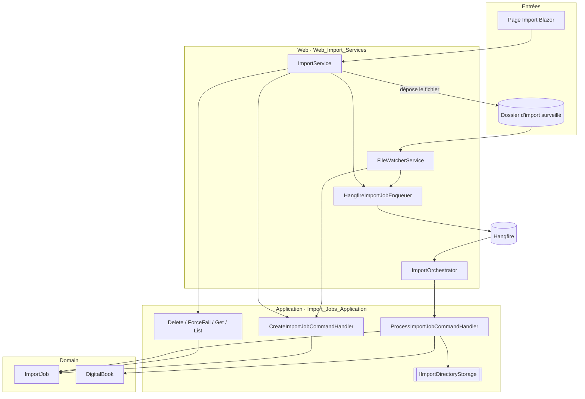
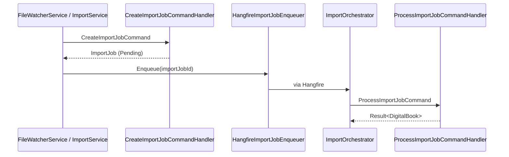

# Pipeline d'import de fichiers (`File_Import_Pipeline`)

## Objectif

Le module `File_Import_Pipeline` gère l'import de fichiers de bandes dessinées numériques (`.cbz`, `.cbr`, `.zip`, `.rar`, `.pdf`) dans une bibliothèque de type `Digital`. Un fichier arrive par dépôt dans un dossier surveillé ou par téléversement depuis l'interface Blazor. Il devient un job d'import (`ImportJob`), traité en tâche de fond, puis un `DigitalBook` rangé dans la bibliothèque, avec ses métadonnées et sa couverture.

Le module suit la Clean Architecture du projet et se compose de deux sous-modules :

- **Côté Application** : les cas d'usage CQRS et le pipeline de traitement.
- **Côté Web** : la surveillance du dossier, l'enfilage Hangfire et la façade utilisée par l'UI. Il sert de racine de composition.

## Architecture

### Flux de données

Le job passe par les états suivants :

`Pending → Extracting → Converting → SearchingMetadata → UploadingCover → BuildingArchive → Completed`

Il peut passer à `Failed` à partir de n'importe quelle étape intermédiaire. Chaque transition est persistée, ce qui permet à l'UI de suivre la progression.

## Points de conception

- **Isolation de Hangfire** : la couche Application ne connaît que `IImportJobEnqueuer` et `IImportOrchestrator`. Hangfire reste confiné à `Web`.
- **Idempotence** : la déduplication par `AlreadyQueued` et le suivi `_inFlight` du watcher évitent les doublons lors des rescans ou des dépôts concurrents.
- **Cohérence stockage / base** : les validations du domaine passent avant les effets de bord sur les fichiers. Une compensation supprime le fichier déplacé si la sauvegarde finale échoue. Le nettoyage du répertoire temporaire et le déplacement vers le dossier d'erreurs se font dans le `finally`.
- **Sécurité** : le contrôle de propriété de la bibliothèque renvoie `NotFound` pour ne pas révéler l'existence d'une ressource. Le nom de fichier téléversé est nettoyé contre le path traversal.
- **Résilience** : l'upload de la couverture est *best-effort*. Un job resté bloqué dans un état intermédiaire est passé en `Failed` à la reprise.

## Documentation des composants

| Sous-module | Contenu | Documentation |
|---|---|---|
| `Import_Jobs_Application` | Handlers CQRS (création, traitement, suppression, échec forcé, lecture), machine à états, `IImportDirectoryStorage`, `ImportSettings` | [Import_Jobs_Application](File_Import_Pipeline/Import_Jobs_Application.md) |
| `Web_Import_Services` | `FileWatcherService`, `HangfireImportJobEnqueuer`, `ImportOrchestrator`, `ImportService` | [Web_Import_Services](File_Import_Pipeline/Web_Import_Services.md) |

## Modules liés

- [Domain_Core](Domain_Model/Domain_Core.md) : entité `ImportJob`, `Library`, `Result`.
- [Application_Interfaces](Application_Contracts___CQRS_Foundation/Application_Interfaces.md) : contrats d'infrastructure.
- [Persistence_Local_Storage](File_Storage___Media_Processing/Persistence_Local_Storage.md) : implémentation de `IImportDirectoryStorage`.
- [Persistence_File_Services](File_Storage___Media_Processing/Persistence_File_Services.md) : extraction, conversion d'images, archive et OCR.
- [Comic_Info_Search](Comic_Info_Search.md) : recherche de métadonnées par ISBN.
- [Web_Feed_Import_Services](Feed_Import_Pipeline/Web_Feed_Import_Services.md) : pendant du pipeline pour les flux RSS.