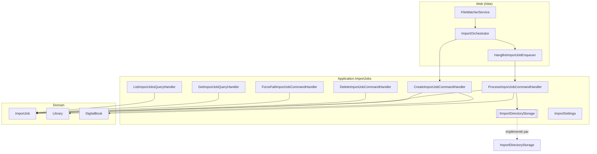
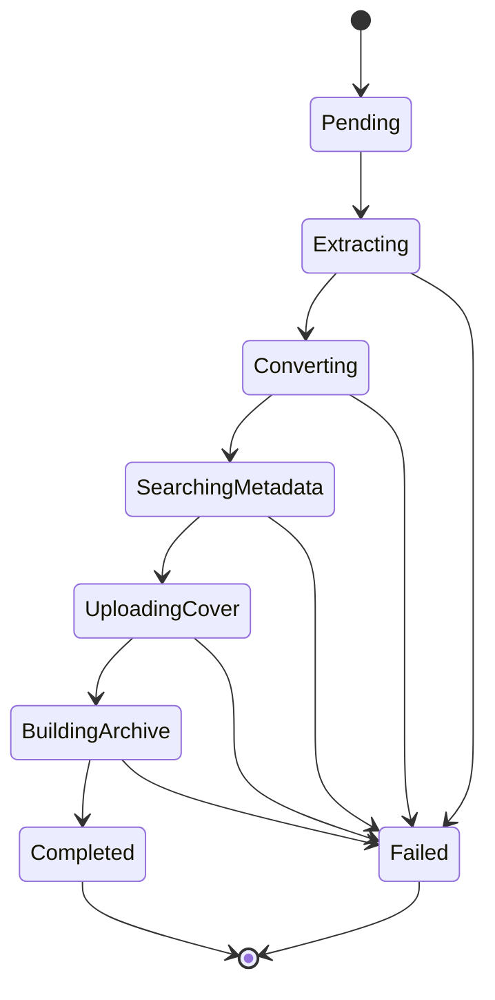
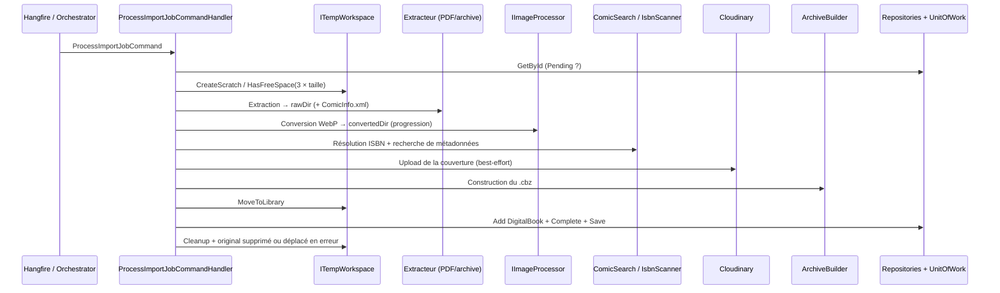

# Import_Jobs_Application — Couche applicative des jobs d'import

## Introduction

Le module `Import_Jobs_Application` regroupe les cas d'usage CQRS (couche `Application`) qui gèrent le cycle de vie des **jobs d'import** de fichiers de bandes dessinées numériques (`.cbz`, `.cbr`, `.zip`, `.rar`, `.pdf`). Il crée, consulte, supprime et force l'échec des jobs, et surtout il orchestre le **pipeline de traitement** (`ProcessImportJobCommandHandler`) qui transforme un fichier déposé en un `DigitalBook` rangé dans une bibliothèque.

Il fait partie du module parent [File_Import_Pipeline](../File_Import_Pipeline.md). La partie « hôte » (surveillance du dossier, enfilage Hangfire, orchestrateur) est documentée dans [Web_Import_Services](Web_Import_Services.md). L'entité `ImportJob` et ses transitions d'état sont décrites dans [Domain_Core](../Domain_Model/Domain_Core.md).

## Composants

| Composant | Rôle |
|---|---|
| `CreateImportJobCommandHandler` | Valide la demande et crée un `ImportJob` (statut initial `Pending`). |
| `ProcessImportJobCommandHandler` | Exécute le pipeline complet d'import et produit un `DigitalBook`. |
| `DeleteImportJobCommandHandler` | Supprime un job terminal (`Completed` ou `Failed`). |
| `ForceFailImportJobCommandHandler` | Marque manuellement un job comme échoué. |
| `GetImportJobQueryHandler` | Retourne un job par identifiant, avec contrôle de propriété. |
| `ListImportJobsQueryHandler` | Liste les jobs d'une bibliothèque. |
| `IImportDirectoryStorage` | Port vers le stockage du dossier d'import (implémenté en persistance). |
| `ImportSettings` | Options de configuration de l'import. |

## Architecture

L'implémentation de `IImportDirectoryStorage` se trouve dans [Persistence_Local_Storage](../File_Storage___Media_Processing/Persistence_Local_Storage.md). Les contrats utilisés (`IImportJobRepository`, `IRepository<Library, Guid>`, `IUnitOfWork`, `ITempWorkspace`, `IArchiveExtractor`, `IImageProcessor`, etc.) sont décrits dans [Application_Interfaces](../Application_Contracts___CQRS_Foundation/Application_Interfaces.md) ; les abstractions `ICommandHandler`/`IQueryHandler` dans [Messaging_Abstractions](../Application_Contracts___CQRS_Foundation/Messaging_Abstractions.md).

## Handlers de gestion

Tous retournent un `Result` / `Result<T>` (pas d'exception pour les erreurs connues) et vérifient que la bibliothèque du job appartient à l'utilisateur ; sinon ils renvoient `NotFound` pour ne pas révéler l'existence de la ressource.

### CreateImportJobCommandHandler

Validations dans l'ordre :
1. Paramètres non vides, taille > 0, `LibraryId` non vide → `ImportJobError.BadRequest`.
2. Extension autorisée (`.cbz`, `.cbr`, `.zip`, `.rar`, `.pdf`, insensible à la casse) → sinon `BadRequest`.
3. Bibliothèque existante et appartenant à l'utilisateur → sinon `LibrariesError.NotFound`.
4. Bibliothèque de type `Digital` → sinon `LibrariesError.BookTypeMismatch`.
5. Déduplication : `ExistsActiveForFilePathAsync` → sinon `ImportJobError.AlreadyQueued`.
6. `ImportJob.Create(...)`, ajout au dépôt et `SaveChangesAsync`.

### DeleteImportJobCommandHandler

Charge le job, vérifie la propriété via la bibliothèque, puis n'autorise la suppression que si le statut est `Completed` ou `Failed` (`ImportJobError.NotTerminal` sinon).

### ForceFailImportJobCommandHandler

Appelle `job.Fail(job.Status.ToString(), "Manually marked as failed.")` : l'étape en cours est conservée comme étape d'échec. Utile pour débloquer un job coincé.

### GetImportJobQueryHandler / ListImportJobsQueryHandler

Lecture seule. Les identifiants vides donnent `BadRequest` ; la liste est celle de `GetByLibraryIdAsync` après contrôle de propriété de la bibliothèque.

## Pipeline de traitement : ProcessImportJobCommandHandler

Le handler reçoit trois groupes de dépendances (`ProcessImportJobRepositories`, `ProcessImportJobFileProcessors`, `ProcessImportJobExternalServices`) plus un `ILogger`, afin de limiter le nombre de paramètres du constructeur.

### Machine à états

Chaque avancement est persisté (`AdvanceAndSaveAsync`) pour que l'interface puisse suivre la progression.

### Séquence

### Étapes

1. **Garde et reprise** : un job non `Pending` est rejeté (`InvalidStatusTransition`). Si le job est dans un état intermédiaire (retry Hangfire après exception), il est marqué `Failed` et le fichier original est déplacé en erreur.
2. **Espace disque** : `HasFreeSpace(OriginalFileSize * 3)`, sinon `InsufficientDiskSpace`.
3. **Extracting** : PDF via `IPdfImageExtractor`, sinon `IArchiveExtractor` ; lecture optionnelle de `ComicInfo.xml`.
4. **Converting** : `IImageProcessor.ProcessImagesAsync`, avec persistance de la progression par paliers d'au moins 10 %.
5. **SearchingMetadata** : l'ISBN vient d'abord du nom de fichier (`FileNameIsbnExtractor`), puis de `ComicInfo.xml`, et seulement en dernier recours d'un scan OCR des pages. Si plusieurs ISBN sont lus, aucun n'est retenu et le choix est laissé à l'utilisateur. Une recherche `IComicSearchService.SearchByIsbnAsync` enrichit ensuite les métadonnées ; un `ComicInfo.xml` mis à jour est écrit (dates à année seule stockées au 1er janvier).
6. **UploadingCover** : envoi de la première page vers Cloudinary, en *best-effort* — un échec n'interrompt jamais le pipeline.
7. **BuildingArchive** : `.cbz` nommé d'après l'ISBN normalisé valide, sinon l'identifiant du job.
8. **Completed** : validation du domaine **avant** tout effet de bord sur le système de fichiers, déplacement vers la bibliothèque, création de `DigitalBook`, enregistrement du scan ISBN (candidats si plusieurs), puis sauvegarde.

### Gestion des erreurs et cohérence

- Toute étape en échec passe par `FailJobAsync` (enregistre l'étape et la description, persiste, renvoie l'erreur).
- Les exceptions `IOException`, `InvalidOperationException`, `UnauthorizedAccessException`, `HttpRequestException` et `InvalidDataException` deviennent une erreur `IMP500` (message tronqué à 500 caractères).
- Dans le `finally` : nettoyage du répertoire temporaire, puis suppression du fichier original en cas de succès ou déplacement vers le dossier d'erreur sinon (via `IImportDirectoryStorage`).
- Si la sauvegarde finale échoue, le fichier déjà déplacé est supprimé (compensation) et le job n'est volontairement pas rechargé en échec : la logique de reprise « job bloqué » s'en charge au prochain essai.

## Contrat de stockage et configuration

`IImportDirectoryStorage` expose `EnsureExists`, `Delete`, `Move`, `DeleteOriginalFile`, `MoveOriginalFileToError`, `GetAvailableFilePath` et `DepositFile`. Ce dernier copie d'abord en `{destination}.part` (ignoré par le watcher) puis renomme, afin que le watcher ne voie jamais de fichier partiel.

`ImportSettings` :

| Option | Valeur par défaut |
|---|---|
| `ImportDirectory` | `/data/import` |
| `TempDirectory` | `/data/temp` |
| `ImageTargetWidth` | `1400` |
| `PollingIntervalSeconds` | `30` |
| `SupportedExtensions` | `.cbz, .cbr, .zip, .rar, .pdf` |
| `MaxFileSizeMb` | `500` |

## Voir aussi

- [File_Import_Pipeline](../File_Import_Pipeline.md) — vue d'ensemble du pipeline d'import
- [Web_Import_Services](Web_Import_Services.md) — déclenchement et orchestration côté Web
- [Domain_Core](../Domain_Model/Domain_Core.md) — `ImportJob`, `Library`, `Result`
- [Persistence_File_Services](../File_Storage___Media_Processing/Persistence_File_Services.md) — extraction, conversion, archive et OCR
- [Comic_Info_Search](../Comic_Info_Search.md) — recherche de métadonnées par ISBN
