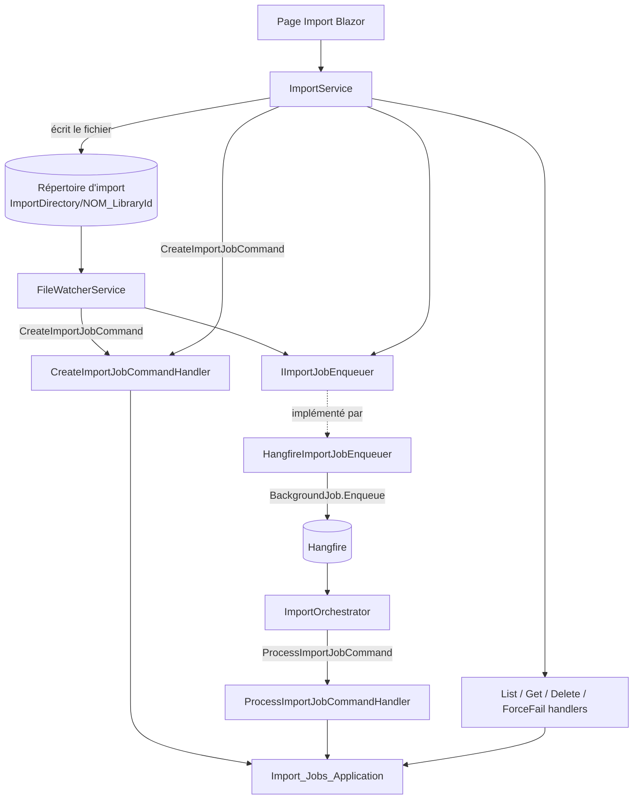
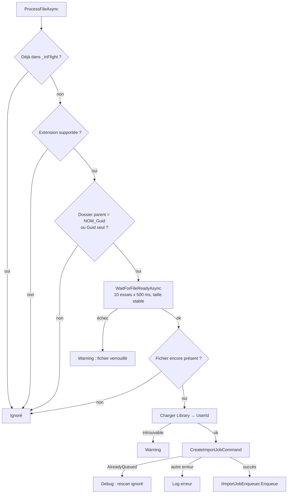
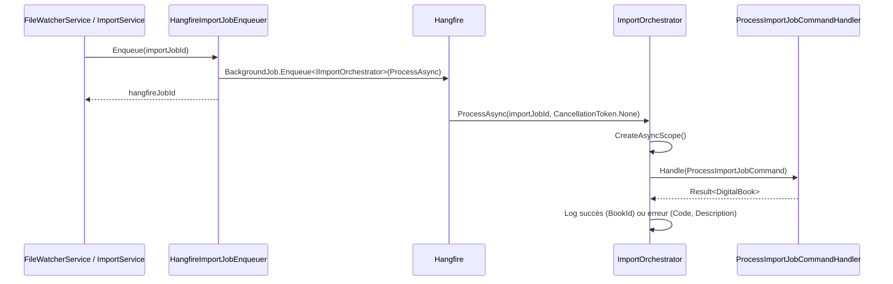

# Services Web d'import de fichiers

Le module `Web_Import_Services` est la couche d'adaptation côté `Web/` du pipeline d'import de fichiers numériques (CBZ, CBR, PDF, etc.). Il relie le monde extérieur (système de fichiers surveillé, téléversement depuis l'interface Blazor, Hangfire) aux handlers CQRS décrits dans [Import_Jobs_Application](Import_Jobs_Application.md). Il constitue la racine de composition de l'import : aucune logique métier n'y réside, uniquement de l'orchestration, de la gestion de scopes DI et de la tolérance aux erreurs d'E/S.

Voir aussi la page parente [File_Import_Pipeline](../File_Import_Pipeline.md).

## Composants

| Composant | Rôle |
|---|---|
| `FileWatcherService` | `IHostedService` qui scrute le répertoire d'import (scan au démarrage + polling périodique) et crée/enfile les jobs d'import. |
| `HangfireImportJobEnqueuer` | Implémentation de `IImportJobEnqueuer` : planifie `IImportOrchestrator.ProcessAsync` dans Hangfire. |
| `ImportOrchestrator` | Implémentation de `IImportOrchestrator` : exécutée par Hangfire, ouvre un scope DI et appelle `ProcessImportJobCommand`. |
| `IImportService` / `ImportService` | Façade utilisée par l'UI ([Web_Admin_And_Other_Pages](../Blazor_UI_Layer/Web_Admin_And_Other_Pages.md), page `Import`) : liste, détail, upload, suppression et échec forcé de jobs. |

## Architecture

Les contrats `IImportJobEnqueuer` et `IImportOrchestrator` sont définis dans [Application_Interfaces](../Application_Contracts___CQRS_Foundation/Application_Interfaces.md) ; la couche Application ne dépend donc jamais de Hangfire. Le stockage physique (`IImportDirectoryStorage`) est implémenté dans [Persistence_Local_Storage](../File_Storage___Media_Processing/Persistence_Local_Storage.md).

## FileWatcherService

### Cycle de vie

- `StartAsync` crée le répertoire racine, enregistre un scan initial sur `ApplicationStarted` (pour ne pas bloquer le démarrage HTTP) et lance une boucle `PeriodicTimer` selon `ImportSettings.PollingIntervalSeconds`.
- Le scan de démarrage commence par `EnsureImportDirectoriesExistAsync` : pour chaque bibliothèque `LibraryBookType.Digital`, il garantit l'existence du sous-répertoire via `IImportDirectoryStorage.EnsureExists`.
- `StopAsync` libère le timer et attend la fin de la boucle de polling ; l'annulation est pilotée par `ApplicationStopping`.

### Traitement d'un fichier

Points de conception :

- **Idempotence** : un `ConcurrentDictionary<string, byte>` (`_inFlight`) évite le traitement concurrent d'un même chemin ; l'erreur `ImportJobError.AlreadyQueued` renvoyée par le handler est traitée comme attendue (l'extraction pouvant durer plusieurs minutes pendant que le polling continue).
- **Identification de la bibliothèque** : l'identifiant est extrait du nom du dossier parent, au format `{RelativePath}_{LibraryId}` ou, pour la compatibilité, un GUID seul (`TryExtractLibraryId`). Le dossier `errors` est ignoré.
- **Fichier prêt** : `WaitForFileReadyAsync` ouvre le fichier en `FileShare.None` et exige une taille non nulle et stable entre deux essais, pour ne pas importer un fichier en cours de copie.
- **Scopes DI** : le service étant singleton, chaque accès à un dépôt ou handler passe par `IServiceScopeFactory.CreateAsyncScope()`.
- **Robustesse** : les exceptions du polling (hors annulation) sont journalisées sans interrompre la boucle.

## HangfireImportJobEnqueuer et ImportOrchestrator

L'enqueuer ne transmet que l'identifiant du job (sérialisation Hangfire minimale). L'orchestrateur ne lève pas d'exception sur échec métier : le `Result<DigitalBook>` est simplement journalisé, l'état du job étant porté par l'entité `ImportJob` (voir [Domain_Core](../Domain_Model/Domain_Core.md)) et le livre créé par [Domain_Books](../Domain_Model/Domain_Books.md).

## ImportService

`ImportService` reçoit un agrégat `ImportJobHandlers` (regroupant les handlers `ListJobs`, `GetJob`, `GetLibrary`, `CreateJob`, `DeleteJob`, `ForceFailJob`), `IImportJobEnqueuer`, `ICurrentUserService`, `IImportDirectoryStorage` et `ImportSettings`. Toutes les opérations résolvent d'abord l'utilisateur courant (voir [Web_Configuration_And_Auth](../Web_Platform,_Security___External_Integrations/Web_Configuration_And_Auth.md)) et propagent les échecs sous forme de `Result`. Les entités sont converties en `ImportJobViewModel` pour l'UI.

`UploadAndCreateJobAsync` suit ce flux :

1. Récupération de l'utilisateur et nettoyage du nom de fichier (`Path.GetFileName`) contre le path traversal.
2. Validation de l'extension via `ImportSettings.SupportedExtensions` (sinon `ImportJobError.BadRequest`).
3. Vérification de l'appartenance de la bibliothèque (`GetLibraryQuery` avec `UserId`).
4. `EnsureExists` du répertoire d'import de la bibliothèque.
5. Copie en flux vers `{ImportDirectory}/{ImportDirectoryName}/{Guid v7}_{nom}` avec limite `MaxFileSizeMb`.
6. `CreateImportJobCommand` ; en cas d'échec, suppression du fichier téléversé (nettoyage au mieux).
7. `Enqueue` du job et retour du `ImportJobViewModel`.

Le fichier déposé dans le répertoire surveillé peut ensuite être détecté par le `FileWatcherService` ; la protection `AlreadyQueued` empêche alors un doublon.

## Dépendances

- Application : [Import_Jobs_Application](Import_Jobs_Application.md) (commandes, requêtes, `ImportSettings`, `IImportDirectoryStorage`) et `GetLibraryQuery` ([Libraries_Application](../Book___Library_Use_Cases/Libraries_Application.md)).
- Contrats : `IImportJobEnqueuer`, `IImportOrchestrator`, `ICurrentUserService`, `IRepository` ([Application_Interfaces](../Application_Contracts___CQRS_Foundation/Application_Interfaces.md)).
- Infrastructure externe : Hangfire (planification), système de fichiers local.
- Pendant pour les flux RSS : [Web_Feed_Import_Services](../Feed_Import_Pipeline/Web_Feed_Import_Services.md).
