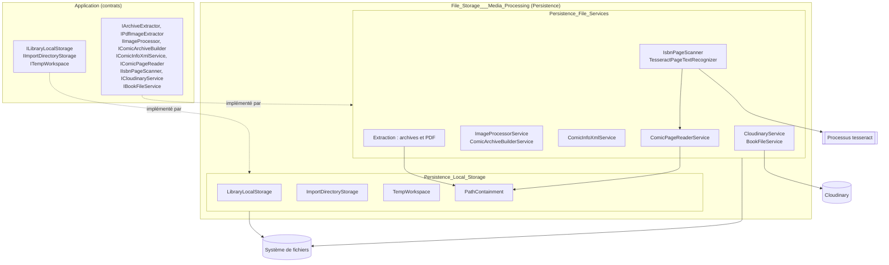
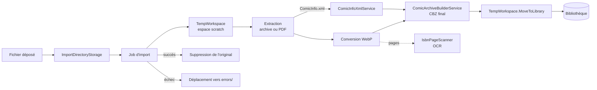

# Stockage de fichiers et traitement des médias (File_Storage___Media_Processing)

## Objectif

Le module `File_Storage___Media_Processing` correspond au dossier `Persistence/`. Il regroupe tout ce que la couche Persistence fait avec des fichiers, en dehors de la base de données. Il implémente les interfaces déclarées dans la couche Application (voir [Application_Contracts___CQRS_Foundation](Application_Contracts___CQRS_Foundation.md)). Il comprend deux sous-modules :

- **Stockage local** : gestion des dossiers de bibliothèque, du répertoire d'import et de l'espace temporaire des jobs.
- **Services de fichiers** : extraction d'archives et de PDF, conversion d'images en WebP, construction de CBZ, lecture et écriture de `ComicInfo.xml`, lecture de pages à la volée, OCR et scan d'ISBN, upload Cloudinary.

Les deux sous-modules renvoient des `Result<T>` (voir [Domain_Core](Domain_Model/Domain_Core.md)) au lieu de lever des exceptions pour les erreurs connues. Ils appliquent les mêmes protections : confinement des chemins (`PathContainment`), limites de taille, XML durci et liste blanche d'hôtes contre le SSRF. Aucun type tiers (SharpCompress, SkiaSharp, PdfPig, Cloudinary) ne remonte vers la couche Application.

## Sous-modules

| Sous-module | Dossier | Rôle | Documentation |
|---|---|---|---|
| Persistence_Local_Storage | `Persistence/LocalStorage` | `LibraryLocalStorage`, `ImportDirectoryStorage` et `TempWorkspace` : dossiers de bibliothèque, répertoire d'import (dépôt atomique via `.part`, fichiers en erreur) et espace temporaire des jobs | [Persistence_Local_Storage](File_Storage___Media_Processing/Persistence_Local_Storage.md) |
| Persistence_File_Services | `Persistence/Services` | Extraction, conversion WebP, construction de CBZ, `ComicInfo.xml`, lecteur de pages, OCR Tesseract, `IsbnPageScanner`, `CloudinaryService`, `BookFileService` | [Persistence_File_Services](File_Storage___Media_Processing/Persistence_File_Services.md) |

## Architecture

Les composants des deux sous-modules ne se connaissent pas directement. Ils partagent seulement `PathContainment`, qui garantit que les chemins restent dans les racines autorisées. Ce sont les cas d'usage de la couche Application qui les orchestrent.

## Flux de données : import d'un fichier

Les services de fichiers font le travail sur les médias : extraction, conversion, assemblage et OCR. Le stockage local fournit les emplacements et les déplacements sûrs : dépôt, espace temporaire, bibliothèque et dossier d'erreurs. À la lecture, `ComicPageReaderService` sert les pages directement depuis le CBZ, sans écriture disque. Le module est surtout consommé par [Import_Jobs_Application](File_Import_Pipeline/Import_Jobs_Application.md), [Book_Reader_Application](Book___Library_Use_Cases/Book_Reader_Application.md), [Isbn_Scan_Application](Book___Library_Use_Cases/Isbn_Scan_Application.md) et [Libraries_Application](Book___Library_Use_Cases/Libraries_Application.md).

## Principes de conception

- **Sécurité** : confinement des chemins, plafonds sur les archives (5 000 entrées, 5 Go) et sur les pages (50 Mo), XML sans DTD, liste blanche d'hôtes pour Cloudinary.
- **Atomicité et non-écrasement** : les dépôts passent par un fichier `.part` et les déplacements refusent d'écraser une destination existante.
- **Ressources limitées** : conversion WebP à mémoire réduite, adaptée au Raspberry Pi, et travail bloquant déporté sur le thread pool.
- **Dégradation maîtrisée** : l'OCR indisponible laisse le livre « à scanner » plus tard, et les nettoyages sont faits au mieux (best effort), sans propager d'erreur.