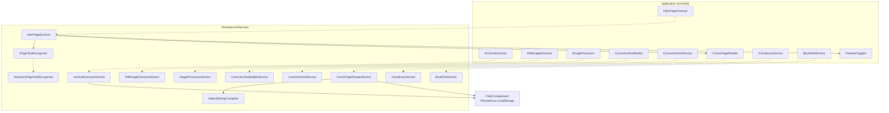
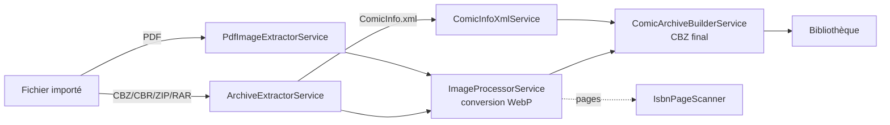
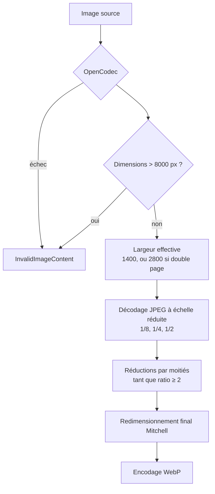
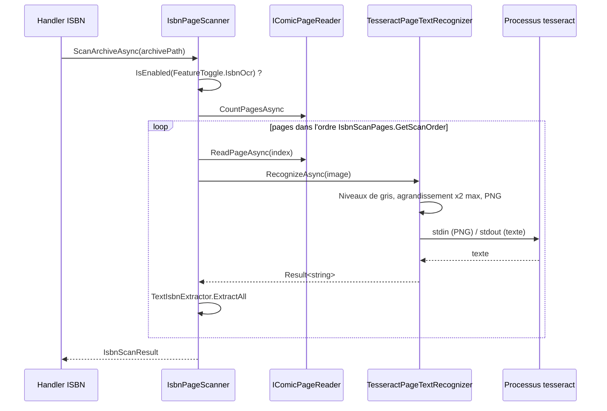

# Services de fichiers de la persistance (Persistence_File_Services)

## Introduction

Le module `Persistence_File_Services` regroupe les implémentations concrètes, situées dans `Persistence/Services/`, des interfaces de traitement de fichiers déclarées dans la couche Application (voir [Application_Interfaces](../Application_Contracts___CQRS_Foundation/Application_Interfaces.md)). Il couvre :

- l'extraction d'archives (CBZ/ZIP/CBR/RAR) et de PDF ;
- la conversion d'images en WebP et la construction d'archives CBZ ;
- la lecture/écriture de `ComicInfo.xml` ;
- la lecture de pages à la volée depuis une archive (lecteur) ;
- l'OCR (Tesseract) et le scan d'ISBN ;
- l'upload d'images vers Cloudinary et la suppression de fichiers de livres.

Le stockage disque lui-même (répertoires de bibliothèque, d'import, espace temporaire) est documenté dans [Persistence_Local_Storage](Persistence_Local_Storage.md). Les erreurs retournées (`FileProcessingError`, `BooksError`, `OcrError`) et le type `Result<T>` proviennent de [Domain_Core](../Domain_Model/Domain_Core.md).

## Vue d'ensemble des composants

| Composant | Interface implémentée | Rôle |
|---|---|---|
| `ArchiveExtractorService` | `IArchiveExtractor` | Extrait images et `ComicInfo.xml` d'une archive, avec garde-fous |
| `PdfImageExtractorService` | `IPdfImageExtractor` | Extrait les images embarquées d'un PDF (PdfPig) |
| `ImageProcessorService` | `IImageProcessor` | Convertit les pages en WebP (SkiaSharp), optimisé pour Raspberry Pi |
| `ComicArchiveBuilderService` | `IComicArchiveBuilder` | Assemble les pages WebP et `ComicInfo.xml` dans un CBZ |
| `ComicInfoXmlService` / `ComicInfoDocument` | `IComicInfoXmlService` | Sérialisation XML des métadonnées |
| `ComicPageReaderService` | `IComicPageReader` | Compte et lit les pages directement dans l'archive, en mémoire |
| `NaturalStringComparer` | `IComparer<string?>` (interne) | Tri naturel des noms de pages |
| `IPageTextRecognizer` / `TesseractPageTextRecognizer` | (interface locale au module) | OCR d'une image de page via la CLI Tesseract |
| `IsbnPageScanner` | `IIsbnPageScanner` | Recherche d'ISBN par OCR sur les pages d'un livre |
| `CloudinaryService` | `ICloudinaryService` | Upload d'images de couverture et ping |
| `BookFileService` | `IBookFileService` | Suppression tolérante d'un fichier de livre numérique |

## Architecture

Les services sont sans état (hors configuration) et retournent des `Result<T>` plutôt que de lever des exceptions pour les cas d'erreur connus. Le travail bloquant (SharpCompress, ZipFile, PdfPig) est déporté sur le thread pool via `Task.Run`.

## Pipeline de traitement d'un import

Ces services sont orchestrés par [Import_Jobs_Application](../File_Import_Pipeline/Import_Jobs_Application.md) (`ProcessImportJobCommandHandler`).

### ArchiveExtractorService

- `CanHandle` : extensions `.cbz`, `.zip`, `.cbr`, `.rar`.
- Limites de sécurité : 5 000 entrées maximum et 5 Go décompressés ; au-delà, `FileProcessingError.CorruptArchive`.
- Seules les extensions `.jpeg .jpg .png .gif .webp .xml` sont extraites ; seul le nom de fichier est conservé (aplatissement).
- Protection contre le *path traversal* via `PathContainment.IsWithinNormalizedRoot`.
- `PreserveFileTime = false` : contournement d'un problème de droits sur les volumes NTFS montés avec ntfs-3g.
- Résultat : `ArchiveExtractionResult` (images triées, chemin éventuel de `ComicInfo.xml`).

### PdfImageExtractorService

Parcourt les pages avec PdfPig et écrit chaque image brute en `page-NNN.jpg|png` (détection par signature magique, `.jpg` par défaut). Retourne un `PdfExtractionResult`.

### ImageProcessorService

Conversion de chaque page en WebP qualité 75, conçue pour une mémoire limitée :

- Les pages sont renommées `page-001.webp`… dans l'ordre alphabétique des fichiers.
- Une page WebP déjà à la largeur cible est simplement copiée (`skipped`).
- `ComicInfo.xml` est copié vers le dossier de destination.
- Une progression est notifiée via le callback `onProgressAsync` (`ImageConversionProgress`).
- `DecodeScaleDenominator` (interne) choisit la plus grande réduction puissance de deux compatible avec la largeur cible.

### ComicArchiveBuilderService

Crée un CBZ (`ZipFile.Open`, `CompressionLevel.Fastest`) avec les pages WebP, puis `ComicInfo.xml` si présent. Une liste vide renvoie `FileProcessingError.EmptyDirectory`. Retourne un `ComicArchiveResult` (chemin, taille, nombre de pages).

### ComicInfoXmlService

- `Read` : lecture sécurisée (DTD interdit, `XmlResolver = null`, 1 M de caractères maximum) puis conversion vers `ComicInfoData`.
- `Write` : sérialisation indentée UTF-8.
- `ComicInfoDocument` : DTO XML (`[XmlRoot("ComicInfo")]`) ; les valeurs numériques à 0 (année, mois, jour, pages) ne sont pas sérialisées (`ShouldSerialize*`) et sont mappées vers `null` en lecture.
- Erreurs : `XmlReadError`, `XmlWriteError`, `FileNotFound`.

## Lecture et OCR

### ComicPageReaderService

Sert les pages directement depuis l'archive, sans écriture disque (voir [Book_Reader_Application](../Book___Library_Use_Cases/Book_Reader_Application.md)).

- Le chemin doit se trouver sous `rootPath` (`PathContainment.IsWithin`), sinon `FileProcessingError.InvalidPath`.
- Les entrées d'image sont triées avec `NaturalStringComparer` (`page2` avant `page10`).
- Une page de plus de 50 Mo est refusée. Le résultat `ComicPage` contient le contenu en mémoire, le type MIME et la date de dernière modification de l'archive (utile pour la mise en cache HTTP).
- Erreurs : `BooksError.PageNotFound`, `BooksError.FileNotFound`, `FileProcessingError.CorruptArchive`.

### TesseractPageTextRecognizer et IsbnPageScanner

- `IsbnPageScanner` parcourt les `PagesFromEachEnd` premières et dernières pages (ordre fourni par `IsbnScanPages`) et s'arrête dès qu'un ISBN est trouvé. `ScanPagesAsync` fait de même sur une liste de fichiers (utilisé pendant l'import). Si la fonctionnalité `IsbnOcr` est désactivée ou si Tesseract est indisponible (`OcrError.Unavailable`), le résultat est `IsbnScanResult.NotScanned` et le livre reste à scanner ultérieurement.
- `TesseractPageTextRecognizer` lance la CLI Tesseract (`stdin stdout -l <langue>`), avec `OMP_THREAD_LIMIT=1`, un délai par page (`PageTimeoutSeconds`) et l'arrêt du processus dans `finally`. Erreurs : `UnreadableImage`, `Unavailable`, `Failed`, `Timeout`.
- Les paramètres viennent de `IsbnOcrSettings` (voir [Isbn_Scan_Application](../Book___Library_Use_Cases/Isbn_Scan_Application.md)).

## Services annexes

### CloudinaryService

Upload de couvertures depuis une URL, un fichier ou un flux (`Overwrite = true`, `UniqueFilename = false`). Pour les URL, une liste blanche d'hôtes HTTPS (`www.bedetheque.com`, `books.google.com`, `books.googleusercontent.com`, `covers.openlibrary.org`) sert de garde SSRF. Les erreurs sont encapsulées dans `CloudinaryUploadResult` (pas d'exception). `PingAsync` alimente le contrôle de santé décrit dans [Web_External_Clients_And_Health](../Web_Platform,_Security___External_Integrations/Web_External_Clients_And_Health.md). Configuration : `CloudinarySettings` ([Comic_Info_Search](../Comic_Info_Search.md)).

### BookFileService

Suppression « au mieux » d'un fichier de livre numérique : chemin vide ou fichier absent sont ignorés (avertissement), les erreurs d'E/S sont journalisées sans être propagées. Utilise des `[LoggerMessage]` générés à la compilation.

### NaturalStringComparer

Comparateur interne, insensible à la casse, comparant les séquences de chiffres par valeur numérique (zéros de tête ignorés, départage par longueur).

## Conventions transverses

- Journalisation via `ILogger<T>` injecté.
- Annulation : `OperationCanceledException` n'est jamais convertie en erreur métier.
- Sécurité : confinement de chemins, limites de taille, XML durci, garde SSRF.
- Aucun type tiers (SharpCompress, SkiaSharp, PdfPig, Cloudinary) ne fuit vers la couche Application : seuls les DTO et `Result<T>` sont exposés.
