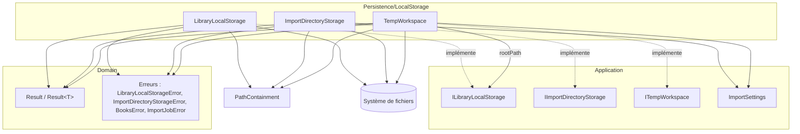
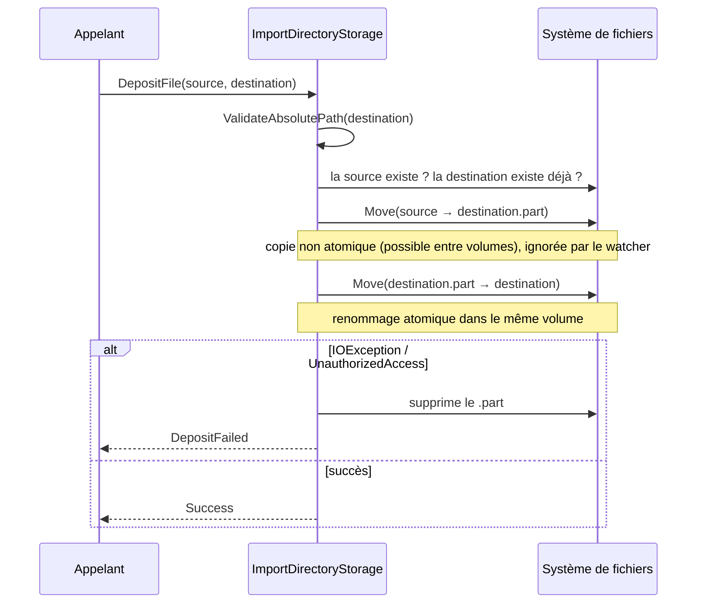
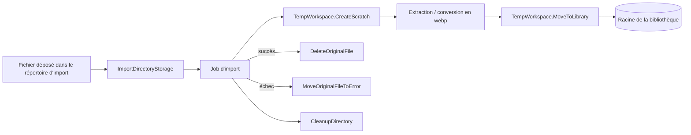

# Persistence_Local_Storage — Stockage local sur système de fichiers

## Introduction

Le module `Persistence_Local_Storage` (dossier `Persistence/LocalStorage/`) regroupe les implémentations d'accès au système de fichiers local de l'application. Il implémente, côté couche Persistence, les interfaces définies dans la couche Application (voir [Application_Contracts___CQRS_Foundation](../Application_Contracts___CQRS_Foundation.md) et [Libraries_Application](../Book___Library_Use_Cases/Libraries_Application.md)) :

| Composant | Interface implémentée | Rôle |
|---|---|---|
| `LibraryLocalStorage` | `ILibraryLocalStorage` | Gère les dossiers et fichiers des bibliothèques (création, déplacement, suppression) |
| `ImportDirectoryStorage` | `IImportDirectoryStorage` | Gère le répertoire d'import (dépôt, déplacement, nettoyage, fichiers en erreur) |
| `TempWorkspace` | `ITempWorkspace` | Espace de travail temporaire des jobs d'import et déplacement final vers la bibliothèque |

Tous les composants renvoient des `Result` / `Result<T>` (voir [Domain_Core](../Domain_Model/Domain_Core.md)) au lieu de lever des exceptions pour les erreurs connues, et protègent contre les évasions de chemin (path traversal) via `PathContainment.IsWithin`.

## Architecture

`TempWorkspace` dépend de `ILibraryLocalStorage` uniquement pour lire `rootPath` ; il n'appelle pas `LibraryLocalStorage` directement. `LibraryLocalStorage` est public et reçoit son `rootPath` par constructeur, alors que `ImportDirectoryStorage` et `TempWorkspace` sont `internal sealed` et configurés via `IOptions<ImportSettings>` (`ImportDirectory`, `TempDirectory`). Les services applicatifs qui les consomment sont décrits dans [Import_Jobs_Application](../File_Import_Pipeline/Import_Jobs_Application.md) ; les services de traitement de fichiers voisins sont dans [Persistence_File_Services](Persistence_File_Services.md).

## Composants

### LibraryLocalStorage

Stockage de la racine des bibliothèques. Opérations :

- `Create(folderName)` : valide l'argument et le chemin, puis `Directory.CreateDirectory`.
- `Move(origin, destination)` : applique `RemoveDiacritics()` aux deux noms, valide les chemins, renvoie `UnknownFolder` si l'origine n'existe pas et `AlreadyExistingFolder` si la destination existe, puis `Directory.Move`.
- `MoveFile(sourceFilePath, destinationFolderName)` : vérifie que la source est dans la racine, que le fichier existe (`BooksError.FileNotFound`) et que la cible n'existe pas (`BooksError.FileAlreadyExists`) ; crée le dossier cible, déplace sans écrasement et renvoie le nouveau chemin. Les `IOException` / `UnauthorizedAccessException` deviennent `FileMoveFailed`.
- `Delete(folderName)` : suppression récursive, `UnknownFolder` si absent.

Remarque : `Create` n'applique pas `RemoveDiacritics()` alors que `Move`, `MoveFile` et `Delete` le font ; les appelants doivent donc fournir un nom déjà normalisé à la création.

### ImportDirectoryStorage

Gère le répertoire surveillé par l'import (voir [Web_Import_Services](../File_Import_Pipeline/Web_Import_Services.md), notamment `FileWatcherService`).

- `EnsureExists`, `Move` (no-op si l'origine n'existe pas, `DestinationAlreadyExists` sinon), `Delete` (idempotent).
- `DeleteOriginalFile` : supprime un fichier source (chemin absolu validé).
- `MoveOriginalFileToError` : déplace le fichier vers un sous-dossier `errors/` voisin ; en cas de collision, ajoute un horodatage UTC `yyyyMMddHHmmssfff`.
- `GetAvailableFilePath` : assainit le nom (`Path.GetFileName`, caractères invalides), puis cherche un nom libre en suffixant ` (2)`, ` (3)`… en tenant compte des fichiers `.part`.
- `DepositFile` : dépose un fichier depuis un répertoire temporaire de façon sûre pour le watcher.

### TempWorkspace

Espace temporaire d'un job d'import :

- `HasFreeSpace(requiredBytes)` : compare à `DriveInfo.AvailableFreeSpace` ; en cas d'erreur d'E/S, journalise un avertissement et autorise la poursuite (fail-open).
- `CreateScratch(jobId)` : calcule (sans créer) `TempDir`, `RawDir` (`raw`) et `ConvertedDir` (`converted`) sous `TempDirectory/{jobId}`.
- `GetWebpFiles(directory)` : liste les `*.webp` triés sans tenir compte de la casse (liste vide si le dossier est absent).
- `MoveToLibrary(sourcePath, libraryRelativePath, fileName)` : vérifie le confinement dans la racine de bibliothèque (`ImportJobError.BadRequest`), crée le dossier, refuse l'écrasement (`ImportJobError.DestinationFileExists`) et déplace le fichier.
- `TryDeleteFile` / `CleanupDirectory` : nettoyage « best effort » (compensation et suppression du scratch) ; les erreurs sont journalisées via `ILogger<TempWorkspace>` sans être propagées.

## Flux de données dans l'import

## Points de conception

- **Sécurité des chemins** : chaque opération valide que le chemin résolu reste dans la racine ; les exceptions de chemin (`ArgumentException`, `NotSupportedException`, `PathTooLongException`) sont converties en `InvalidPath`.
- **Pas de surcharge involontaire** : les déplacements utilisent `overwrite: false` ou vérifient l'existence préalable.
- **Ordre des effets de bord** : conformément aux règles du projet, les handlers doivent valider le domaine avant d'appeler `ILibraryLocalStorage.Move` afin d'éviter toute divergence entre stockage et base de données.
- **Atomicité** : le dépôt via fichier `.part` évite que le watcher ne traite un fichier partiellement copié.
