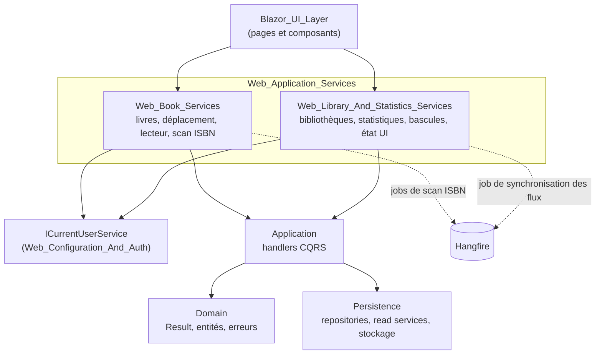
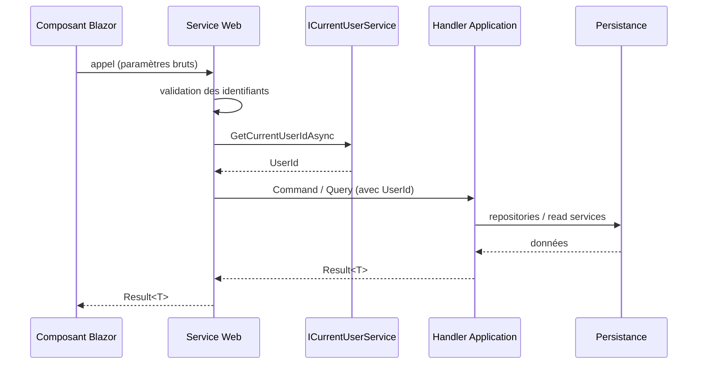

# Services applicatifs Web (`Web_Application_Services`)

## Objectif

Le module `Web_Application_Services` (dossier `Web/Services`, namespace `Web.Services`) est la couche de façade entre l'interface Blazor Server et la couche Application (CQRS). Il suit le principe de la Clean Architecture : les composants Razor ne contiennent aucune logique métier et n'appellent jamais directement les handlers. Les services Web s'en chargent à leur place.

Chaque service applique le même schéma :

1. Valider les identifiants venus de l'UI (`Guid.TryParse`, `Guid.Empty`) et renvoyer une erreur de validation du domaine si l'identifiant est invalide.
2. Résoudre l'utilisateur courant avec `ICurrentUserService.GetCurrentUserIdAsync`. Cet identifiant est toujours injecté par le service et jamais fourni par l'UI.
3. Construire la commande ou la requête, puis la déléguer au `ICommandHandler` ou `IQueryHandler` correspondant.
4. Renvoyer un `Result<T>` sans lever d'exception pour les erreurs connues.

Le module contient aussi quelques services d'interface et d'infrastructure : état d'écran en mémoire, préchauffage des icônes, localisation d'ancrage des menus, orchestration de dialogues et de snackbars, mise en file de jobs Hangfire.

## Architecture d'ensemble

## Flux de données type

L'UI traite ensuite `IsFailure` en affichant un Snackbar et en journalisant l'erreur.

## Sous-modules

| Sous-module | Responsabilités | Documentation |
|---|---|---|
| `Web_Book_Services` | CRUD des livres et dates de lecture (`BooksService`), déplacement entre bibliothèques (`BookMoveService`, `BookMoveWorkflow`), lecteur de BD (`BookReaderService`), scan d'ISBN par OCR (`IsbnScanService`, `IsbnScanOrchestrator`, `HangfireIsbnScanJobEnqueuer`) | [Web_Book_Services](Web_Application_Services/Web_Book_Services.md) |
| `Web_Library_And_Statistics_Services` | Gestion des bibliothèques (`LibrariesService`), statistiques (`StatisticsService`), bascules de fonctionnalités (`FeatureToggleService`), services d'interface (`LibraryStateService`, `LibraryIconsWarmupService`, `PopupAnchorLocator`) | [Web_Library_And_Statistics_Services](Web_Application_Services/Web_Library_And_Statistics_Services.md) |

## Points d'architecture notables

- **Tâches de fond Hangfire.** Le scan d'ISBN d'une bibliothèque est mis en file par `HangfireIsbnScanJobEnqueuer`. `IsbnScanOrchestrator` l'exécute ensuite dans un nouveau scope DI, avec `[DisableConcurrentExecution]`. Activer ou désactiver la bascule `FeedImport` ajoute ou retire immédiatement le job récurrent de synchronisation des flux.
- **Workflow UI.** `BookMoveWorkflow` regroupe dialogue, snackbar et journalisation du déplacement d'un livre, pour que les pages n'aient pas à répéter ce code.
- **État par circuit.** `LibraryStateService` et `PopupAnchorLocator` ont une durée de vie liée au circuit Blazor.
- **Testabilité.** Les interfaces de service exposent leurs éléments internes à `DynamicProxyGenAssembly2`, ce qui permet à NSubstitute de les simuler dans `Web.Tests`.

## Références vers les modules liés

- Couche Application : [Book___Library_Use_Cases](Book___Library_Use_Cases.md), [Application_Contracts___CQRS_Foundation](Application_Contracts___CQRS_Foundation.md), [Feed_Import_Pipeline](Feed_Import_Pipeline.md)
- Domaine : [Domain_Model](Domain_Model.md)
- Persistance : [Data_Persistence___Queries](Data_Persistence___Queries.md), [File_Storage___Media_Processing](File_Storage___Media_Processing.md)
- Plateforme Web et authentification : [Web_Platform,_Security___External_Integrations](Web_Platform,_Security___External_Integrations.md)
- Consommateurs : [Blazor_UI_Layer](Blazor_UI_Layer.md)