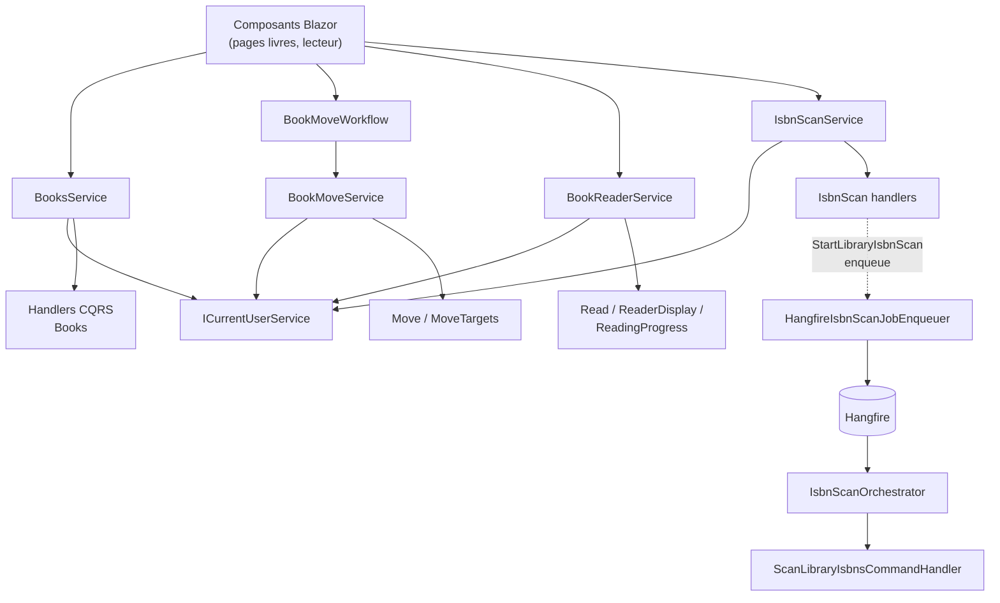
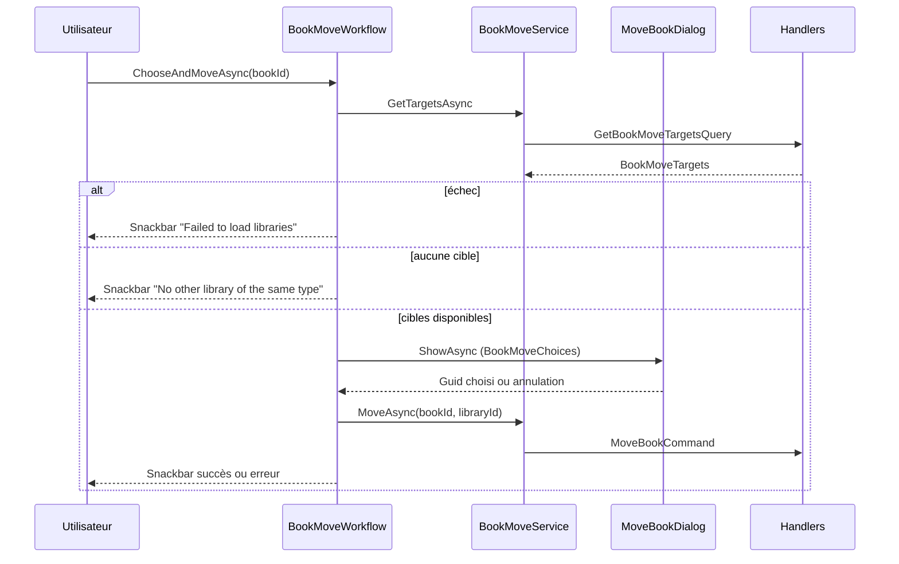
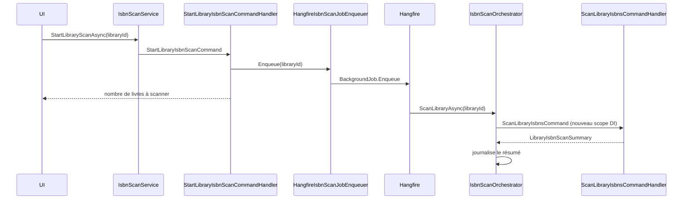
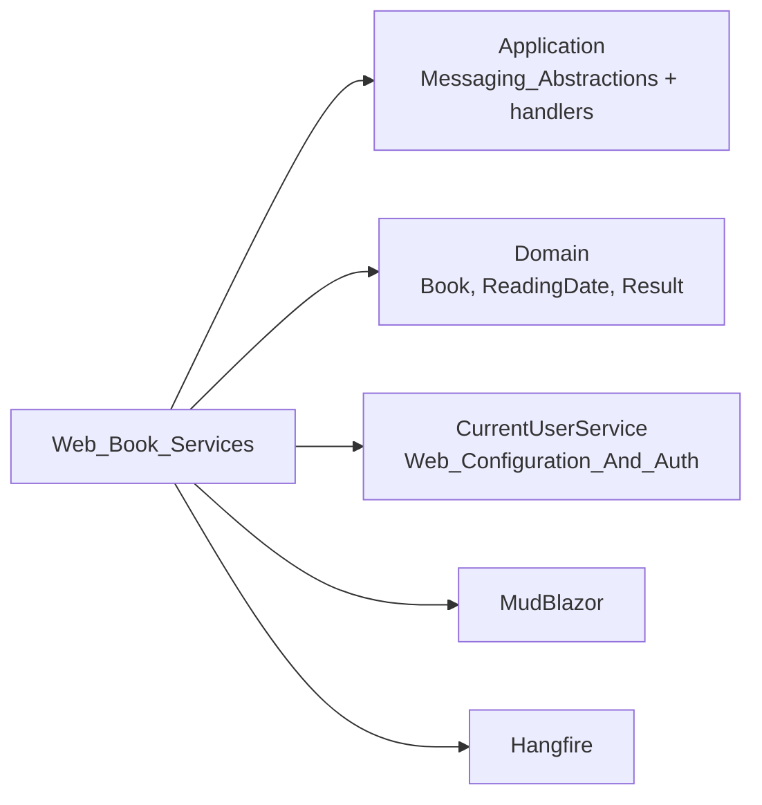

# Services Web pour les livres

Le module `Web_Book_Services` regroupe les services de la couche `Web` (namespace `Web.Services`) qui servent de façade entre les composants Blazor et la couche Application (CQRS) pour tout ce qui concerne les livres : CRUD et dates de lecture, déplacement entre bibliothèques, lecteur de bande dessinée et scan d'ISBN par OCR.

Il fait partie du module parent [Web_Application_Services](../Web_Application_Services.md). Son pendant pour les bibliothèques, les statistiques et les fonctionnalités activables est [Web_Library_And_Statistics_Services](Web_Library_And_Statistics_Services.md).

## Rôle et principes

Chaque service du module suit le même schéma :

1. Valider les identifiants reçus de l'UI (`Guid.TryParse`, `Guid.Empty`) et renvoyer `BooksError.ValidationError` en cas d'échec.
2. Récupérer l'identifiant de l'utilisateur courant via `ICurrentUserService.GetCurrentUserIdAsync`.
3. Construire la commande ou la requête CQRS avec cet `UserId`.
4. Déléguer au `ICommandHandler` / `IQueryHandler` correspondant et renvoyer un `Result<T>`.

Les services ne contiennent donc pas de logique métier : celle-ci reste dans la couche Application (voir [Book___Library_Use_Cases](../Book___Library_Use_Cases.md)). Les erreurs sont propagées par le pattern `Result<T>` du [Domain_Model](../Domain_Model.md), sans exception.

## Composants

| Composant | Interface | Rôle |
|---|---|---|
| `BooksService` | `IBooksService` | CRUD des livres, listes (toutes, par bibliothèque, paginées), dates de lecture |
| `BookMoveService` | `IBookMoveService` | Récupération des bibliothèques cibles et déplacement d'un livre |
| `BookMoveWorkflow` | `IBookMoveWorkflow` | Orchestration UI du déplacement : dialogue, snackbar, journalisation |
| `BookReaderService` | `IBookReaderService` | Infos du lecteur, sauvegarde de la progression et des réglages |
| `IsbnScanService` | `IIsbnScanService` | Démarrage du scan d'une bibliothèque, scan immédiat d'un livre |
| `IsbnScanOrchestrator` | `IIsbnScanOrchestrator` (Application) | Exécution du scan en tâche de fond (Hangfire) |
| `HangfireIsbnScanJobEnqueuer` | `IIsbnScanJobEnqueuer` (Application) | Mise en file Hangfire du job de scan |

Les interfaces `IIsbnScanOrchestrator` et `IIsbnScanJobEnqueuer` sont définies dans [Application_Interfaces](../Application_Contracts___CQRS_Foundation/Application_Interfaces.md).

## Architecture

## BooksService

Dépend de huit handlers (lecture par id, liste, liste paginée, création, mise à jour, suppression, ajout/suppression de date de lecture).

- `GetById`, `Update`, `Delete`, `AddReadingDate`, `DeleteReadingDate` : les identifiants arrivent en `string` depuis l'UI et sont parsés ; un échec donne `BooksError.ValidationError`.
- `GetByLibrary` et `GetPagedByLibrary` rejettent `Guid.Empty`.
- `GetPagedByLibrary` transmet page, taille, `BookSortOrder` et terme de recherche à `GetPagedBooksQuery` et renvoie un `IPagedList<BookSummaryDto>`.
- `GetAll` et `GetById` n'ont pas de `CancellationToken` et utilisent `CancellationToken.None`.
- `IBooksService` porte l'attribut d'assembly `InternalsVisibleTo("DynamicProxyGenAssembly2")` pour permettre NSubstitute dans `Web.Tests`.

## Déplacement d'un livre

`BookMoveService` est un simple adaptateur. `BookMoveWorkflow` encapsule le comportement UI (`IDialogService`, `ISnackbar`, `ILogger`) afin que les pages n'aient pas à le dupliquer ; il renvoie `true` uniquement si le livre a été déplacé. Le dialogue est décrit dans [Web_Layout_And_Shared_Components](../Blazor_UI_Layer/Web_Layout_And_Shared_Components.md). Rappel : côté handler, les validations domaine précèdent tout effet de bord sur le système de fichiers (`ILibraryLocalStorage`).

## BookReaderService

Trois opérations, toutes liées à l'utilisateur courant :

- `GetReaderInfoAsync` → `GetBookReaderInfoQuery` → `BookReaderInfoDto`
- `SaveProgressAsync` → `UpdateReadingProgressCommand` (index de page)
- `SaveSettingsAsync` → `UpdateReaderSettingsCommand` (`ReaderSettings`)

Les handlers sont décrits dans [Book_Reader_Application](../Book___Library_Use_Cases/Book_Reader_Application.md). Les modèles de fenêtre de pages se trouvent dans [Web_Models_And_Validators](../Web_Platform,_Security___External_Integrations/Web_Models_And_Validators.md).

## Scan d'ISBN

- `IsbnScanService.StartLibraryScanAsync` retourne le nombre de livres à scanner (ceux sans ISBN) ; `ScanBookAsync` lit immédiatement les pages d'un livre, même déjà scanné, et retourne un `IsbnScanOutcome`.
- `HangfireIsbnScanJobEnqueuer.Enqueue` appelle `BackgroundJob.Enqueue<IIsbnScanOrchestrator>` et renvoie l'identifiant du job.
- `IsbnScanOrchestrator.ScanLibraryAsync` est annoté `[DisableConcurrentExecution(timeoutInSeconds: 60)]` pour éviter de lire deux fois les mêmes pages. Comme le job s'exécute hors requête, il crée un scope via `IServiceScopeFactory` pour résoudre le handler, puis journalise soit l'erreur (`Code`, `Description`), soit le résumé (assignés, à choisir, sans ISBN, non scannés).

Détails métier : [Isbn_Scan_Application](../Book___Library_Use_Cases/Isbn_Scan_Application.md). L'OCR lui-même est dans [Persistence_File_Services](../File_Storage___Media_Processing/Persistence_File_Services.md).

## Dépendances

- Abstractions de messagerie : [Messaging_Abstractions](../Application_Contracts___CQRS_Foundation/Messaging_Abstractions.md)
- Implémentation de `ICurrentUserService` : [Web_Configuration_And_Auth](../Web_Platform,_Security___External_Integrations/Web_Configuration_And_Auth.md)
- Entités `Book`, `ReadingDate` : [Domain_Books](../Domain_Model/Domain_Books.md)
- Consommateurs : [Web_Book_Pages](../Blazor_UI_Layer/Web_Book_Pages.md) et [Web_Library_Pages](../Blazor_UI_Layer/Web_Library_Pages.md)
