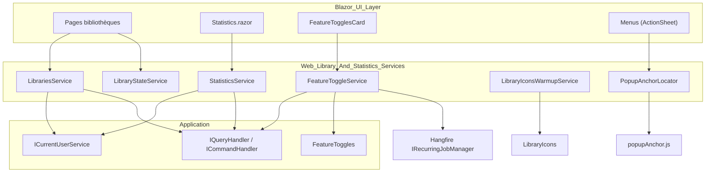
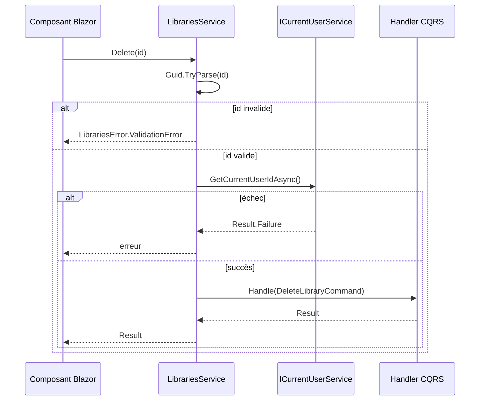
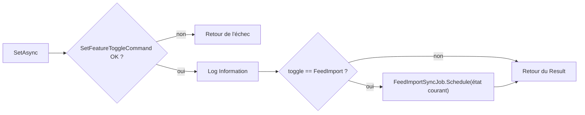
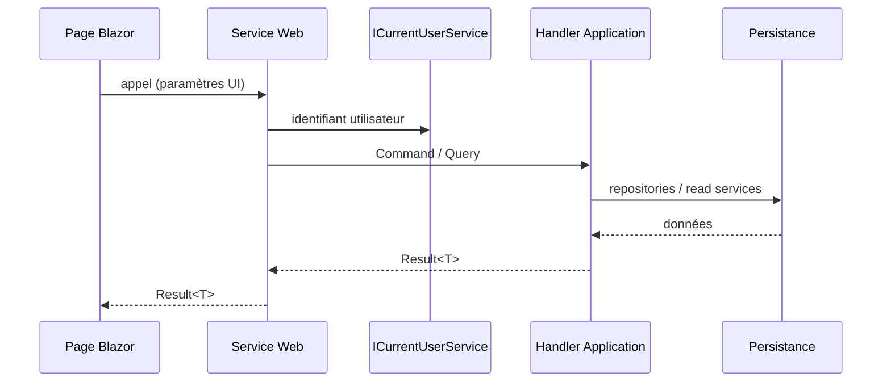

# Services Web : bibliothèques, statistiques et paramètres

## Introduction

Ce module regroupe les services de la couche `Web` (`Web/Services/`) qui servent de **façade** entre les composants Blazor et la couche Application (CQRS). Il couvre :

- la gestion des bibliothèques (`ILibrariesService` / `LibrariesService`) ;
- les statistiques de lecture (`IStatisticsService` / `StatisticsService`) ;
- les bascules de fonctionnalités (`IFeatureToggleService` / `FeatureToggleService`) ;
- trois services utilitaires d'interface : `LibraryStateService`, `LibraryIconsWarmupService` et `PopupAnchorLocator`.

Règle d'architecture : la logique métier reste dans les handlers de l'Application ; ces services se limitent à résoudre l'utilisateur courant, valider les identifiants reçus de l'UI, construire les commandes/requêtes et renvoyer un `Result<T>`.

Voir aussi : [Web_Book_Services](Web_Book_Services.md) (services équivalents pour les livres), [Libraries_Application](../Book___Library_Use_Cases/Libraries_Application.md), [Settings_Statistics_Users_Application](../Book___Library_Use_Cases/Settings_Statistics_Users_Application.md), [Messaging_Abstractions](../Application_Contracts___CQRS_Foundation/Messaging_Abstractions.md) et [Domain_Core](../Domain_Model/Domain_Core.md) (`Result`, `Library`).

## Architecture

## Composants

### LibrariesService

Implémente `ILibrariesService`. Chaque méthode suit le même schéma :

1. validation de l'identifiant (`Guid.TryParse`) → `LibrariesError.ValidationError` si invalide ;
2. récupération de l'identifiant utilisateur via `ICurrentUserService.GetCurrentUserIdAsync` (échec propagé) ;
3. construction de la commande ou requête et délégation au handler.

| Méthode | Handler délégué | Remarques |
|---|---|---|
| `GetById(string?)` | `GetLibraryQuery` | n'accepte pas de `CancellationToken` (utilise `CancellationToken.None`) |
| `Create(CreateLibraryRequest)` | `CreateLibraryCommand` | nom, couleur, icône, type de livre |
| `Update(UpdateLibraryRequest)` | `UpdateLibraryCommand` | inclut `DefaultBookSortOrder` |
| `FilterBy(...)` | `GetLibrariesQuery` | recherche, tri (`LibrariesColumn`, `SortOrder`), pagination → `IPagedList<Library>` |
| `GetSummaries()` | `GetLibrarySummariesQuery` | liste de `LibrarySummary` |
| `Delete(string?)` | `DeleteLibraryCommand` | retourne un `Result` simple |

Le fichier `ILibrariesService.cs` déclare aussi `InternalsVisibleTo("DynamicProxyGenAssembly2")` pour permettre à NSubstitute de générer des doubles dans `Web.Tests`.

### StatisticsService

Implémente `IStatisticsService.Get(Guid? libraryId, ct)` : résout l'utilisateur courant puis exécute `GetStatisticsQuery(userId, libraryId)` et retourne un `Result<StatisticsDto>`. Un `libraryId` nul signifie « toutes les bibliothèques ». Le calcul est réalisé côté persistance (voir [Persistence_Read_Services](../Data_Persistence___Queries/Persistence_Read_Services.md)).

### FeatureToggleService

Implémente `IFeatureToggleService` :

- `GetToggles()` : projette `FeatureToggles.GetStates()` en `FeatureToggleViewModel`.
- `SetAsync(toggle, enabled)` : exécute `SetFeatureToggleCommand`, journalise le changement via `ILogger<FeatureToggleService>`, puis, si la bascule est `FeatureToggle.FeedImport`, appelle `FeedImportSyncJob.Schedule(...)` pour **ajouter ou retirer immédiatement** le job Hangfire récurrent de synchronisation Miniflux (voir [Web_Feed_Import_Services](../Feed_Import_Pipeline/Web_Feed_Import_Services.md)).

### LibraryStateService

Service d'état en mémoire (`Dictionary<Guid, LibraryPageState>`) qui mémorise, par bibliothèque, la recherche et le mode d'affichage (`ViewMode`) via le record `LibraryPageState(Search, View)`. `Save` écrase l'état, `Load` retourne `null` s'il n'existe pas. Il sert à restaurer l'écran en revenant sur une bibliothèque. Le dictionnaire n'est pas thread-safe : le service est destiné à une durée de vie limitée à la session/circuit Blazor.

### LibraryIconsWarmupService

`IHostedService` interne qui appelle `LibraryIcons.Resolve(string.Empty)` au démarrage pour forcer l'initialisation du dictionnaire statique d'icônes (construit par réflexion), évitant ce coût à la première requête utilisateur. `StopAsync` ne fait rien.

### PopupAnchorLocator

Service par circuit qui calcule la position d'ancrage d'un menu sur tablette ou grand écran :

- charge paresseusement le module JS `./js/popupAnchor.js` (URL versionnée par `AppVersion.Versioned`) ;
- `AnchorOfAsync(elementId)` appelle `anchorOf` et retourne un `PopupAnchor?` ; en cas de `JSException`, un avertissement est journalisé et `null` est retourné (le menu est alors centré) ;
- `DisposeAsync` libère le module en ignorant `JSException`, `JSDisconnectedException` et `InvalidOperationException` (circuit déconnecté).

## Flux de données global

## Points d'attention

- Toutes les erreurs connues transitent par `Result<T>` (pas d'exceptions) ; l'UI doit gérer `IsFailure` (Snackbar + log).
- Chaque requête est isolée par utilisateur : l'identifiant est toujours injecté par le service, jamais fourni par l'UI.
- La modification de `FeatureToggle.FeedImport` a un effet de bord immédiat sur Hangfire, en plus de la persistance de la bascule.
