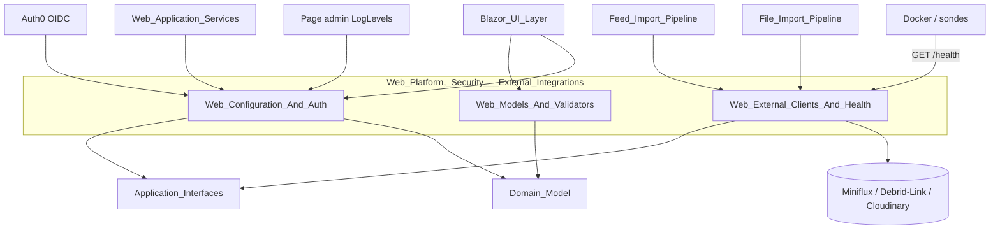
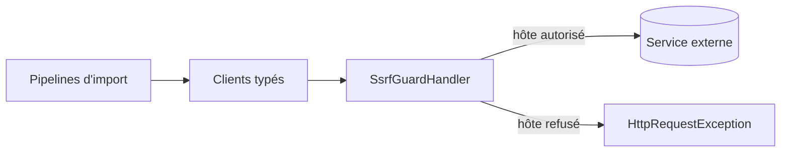

# Plateforme Web, sécurité et intégrations externes

## Objectif

Ce module regroupe les briques transverses de la couche `Web`, qui est la composition root Blazor Server de MyComicsManager. Il ne contient ni page ni logique métier. Il fournit ce dont les pages et les services Web ont besoin pour fonctionner de façon sûre :

- **identité et configuration** : Auth0, provisionnement des utilisateurs, utilisateur courant, gestion globale des exceptions, protection du tableau de bord Hangfire, niveaux de logs modifiables à chaud ;
- **intégrations sortantes** : clients Miniflux et Debrid-Link, récupération de pages et téléchargement de fichiers, avec une protection SSRF, plus les sondes de santé exposées sur `/health` ;
- **modèles de présentation** : DTO de formulaire, validateurs FluentValidation, gestion des erreurs de formulaire et calcul de l'état du lecteur de bandes dessinées.

Le module respecte les règles de couches du projet. Il implémente des interfaces définies dans `Application` (`ICurrentUserService`, `IMinifluxClient`, `IDebridLinkClient`, etc.). La logique métier reste dans le domaine et les handlers CQRS.

## Sous-modules

| Sous-module | Chemin | Rôle |
|---|---|---|
| [Configuration web et authentification](Web_Platform,_Security___External_Integrations/Web_Configuration_And_Auth.md) | `Web` | Options Auth0 et stockage local, `CustomAuthenticationStateProvider`, `CurrentUserService`, `GlobalExceptionHandler`, `HangfireAuthorizationFilter`, `LogLevelSwitches` |
| [Clients externes et contrôles de santé](Web_Platform,_Security___External_Integrations/Web_External_Clients_And_Health.md) | `Web/Infrastructure` | `SsrfGuardHandler`, `MinifluxClient`, `DebridLinkClient`, `ArticlePageFetcher`, `FeedImportFileDownloader`, sondes `IHealthCheck` et `HealthCheckResultCache` |
| [Modèles et validateurs Web](Web_Platform,_Security___External_Integrations/Web_Models_And_Validators.md) | `Web/Models` | `BookUiDto`, `LibraryUiDto`, validateurs, `FormErrors`, `ReaderPageWindow`, `ReaderSpreads` |

## Architecture d'ensemble



Les trois sous-modules sont indépendants entre eux et ne partagent que des abstractions de `Application` et `Domain`.

## Flux principaux

### Authentification et utilisateur courant

À chaque résolution de l'état d'authentification, `CustomAuthenticationStateProvider` lit les claims Auth0 (`sub`, e-mail). Il crée l'utilisateur au premier passage, une seule fois par circuit Blazor. `CurrentUserService` s'appuie sur ce provisionnement pour fournir le `Guid` de l'utilisateur courant aux handlers et aux services Web, avec un repli par e-mail pour les anciens comptes.

```mermaid
sequenceDiagram
    participant UI as Composant / service
    participant P as CustomAuthenticationStateProvider
    participant S as CurrentUserService
    participant R as IUserReadService
    UI->>P: GetAuthenticationStateAsync
    P->>R: GetUserByAuthId(sub)
    R-->>P: NotFound
    P->>P: User.Create + SaveChanges
    UI->>S: GetCurrentUserIdAsync
    S->>R: GetUserByAuthId, puis GetUserByEmail
    S-->>UI: Result&lt;Guid&gt;
```

### Appels sortants sécurisés

Tous les `HttpClient` typés passent par `SsrfGuardHandler`. Celui-ci valide l'hôte de chaque requête et de chaque redirection (5 redirections au maximum). Il ne transmet pas `Authorization` ni `Cookie` quand l'hôte change. Les clients retournent des `Result<T>` avec des erreurs `FeedImportError` au lieu d'exceptions.



### Santé et observabilité

`/health` est public. Les sondes Miniflux, Debrid-Link et Cloudinary passent par un cache de 30 secondes pour éviter des appels tiers non limités. Les échecs Miniflux et Debrid-Link donnent un statut *Degraded*, car ces services ne servent qu'à l'import par flux. Côté logs, `LogLevelSwitches` déclare un `LoggingLevelSwitch` Serilog par logger. Il les organise en arbre hiérarchique pour que la page d'administration puisse changer les niveaux à l'exécution sans redémarrage.

### Saisie et lecteur

Les composants Blazor utilisent `BookUiDto` et `LibraryUiDto` avec leurs validateurs, dont la méthode `ValidateValue` valide un champ à la fois. `FormErrors` traduit un `ValidationResult` en messages par champ et en attributs `aria-invalid`. `ReaderPageWindow` et `ReaderSpreads` pilotent le chargement des pages et la mise en page du lecteur selon `ReaderSettings`.

## Dépendances avec les autres modules

- Interfaces implémentées ou consommées : [Application_Interfaces](Application_Contracts___CQRS_Foundation/Application_Interfaces.md) ;
- Entités, `Result` et constantes : [Domain_Core](Domain_Model/Domain_Core.md) et [Domain_Books](Domain_Model/Domain_Books.md) ;
- Pipelines servis par les clients externes : [Feed_Import_Pipeline](Feed_Import_Pipeline.md) et [File_Import_Pipeline](File_Import_Pipeline.md) ;
- Stockage local et Cloudinary : [Persistence_Local_Storage](File_Storage___Media_Processing/Persistence_Local_Storage.md) et [Persistence_File_Services](File_Storage___Media_Processing/Persistence_File_Services.md) ;
- Consommateurs des modèles et de l'administration des logs : [Blazor_UI_Layer](Blazor_UI_Layer.md).