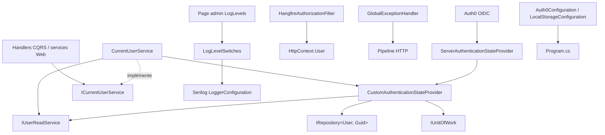
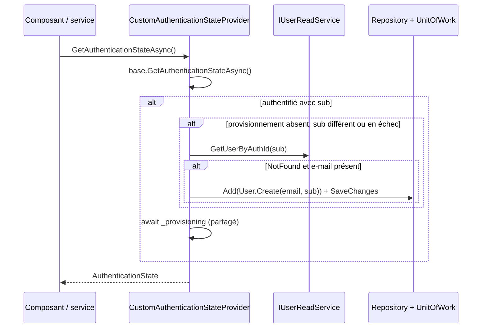
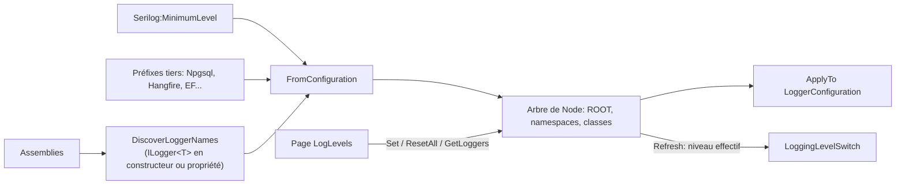

# Configuration web et authentification

Ce module regroupe les briques transverses de la couche `Web` (composition root Blazor Server) liées à la configuration, à l'identité de l'utilisateur, à la gestion des erreurs HTTP, à la sécurité du tableau de bord Hangfire et à l'ajustement des niveaux de journalisation à l'exécution. Il fait partie de [Web_Platform,_Security___External_Integrations](../Web_Platform,_Security___External_Integrations.md), à côté de [Web_External_Clients_And_Health](Web_External_Clients_And_Health.md) et [Web_Models_And_Validators](Web_Models_And_Validators.md).

## Composants

| Composant | Fichier | Rôle |
|---|---|---|
| `Auth0Configuration` | `Web/Configuration/Auth0Configuration.cs` | Options Auth0 (`Domain`, `ClientId`) |
| `LocalStorageConfiguration` | `Web/Configuration/LocalStorageConfiguration.cs` | Option `RootPath` du stockage local des bibliothèques |
| `CustomAuthenticationStateProvider` | `Web/CustomAuthenticationStateProvider.cs` | Fournisseur d'état d'authentification Blazor avec provisionnement automatique de l'utilisateur |
| `CurrentUserService` | `Web/Services/CurrentUserService.cs` | Implémentation de `ICurrentUserService` : résout l'identifiant (`Guid`) de l'utilisateur courant |
| `GlobalExceptionHandler` | `Web/GlobalExceptionHandler.cs` | `IExceptionHandler` renvoyant un `ProblemDetails` 500 |
| `HangfireAuthorizationFilter` | `Web/Infrastructure/HangfireAuthorizationFilter.cs` | Restreint le tableau de bord Hangfire aux administrateurs |
| `LogLevelSwitches` / `Node` | `Web/Infrastructure/LogLevelSwitches.cs` | Niveaux de logs Serilog modifiables à chaud, avec héritage hiérarchique |

## Architecture

Les interfaces (`IUserReadService`, `IRepository`, `IUnitOfWork`, `ICurrentUserService`) sont définies dans [Application_Interfaces](../Application_Contracts___CQRS_Foundation/Application_Interfaces.md) ; l'entité `User` dans [Domain_Core](../Domain_Model/Domain_Core.md).

## Configuration

`Auth0Configuration` et `LocalStorageConfiguration` sont des classes d'options immuables (`required`, `init`) liées à la configuration (variables d'environnement, `appsettings`). Les secrets ne sont jamais versionnés. `RootPath` sert de racine au stockage local décrit dans [Persistence_Local_Storage](../File_Storage___Media_Processing/Persistence_Local_Storage.md).

## Authentification et provisionnement

`CustomAuthenticationStateProvider` étend `ServerAuthenticationStateProvider`. À chaque appel de `GetAuthenticationStateAsync` pour un utilisateur authentifié :

1. extraction de l'e-mail (`ClaimTypes.Email` ou `email`) ;
2. extraction du `sub` Auth0 (`sub` brut ou `ClaimTypes.NameIdentifier` mappé par OIDC) ;
3. provisionnement : si aucun utilisateur n'existe pour ce `sub` (`UsersError.NotFound`) et qu'un e-mail est présent, `User.Create(email, sub)` est ajouté puis persisté.

Le provisionnement est exécuté **une fois par circuit** : la tâche `_provisioning` est mémorisée et partagée par les appelants concurrents (`AuthorizeRouteView`, `CurrentUserService`…) qui partagent le même `DbContext` du circuit. Une tâche en échec ou annulée, ou un changement de `sub`, déclenche une nouvelle tentative.

### Utilisateur courant

`CurrentUserService.GetCurrentUserIdAsync` renvoie un `Result<Guid>` :

1. recherche par `sub` via `GetUserByAuthId` ;
2. à défaut, repli par e-mail (`Identity.Name`) via `GetUserByEmail`, pour les comptes non encore migrés vers l'`AuthId` ;
3. sinon `UsersError.NotFound`.

Le modèle `Result` est décrit dans [Domain_Core](../Domain_Model/Domain_Core.md).

## Gestion globale des exceptions

`GlobalExceptionHandler` journalise l'exception via `ILogger<GlobalExceptionHandler>` puis écrit un `ProblemDetails` (`500`, titre « Server error », `application/problem+json`) et renvoie `true`. Si la réponse a déjà démarré, il journalise un avertissement et renvoie `false`, laissant le pipeline continuer.

## Sécurité du tableau de bord Hangfire

`HangfireAuthorizationFilter` n'autorise l'accès que si l'utilisateur est authentifié **et** possède le rôle `Admin`. Hangfire est utilisé notamment par les pipelines [File_Import_Pipeline](../File_Import_Pipeline.md) et [Feed_Import_Pipeline](../Feed_Import_Pipeline.md).

## Niveaux de journalisation dynamiques

`LogLevelSwitches` fournit un tableau de bord de logs de type Logback/JHipster : un `LoggingLevelSwitch` Serilog par logger déclaré. Serilog figeant sa table d'overrides à la construction, tous les loggers ajustables sont déclarés au démarrage.

Points clés :

- **Découverte** : `DiscoverLoggerNames` parcourt par réflexion les paramètres de constructeurs et propriétés (y compris privées, pour les `[Inject]` des composants Razor) de type `ILogger<T>`, en tolérant `ReflectionTypeLoadException`. Les types imbriqués utilisent `.` comme `Microsoft.Extensions.Logging`.
- **Hiérarchie** : chaque nom est complété de ses espaces de noms parents (`Web.Services.X` → `Web.Services` → `Web`). `FindParent` rattache chaque `Node` à son parent déclaré le plus proche, sinon à `ROOT`.
- **Héritage** : `Node.EffectiveLevel = ConfiguredLevel ?? Parent.EffectiveLevel ?? Information`. `Refresh()` recalcule le niveau de chaque switch, car Serilog n'applique que l'override le plus spécifique.
- **API** : `Set(name, level)` (`null` = hériter ; pour `ROOT`, retour au niveau initial ; `false` si logger non déclaré), `ResetAll()`, `GetLoggers()` (liste `LoggerLevel` avec niveau configuré et effectif), `ApplyTo()` à appeler après `ReadFrom.Configuration`. `Off` (`LevelAlias.Off`) désactive un logger.
- **Concurrence** : les mutations et lectures sont protégées par un `Lock` ; le dictionnaire est un `FrozenDictionary`.
- **Persistance** : état en mémoire uniquement ; un redémarrage restaure les niveaux des fichiers `appsettings`.

L'interface d'administration correspondante est décrite dans [Web_Admin_And_Other_Pages](../Blazor_UI_Layer/Web_Admin_And_Other_Pages.md). La règle du projet impose que toutes les classes journalisent via `ILogger<T>`, seul `Program.cs` utilisant le `Serilog.Log` statique.
