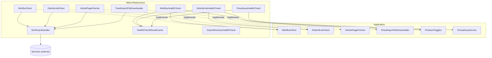
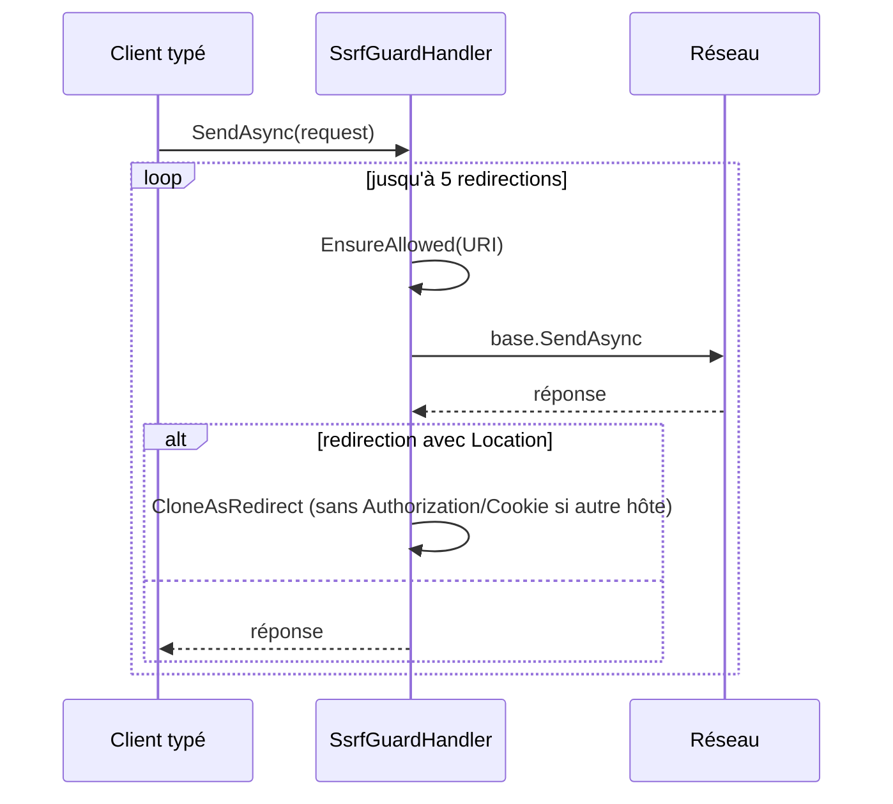
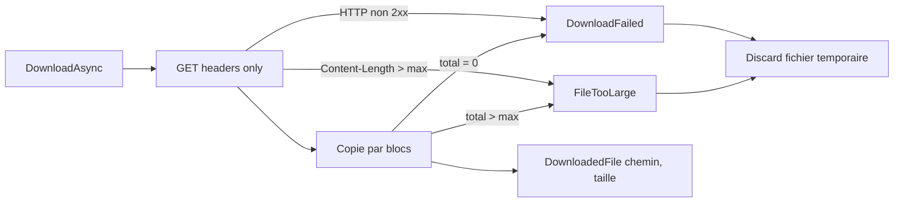
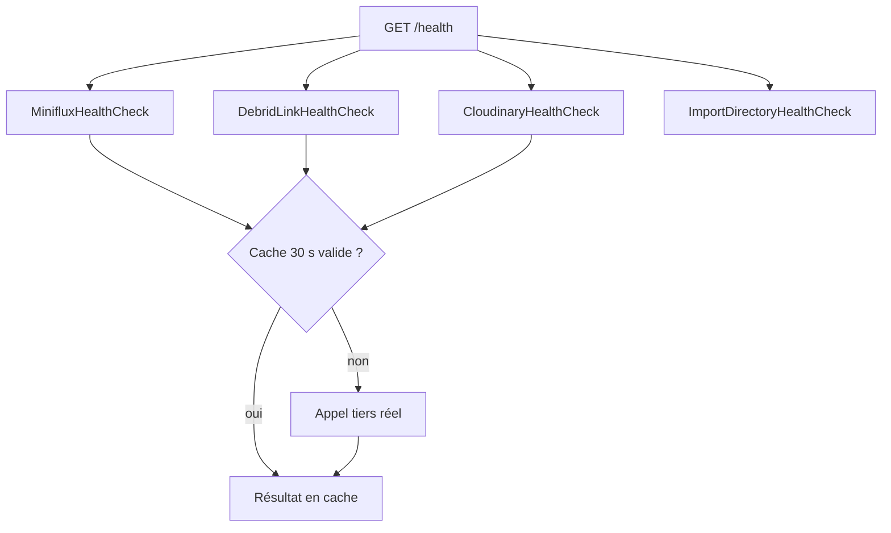

# Clients externes et contrôles de santé (Web_External_Clients_And_Health)

## Introduction

Ce module regroupe, dans `Web/Infrastructure/`, les adaptateurs HTTP sortants de l'application et les sondes de santé (`IHealthCheck`) exposées par `/health`. Il implémente côté Web les interfaces déclarées dans la couche Application (`IMinifluxClient`, `IDebridLinkClient`, `IArticlePageFetcher`, `IFeedImportFileDownloader`) et protège tous les appels sortants contre les attaques SSRF grâce à `SsrfGuardHandler`.

Il sert principalement le pipeline d'import par flux décrit dans [Feed_Import_Pipeline](../Feed_Import_Pipeline.md) (voir aussi [Feed_Imports_Application](../Feed_Import_Pipeline/Feed_Imports_Application.md)), ainsi que les services Cloudinary ([Persistence_File_Services](../File_Storage___Media_Processing/Persistence_File_Services.md)) et le répertoire d'import ([Import_Jobs_Application](../File_Import_Pipeline/Import_Jobs_Application.md)).

## Composants

| Composant | Rôle |
|---|---|
| `SsrfGuardHandler` | `DelegatingHandler` qui valide l'hôte de chaque requête et de chaque redirection. |
| `MinifluxClient` | Client de l'API Miniflux (catégories, entrées favorites, retrait de l'étoile). |
| `DebridLinkClient` | Client de l'API Debrid-Link v2 (domaines supportés, compte, déverrouillage de lien). |
| `ArticlePageFetcher` | Récupération du HTML d'une page d'article (limite 5 Mo). |
| `FeedImportFileDownloader` | Téléchargement en flux d'un fichier vers `Import:TempDirectory`. |
| `HealthCheckResultCache<TCheck>` | Cache de 30 s des résultats de sondes, un singleton par type de sonde. |
| `MinifluxHealthCheck`, `DebridLinkHealthCheck`, `CloudinaryHealthCheck` | Sondes des services tiers. |
| `ImportDirectoryHealthCheck` | Sonde d'écriture du répertoire d'import. |

## Architecture

Les `HttpClient` typés sont enregistrés dans `Program.cs` avec `SsrfGuardHandler` dans leur pipeline de handlers ; la liste blanche d'hôtes, l'autorisation HTTP et celle des sous-domaines sont fournies à la construction du handler.

## Protection SSRF : `SsrfGuardHandler`

- Avant chaque envoi, `EnsureAllowed` vérifie l'URI via `IsAllowedHost` (extension de `Domain.Extensions`) ; sinon une `HttpRequestException` est levée et un avertissement journalisé.
- Les redirections (301, 302, 303, 307, 308) sont suivies manuellement, jusqu'à `MaxRedirects = 5`, chaque cible étant revalidée.
- 307/308 conservent la méthode ; les autres codes passent en `GET`. Le corps n'est pas recopié (tous les clients concernés n'émettent que des `GET`, hors `PUT`/`POST` sans redirection).
- Lors d'un changement d'hôte, les en-têtes `Authorization` et `Cookie` ne sont pas propagés.
- Les requêtes clonées sont libérées dans le bloc `finally`.

## Clients externes

Tous retournent un `Result<T>` (voir [Domain_Core](../Domain_Model/Domain_Core.md)) avec des erreurs `FeedImportError` plutôt que des exceptions ; seules les erreurs de transport (`HttpRequestException`, `JsonException`, timeout sans annulation de l'appelant) sont capturées.

### `MinifluxClient`
- `GetCategoriesAsync` : `GET v1/categories`.
- `GetStarredEntriesAsync` : pagination par pages de 100 (`starred=true`, tri `published_at` ascendant) jusqu'à épuisement ou `total` atteint.
- `UnstarAsync` : lit d'abord l'entrée ; si elle est absente (404) ou déjà non étoilée, succès sans action (la bascule `PUT .../bookmark` la réétoilerait sinon).
- 401/403 → `MinifluxUnauthorized`, autres échecs → `MinifluxUnavailable`.

### `DebridLinkClient`
- Enveloppe API v2 : `{"success": bool, "value" | "error"}`.
- `GetSupportedDomainsAsync`, `CheckAccountAsync`, `UnlockAsync` (`POST downloader/add`).
- Si le lien est un dossier (tableau), le premier fichier est retenu ; `ToFile` extrait `downloadUrl`, `name` et `size` dans un `DebridLinkFile`.
- `MapError` traduit les codes d'erreur de l'API : jeton invalide, quotas global/par hébergeur, fichier indisponible, hébergeur non supporté, indisponibilité générique.

### `ArticlePageFetcher`
- `GET` avec `ResponseHeadersRead`, rejet si `Content-Length` > 5 Mo, puis lecture par blocs avec plafond strict (un en-tête absent ou mensonger ne peut pas saturer la mémoire).
- Encodage déduit du `charset`, UTF-8 par défaut.

### `FeedImportFileDownloader`
- Écrit dans `Import:TempDirectory/feed-imports/<guid v7>.download`, jamais dans le répertoire surveillé par le watcher (voir [Web_Import_Services](../File_Import_Pipeline/Web_Import_Services.md)).
- Plafond `maxBytes` vérifié sur l'en-tête puis pendant la copie ; fichier vide → `DownloadFailed` ; `FileTooLarge` au dépassement.
- Fichier temporaire supprimé (`Discard`) sur tout échec ou annulation.

## Contrôles de santé

| Sonde | Conditions et statuts |
|---|---|
| `MinifluxHealthCheck` | Toggle `FeatureToggle.FeedImport` désactivé → Healthy. Sinon liste les catégories : échec → Degraded ; catégorie `Miniflux:CategoryName` absente → Degraded ; sinon Healthy. |
| `DebridLinkHealthCheck` | Toggle désactivé → Healthy ; clé `DebridLink:ApiKey` vide → Degraded ; `CheckAccountAsync` en échec → Degraded. |
| `CloudinaryHealthCheck` | `PingAsync` : Healthy ou Unhealthy. |
| `ImportDirectoryHealthCheck` | Crée le répertoire, écrit puis supprime `.healthcheck` ; exception → Unhealthy. |

Miniflux et Debrid-Link ne servent qu'à l'import par flux : leur échec est donc *Degraded*, jamais *Unhealthy*, pour ne pas empêcher le démarrage ni le fonctionnement du reste de l'application. Les toggles proviennent de [Settings_Statistics_Users_Application](../Book___Library_Use_Cases/Settings_Statistics_Users_Application.md).

### `HealthCheckResultCache<TCheck>`
`/health` est public et non authentifié (HEALTHCHECK Docker, sondes d'infrastructure). Sans cache, chaque appel déclencherait un appel tiers sans limite de débit. Le cache conserve le résultat 30 secondes ; il est enregistré en singleton par type de sonde, car les sondes dépendent de services scoped ou transients (évite une erreur de dépendance captive). Il n'utilise pas de verrou : deux contrôles concurrents peuvent se produire lors d'un échec de cache, ce qui est acceptable au trafic actuel.

## Voir aussi
- [Web_Platform,_Security___External_Integrations](../Web_Platform,_Security___External_Integrations.md)
- [Web_Configuration_And_Auth](Web_Configuration_And_Auth.md)
- [Web_Feed_Import_Services](../Feed_Import_Pipeline/Web_Feed_Import_Services.md)
