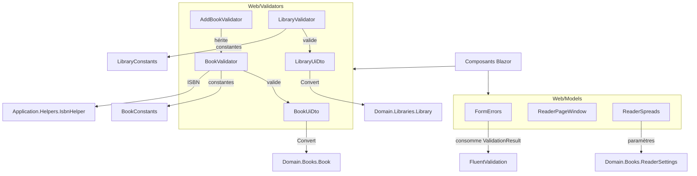
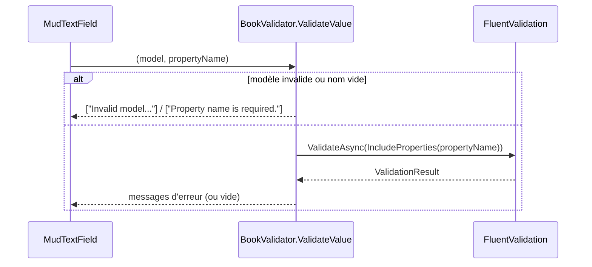
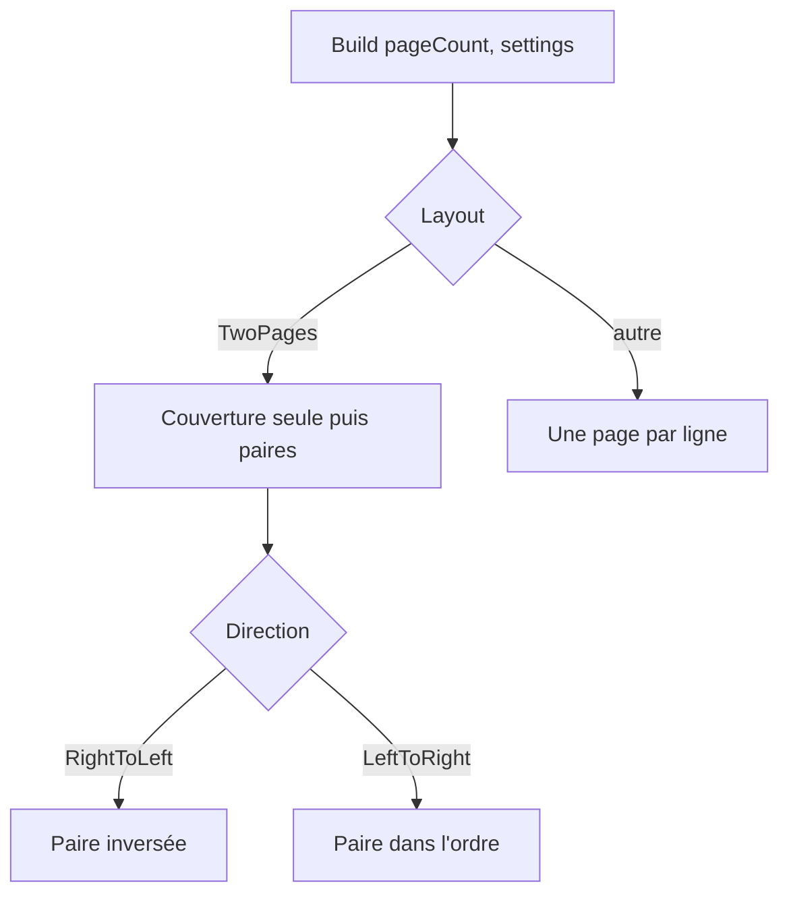

# Modèles et validateurs Web

## Introduction

Le module `Web_Models_And_Validators` regroupe les petits objets de la couche Web qui se placent entre les composants Blazor et le reste de l'application :

- **Validateurs FluentValidation et DTO d'interface** (`Web/Validators`) : `BookUiDto`, `LibraryUiDto`, `BookValidator`, `AddBookValidator`, `LibraryValidator`.
- **Modèles de présentation** (`Web/Models`) : `FormErrors` pour l'affichage des erreurs de formulaire, `ReaderPageWindow` et `ReaderSpreads` pour le lecteur de bandes dessinées.

Ces types ne contiennent pas de logique métier. Ils adaptent des entités du [domaine](../Domain_Model.md) à la saisie dans un formulaire, ou calculent l'état d'affichage du lecteur. Ils sont utilisés par les composants décrits dans [Blazor_UI_Layer](../Blazor_UI_Layer.md), en particulier [Web_Book_Pages](../Blazor_UI_Layer/Web_Book_Pages.md) et [Web_Library_Pages](../Blazor_UI_Layer/Web_Library_Pages.md).

## Architecture

## Validateurs et DTO d'interface

### `BookUiDto`

Hérite de `Entity<Guid>` (voir [Domain_Core](../Domain_Model/Domain_Core.md)). C'est le modèle de formulaire modifiable d'un livre : `Serie`, `Title`, `ISBN`, `VolumeNumber`, `ImageLink`, `Rating`, `Authors`, `Publishers`, `PublishDate`, `NumberOfPages`, `LibraryId`. Les attributs `[Label]` de MudBlazor fournissent les libellés.

Points notables :
- `IsPhysical` vaut `true` par défaut (ajout manuel). Il détermine si l'ISBN est obligatoire : un livre physique l'exige (voir [Domain_Books](../Domain_Model/Domain_Books.md)), un livre numérique importé sans correspondance de métadonnées peut ne pas en avoir.
- `Convert(Book)` construit le DTO depuis une entité. `IsPhysical` est déduit de `book is PhysicalBook`. `Rating` est forcé à 0, car la note provient des dates de lecture.

### `LibraryUiDto`

Équivalent pour une bibliothèque : `Name`, `Color` (défaut `#5C6BC0`), `Icon`, `BookType`, `DefaultBookSortOrder`. `RelativePath` est une propriété calculée en lecture seule : le nom sans diacritiques, en majuscules (`RemoveDiacritics().ToUpperInvariant()`). Elle correspond au dossier de stockage local de la bibliothèque (voir [Persistence_Local_Storage](../File_Storage___Media_Processing/Persistence_Local_Storage.md)). `Convert(Library)` effectue le mapping depuis le domaine.

### `BookValidator`, `AddBookValidator`, `LibraryValidator`

| Validateur | Cible | Règles principales |
|---|---|---|
| `BookValidator` | `BookUiDto` | Titre et série obligatoires, longueurs max (`BookConstants`) ; ISBN obligatoire si `IsPhysical`, format 10 ou 13 chiffres via `IsbnHelper.IsValidISBN` (appliqué si physique ou ISBN non vide) ; `VolumeNumber > 0` ; `Rating` entre 0 et 5 ; `NumberOfPages > 0` si renseigné ; `PublishDate` non future |
| `AddBookValidator` | `BookUiDto` | Hérite de `BookValidator` et ajoute `LibraryId` non vide (« Choose a library ») |
| `LibraryValidator` | `LibraryUiDto` | Nom obligatoire et borné (`LibraryConstants`) ; couleur `^#[0-9A-Fa-f]{6}$` (cascade `Stop`) ; icône obligatoire et bornée ; `BookType` dans l'enum |

Les règles d'ISBN utilisent `ApplyConditionTo.CurrentValidator` pour que la condition `When` ne s'applique qu'au validateur qui la précède et non à toute la chaîne.

### Validation d'une seule propriété : `ValidateValue`

`BookValidator` et `LibraryValidator` exposent `ValidateValue`, un `Func<object, string, Task<IEnumerable<string>>>` conforme au paramètre `Validation` des champs MudBlazor. Il valide uniquement la propriété demandée grâce à `IncludeProperties`, et renvoie les messages d'erreur ou une liste vide.

## Modèles de présentation

### `FormErrors`

Représente les erreurs d'un formulaire après soumission : un message par champ, plus un résumé. `FormErrors.From(ValidationResult)` conserve la première erreur de chaque propriété (`TryAdd`, dans l'ordre des règles). API :

- `For(propertyName)` : message du champ ou `null`.
- `AriaInvalid(propertyName)` : `"true"` pour l'attribut `aria-invalid`, sinon `null` (accessibilité).
- `Count`, `Any`, `Summary` (« 1 field needs your attention. » ou « N fields need your attention. »).
- `FormErrors.None` : instance vide partagée.

### `ReaderPageWindow`

Fenêtre des pages dont l'image est demandée par le lecteur continu. `RequestAround(pageIndex)` marque les pages de `index - PagesBehind (1)` à `index + PagesAhead (3)`, bornées au nombre de pages. Une page demandée n'est jamais libérée : sa hauteur, donc la position de défilement, reste stable. `IsRequested(i)` tolère les index hors bornes.

### `ReaderSpreads`

Calcule les lignes d'affichage du lecteur selon `ReaderSettings` (voir [Book_Reader_Application](../Book___Library_Use_Cases/Book_Reader_Application.md)) :

- Mise en page à une page : une ligne par page.
- Mise en page `TwoPages` : la couverture est seule, puis les pages vont par paires ; une dernière page orpheline reste seule. En lecture `RightToLeft` (mangas), l'ordre d'écran de chaque paire est inversé.

Méthodes : `Count`, `PagesOf`, `FirstPageOf`, `LastPageOf`, `RowOf` (index borné par `Math.Clamp`), `Counter(row)` (« 5 / 188 » ou « 4-5 / 188 »). La construction se fait par `ReaderSpreads.Build(pageCount, settings)`.

## Place dans le système

Ce module appartient à [Web_Platform,_Security___External_Integrations](../Web_Platform,_Security___External_Integrations.md), à côté de [Web_Configuration_And_Auth](Web_Configuration_And_Auth.md) et de [Web_External_Clients_And_Health](Web_External_Clients_And_Health.md). Conformément aux règles de couches, la logique métier reste dans le domaine et les handlers de l'[Application](../Book___Library_Use_Cases.md) : la validation Web ne sert qu'à donner un retour immédiat dans l'interface, les handlers revalidant eux-mêmes leurs entrées.
