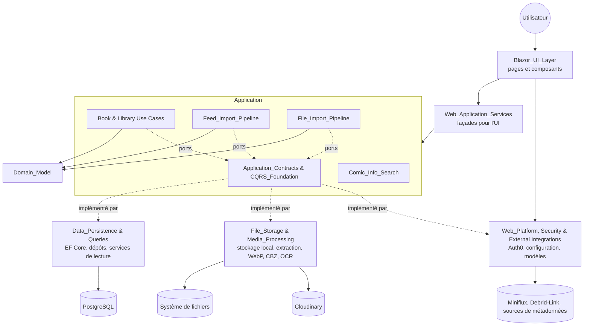
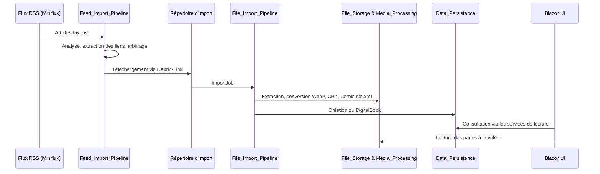

# Vue d'ensemble de `codewiki` (MyComicsManager)

## Objectif

MyComicsManager est une application .NET 10 de gestion de bibliothèques de bandes dessinées, physiques et numériques. Elle permet de :

- cataloguer des livres, avec ISBN, séries et dates de lecture ;
- organiser des bibliothèques et lire des fichiers CBZ, CBR ou PDF dans un lecteur intégré ;
- scanner des ISBN avec OCR ;
- enrichir les métadonnées (`ComicInfo.xml`, recherche d'informations) ;
- importer automatiquement des fichiers, soit déposés dans un répertoire, soit issus d'un flux RSS (Miniflux, Debrid-Link).

Le code suit une **Clean Architecture avec CQRS**. Les erreurs connues passent par le motif `Result<T>` plutôt que par des exceptions. Les règles de couches sont vérifiées par `Architecture.Tests`.

| Couche | Rôle |
|---|---|
| `Domain` | Entités, value objects, erreurs, sans dépendance externe |
| `Application` | Handlers CQRS et interfaces (ports), dépend uniquement du domaine |
| `Persistence` | EF Core/PostgreSQL, requêtes de lecture, stockage de fichiers et traitement des médias |
| `Web` | Blazor Server + MudBlazor, Auth0, jobs Hangfire, clients HTTP externes (racine de composition) |

## Architecture de bout en bout

## Flux de données principal : de l'import à la lecture

Les handlers valident l'entrée et le domaine **avant** tout effet de bord sur les fichiers. Cela évite toute divergence entre le stockage et la base de données.

## Modules principaux

| Module | Description |
|---|---|
| [Domain_Model](Domain_Model.md) | Cœur métier : `Result`, `User`, `Library`, `ImportJob`, livres physiques et numériques, décisions d'import de flux. |
| [Application_Contracts___CQRS_Foundation](Application_Contracts___CQRS_Foundation.md) | Abstractions de messagerie (`ICommand`, `IQuery` et handlers) et interfaces implémentées par Persistence et Web. |
| [Book___Library_Use_Cases](Book___Library_Use_Cases.md) | Cas d'usage des livres, du lecteur, du scan d'ISBN, des bibliothèques, des paramètres, des statistiques et des utilisateurs. |
| [Comic_Info_Search](Comic_Info_Search.md) | Recherche d'informations sur les bandes dessinées pour enrichir les métadonnées. |
| [Feed_Import_Pipeline](Feed_Import_Pipeline.md) | Import automatisé depuis Miniflux : extraction de liens, arbitrage, téléchargement, jobs Hangfire. |
| [File_Import_Pipeline](File_Import_Pipeline.md) | Jobs d'import de fichiers et services Web associés. |
| [Data_Persistence___Queries](Data_Persistence___Queries.md) | EF Core, dépôts, migrations et services de lecture. |
| [File_Storage___Media_Processing](File_Storage___Media_Processing.md) | Dossiers de bibliothèque, extraction d'archives et de PDF, WebP, CBZ, `ComicInfo.xml`, OCR, Cloudinary. |
| [Web_Application_Services](Web_Application_Services.md) | Services Web (livres, bibliothèques, statistiques) qui servent de façade à l'UI Blazor. |
| [Web_Platform,_Security___External_Integrations](Web_Platform,_Security___External_Integrations.md) | Configuration, authentification Auth0, clients externes, health checks, modèles et validateurs. |
| [Blazor_UI_Layer](Blazor_UI_Layer.md) | Pages et composants Blazor/MudBlazor : livres, bibliothèques, administration, mise en page. |

## Technologies clés

PostgreSQL et EF Core, Blazor Server avec MudBlazor, Auth0, Hangfire, Serilog, FluentValidation, Scrutor (enregistrement automatique des handlers) et gestion centralisée des paquets (`Directory.Packages.props`). Les tests couvrent les handlers (xUnit, NSubstitute), le domaine, l'intégration PostgreSQL, les règles d'architecture (NetArchTest) et les composants (bUnit).