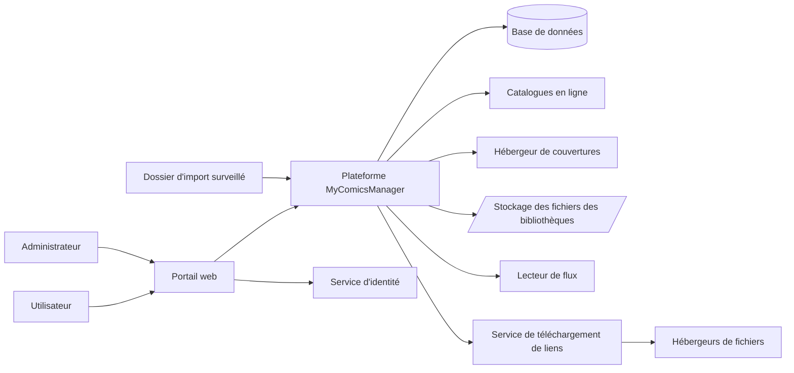
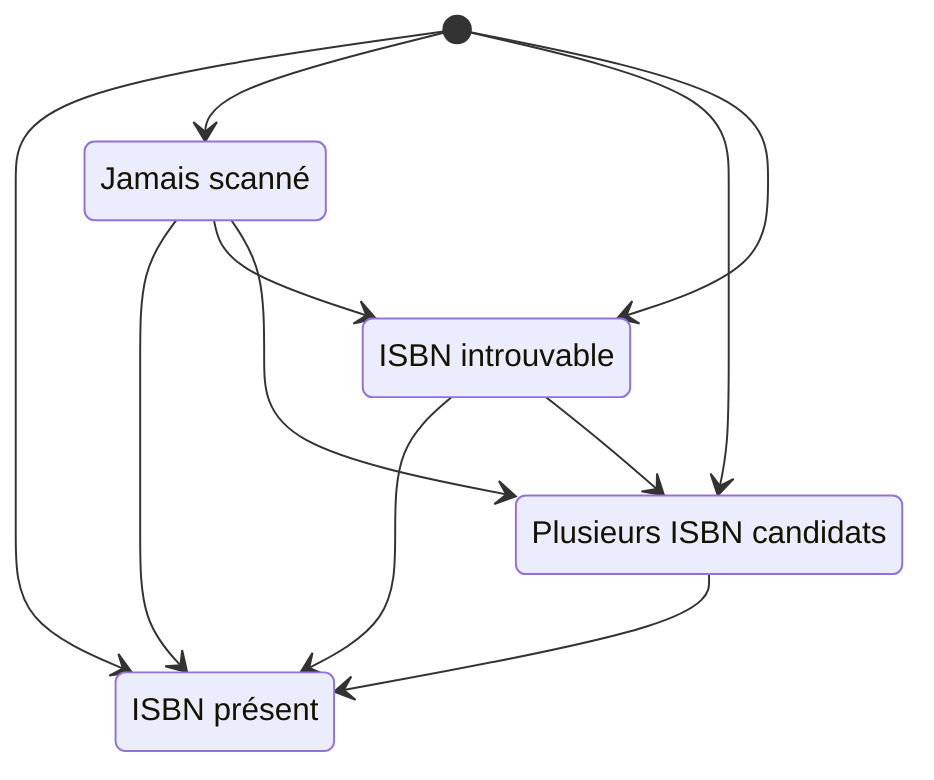
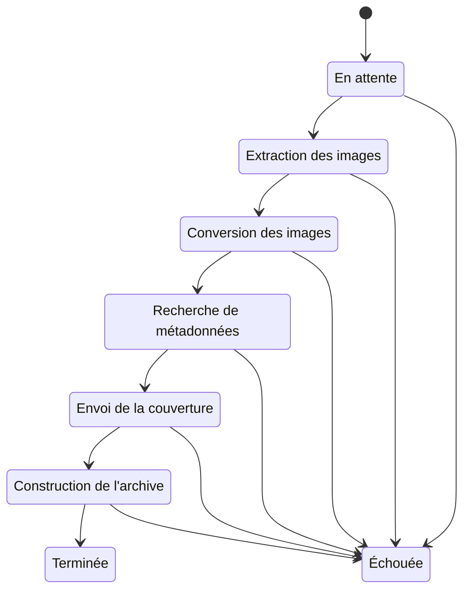
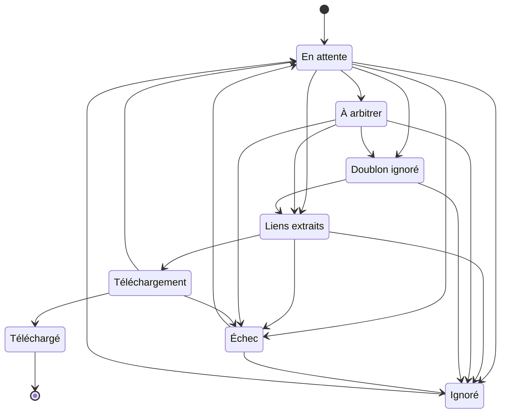
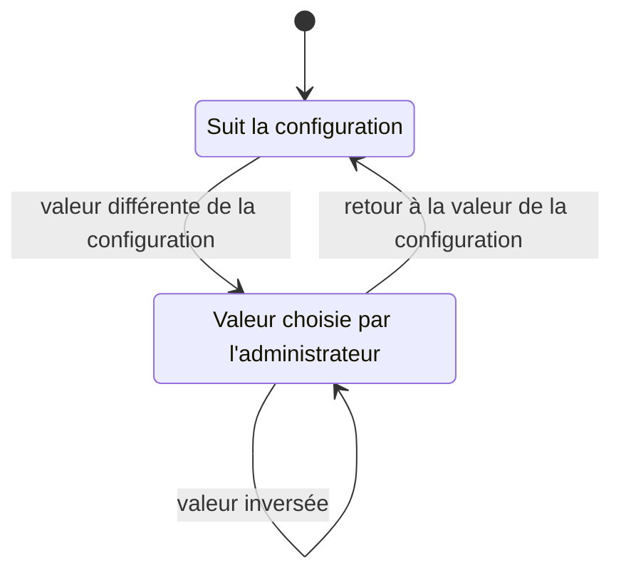
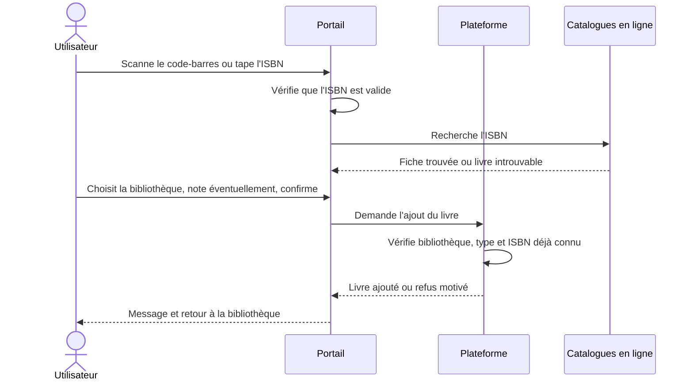
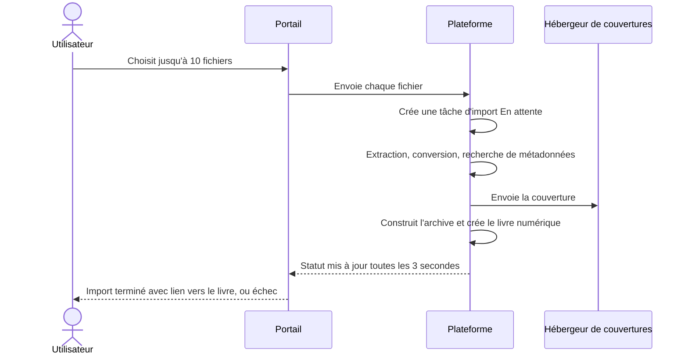

# Spécification des exigences métier — MyComicsManager

## 1. Contrôle du document

| Élément | Valeur |
|---|---|
| Version | 0.1 |
| Date | 2026-10-17 |
| Système cible | MyComicsManager (gestionnaire de bibliothèques de bandes dessinées) |
| Version du code analysée | 631720b92a58d61a0eb09343f7cbfc2f14a5f1ce (branche principale) |
| Mode de génération | Brouillon (draft) : les exigences Brouillon et En revue sont incluses et signalées |
| Langue | Français (les textes affichés à l'écran par l'application sont en anglais et cités entre guillemets) |

**État de confirmation des exigences**

| Confirmé | Modifié | En revue | Brouillon | Total | % confirmé |
|---|---|---|---|---|---|
| 0 | 0 | 0 | 80 | 80 | 0 % |

> **Avertissement.** Les exigences non confirmées par le produit décrivent le **comportement actuel** de l'application, tel que relevé dans le code ; elles ne constituent pas une intention déjà validée. Seul le produit peut les confirmer, les corriger ou les rejeter. Ce document est généré : on ne le modifie pas à la main, on corrige les fichiers de travail puis on le régénère.

## 2. Résumé exécutif

- MyComicsManager permet à chaque utilisateur de cataloguer ses bandes dessinées dans des bibliothèques nommées, papier ou numériques.
- Les livres numériques se lisent en ligne, avec reprise à la dernière page, et s'importent depuis des archives déposées sur l'application.
- Un import par flux, désactivé par défaut, récupère automatiquement les sorties repérées dans un lecteur de flux, après arbitrage des doublons et des liens ambigus.
- L'unique canal utilisateur est le portail web ; les administrateurs règlent en plus les fonctionnalités activables et le niveau de détail des journaux.
- Seuls deux ensembles sont extraits à ce jour : les règles du portail web (66) et celles de la base de données (14). Les règles métier des traitements serveur (livres, bibliothèques, imports, catalogues, statistiques) restent à extraire.
- Aucune des 80 exigences n'est encore confirmée par le produit.
- Risques majeurs : perte possible de fichiers à la suppression d'une bibliothèque ou à la fin d'un import, et mélange de fichiers entre utilisateurs dont les bibliothèques portent des noms proches.
- Décisions attendues : unicité de l'ISBN par utilisateur ou globale, attribution du rôle Administrateur, accessibilité publique de l'état de santé, confirmations avant certaines suppressions.

## 3. Aperçu du produit et périmètre

### 3.1 Finalité (déduite du code, à confirmer)

L'application sert à constituer et suivre une collection personnelle de bandes dessinées : savoir ce qu'on possède, où c'est rangé, ce qu'on a lu et avec quelle note, et, pour les fichiers numériques, les lire directement dans le navigateur. La finalité commerciale et les indicateurs de succès ne se déduisent pas du code et ne sont pas documentés ici.

### 3.2 Canaux

| Canal | Description | Observations |
|---|---|---|
| Portail web | Application consultée dans un navigateur, sur ordinateur ou téléphone : seule porte d'entrée des utilisateurs | Connexion par un service d'identité externe |
| Adresses d'API | Deux adresses qui servent les pages du lecteur et le téléchargement d'un livre numérique | Rattachées aux livres ; pas de couche de services web distincte |
| Tâches de fond | Traitement des imports de fichiers, synchronisation du flux, surveillance du dossier d'import | Internes ; pilotées depuis le portail ou par dépôt de fichiers |
| Supervision | Adresse d'état de santé | Accessible sans connexion (voir D-UI-008) |

### 3.3 Dans le périmètre (comportements extraits)

- Connexion, déconnexion et réservation de l'administration au rôle Administrateur.
- Gestion des bibliothèques : création, modification, suppression, tri, recherche, affichage.
- Ajout d'un livre papier (scan du code-barres, saisie de l'ISBN, saisie manuelle), fiche, modification, lectures datées et notées.
- Déplacement, téléchargement et suppression d'un livre.
- Complément d'une fiche depuis des catalogues en ligne, recherche de l'ISBN dans les pages d'un livre numérique.
- Lecteur en ligne : reprise de lecture, réglages d'affichage, fin de lecture.
- Import de fichiers dans une bibliothèque numérique et suivi des imports.
- Traitement des décisions de l'import par flux.
- Statistiques de la collection.
- Fonctionnalités activables, niveaux de journalisation, état de santé.
- Contraintes de données : unicités, suppressions en cascade, longueurs maximales, détection des modifications concurrentes.

### 3.4 Pas encore couvert ou absent

| Sujet | État |
|---|---|
| Règles métier des traitements serveur : livres, bibliothèques, import de fichiers, import par flux, recherche de métadonnées, statistiques, utilisateurs, administration, stockage de fichiers, exploitation, scripts | **Non extraites à ce jour** (aucune règle ne figure ici pour elles ; seules les règles visibles à l'écran et dans la base sont couvertes) |
| Processus de bout en bout formalisés | Aucun n'est encore rédigé ; la section 7 s'appuie sur les parcours utilisateur |
| Intégrations avec des tiers | Non documentées en tant que telles (voir le contexte ci-dessous) |
| Couche de services web distincte | Absente : l'application est un ensemble unique |
| Traitements batch dédiés | Absents : les tâches de fond sont dans les imports |
| Procédures stockées, fonctions, vues, déclencheurs en base | Absents : la logique en base se limite à des contraintes |
| Back-office distinct du portail | Absent : une seule application, avec une section réservée aux administrateurs (Q-UI-002) |
| Objectifs non fonctionnels (performance, accessibilité, navigateurs) et indicateurs de succès | Hors périmètre de l'extraction |

### 3.5 Vue de contexte

## 4. Acteurs et rôles

| Acteur | Description |
|---|---|
| Visiteur | Personne non connectée : ne voit que l'écran de connexion et la page d'erreur |
| Utilisateur | Personne connectée via le service d'identité ; propriétaire de ses bibliothèques, livres et décisions d'import. Son compte est créé à la première connexion si le service d'identité fournit une adresse de courriel |
| Administrateur | Utilisateur disposant du rôle Administrateur ; seul rôle explicite de l'application (attribution : voir Q-UI-003 et Q-UI-030) |
| Service d'identité | Système externe qui authentifie les utilisateurs et fournit le rôle |

Les données d'un utilisateur lui sont toujours réservées : toutes les demandes sont faites au nom de l'utilisateur connecté.

| Action | Visiteur | Utilisateur | Administrateur |
|---|---|---|---|
| Voir l'écran de connexion et la page d'erreur | Oui | Oui | Oui |
| Voir toute autre page | Non (renvoi à la connexion) | Oui | Oui |
| Voir l'état de santé technique (adresse de supervision) | Oui (sans connexion) | Oui | Oui |
| Créer, modifier, supprimer ses bibliothèques | Non | Oui | Oui |
| Ajouter, modifier, supprimer, déplacer ses livres | Non | Oui | Oui |
| Lire et télécharger ses livres numériques | Non | Oui | Oui |
| Importer des fichiers, suivre et effacer ses imports | Non | Oui | Oui |
| Traiter les décisions d'import par flux | Non | Oui | Oui |
| Lancer la synchronisation du flux | Non | Oui, si la fonctionnalité est activée | Oui, si activée |
| Voir ses statistiques | Non | Oui | Oui |
| Voir compte, santé du système, version | Non | Oui | Oui |
| Activer ou couper une fonctionnalité | Non | Non (non affiché ; non contrôlé côté serveur, D-UI-001) | Oui |
| Régler les niveaux de journalisation | Non | Non (renvoi à la connexion) | Oui |
| Ouvrir le tableau de bord des tâches de fond | Non | Non | Oui |

Aucun circuit d'approbation, aucune correction soumise à validation et aucun rapport d'administration n'existent à l'écran. Les changements de fonctionnalités et de niveaux de journalisation sont seulement tracés dans les journaux applicatifs, sans identité de l'administrateur et sans historique consultable.

## 5. Glossaire métier

| Terme | Définition | Confirmé par le produit |
|---|---|---|
| Livre | Album de bande dessinée du catalogue, physique ou numérique | Non |
| Livre physique | Exemplaire papier possédé par l'utilisateur. À confirmer | Non |
| Livre numérique | Livre disposant d'un fichier d'archive lisible en ligne. À confirmer | Non |
| Série | Ensemble de livres partageant un même titre de série. À confirmer | Non |
| ISBN | Identifiant international d'un livre, utilisé pour la recherche et le scan. À confirmer | Non |
| Métadonnées du livre | Informations descriptives du livre (titre, auteurs, éditeur…). À confirmer | Non |
| Date de lecture | Date à laquelle l'utilisateur a lu un livre ; un livre peut en avoir plusieurs | Non |
| Progression de lecture | Position atteinte dans un livre numérique. À confirmer | Non |
| Réglages du lecteur | Préférences d'affichage de la lecture en ligne. À confirmer | Non |
| Lecteur | Écran de lecture en ligne d'un livre numérique | Non |
| Bibliothèque | Collection nommée de livres, avec type, tri et icône | Non |
| Type de bibliothèque | Nature des livres d'une bibliothèque (physique ou numérique). À confirmer | Non |
| Ordre de tri des livres | Critère de tri des livres d'une bibliothèque. À confirmer | Non |
| Déplacement de livre | Changement de bibliothèque d'un livre (avec son fichier) | Non |
| Utilisateur | Personne authentifiée propriétaire de ses livres et bibliothèques. À confirmer | Non |
| Administrateur | Utilisateur ayant le rôle Administrateur, autorisé à superviser les tâches de fond | Non |
| Tâche d'import | Traitement asynchrone d'un fichier déposé, avec un statut | Non |
| Statut de tâche d'import | État d'avancement d'une tâche d'import. À confirmer | Non |
| Dossier d'import | Dossier surveillé où l'on dépose des archives à importer | Non |
| Archive de bande dessinée | Fichier cbz, cbr, zip, rar ou pdf contenant les pages d'un album | Non |
| Analyse des pages (OCR) | Lecture du texte de pages pour retrouver l'ISBN d'un livre importé | Non |
| Scan ISBN | Recherche automatique de l'ISBN sur les pages d'un livre ou d'une bibliothèque | Non |
| Fonctionnalité activable | Fonction que l'administrateur active ou désactive sans redéploiement | Non |
| Import par flux | Récupération automatique des sorties repérées dans un lecteur de flux | Non |
| Décision d'import par flux | Enregistrement du sort réservé à une entrée du flux (retenue, écartée, téléchargée…). À confirmer | Non |
| Arbitrage | Choix à faire quand plusieurs candidats ou doublons sont possibles. À confirmer | Non |
| Miroir de téléchargement | Lien alternatif d'hébergeur pour un même fichier | Non |
| Bibliothèque « À trier » | Bibliothèque cible par défaut des fichiers téléchargés | Non |
| Catalogue externe | Source tierce de métadonnées (OpenLibrary, BnF, Google Books, Bédéthèque, Bubble) | Non |
| Couverture | Image de couverture d'un livre, hébergée chez un service d'images | Non |
| Statistiques | Indicateurs chiffrés sur la collection et la lecture. À confirmer | Non |
| Garde SSRF | Contrôle qui limite les appels sortants aux hôtes autorisés | Non |
| Surcharge de fonctionnalité | Valeur choisie par l'administrateur pour une fonctionnalité activable, qui remplace celle de la configuration | Non |
| Note de lecture | Appréciation de 1 à 5 donnée à une lecture ; 0 à la création. À confirmer | Non |
| Rang dans l'article | Position d'un livre parmi ceux d'un même article de flux ; 0 pour la décision créée depuis l'entrée | Non |
| Statut de décision d'import | État d'avancement d'une décision (En attente, Liens extraits, À arbitrer, Doublon ignoré, Téléchargement, Téléchargé, Importé (inutilisé), Ignoré, Échec) | Non |
| Nature d'arbitrage | Raison pour laquelle l'utilisateur doit trancher : liens ambigus ou doublon probable | Non |
| Fiche Bédéthèque mémorisée | Adresse de la fiche Bédéthèque d'un ISBN, gardée pour éviter de la rechercher à nouveau | Non |
| Mise en page / sens de lecture | Préférences du lecteur : largeur de page, page seule, deux pages ; gauche à droite ou droite à gauche (mangas) | Non |
| Clés de protection des sessions | Clés qui protègent les cookies de connexion, conservées en base pour survivre à un redéploiement | Non |
| Modifications concurrentes | Refus d'enregistrer une tâche ou une décision modifiée entre-temps par un autre traitement | Non |
| Bibliothèque physique | Bibliothèque de livres papier, où l'on ajoute un livre par scan, saisie d'ISBN ou saisie manuelle. À confirmer | Non |
| Bibliothèque numérique | Bibliothèque de fichiers (CBZ, CBR, PDF…) lisibles dans l'application, alimentée par l'import. À confirmer | Non |
| Lecture (historique) | Passage d'un livre de l'état non lu à lu, daté du jour et noté de 1 à 5 ; un livre peut avoir plusieurs lectures | Non |
| Import d'informations depuis le web | Écran qui compare les valeurs actuelles d'un livre à celles des catalogues en ligne et applique celles que l'utilisateur choisit, champ par champ | Non |
| Mode recherche d'ISBN | Ouverture du lecteur pour retrouver l'ISBN imprimé dans les pages d'un livre, sans enregistrer la progression de lecture | Non |
| Doublon probable | Entrée du flux dont la série et le tome correspondent à un livre déjà possédé ; l'utilisateur doit confirmer ou infirmer | Non |
| Liens ambigus | Entrée du flux qui offre plusieurs fichiers possibles ; l'utilisateur garde le bon ou déclare qu'ils sont identiques | Non |
| Import bloqué | Import ni terminé ni en attente que l'utilisateur peut déclarer en échec. À confirmer | Non |

## 6. Modèle d'information métier

### 6.1 Livre

Album de bande dessinée du catalogue d'un utilisateur, rangé dans une seule bibliothèque. Il est soit **physique** (exemplaire papier), soit **numérique** (archive lisible en ligne, avec un fichier stocké sur le serveur).

| Attribut | Signification | Valeurs / limites |
|---|---|---|
| Bibliothèque | Collection qui contient le livre | Obligatoire, une seule |
| Série, titre | Intitulés de l'album | Obligatoires à la création, 200 caractères au plus |
| ISBN | Identifiant international | Obligatoire pour un livre physique, facultatif pour un livre numérique, 20 caractères au plus |
| Numéro de tome | Position dans la série | Entier, 1 par défaut |
| Auteurs, éditeurs | Texte libre | 200 caractères au plus chacun |
| Date de parution, nombre de pages | Informations facultatives | — |
| Couverture | Lien de l'image | 500 caractères au plus |
| Fichier (numérique) | Archive stockée dans le dossier de la bibliothèque | Taille strictement positive |
| Dernière page lue (numérique) | Reprise de lecture | Entier ≥ 0 |
| Réglages du lecteur (numérique) | Mise en page, défilement, sens de lecture propres au livre | Voir les listes de valeurs ci-dessous |
| ISBN candidats, date du dernier scan (numérique) | ISBN lus dans les pages quand plusieurs ont été trouvés | — |

Listes de valeurs : mise en page (largeur de page par défaut, page seule, deux pages) ; défilement (continu par défaut, page par page) ; sens de lecture (gauche à droite par défaut, droite à gauche pour les mangas).

Cycle de vie : le livre n'a pas de statut. Seul l'état de la recherche d'ISBN d'un livre numérique est dérivé de ses données.

Le déplacement entre bibliothèques n'est pas un changement d'état : il est refusé si la bibliothèque cible est identique ou d'un autre type, et le fichier d'un livre numérique est déplacé avant la mise à jour des données.

### 6.2 Date de lecture

Une lecture enregistre qu'un utilisateur a lu un livre à une date donnée, avec une note ; un livre peut avoir plusieurs lectures.

| Attribut | Signification | Valeurs |
|---|---|---|
| Date | Moment de la lecture | « Maintenant » (heure universelle) lors de l'ajout depuis l'écran |
| Note | Appréciation | 1 à 5 à l'ajout ; 0 à la création d'un livre signifie « non lu » et ne crée aucune lecture |
| Livre | Livre lu | Obligatoire |

Cycle de vie : sans statut. Une lecture est créée (livre noté à la création, ajout depuis la fiche ou le lecteur) ou supprimée (par l'utilisateur ou avec son livre, BR-DB-008). Aucune modification d'une lecture n'est possible depuis l'application (Q-DOM-005).

### 6.3 Bibliothèque

Collection nommée de livres d'un utilisateur, avec une couleur, une icône et un ordre de tri par défaut. Elle est **physique** ou **numérique** et ne contient que des livres de son type.

| Attribut | Signification | Valeurs / limites |
|---|---|---|
| Nom | Intitulé affiché | Non vide, 200 caractères au plus ; unique pour un utilisateur sans tenir compte de la casse ni des espaces de bord (contrôle applicatif seulement, D-DOM-001) |
| Couleur, icône | Affichage | Couleur au format #RRGGBB ; icône de 100 caractères au plus |
| Type | Physique ou numérique | Fixé à la création, jamais modifié |
| Propriétaire | Utilisateur | Obligatoire |
| Ordre de tri par défaut | Tri initial des livres | Plus récents d'abord (défaut), plus anciens d'abord, série puis tome croissant |

Cycle de vie : création, modification (nom, couleur, icône, tri) et suppression par le propriétaire uniquement. Pour une bibliothèque numérique, créer, renommer ou supprimer entraîne la création, le déplacement ou la suppression de ses dossiers (le renommage est annulé si le second déplacement échoue). La suppression emporte les livres (BR-DB-007).

### 6.4 Utilisateur

Personne authentifiée par le service d'identité ; son enregistrement local est créé à la première connexion et sert de propriétaire à ses bibliothèques et décisions d'import.

| Attribut | Signification |
|---|---|
| Courriel | Adresse fournie par le service d'identité, obligatoire pour créer le compte |
| Identifiant d'authentification | Identifiant fourni par le service d'identité, utilisé pour retrouver l'utilisateur à chaque connexion |

Cycle de vie : sans statut ; jamais modifié après sa création (Q-DOM-006). Aucune unicité du courriel ni de l'identifiant n'est garantie par la base (D-DOM-003).

### 6.5 Tâche d'import

Suit le traitement d'une archive (cbz, cbr, zip, rar, pdf) déposée pour une bibliothèque numérique, de l'attente jusqu'à la création du livre ou l'échec.

| Attribut | Signification | Valeurs / limites |
|---|---|---|
| Fichier d'origine | Nom (260 caractères au plus), emplacement (500), taille strictement positive | Un même fichier ne peut avoir qu'une tâche non terminée à la fois (BR-DB-001) |
| Bibliothèque cible | Bibliothèque numérique où le livre sera créé | Obligatoire |
| Livre créé | Livre numérique résultant | Renseigné à la fin de l'import |
| Statut | Étape courante | Huit statuts ci-dessous |
| Dates | Création, fin | La fin n'est renseignée qu'en cas de succès |
| Étape et message d'erreur | Cause de l'échec | 100 et 2 000 caractères au plus |
| Progression de la conversion | Images converties sur le total | Entiers |

Le passage d'un statut au suivant se fait un cran à la fois ; Terminée et Échouée sont définitives. L'échec peut survenir à toute étape, y compris sur action manuelle du propriétaire de la bibliothèque.

Si l'enregistrement de la fin d'import échoue après le déplacement du fichier, le fichier est supprimé et la tâche reste à la dernière étape jusqu'à la prochaine exécution (D-DOM-005).

### 6.6 Décision d'import par flux

Enregistre le sort réservé à un livre repéré dans un article favori du lecteur de flux : analyse, liens trouvés, doublon éventuel, téléchargement ou abandon. Un article peut contenir plusieurs livres, chacun ayant sa décision. Chaque changement de statut est tracé dans un historique.

| Attribut | Signification | Valeurs / limites |
|---|---|---|
| Propriétaire | Utilisateur concerné | Obligatoire |
| Article | Identifiant, titre (500 caractères au plus, tronqué sans rejet) et adresse absolue (2 000 caractères au plus) | Un livre d'un article n'est enregistré qu'une fois par utilisateur (BR-DB-003) |
| Livre reconnu | Série (200), titre (300), tome | — |
| Liens de téléchargement | Candidats, chacun avec au moins un lien alternatif | — |
| Lien retenu, livre apparié, tâche d'import | Suites données à la décision | — |
| Statut | Neuf valeurs | Voir ci-dessous |
| Nature d'arbitrage | Pourquoi l'utilisateur doit trancher | Aucune, liens ambigus, doublon probable |
| Motif, auteur de la décision | Dernière raison (1 000 caractères au plus) ; automatique ou utilisateur | — |
| Étape et message d'erreur | Cause de l'échec | 100 et 2 000 caractères au plus |

Le statut « Importé » n'est affecté nulle part ; il est conservé pour ne pas décaler les valeurs enregistrées et masqué dans les filtres (Q-DOM-001). Un téléchargement est considéré interrompu au-delà d'une heure sans mise à jour (Q-DOM-004). Une décision peut être supprimée sauf pendant un téléchargement en cours.

### 6.7 Surcharge de fonctionnalité

Valeur (activée ou non) choisie par un administrateur pour une fonctionnalité activable ; elle remplace la valeur de la configuration tant qu'elle existe.

| Fonctionnalité activable | Rôle |
|---|---|
| Import par flux | Synchronisation avec le lecteur de flux et téléchargements automatiques |
| Lecture d'ISBN par analyse des pages | ISBN lu sur les pages des livres importés |
| Recherche Bédéthèque | Catalogue en ligne (service payant à quota) |
| Recherche BnF | Catalogue de la Bibliothèque nationale de France |
| Recherche Google Books | Catalogue en ligne |
| Recherche OpenLibrary | Catalogue en ligne |
| Recherche Bubble | Catalogue en ligne (clé d'accès requise) |

L'activation est refusée si la configuration obligatoire manque (import par flux, lecture d'ISBN, Bubble) ; une fonctionnalité inconnue est refusée.

## 7. Processus métier

Aucun processus de bout en bout (P-NNN) n'a encore été formalisé : le dossier des processus est vide à ce jour. Cette section présente donc les **15 parcours utilisateur** du portail, qui jouent ici le rôle de processus. Ils sont identifiés UJ-FO-NNN et se rapportent aux exigences de la section 8. Ce choix par défaut est consigné en Q-PUB-001.

### 7.1 UJ-FO-001 — Se connecter et se déconnecter

**Objectif.** Accéder à ses bibliothèques en s'identifiant, et pouvoir se déconnecter.

**Déclencheur.** Le visiteur demande une page de l'application.

**Déroulement.**

1. Le visiteur non connecté est renvoyé vers l'écran de connexion (l'adresse demandée n'est pas retenue).
2. Il clique sur « Login » et s'identifie auprès du service d'identité externe ; la session est persistante (7 jours, prolongés à chaque usage).
3. Il arrive sur la liste de ses bibliothèques ; son compte est créé à la première connexion.
4. Depuis les paramètres, « Sign out » le déconnecte puis le ramène à l'écran de connexion.

**Cas alternatifs et échecs, tels que l'utilisateur les vit.** Le compte n'est créé que si le service d'identité fournit une adresse de courriel et qu'aucun compte ne porte déjà cet identifiant ; sans courriel, la connexion aboutit mais les écrans échouent ensuite (Q-UI-012). La déconnexion peut être déclenchée depuis une page tierce (D-UI-010).

**Exigences liées.** BR-UI-001, BR-UI-003, BR-UI-064

### 7.2 UJ-FO-002 — Parcourir mes bibliothèques

**Objectif.** Voir ses bibliothèques, leur contenu en un coup d'œil, et naviguer vers les autres parties de l'application.

**Déclencheur.** L'utilisateur ouvre la liste des bibliothèques.

**Déroulement.**

1. Une carte par bibliothèque, classée par nom : jusqu'à trois dernières couvertures, icône, nom, type (physique ou numérique) et nombre de livres ; un sous-titre récapitule le nombre de bibliothèques et de livres.
2. Sans bibliothèque, l'écran invite à en créer une.
3. L'ouverture d'une carte affiche les livres de la bibliothèque (UJ-FO-005).
4. La navigation mène aux statistiques, à l'import, aux flux et aux paramètres ; une pastille signale les arbitrages d'import par flux en attente.

**Cas alternatifs et échecs, tels que l'utilisateur les vit.** Si le premier chargement échoue, l'écran affiche « No libraries yet » en plus d'un message temporaire, ce qui ressemble à un compte vide (D-UI-007).

**Exigences liées.** BR-UI-004

### 7.3 UJ-FO-003 — Créer une bibliothèque

**Objectif.** Créer une bibliothèque de livres papier ou de fichiers numériques, avec un nom, une couleur et une icône.

**Déclencheur.** L'utilisateur choisit « New library ».

**Déroulement.**

1. Le formulaire s'ouvre avec le type « Physical books » présélectionné, une couleur et une icône par défaut, et un aperçu de la carte.
2. L'utilisateur saisit le nom et choisit type, couleur et icône.
3. Il clique sur « Create library » : la saisie est contrôlée ; en cas d'erreur, un résumé et un message par champ s'affichent.
4. Si l'envoi est accepté, la bibliothèque est créée, un message l'annonce et l'utilisateur retourne à la liste (pour une bibliothèque numérique, ses dossiers sont créés avant l'enregistrement).

**Cas alternatifs et échecs, tels que l'utilisateur les vit.** Nom déjà pris par une autre bibliothèque du même utilisateur (casse et espaces de bord ignorés) : « Another library already has this name » ; tout autre refus : « Unable to create the library ». L'utilisateur reste sur le formulaire. Deux utilisateurs peuvent partager un dossier si les noms sont proches (D-UI-009).

**Exigences liées.** BR-UI-005, BR-UI-006, BR-UI-007, BR-UI-008, BR-UI-009, BR-UI-010

### 7.4 UJ-FO-004 — Modifier ou supprimer une bibliothèque

**Objectif.** Changer le nom, la couleur ou l'icône d'une bibliothèque, ou la supprimer avec ses livres.

**Déclencheur.** L'utilisateur ouvre le menu d'une bibliothèque.

**Déroulement.**

1. Le menu propose la modification, l'import (bibliothèques numériques) et la suppression.
2. La modification présente un formulaire prérempli ; le type n'est pas modifiable ; pour une bibliothèque numérique, le renommage déplace aussi ses dossiers.
3. « Save changes » contrôle la saisie, enregistre et ramène à la bibliothèque.
4. La suppression demande une confirmation rappelant la suppression des livres (avec leur nombre) et son caractère irréversible, puis supprime la bibliothèque.

**Cas alternatifs et échecs, tels que l'utilisateur les vit.** Bibliothèque introuvable ou d'un autre utilisateur : page « Library not found » avec bouton de retour. Nom pris : « Another library already has this name » ; autre cause : « Unable to save the changes ». Si l'enregistrement échoue après suppression des dossiers d'une bibliothèque numérique, les fichiers sont perdus (D-DOM-007).

**Exigences liées.** BR-UI-005 à BR-UI-011, BR-UI-016, BR-DB-007

### 7.5 UJ-FO-005 — Consulter, rechercher et trier les livres d'une bibliothèque

**Objectif.** Retrouver un livre, choisir l'ordre et la présentation de la liste.

**Déclencheur.** L'utilisateur ouvre une bibliothèque.

**Déroulement.**

1. La première page de 24 livres s'affiche dans le tri par défaut de la bibliothèque ; la recherche et le mode d'affichage de la dernière visite sont retrouvés.
2. Le défilement charge les pages suivantes à la demande.
3. La recherche porte sur le titre et la série (sans tenir compte de la casse) et s'applique 300 ms après la dernière frappe.
4. Trois tris sont proposés (plus récents, plus anciens, série puis tome) ; le tri choisi devient le tri par défaut de la bibliothèque.
5. Le mode d'affichage (couvertures ou liste) est mémorisé pour la session.
6. Un menu par livre propose les actions disponibles selon le type de la bibliothèque.

**Cas alternatifs et échecs, tels que l'utilisateur les vit.** Échec de chargement : « Failed to load books », sans effacer les livres déjà affichés ; mais un échec du premier chargement affiche l'état vide (D-UI-011). Une recherche faite d'espaces est ignorée tout en affichant un libellé trompeur (D-UI-012). Adresse invalide : retour silencieux à la liste.

**Exigences liées.** BR-UI-012 à BR-UI-016

### 7.6 UJ-FO-006 — Ajouter un livre papier

**Objectif.** Ajouter à une bibliothèque physique un livre en scannant son code-barres, en tapant son ISBN, ou en saisissant ses informations à la main.

**Déclencheur.** L'utilisateur clique sur « New book » dans une bibliothèque physique.

**Déroulement.**

1. Le menu propose « Scan the barcode », « Type the ISBN » et « Enter details manually ».
2. Par scan : un ISBN valide mène à la recherche ; par saisie : l'ISBN est nettoyé des tirets et espaces puis contrôlé.
3. L'écran recherche l'ISBN dans les catalogues en ligne : fiche trouvée, ou formulaire à compléter avec l'ISBN prérempli.
4. L'utilisateur choisit la bibliothèque (présélectionnée si connue ou unique), donne éventuellement une note, puis « Add to <bibliothèque> » (ou « Add book » depuis le formulaire).
5. Le livre est créé, un message l'annonce et l'utilisateur retourne à la bibliothèque.

**Cas alternatifs et échecs, tels que l'utilisateur les vit.** ISBN déjà connu : « This book is already in your libraries » (la recherche porte sur tous les livres de tous les propriétaires, D-UI-020) ; autre échec : « Unable to add the book ». Si le contrôle échoue depuis la fiche trouvée, l'écran bascule vers le formulaire complet. Caméra inutilisable : écran « Camera not available » avec saisie de l'ISBN. Aucune protection côté serveur contre un double envoi (D-DOM-002).

**Exigences liées.** BR-UI-017 à BR-UI-028, BR-DB-010, BR-DB-013

### 7.7 UJ-FO-007 — Consulter et modifier la fiche d'un livre

**Objectif.** Voir la fiche d'un livre, corriger ses informations, gérer son historique de lectures.

**Déclencheur.** L'utilisateur ouvre un livre.

**Déroulement.**

1. La fiche montre couverture, titre, série et tome, auteurs, format, dernière note, détails et historique des lectures ; un livre numérique propose « Read » ou « Continue reading ».
2. « Add a reading » enregistre une lecture à la date du jour avec une note de 1 à 5 (« Save » reste grisé tant qu'aucune étoile n'est choisie).
3. « Edit » ouvre la modification ; « Save changes » valide, enregistre et ramène à la fiche.
4. Une lecture se supprime depuis la modification, après confirmation « Delete this reading? ».

**Cas alternatifs et échecs, tels que l'utilisateur les vit.** Livre inexistant ou d'un autre utilisateur : « Book not found ». ISBN déjà porté par un autre livre : « Another book already has this ISBN » ; autre échec : « Unable to save the changes ». La note d'une lecture existante n'est pas modifiable (Q-DOM-005).

**Exigences liées.** BR-UI-022 à BR-UI-026, BR-UI-028 à BR-UI-030

### 7.8 UJ-FO-008 — Compléter un livre depuis les catalogues en ligne

**Objectif.** Remplacer ou compléter les informations d'un livre avec celles des catalogues en ligne.

**Déclencheur.** L'utilisateur choisit « Import info from the web ».

**Déroulement.**

1. Si le livre a un ISBN, les catalogues activés sont interrogés simultanément, avec une progression ; sans ISBN, aucune recherche n'est faite.
2. Chaque source s'affiche dès sa réponse ; l'échec de l'une n'empêche ni les autres ni l'enregistrement avec les valeurs actuelles.
3. Pour chaque champ, l'utilisateur choisit la valeur actuelle ou celle d'une source ; un ISBN lu dans les pages compte pour un changement.
4. « Apply » met le livre à jour ; une couverture externe est d'abord copiée chez l'hébergeur d'images.
5. « Cancel » revient à la fiche sans rien enregistrer.

**Cas alternatifs et échecs, tels que l'utilisateur les vit.** Aucune source ne connaît le livre : « No source found this book. ». Copie de couverture en échec : l'adresse d'origine est enregistrée avec un avertissement. L'enregistrement ne repasse pas par les contrôles du formulaire (D-UI-004).

**Exigences liées.** BR-UI-036 à BR-UI-040

### 7.9 UJ-FO-009 — Lire un livre numérique

**Objectif.** Lire un livre numérique page par page, reprendre là où l'on s'était arrêté, et le marquer comme lu à la fin.

**Déclencheur.** L'utilisateur choisit « Read » ou « Continue reading ».

**Déroulement.**

1. Le lecteur reprend à la dernière page, avec les réglages mémorisés pour ce livre.
2. L'utilisateur tourne les pages (touches, gestes, curseur, défilement) ; en sens droite-à-gauche, les commandes sont inversées.
3. La progression est enregistrée après une seconde sur une page, à la fermeture et à la sortie.
4. « Display » règle mise en page, défilement et sens de lecture, mémorisés pour le livre.
5. À la dernière page, une fenêtre propose une note (3 par défaut) : « Mark as read » ajoute une lecture à la date du jour, remet la progression à la première page et retourne à la fiche ; « Keep reading » ferme la fenêtre.

**Cas alternatifs et échecs, tels que l'utilisateur les vit.** Livre illisible : écran « This book cannot be read » avec retour à la fiche. Un échec d'enregistrement de la progression n'est que journalisé. À la fin de lecture, l'ajout de la lecture et la remise à zéro de la progression sont deux appels distincts (D-UI-005).

**Exigences liées.** BR-UI-041 à BR-UI-045

### 7.10 UJ-FO-010 — Retrouver l'ISBN d'un livre numérique

**Objectif.** Donner un ISBN à un livre numérique importé sans ISBN, afin d'aller chercher ses informations.

**Déclencheur.** L'utilisateur lance « Find missing ISBNs » sur une bibliothèque, ou le scan sur la fiche d'un livre.

**Déroulement.**

1. Pour une bibliothèque : la lecture des pages est lancée en arrière-plan pour les livres numériques sans ISBN et jamais analysés.
2. Pour un livre : lecture immédiate des pages ; un seul ISBN inconnu est enregistré et ouvre l'import d'informations ; plusieurs ISBN (ou un seul déjà porté par un autre livre) sont proposés au choix ; aucun ISBN ou pages illisibles : message dédié.
3. Dans le lecteur en mode recherche d'ISBN (progression non enregistrée), l'utilisateur lit une page ou les premières et dernières pages pour y trouver l'ISBN.
4. Il choisit un ISBN, ce qui ouvre l'import d'informations avec cet ISBN (enregistré à l'application des choix).

**Cas alternatifs et échecs, tels que l'utilisateur les vit.** L'ISBN unique trouvé automatiquement est enregistré sans validation par l'utilisateur (D-UI-024). La progression n'est pas enregistrée en mode recherche d'ISBN (D-UI-023). Lecture impossible : « The pages could not be read ».

**Exigences liées.** BR-UI-034, BR-UI-035, BR-UI-046, BR-UI-047

### 7.11 UJ-FO-011 — Importer des fichiers dans une bibliothèque numérique

**Objectif.** Verser des archives de bandes dessinées dans une bibliothèque numérique et suivre leur traitement.

**Déclencheur.** L'utilisateur ouvre l'écran d'import.

**Déroulement.**

1. L'écran liste les bibliothèques numériques (présélection) et les imports récents ; sans bibliothèque numérique, il invite à en créer une.
2. L'utilisateur choisit jusqu'à 10 fichiers CBZ, CBR, ZIP, RAR ou PDF ; chaque fichier devient un import.
3. Les imports se rafraîchissent toutes les 3 secondes tant que l'un d'eux n'est pas terminé ; un import terminé propose le livre créé.
4. « Clear finished imports » retire les imports terminés ou échoués, sans confirmation.
5. Un import bloqué peut être déclaré en échec.

**Cas alternatifs et échecs, tels que l'utilisateur les vit.** Les échecs sont listés par fichier. Un fichier dépassant la taille maximale provoque une erreur non interceptée (D-UI-030). Un même fichier peut être envoyé deux fois (D-UI-031). L'action « forcer l'échec » n'est pas proposée pour un import en attente.

**Exigences liées.** BR-UI-048 à BR-UI-053, BR-DB-001, BR-DB-002

### 7.12 UJ-FO-012 — Traiter les entrées du flux (import par flux)

**Objectif.** Suivre les articles repérés dans le lecteur de flux, trancher les cas ambigus (doublons, liens multiples), relancer, corriger ou nettoyer.

**Déclencheur.** L'utilisateur ouvre l'écran « Feeds » ou y est invité par la pastille de navigation.

**Déroulement.**

1. La liste des décisions s'affiche par pages de 20, filtrable par statut (avec compteurs) et par recherche.
2. « Sync now » lance une synchronisation en arrière-plan, si la fonctionnalité est activée.
3. Pour un doublon probable, l'utilisateur choisit « Not a duplicate » ou « Confirm duplicate » ; pour des liens ambigus, « Keep this link » ou « All these links are the same file ».
4. Il peut aussi forcer le téléchargement, réessayer, corriger la série et le volume (la série est obligatoire), ou ignorer une entrée.
5. Il peut supprimer des décisions (avec confirmation) ou purger les décisions téléchargées.

**Cas alternatifs et échecs, tels que l'utilisateur les vit.** Les décisions en cours de téléchargement ne sont pas supprimées. Sans clé du service de téléchargement, un arbitrage réussi ne lance rien et n'en avertit pas l'utilisateur (D-UI-032). Une seule action à la fois est acceptée.

**Exigences liées.** BR-UI-004, BR-UI-054 à BR-UI-062, BR-DB-003, BR-DB-004, BR-DB-009

### 7.13 UJ-FO-013 — Consulter les statistiques

**Objectif.** Voir le volume de sa collection, la part lue et le rythme de lecture, pour l'ensemble de ses bibliothèques ou pour une seule.

**Déclencheur.** L'utilisateur ouvre « Statistics ».

**Déroulement.**

1. L'écran montre le nombre de livres, la part lue (arrondie à l'entier inférieur pour qu'un seul livre non lu n'affiche jamais 100 %), des indicateurs et un graphique des lectures par mois sur 12 mois.
2. Le choix d'une bibliothèque restreint les chiffres à celle-ci.
3. Sans livre, l'écran affiche « No books yet. ».

**Cas alternatifs et échecs, tels que l'utilisateur les vit.** Échec de chargement : « Failed to load statistics » ; les chiffres de la bibliothèque précédente peuvent rester affichés (D-UI-033).

**Exigences liées.** BR-UI-063

### 7.14 UJ-FO-014 — Déplacer, télécharger ou supprimer un livre

**Objectif.** Changer un livre de bibliothèque, récupérer son fichier, ou le retirer définitivement.

**Déclencheur.** L'utilisateur ouvre le menu d'un livre.

**Déroulement.**

1. Le déplacement propose les autres bibliothèques du même type ; une destination « Suggested » (celle qui contient le plus de livres de la même série) est signalée ; le fichier d'un livre numérique suit.
2. Le téléchargement d'un livre numérique récupère son fichier CBZ.
3. La suppression demande une confirmation rappelant la suppression des lectures et son caractère irréversible, puis supprime le livre (et son fichier pour un livre numérique).

**Cas alternatifs et échecs, tels que l'utilisateur les vit.** Déplacement refusé : motif du serveur ou « Failed to move book » ; si l'enregistrement échoue, le fichier est remis dans sa bibliothèque d'origine. Les refus de téléchargement s'affichent comme une page d'erreur brute. La suppression du fichier a lieu après l'enregistrement, sans contrôle de son résultat (D-UI-034) ; échec : « Failed to delete book ».

**Exigences liées.** BR-UI-031 à BR-UI-033, BR-DB-008

### 7.15 UJ-FO-015 — Administrer l'application

**Objectif.** Activer ou couper des fonctionnalités sans redéploiement, régler le niveau de détail des journaux, accéder au tableau de bord des tâches de fond, vérifier la santé du système.

**Déclencheur.** L'utilisateur ouvre les paramètres ; les actions d'administration exigent le rôle Administrateur.

**Déroulement.**

1. Les paramètres montrent le compte, l'état de santé du système et la version ; la section « Administration » n'apparaît que pour un administrateur.
2. L'administrateur active ou coupe l'une des sept fonctionnalités ; le changement est immédiat et durable.
3. Il règle le niveau de détail des journaux par composant (effet immédiat jusqu'au redémarrage) ou remet les niveaux configurés.
4. Il peut ouvrir le tableau de bord des tâches de fond, qui n'est pas en lecture seule (D-UI-035).

**Cas alternatifs et échecs, tels que l'utilisateur les vit.** L'activation est refusée si la configuration est incomplète (import par flux, lecture d'ISBN, Bubble) ; en cas d'échec, l'interrupteur revient à son état réel. L'attribution du rôle Administrateur n'est pas visible dans le code (Q-UI-030).

**Exigences liées.** BR-UI-002, BR-UI-064 à BR-UI-066, BR-DB-005

### 7.16 Schémas de séquence

**Ajout d'un livre papier (UJ-FO-006)**

**Import de fichiers dans une bibliothèque numérique (UJ-FO-011)**

## 8. Exigences fonctionnelles par capacité métier

Tous les identifiants sont conservés. Les exigences sont regroupées par capacité ; une exigence implémentée à plusieurs niveaux n'apparaît qu'une fois, avec tous ses canaux. Statut : toutes les exigences sont **Brouillon**. « ⚠ non vérifié » signale une confiance faible (aucune à ce jour) ; « (confiance moyenne) » signale une déduction. « Écart relevé » signale un point où la vérification du 2026-10-17 a trouvé la règle inexacte ou incomplète (Q-UI-034).

### 8.1 Compte, accès et administration

Connexion obligatoire, réservation de l'administration, fonctionnalités activables et journalisation.

| ID | Exigence (langage métier) | Canal(aux) | Statut |
|---|---|---|---|
| BR-UI-001 | **Toute page exige une connexion, sauf la connexion et la page d'erreur.** Un visiteur non connecté qui demande une page de l'application est renvoyé vers l'écran de connexion ; seuls l'écran de connexion et la page d'erreur sont accessibles sans être connecté. Conditions : Les pages « Connexion » et « Erreur » sont explicitement anonymes. Résultat en cas de refus ou d'échec : Redirection vers l'écran de connexion. | Portail web | Brouillon |
| BR-UI-003 | **Après connexion, l'utilisateur arrive sur la liste des bibliothèques.** Le bouton « Login » mène à la connexion externe, puis l'utilisateur est renvoyé sur la liste de ses bibliothèques. | Portail web | Brouillon |
| BR-UI-064 | **La page des paramètres montre le compte, la santé du système et la version.** Les paramètres affichent le nom, le courriel et la photo du compte (photo acceptée seulement si son adresse est en https), un résumé de la santé du système dépliable, la version de l'application et « Sign out ». Conditions : Visible de tout utilisateur connecté. Résultat en cas de refus ou d'échec : « Failed to load system health ». (confiance moyenne) | Portail web | Brouillon |
| BR-UI-002 | **L'administration est réservée au rôle Administrateur dans l'interface.** La section « Administration » des paramètres (niveaux de journalisation, tableau de bord des tâches de fond, fonctionnalités activables) n'est affichée qu'aux administrateurs, et la page des niveaux de journalisation refuse les autres utilisateurs. Conditions : Rôle Administrateur. Le tableau de bord des tâches de fond est protégé de la même façon côté serveur. Résultat en cas de refus ou d'échec : Section absente ; page des niveaux de journalisation refusée (redirection vers la connexion). | Portail web | Brouillon |
| BR-UI-065 | **Un administrateur active ou désactive les fonctionnalités sans redéploiement.** Un administrateur active ou désactive une fonctionnalité (par exemple import par flux, catalogues en ligne) ; le changement s'applique tout de suite et survit à un redémarrage ; remettre la valeur de la configuration supprime la surcharge, et activer une fonctionnalité dont la configuration est incomplète est refusé. Conditions : Rôle Administrateur. Un seul changement à la fois ; en cas d'échec, l'interrupteur revient à son état réel. Résultat en cas de refus ou d'échec : Message d'erreur de la règle serveur ; « Unable to change the feature. » | Portail web | Brouillon |
| BR-UI-066 | **Un administrateur règle les niveaux de journalisation jusqu'au redémarrage.** Un administrateur règle le niveau de détail des journaux par composant (Debug, Info, Warning, Error, None) ou le laisse hérité du parent ; le changement est immédiat et dure jusqu'au prochain redémarrage ; « Reset » remet tous les niveaux à leur valeur configurée. Conditions : Rôle Administrateur. | Portail web | Brouillon |
| BR-DB-005 | **Une seule surcharge par fonctionnalité.** Une fonctionnalité activable a au plus une valeur choisie par l'administrateur. Conditions : Choisir la valeur de la configuration supprime la surcharge au lieu de la stocker. Résultat en cas de refus ou d'échec : Enregistrement refusé. | Plateforme (base de données) | Brouillon |
| BR-DB-014 | **Les clés de protection des sessions survivent à un redéploiement.** Les clés qui protègent les cookies d'authentification sont conservées en base, afin que les utilisateurs restent connectés après un redéploiement. Conditions : Le chiffrement au repos de ces clés n'est pas configuré dans la base (non vérifié, Q-DOM-009). (confiance moyenne) | Plateforme (base de données) | Brouillon |

### 8.2 Bibliothèques

Création, modification, suppression, tri, recherche et affichage des bibliothèques.

| ID | Exigence (langage métier) | Canal(aux) | Statut |
|---|---|---|---|
| BR-UI-005 | **Le nom d'une bibliothèque est obligatoire et limité à 200 caractères.** Une bibliothèque ne peut être créée ou renommée sans nom, et le nom ne dépasse pas 200 caractères. Conditions : Champ marqué « obligatoire » dans le formulaire. Résultat en cas de refus ou d'échec : Messages « Name is required. » / « Name must not exceed 200 characters. » ; l'enregistrement n'est pas lancé. **Écart relevé en vérification :** Le serveur contrôle aussi le nom d'une bibliothèque (présence et longueur) ; la règle ne mentionnait que l'écran. | Portail web | Brouillon |
| BR-UI-006 | **La couleur et l'icône d'une bibliothèque sont obligatoires.** Une bibliothèque a toujours une couleur au format #RRGGBB et une icône (100 caractères au plus) ; sans choix, la couleur proposée est un indigo et l'icône est « collection de livres ». Conditions : Les couleurs sont choisies dans une palette fixe ; les icônes dans une liste. Résultat en cas de refus ou d'échec : « Color is required. », « Invalid color format. », « Icon is required. », « Icon name must not exceed 100 characters. » **Écart relevé en vérification :** Le serveur contrôle aussi la présence et la longueur de la couleur et de l'icône. | Portail web | Brouillon |
| BR-UI-007 | **Le type d'une bibliothèque se choisit à la création et ne change plus.** À la création, l'utilisateur choisit si la bibliothèque contient des livres papier (« Physical books », par défaut) ou des fichiers numériques (« Digital books ») ; ce type ne peut plus être modifié ensuite. Conditions : À la modification, le choix du type n'est pas proposé et la demande de mise à jour ne le transporte pas. **Écart relevé en vérification :** Le serveur contrôle aussi que le type est une valeur valide. | Portail web | Brouillon |
| BR-UI-010 | **Une bibliothèque portant déjà ce nom est refusée.** Créer ou renommer une bibliothèque avec le nom d'une autre bibliothèque est refusé avec le message « Another library already has this name ». Conditions : Comparaison faite par le serveur ; l'écran ne fait que présenter le message. Résultat en cas de refus ou d'échec : Message d'erreur ; l'utilisateur reste sur le formulaire. (confiance moyenne) **Écart relevé en vérification :** La comparaison des noms ignore la casse et les espaces en début et fin de nom. | Portail web | Brouillon |
| BR-UI-011 | **La suppression d'une bibliothèque demande une confirmation.** Avant de supprimer une bibliothèque, l'utilisateur doit confirmer par un message qui rappelle que la bibliothèque est supprimée avec ses livres et que l'opération est irréversible ; le bouton de confirmation est rouge et il existe un bouton « Cancel ». Résultat en cas de refus ou d'échec : Sans confirmation, rien n'est supprimé. | Portail web | Brouillon |
| BR-UI-012 | **Le tri choisi devient le tri par défaut de la bibliothèque.** Quand l'utilisateur choisit un tri (plus récents d'abord, plus anciens d'abord, série puis tome) dans une bibliothèque, ce choix est enregistré sur la bibliothèque et réutilisé à sa prochaine ouverture ; le tri initial d'une bibliothèque est « plus récents d'abord ». Conditions : Un choix identique au tri actuel ne fait rien. Un nouveau choix annule le précédent s'il est encore en cours. Résultat en cas de refus ou d'échec : Échec : message « Failed to save sort order » et le tri affiché ne change pas. | Portail web | Brouillon |
| BR-UI-013 | **Le mode d'affichage et la recherche sont mémorisés par bibliothèque.** Quand l'utilisateur quitte une bibliothèque puis y revient, le mode d'affichage (couvertures ou liste) et la recherche en cours sont retrouvés ; le mode initial est « couvertures ». Conditions : La durée de conservation n'est pas établie. (confiance moyenne) | Portail web | Brouillon |
| BR-UI-014 | **La recherche porte sur le titre ou la série, après une courte pause.** La recherche d'une bibliothèque cherche dans le titre et la série des livres et s'applique 300 ms après la dernière frappe ; sans résultat, l'écran affiche « No results for “…” » avec une action pour effacer la recherche. Conditions : Une frappe plus récente annule la recherche précédente. | Portail web | Brouillon |
| BR-UI-015 | **Les livres s'affichent par pages de 24, à la demande.** Une bibliothèque affiche ses livres 24 par 24 ; la page suivante se charge quand l'utilisateur atteint le bas de la liste. Un échec de chargement affiche « Failed to load books » sans effacer les livres déjà affichés. Conditions : Un nouveau tri ou une nouvelle recherche rend caduque toute page demandée avant. | Portail web | Brouillon |
| BR-UI-016 | **Les actions d'une bibliothèque dépendent de son type.** Dans une bibliothèque numérique, la barre propose « More actions » (Import, recherche des ISBN manquants) et chaque livre propose Lire, Chercher l'ISBN et Télécharger ; dans une bibliothèque physique, la barre propose « New book » (ajout par scan, ISBN saisi ou saisie manuelle) et ces actions sont absentes. Une bibliothèque vide propose « Import » (numérique) ou « Add your first book » (physique). Conditions : Actions communes : modifier, importer l'information depuis le web, déplacer, supprimer. | Portail web | Brouillon |
| BR-DB-007 | **La suppression d'une bibliothèque supprime ses livres.** Quand une bibliothèque est supprimée, tous les livres qu'elle contient sont supprimés avec elle. Conditions : Pour une bibliothèque numérique, les dossiers sont supprimés avant l'enregistrement en base. | Plateforme (base de données) | Brouillon |
| BR-DB-011 | **Longueurs maximales d'une bibliothèque et d'une tâche d'import.** Le nom d'une bibliothèque compte au plus 200 caractères, sa couleur 7 et son icône 100 ; pour une tâche d'import, le nom de fichier compte au plus 260 caractères, le chemin 500, le message d'erreur 2000 et l'étape en erreur 100. Conditions : Pour une bibliothèque, les valeurs vides ou trop longues sont refusées avant l'enregistrement. Pour une tâche d'import, seules les valeurs vides sont refusées avant l'enregistrement ; les messages d'erreur ne sont pas raccourcis. Résultat en cas de refus ou d'échec : Bibliothèque : demande refusée ; tâche d'import : enregistrement refusé. | Plateforme (base de données) | Brouillon |

### 8.3 Ajout d'un livre papier

Scan, saisie de l'ISBN, saisie manuelle et ajout en un geste.

| ID | Exigence (langage métier) | Canal(aux) | Statut |
|---|---|---|---|
| BR-UI-017 | **Un livre papier ne s'ajoute que dans une bibliothèque physique.** Le formulaire d'ajout ne propose que les bibliothèques physiques ; la bibliothèque d'où l'on vient est présélectionnée, sinon la bibliothèque physique unique s'il n'y en a qu'une, sinon l'utilisateur doit choisir. Conditions : Seules les 100 premières bibliothèques triées par nom sont chargées (voir Q-UI-009). Échec de chargement : « Unable to load your libraries ». Résultat en cas de refus ou d'échec : Message « Choose a library » à l'envoi si aucune n'est choisie. | Portail web | Brouillon |
| BR-UI-018 | **Un ISBN scanné invalide est refusé.** Quand le lecteur de code-barres détecte un ISBN dont la clé de contrôle est fausse, l'écran affiche « Invalid ISBN scanned: … » et reprend le scan ; un ISBN valide mène à la recherche du livre. Conditions : Si la caméra est inutilisable, un message unique est affiché avec une possibilité de réessayer. Résultat en cas de refus ou d'échec : Message d'erreur, scan repris. **Écart relevé en vérification :** Le script de la caméra ignore déjà en silence un code-barres invalide : le message « Invalid ISBN scanned » n'est en pratique pas atteint et, s'il l'était, le scan ne reprendrait pas (D-UI-021). | Portail web | Brouillon |
| BR-UI-019 | **L'ISBN saisi à la main est contrôlé avant la recherche.** L'ISBN tapé à la main est nettoyé des tirets et espaces ; s'il est vide l'écran affiche « Enter the ISBN », s'il n'est pas valide « Enter a valid ISBN: 10 or 13 digits », sinon la recherche du livre est lancée. Conditions : L'aide affichée est « 10 or 13 digits. Dashes and spaces are ignored. ». Résultat en cas de refus ou d'échec : Message sous le champ, pas de recherche. | Portail web | Brouillon |
| BR-UI-020 | **Un livre trouvé s'ajoute en un geste, avec une bibliothèque obligatoire.** Quand les catalogues connaissent l'ISBN, l'écran présente la fiche trouvée (couverture, titre, série, auteurs, parution, source) et le bouton « Add to <bibliothèque> » ajoute le livre ; une note facultative (« Already read it? ») ajoute en plus une date de lecture ; « Edit details before adding » ouvre le formulaire complet. Conditions : Si l'ajout échoue à la validation, l'écran bascule vers le formulaire complet. Résultat en cas de refus ou d'échec : Message « Choose a library » ou erreurs du formulaire. | Portail web | Brouillon |
| BR-UI-021 | **Livre introuvable : le formulaire est proposé, ISBN prérempli.** Quand aucun catalogue ne connaît l'ISBN, ou quand la recherche échoue, le formulaire d'ajout s'ouvre avec l'ISBN prérempli ("Not found online: fill in the details") ; en cas d'échec de la recherche, un avertissement « The catalogues could not be searched: fill in the details » est ajouté. | Portail web | Brouillon |
| BR-UI-027 | **La note à l'ajout est facultative, de 1 à 5.** À l'ajout d'un livre, l'utilisateur peut le noter de 1 à 5 étoiles pour y associer aussitôt une date de lecture ; sans note, aucune lecture n'est créée. Conditions : Valeur 0 = « pas de note » ; hors de 0 à 5, le serveur refuse. Résultat en cas de refus ou d'échec : Message d'erreur du formulaire ou du serveur. | Portail web | Brouillon |

### 8.4 Fiche d'un livre et saisie

Contrôles de saisie des formulaires et de la fiche d'un livre.

| ID | Exigence (langage métier) | Canal(aux) | Statut |
|---|---|---|---|
| BR-UI-008 | **Les erreurs d'un formulaire apparaissent à l'envoi puis suivent la saisie.** Un formulaire (bibliothèque, ajout ou modification de livre) n'affiche aucune erreur avant le premier envoi ; après un envoi refusé, chaque erreur se met à jour à chaque modification d'un champ. Conditions : Un livre trouvé en un geste qui échoue à la validation bascule vers le formulaire détaillé pour montrer l'erreur. Résultat en cas de refus ou d'échec : Résumé d'erreur et message sous le champ concerné. | Portail web | Brouillon |
| BR-UI-009 | **Un formulaire ne peut pas être envoyé deux fois pendant l'enregistrement.** Pendant l'enregistrement d'une bibliothèque, d'un livre ou de ses modifications, les boutons d'envoi sont désactivés et un second envoi est ignoré. Conditions : Garde propre à l'écran ; l'envoi est seulement ignoré pour une même page ouverte. Résultat en cas de refus ou d'échec : Second envoi ignoré sans message. | Portail web | Brouillon |
| BR-UI-022 | **Le titre et la série d'un livre sont obligatoires.** Un livre ne peut être ajouté ou modifié sans titre ni série. Résultat en cas de refus ou d'échec : « Enter a title », « Enter a series ». | Portail web | Brouillon |
| BR-UI-023 | **L'ISBN d'un livre physique est obligatoire et doit être valide.** Pour un livre papier, l'ISBN est obligatoire et doit être un ISBN valide de 10 ou 13 chiffres (20 caractères au plus) ; pour un livre numérique l'ISBN peut rester vide, mais s'il est renseigné il doit être valide. Conditions : Le champ n'est marqué « obligatoire » que pour un livre papier. Résultat en cas de refus ou d'échec : « Enter the ISBN », « Enter a valid ISBN: 10 or 13 digits », « ISBN must not exceed 20 characters. » | Portail web | Brouillon |
| BR-UI-024 | **Le tome et le nombre de pages doivent être supérieurs à zéro.** Le numéro de tome doit être supérieur à 0 (1 par défaut) ; le nombre de pages, s'il est renseigné, doit être supérieur à 0. Conditions : Les champs numériques du formulaire ont aussi un minimum de 1. Résultat en cas de refus ou d'échec : « Volume number must be greater than 0. », « Number of pages must be greater than 0. » (confiance moyenne) | Portail web | Brouillon |
| BR-UI-025 | **La date de parution ne peut pas être dans le futur.** La date de parution d'un livre, si elle est renseignée, ne peut pas être postérieure à aujourd'hui. Conditions : Jour courant en temps universel. Résultat en cas de refus ou d'échec : « Publish date must not be in the future. » (confiance moyenne) | Portail web | Brouillon |
| BR-UI-026 / BR-DB-010 | **Longueurs maximales des champs d'un livre.** Le formulaire limite le titre à 200 caractères, la série à 200, l'ISBN à 20, les auteurs à 200, les éditeurs à 200 et l'adresse de la couverture à 500. Résultat en cas de refus ou d'échec : « Title must not exceed 200 characters. » et messages analogues. — **Même exigence appliquée aussi à l'enregistrement (BR-DB-010) :** Dans la fiche d'un livre, la série et le titre comptent au plus 200 caractères, l'ISBN 20, le lien d'image 500, les auteurs 200, les éditeurs 200 et le chemin du fichier numérique 500. Le formulaire vérifie ces limites ; les autres chemins d'enregistrement ne les vérifient pas et la base refuse alors la valeur (Q-DOM-008). | Portail web ; plateforme (base de données) | Brouillon |
| BR-UI-028 | **Un ISBN déjà présent est refusé à l'ajout et à la modification.** Ajouter un livre dont l'ISBN existe déjà affiche « This book is already in your libraries » ; modifier un livre pour lui donner l'ISBN d'un autre affiche « Another book already has this ISBN ». Conditions : Contrôle fait par le serveur. Résultat en cas de refus ou d'échec : Message, l'utilisateur reste sur l'écran. | Portail web | Brouillon |
| BR-DB-013 | **Un livre est physique ou numérique, jamais les deux.** Chaque livre est soit un livre physique soit un livre numérique ; il possède l'un ou l'autre ensemble de données propres (le fichier et ses réglages de lecture pour le numérique). Conditions : La compatibilité avec le type de la bibliothèque est contrôlée par l'application. Résultat en cas de refus ou d'échec : Création refusée (type de livre incompatible). (confiance moyenne) | Plateforme (base de données) | Brouillon |

### 8.5 Lectures datées et notées

Historique de lecture d'un livre.

| ID | Exigence (langage métier) | Canal(aux) | Statut |
|---|---|---|---|
| BR-UI-029 | **Une lecture ajoutée depuis la fiche exige une note de 1 à 5.** Sur la fiche d'un livre, « Add a reading » enregistre une lecture à la date du jour ; le bouton « Save » reste désactivé tant qu'aucune étoile n'est choisie. Conditions : Pour un livre numérique, le bouton principal est « Lire » ; « Add a reading » reste disponible dans l'historique. Résultat en cas de refus ou d'échec : Bouton désactivé ; le serveur refuse aussi une note hors de 1 à 5. | Portail web | Brouillon |
| BR-UI-030 | **Une lecture se supprime depuis la modification du livre, après confirmation.** Dans la modification d'un livre, chaque lecture peut être supprimée après une confirmation « Delete this reading? » ; une seule suppression de lecture à la fois est possible. Conditions : La note d'une lecture existante n'est pas modifiable depuis l'écran. Résultat en cas de refus ou d'échec : Échec : « Unable to delete the reading ». | Portail web | Brouillon |
| BR-DB-008 | **La suppression d'un livre supprime ses dates de lecture.** Quand un livre est supprimé, toutes ses lectures datées et notées sont supprimées. | Plateforme (base de données) | Brouillon |

### 8.6 Déplacement, téléchargement et suppression d'un livre

| ID | Exigence (langage métier) | Canal(aux) | Statut |
|---|---|---|---|
| BR-UI-031 | **La suppression d'un livre demande une confirmation.** Avant de supprimer un livre, depuis sa fiche ou depuis la bibliothèque, l'utilisateur confirme un message qui rappelle que le livre est supprimé avec ses lectures et que l'opération est irréversible. Résultat en cas de refus ou d'échec : Sans confirmation, rien n'est supprimé ; échec : « Failed to delete book ». | Portail web | Brouillon |
| BR-UI-032 | **Un livre ne se déplace que vers une autre bibliothèque du même type.** Le déplacement propose seulement les autres bibliothèques du même type (physique ou numérique), indique que le fichier est déplacé avec le livre, marque une bibliothèque « Suggested », et désactive « Move » tant qu'aucune destination n'est choisie ; sans destination possible, l'écran annonce « No other library of the same type ». Un déplacement à la fois. Conditions : La boîte de dialogue de choix tient lieu de confirmation. Résultat en cas de refus ou d'échec : Échec : message de l'erreur ou « Failed to move book ». | Portail web | Brouillon |
| BR-UI-033 | **Le téléchargement d'un livre est réservé à son propriétaire et aux livres numériques.** « Download CBZ » (ou « CBZ » sur la fiche) télécharge le fichier du livre numérique ; l'adresse de téléchargement refuse un utilisateur non connecté, un livre qui n'est pas à lui, un livre papier, et un fichier hors du dossier de stockage. Conditions : Livres numériques seulement. Résultat en cas de refus ou d'échec : Non autorisé, introuvable ou « Only digital books can be downloaded. » | Portail web ; adresse de téléchargement | Brouillon |

### 8.7 Informations en ligne et recherche d'ISBN

Complément d'une fiche depuis les catalogues et lecture de l'ISBN dans les pages d'un livre numérique.

| ID | Exigence (langage métier) | Canal(aux) | Statut |
|---|---|---|---|
| BR-UI-034 | **Le lancement de la recherche des ISBN manquants est signalé et non répétable pendant son démarrage.** « Find missing ISBNs » lance en arrière-plan la lecture des pages des livres numériques sans ISBN ; l'écran annonce combien de livres sont traités, ou « Every book of this library has an ISBN or was already scanned » s'il n'y en a aucun, et l'action est grisée pendant le démarrage. Conditions : Les livres déjà analysés sont ignorés. Résultat en cas de refus ou d'échec : « Unable to start the search of the missing ISBNs ». | Portail web | Brouillon |
| BR-UI-035 | **L'issue de la recherche d'ISBN dans les pages oriente l'utilisateur.** Après « Scan » sur la fiche d'un livre numérique : un ISBN unique trouvé est enregistré et mène à l'import d'informations (« ISBN found in the pages ») ; plusieurs ISBN proposent un choix (« Several ISBNs found in the pages: pick the book's own ») ; aucun ISBN donne « No ISBN found in the pages » ; une lecture impossible donne « The pages could not be read ». Conditions : Une analyse à la fois (bouton grisé). Résultat en cas de refus ou d'échec : Voir issues. **Écart relevé en vérification :** Le serveur enregistre l'ISBN unique inconnu sans validation de l'utilisateur ; un ISBN unique déjà porté par un autre livre, ou plusieurs ISBN, sont proposés au choix (D-UI-024). | Portail web | Brouillon |
| BR-UI-046 | **Le mode recherche d'ISBN ne sauvegarde pas la progression.** Quand le lecteur est ouvert pour chercher l'ISBN, il ne retient ni la page ni la fin de lecture : il affiche « ISBN search · progress not saved » et ne propose pas de marquer le livre comme lu. Conditions : Mode demandé depuis la bibliothèque, la fiche ou le bouton « Look in the reader ». | Portail web | Brouillon |
| BR-UI-047 | **La lecture du texte des pages propose les ISBN trouvés.** Dans le lecteur, « Find the ISBN on this page » lit le texte de la page affichée, et le mode recherche d'ISBN lit une à une les premières et dernières pages jusqu'à trouver un ISBN ; les ISBN trouvés sont proposés à l'utilisateur, qui en choisit un pour aller chercher les informations du livre (la progression est alors enregistrée avant de quitter). Conditions : Délai de 2 minutes par page (le premier usage télécharge le moteur de lecture). Aucun ISBN : « No ISBN found on this page » ou « No ISBN found in the first and last pages ». Résultat en cas de refus ou d'échec : « Unable to read the text of this page ». **Écart relevé en vérification :** En mode recherche d'ISBN, la progression n'est en réalité pas enregistrée avant l'import d'informations (D-UI-023). | Portail web | Brouillon |
| BR-UI-036 | **Les catalogues en ligne sont interrogés en parallèle et indépendamment.** « Import info from the web » interroge en même temps les catalogues activés (BnF, Bédéthèque, Bubble, OpenLibrary, Google Books) pour l'ISBN du livre ; chacun s'affiche dès sa réponse, et l'échec de l'un n'empêche ni les autres ni l'enregistrement avec les valeurs actuelles (« Could not fetch data from …. You can still save with current values. »). Conditions : Chaque source peut être désactivée dans « Settings → Features ». Sans ISBN, aucune recherche. Résultat en cas de refus ou d'échec : Avertissement par source. | Portail web | Brouillon |
| BR-UI-037 | **L'utilisateur choisit la source de chaque champ ; le reste est conservé.** Pour chaque champ (titre, série, tome, auteurs, éditeur, date de parution, nombre de pages, couverture) l'utilisateur choisit la valeur actuelle ou celle d'une source ; un champ non choisi garde sa valeur actuelle, et le bouton d'application reste désactivé tant qu'aucun changement n'est choisi. Conditions : Une valeur de source illisible (tome, date, pages) est ignorée et la valeur actuelle est gardée. Résultat en cas de refus ou d'échec : Échec : « Failed to update book: … ». | Portail web | Brouillon |
| BR-UI-038 | **La couverture externe est copiée chez l'hébergeur d'images avant l'enregistrement.** Si la couverture choisie est une adresse web qui ne pointe pas déjà vers l'hébergeur d'images, elle y est copiée avant l'enregistrement ; si la copie échoue, l'adresse d'origine est enregistrée et un avertissement est affiché (« Cover could not be uploaded to Cloudinary. The original URL will be saved. »). Conditions : Adresses http ou https absolues seulement. Résultat en cas de refus ou d'échec : Avertissement, enregistrement poursuivi. | Portail web | Brouillon |
| BR-UI-039 | **Un ISBN lu dans les pages est enregistré sur le livre.** Quand la page d'import d'informations est ouverte avec un ISBN lu dans les pages du livre et que cet ISBN est valide, il remplace l'ISBN actuel pour la recherche et il est enregistré sur le livre avec l'application des choix ; il compte comme un changement. Conditions : Un ISBN invalide dans l'adresse est ignoré. | Portail web | Brouillon |
| BR-UI-040 | **Une recherche en ligne n'est pas relancée pour le même livre et le même ISBN.** La page d'import d'informations ne relance pas les recherches si le livre et l'ISBN n'ont pas changé, car chaque recherche consomme un quota de services payants (SerpApi, Google). Conditions : Un autre livre ou un autre ISBN relance les recherches. (confiance moyenne) | Portail web | Brouillon |
| BR-DB-006 | **Une seule URL Bédéthèque mémorisée par ISBN.** Pour un ISBN donné, une seule adresse de la fiche Bédéthèque est mémorisée. Conditions : ISBN 20 caractères max, adresse 500 caractères max. Résultat en cas de refus ou d'échec : Enregistrement refusé. | Plateforme (base de données) | Brouillon |

### 8.8 Lecture en ligne

| ID | Exigence (langage métier) | Canal(aux) | Statut |
|---|---|---|---|
| BR-UI-041 | **Le lecteur reprend à la dernière page lue.** Ouvrir un livre numérique dans le lecteur ramène à la dernière page enregistrée, avec les réglages d'affichage de ce livre ; un livre introuvable ou illisible affiche « This book cannot be read » ou un message d'erreur. Conditions : En mode recherche d'ISBN, le lecteur commence à la première page. Résultat en cas de refus ou d'échec : Message d'erreur. | Portail web ; adresses d'API du lecteur | Brouillon |
| BR-UI-042 | **La progression de lecture est enregistrée après une courte pause et à la sortie.** La page atteinte est enregistrée quand l'utilisateur reste une seconde sur une page, à la fermeture du lecteur et à toute sortie de la page, sans avertir en cas d'échec. Conditions : Rien n'est enregistré si la page n'a pas changé. Résultat en cas de refus ou d'échec : Échec silencieux (journalisé). | Portail web | Brouillon |
| BR-UI-043 | **En fin de livre, l'utilisateur peut le marquer comme lu avec une note.** En atteignant la fin d'un livre, le lecteur propose une note de 1 à 5 (3 par défaut) ; « Mark as read » ajoute une lecture à la date du jour, remet la progression à la première page et retourne à la fiche ; « Keep reading » ferme la proposition. Conditions : Non proposé en mode recherche d'ISBN. Le bouton est désactivé pendant l'enregistrement. Résultat en cas de refus ou d'échec : Échec : « Unexpected error while adding reading date ». | Portail web | Brouillon |
| BR-UI-044 | **Les réglages d'affichage du lecteur sont mémorisés par livre.** La mise en page (pleine largeur, page seule, deux pages), le défilement (continu ou page par page) et le sens de lecture choisis sont mémorisés pour ce livre et retrouvés à sa prochaine ouverture ; si la mémorisation échoue, un avertissement est affiché. Conditions : Aide au premier usage affichée une fois (gestes, rotation du téléphone en portrait). Résultat en cas de refus ou d'échec : « Unable to save the display settings ». | Portail web | Brouillon |
| BR-UI-045 | **Le sens de lecture inverse les commandes de page.** En sens droite-à-gauche (mangas), la flèche gauche et la zone gauche de l'écran vont à la page suivante, la flèche droite à la précédente, et la barre de progression se remplit depuis la droite. Conditions : Sens choisi par livre. | Portail web | Brouillon |

### 8.9 Import de fichiers

Dépôt, formats, taille, suivi et nettoyage des imports.

| ID | Exigence (langage métier) | Canal(aux) | Statut |
|---|---|---|---|
| BR-UI-048 | **L'import de fichiers ne propose que les bibliothèques numériques.** L'écran d'import ne liste que les bibliothèques numériques ; la bibliothèque indiquée dans l'adresse est présélectionnée, sinon la première ; sans bibliothèque numérique, l'écran invite à en créer une (« No digital library yet. Create one to import comic files. »). Conditions : 200 bibliothèques au plus chargées. Résultat en cas de refus ou d'échec : « Unable to load the libraries. » | Portail web | Brouillon |
| BR-UI-049 | **Formats et nombre de fichiers acceptés à l'import.** On peut choisir jusqu'à 10 fichiers à la fois, aux formats CBZ, CBR, ZIP, RAR ou PDF ; le choix est impossible tant qu'aucune bibliothèque n'est sélectionnée ou pendant un envoi. Chaque fichier devient un import ; les échecs sont listés par fichier (« <fichier> : <raison> »). Conditions : Le contrôle des extensions est refait côté serveur. Résultat en cas de refus ou d'échec : Message par fichier ; « n file(s) uploaded successfully » si aucun échec. | Portail web | Brouillon |
| BR-UI-050 | **Taille maximale d'un fichier importé.** Un fichier importé ne peut pas dépasser la taille maximale configurée (1 024 Mo dans la configuration du dépôt). Conditions : Valeur de production inconnue. Résultat en cas de refus ou d'échec : Fichier refusé, motif affiché sous l'écran. (confiance moyenne) | Portail web | Brouillon |
| BR-UI-051 | **Le suivi des imports se rafraîchit tant qu'un import n'est pas terminé.** La liste des imports de la bibliothèque (du plus récent au plus ancien) se rafraîchit toutes les 3 secondes tant qu'au moins un import n'est ni terminé ni échoué, puis s'arrête. Conditions : Terminé = Completed ou Failed ; un import terminé propose un lien vers le livre créé. | Portail web | Brouillon |
| BR-UI-052 | **Les imports terminés ou échoués peuvent être effacés de la liste.** Un import terminé ou échoué peut être effacé de la liste, un par un ou tous ensemble (« Clear finished imports »), sans confirmation ; les livres déjà créés ne sont pas concernés. Conditions : Les imports en cours ne peuvent pas être effacés. Résultat en cas de refus ou d'échec : « Unable to delete n job(s) ». | Portail web | Brouillon |
| BR-UI-053 | **Un import bloqué peut être déclaré en échec.** Pour un import ni terminé ni en attente, l'écran propose de le déclarer en échec (« Import marked as failed. »), ce qui permet ensuite de l'effacer et, selon la règle d'unicité des imports, de réimporter le même fichier. Conditions : Proposé pour tout import dont le statut n'est ni terminé ni « Waiting » ; aucune confirmation. Résultat en cas de refus ou d'échec : « Unable to force the job to fail ». (confiance moyenne) **Écart relevé en vérification :** L'action est proposée pour tout import ni terminé ni « Pending » (le statut « Waiting » cité n'existe pas). | Portail web | Brouillon |
| BR-DB-001 | **Un seul import non terminé par fichier source.** Tant qu'une tâche d'import n'est ni terminée ni échouée pour un fichier donné, aucune autre tâche ne peut être créée pour le même chemin de fichier ; une fois la tâche terminée ou échouée, le même fichier peut être importé à nouveau. Conditions : S'applique aux statuts autres que Terminée et Échouée. Résultat en cas de refus ou d'échec : Enregistrement refusé. | Plateforme (imports) | Brouillon |
| BR-DB-002 | **Modifications concurrentes d'une tâche d'import détectées.** Si deux traitements modifient en même temps la même tâche d'import, le second enregistrement est refusé au lieu d'écraser silencieusement le premier. Résultat en cas de refus ou d'échec : Enregistrement refusé. (confiance moyenne) | Plateforme (imports) | Brouillon |

### 8.10 Import par flux

Arbitrage des doublons et des liens ambigus, actions manuelles, suppression.

| ID | Exigence (langage métier) | Canal(aux) | Statut |
|---|---|---|---|
| BR-UI-004 | **Une pastille signale les arbitrages d'import par flux en attente.** Dans la navigation, l'entrée « Feeds » affiche le nombre de décisions d'import qui attendent un arbitrage de l'utilisateur, dès qu'il est supérieur à zéro. Conditions : L'entrée « Feeds » est affichée même si l'import par flux est désactivé (voir Q-UI-005). (confiance moyenne) | Portail web | Brouillon |
| BR-UI-054 | **Les décisions d'import par flux se filtrent par statut et se recherchent.** L'écran « Feeds » liste les décisions par pages de 20 (« Show more »), avec des boutons de filtre par statut affichant leur compteur et une recherche d'articles qui s'applique 400 ms après la frappe. Conditions : Une réponse arrivée après un changement de filtre ou de recherche est ignorée. Résultat en cas de refus ou d'échec : « Unable to load the import decisions. » | Portail web | Brouillon |
| BR-UI-055 | **La synchronisation manuelle n'existe que si l'import par flux est activé.** Le bouton « Sync now » n'est affiché que si la fonctionnalité d'import par flux est activée ; sinon l'écran indique « Miniflux sync is turned off (Settings, Features) ». La demande déclenche une synchronisation en arrière-plan (« Sync started. Refresh the list in a few moments. ») et le bouton est grisé pendant la demande. Conditions : La fonctionnalité est désactivée par défaut dans la configuration du dépôt. Résultat en cas de refus ou d'échec : Demande refusée côté serveur (« désactivé ») si la fonctionnalité est coupée entre-temps. | Portail web | Brouillon |
| BR-UI-056 | **Un doublon probable demande une décision de l'utilisateur.** Quand un livre de même série et même tome existe déjà, l'écran signale un « doublon probable », donne un lien vers le livre existant et demande de choisir « Not a duplicate » ou « Confirm duplicate ». Conditions : Visible sur la carte et dans le détail. Résultat en cas de refus ou d'échec : « Unable to update the decision. » | Portail web | Brouillon |
| BR-UI-057 | **Des liens ambigus demandent un choix de l'utilisateur.** Quand plusieurs liens de téléchargement sont possibles, l'utilisateur garde le bon fichier (« Keep this link ») ou indique que tous les liens désignent le même fichier (« All these links are the same file », proposé s'il y a plusieurs fichiers). Conditions : Les liens sont ouverts dans un nouvel onglet sans transmission de la page d'origine. Résultat en cas de refus ou d'échec : « Unable to update the decision. » | Portail web | Brouillon |
| BR-UI-058 | **Les actions manuelles sur une décision dépendent de son état.** Selon l'état d'une décision, l'écran propose : forcer le téléchargement, réessayer, corriger la série et le volume, ou ignorer. Conditions : Les conditions exactes de chaque action sont calculées par le modèle de vue. (confiance moyenne) | Portail web | Brouillon |
| BR-UI-059 | **La correction de série et de volume exige une série.** Corriger l'analyse du titre d'une décision exige une série (200 caractères au plus), accepte un titre (300 au plus) et un volume non négatif ; « Save » reste grisé tant que la série est vide. Le contrôle de doublon est relancé après la correction. Conditions : Une seule correction en cours à la fois. Résultat en cas de refus ou d'échec : Bouton grisé ; ou « Unable to update the decision. » | Portail web | Brouillon |
| BR-UI-060 | **Une seule action à la fois sur les décisions d'import.** Tant qu'une action est en cours sur une décision, toute autre action sur les décisions est ignorée et les boutons sont grisés. Conditions : Après réussite : « Decision updated. », rechargement et mise à jour de la pastille de navigation. Résultat en cas de refus ou d'échec : Action ignorée sans message. | Portail web | Brouillon |
| BR-UI-061 | **La suppression de décisions demande une confirmation et épargne celles en cours.** Supprimer une ou plusieurs décisions demande une confirmation qui précise que l'historique est supprimé et que les livres déjà importés sont conservés ; les décisions en cours de téléchargement ne peuvent pas être supprimées et sont conservées (« being downloaded will be kept »). Conditions : Le compte rendu distingue les décisions supprimées et non supprimées. Résultat en cas de refus ou d'échec : « Unable to delete the decisions. » | Portail web | Brouillon |
| BR-UI-062 | **La purge des décisions téléchargées demande une confirmation.** « Delete downloaded items » supprime, après confirmation, toutes les décisions téléchargées avec succès et leur historique ; les décisions dont l'import est en cours ou échoué sont conservées. Résultat en cas de refus ou d'échec : « Unable to delete the downloaded decisions. » | Portail web | Brouillon |
| BR-DB-003 | **Une seule décision par livre d'un article et par utilisateur.** Pour un utilisateur, un livre d'un article Miniflux (repéré par le numéro d'entrée et le rang dans l'article) ne peut avoir qu'une seule décision d'import. Conditions : La synchronisation vérifie d'abord si la décision existe déjà. Résultat en cas de refus ou d'échec : Enregistrement refusé. | Plateforme (import par flux) | Brouillon |
| BR-DB-004 | **Modifications concurrentes d'une décision d'import détectées.** Si deux traitements modifient en même temps la même décision d'import par flux, le second enregistrement est refusé. Conditions : Même principe que BR-DB-002. Résultat en cas de refus ou d'échec : Enregistrement refusé. (confiance moyenne) | Plateforme (import par flux) | Brouillon |
| BR-DB-009 | **La suppression d'une décision d'import supprime son historique.** Quand une décision d'import par flux est supprimée, tout son historique de changements de statut est supprimé. Conditions : La suppression est refusée pendant un téléchargement en cours. | Plateforme (import par flux) | Brouillon |

### 8.11 Statistiques

| ID | Exigence (langage métier) | Canal(aux) | Statut |
|---|---|---|---|
| BR-UI-063 | **Les statistiques portent sur toutes les bibliothèques ou sur une seule.** L'écran des statistiques montre, pour toutes les bibliothèques par défaut ou pour celle choisie, le nombre de livres, la part lue, des indicateurs et un graphique des lectures par mois ; sans livre, il affiche « No books yet. Add books to a library to see your statistics. ». Conditions : Un changement de bibliothèque annule le chargement précédent. 200 bibliothèques au plus listées. Résultat en cas de refus ou d'échec : « Failed to load statistics ». | Portail web | Brouillon |

### 8.12 Traçabilité des données

| ID | Exigence (langage métier) | Canal(aux) | Statut |
|---|---|---|---|
| BR-DB-012 | **Les dates de création et de modification sont horodatées à l'enregistrement.** À chaque enregistrement, un nouvel élément reçoit sa date de création et un élément modifié reçoit sa date de modification, en heure UTC. Conditions : La date de création n'est fixée qu'à l'ajout ; les tâches d'import et les décisions d'import portent en plus leur propre date de création. | Plateforme (base de données) | Brouillon |

## 9. Différences entre canaux

| Sujet | Portail web | Autre canal | Observation |
|---|---|---|---|
| Doublon d'import d'un même fichier | Un envoi depuis l'écran reçoit un chemin unique : l'unicité des imports ne joue pas (D-UI-031, Q-UI-033) | Le dépôt dans le dossier surveillé est protégé par l'unicité d'un import non terminé par fichier (BR-DB-001) | Le même fichier peut être importé deux fois depuis l'écran |
| Contrôle de saisie d'un livre | Le formulaire contrôle tome, pages, date de parution et longueurs (BR-UI-024 à BR-UI-026) | L'import d'informations depuis les catalogues ne repasse pas par ces contrôles ; le serveur ne contrôle pas tome, pages ni date (D-UI-003, D-UI-004) | Des valeurs invalides peuvent entrer par ce chemin |
| Réservation de l'administration | Les fonctionnalités activables ne sont affichées qu'aux administrateurs (BR-UI-002) | Aucun contrôle de rôle côté serveur pour changer une fonctionnalité (D-UI-001) ; le tableau de bord des tâches est contrôlé côté serveur | Protection par l'affichage seulement pour les fonctionnalités |
| État de santé | Visible des utilisateurs connectés dans les paramètres (BR-UI-064) | L'adresse de supervision est publique, avec le détail des contrôles (D-UI-008) | À confirmer (Q-UI-013) |
| Téléchargement d'un livre | Bouton réservé aux livres numériques (BR-UI-033) | L'adresse de téléchargement refuse indépendamment tout utilisateur non connecté, livre d'autrui, livre papier ou fichier hors stockage ; le refus s'affiche comme une page d'erreur brute | Contrôle double, présentation des refus différente |
| Tâches de fond | Le bouton de synchronisation n'existe que si l'import par flux est activé (BR-UI-055) | Le serveur refuse aussi la demande si la fonctionnalité est coupée entre-temps | Contrôle présent aux deux endroits |

## 10. Protection des données et comportements de contrôle

| Sujet | Comportement | Référence |
|---|---|---|
| Authentification | Déléguée à un service d'identité externe ; session persistante de 7 jours, prolongée à chaque usage ; aucun mot de passe n'est géré par l'application | BR-UI-001, BR-UI-003, UJ-FO-001 |
| Cloisonnement des données | Les bibliothèques, livres, lectures et décisions d'import sont toujours demandés au nom de l'utilisateur connecté ; modifier ou supprimer une bibliothèque est réservé à son propriétaire | Section 4, UJ-FO-004 |
| Téléchargement | Réservé au propriétaire du livre numérique, sans sortie du dossier de stockage | BR-UI-033 |
| Clés de protection des sessions | Conservées en base pour survivre à un redéploiement ; chiffrement au repos non vérifié | BR-DB-014, Q-DOM-009 |
| Administration | Section, niveaux de journalisation et tableau de bord des tâches réservés au rôle Administrateur | BR-UI-002 |
| Photo du compte | N'est affichée que si son adresse est en https | BR-UI-064 |
| Appels sortants | Un contrôle limite les appels sortants (import par flux) aux hôtes autorisés ; ses règles ne sont pas encore extraites | Glossaire : garde SSRF |
| Atomicité des suppressions | Suppression en cascade d'une bibliothèque vers ses livres puis leurs lectures ; d'une décision d'import vers son historique | BR-DB-007, BR-DB-008, BR-DB-009 |
| Ordre fichiers / base | Création et suppression de dossiers autour de l'enregistrement : risque de divergence si l'enregistrement échoue | D-DOM-007, D-UI-034, D-DOM-005 |
| Retour arrière | Le déplacement d'un livre remet son fichier dans la bibliothèque d'origine si l'enregistrement échoue ; le renommage d'une bibliothèque numérique annule le premier déplacement si le second échoue | UJ-FO-014, UJ-FO-004 |
| Modifications concurrentes | Refusées plutôt que d'écraser silencieusement (tâches d'import, décisions d'import) | BR-DB-002, BR-DB-004 |
| Double envoi | Les boutons d'envoi sont désactivés pendant l'enregistrement ; **aucune protection côté serveur** contre un double envoi | BR-UI-009, BR-UI-060, D-DOM-002 |
| Traçabilité | Dates de création et de modification enregistrées partout ; pas d'historique des actions d'administration | BR-DB-012, section 4 |

## 11. Anomalies suspectées et risques

Ces éléments **ne sont pas des exigences** : ce sont des observations à trier par le produit et l'ingénierie. Le classement par impact est une proposition de la publication (Q-PUB-002). Toutes les anomalies sont au statut « Ouverte », sans décision.

### Impact élevé (3)

| ID | Impact pour l'activité | Décision | Statut |
|---|---|---|---|
| D-DOM-005 | Si l'enregistrement de la fin d'un import échoue après le déplacement du fichier, le fichier est supprimé et l'import reste bloqué à sa dernière étape jusqu'à la prochaine exécution : l'archive peut être perdue pour l'utilisateur. | — | Ouverte |
| D-DOM-007 | À la suppression d'une bibliothèque numérique, ses dossiers sont supprimés avant l'enregistrement ; si l'enregistrement échoue, les livres existent toujours mais leurs fichiers ont disparu. | — | Ouverte |
| D-UI-009 | Le dossier d'une bibliothèque numérique est dérivé de son nom (majuscules, sans accents) sous une racine unique, sans distinction d'utilisateur : deux utilisateurs, ou deux noms proches comme « Café » et « Cafe », partagent un dossier, et supprimer ou renommer l'une touche les fichiers de l'autre (confiance moyenne : l'usage multi-utilisateur en production est inconnu). | — | Ouverte |

### Impact moyen (20)

| ID | Impact pour l'activité | Décision | Statut |
|---|---|---|---|
| D-DOM-001 | L'unicité du nom d'une bibliothèque n'est garantie que par l'application : deux créations simultanées peuvent produire deux bibliothèques de même nom (et de même dossier). | — | Ouverte |
| D-DOM-002 | L'unicité de l'ISBN n'est garantie que par l'application : des doublons sont possibles en cas de créations simultanées (import en parallèle, double clic). | — | Ouverte |
| D-DOM-003 | Aucune unicité du courriel ni de l'identifiant d'authentification n'est garantie en base : deux connexions simultanées d'un même nouvel utilisateur peuvent créer deux comptes et éclater ses bibliothèques. | — | Ouverte |
| D-DOM-004 | Le contrôle d'unicité des imports repose sur deux numéros de statut recopiés à la main : un réordonnancement des statuts casserait silencieusement l'unicité ou bloquerait des réimports. | — | Ouverte |
| D-DOM-006 | La suppression d'une bibliothèque ne supprime pas ses tâches d'import : des tâches orphelines peuvent rester visibles ou être rejouées sur une bibliothèque disparue. | — | Ouverte |
| D-UI-001 | Le changement d'une fonctionnalité activable n'est protégé que par l'affichage : le rôle Administrateur n'est vérifié ni par le service ni par la commande. Risque faible tant que seul l'écran réservé y accède. | — | Ouverte |
| D-UI-003 | Le tome, le nombre de pages et la date de parution ne sont contrôlés que par le formulaire : des valeurs invalides sont acceptées par tout autre chemin (import d'informations, scripts). | — | Ouverte |
| D-UI-004 | L'import d'informations depuis le web enregistre le livre sans repasser par les contrôles du formulaire : un titre, une série ou des auteurs trop longs issus d'un catalogue sont refusés par la base avec un message technique (« Failed to update book »). | — | Ouverte |
| D-UI-005 | En fin de lecture, la lecture est ajoutée puis la progression remise à zéro par deux appels distincts, l'échec du second n'étant que journalisé : le livre peut être marqué lu mais repris à sa dernière page, sans que l'utilisateur le sache. | — | Ouverte |
| D-UI-007 | Au premier chargement de la liste des bibliothèques, un échec laisse afficher « No libraries yet » : une panne ressemble à un compte vide et l'utilisateur peut créer une bibliothèque en croyant repartir de zéro. | — | Ouverte |
| D-UI-008 | L'adresse de supervision est accessible sans connexion et détaille chaque contrôle (base, hébergeur d'images, service de téléchargement, lecteur de flux) : divulgation d'information à tout visiteur, peut-être voulue pour la supervision (Q-UI-013). | — | Ouverte |
| D-UI-011 | Dans une bibliothèque, un échec du premier chargement des livres affiche « No books in this library yet » : une panne ressemble à une bibliothèque vide. | — | Ouverte |
| D-UI-020 | Le contrôle de doublon d'ISBN porte sur tous les livres, quel que soit le propriétaire : un utilisateur ne peut pas ajouter un livre qu'un autre possède, le message « already in your libraries » est trompeur et l'existence d'un ISBN chez un autre utilisateur est révélée (Q-UI-021). | — | Ouverte |
| D-UI-024 | L'analyse automatique d'ISBN enregistre l'ISBN trouvé sans validation : un ISBN lu sur une page de garde (par exemple celui d'un autre tome) est enregistré directement ; seul garde-fou : le contrôle de doublon. | — | Ouverte |
| D-UI-030 | Un fichier dépassant la taille maximale provoque une erreur non traitée par l'écran, au lieu d'un message par fichier ; un fichier partiel est possible dans le dossier d'import. | — | Ouverte |
| D-UI-031 | L'unicité des imports est inopérante pour un envoi depuis l'écran, et la liste des extensions acceptées est dupliquée en dur : une extension ajoutée à la configuration serait refusée par la commande. | — | Ouverte |
| D-UI-032 | Un arbitrage réussi demande un téléchargement, mais sans clé du service de téléchargement rien n'est lancé et seul un journal le signale, alors que l'écran affiche « Decision updated. » ; la demande intervient après l'enregistrement, donc un échec afficherait une erreur pour une décision déjà enregistrée. | — | Ouverte |
| D-UI-033 | Après un échec de chargement des statistiques, les chiffres de la bibliothèque précédente restent affichés sous le nouveau choix. | — | Ouverte |
| D-UI-034 | La suppression du fichier d'un livre numérique a lieu après l'enregistrement, sans contrôle de son résultat : un fichier orphelin est possible sans que l'utilisateur le sache. | — | Ouverte |
| D-UI-035 | Le tableau de bord des tâches de fond n'est pas en lecture seule : un administrateur peut relancer ou supprimer des tâches (impact limité au rôle Administrateur). | — | Ouverte |

### Impact faible (7)

| ID | Impact pour l'activité | Décision | Statut |
|---|---|---|---|
| D-UI-002 | Le message du formulaire de livre dit « between 1 and 5 stars » alors que la valeur 0 (pas de note) est acceptée. | — | Ouverte |
| D-UI-006 | La page d'erreur, accessible sans connexion, affiche à tous un texte destiné aux développeurs (« Development Mode … ») qui indique aussi la technologie utilisée. | — | Ouverte |
| D-UI-010 | La déconnexion est un simple lien sans jeton anti-contrefaçon : une page tierce peut forcer la déconnexion d'un utilisateur. | — | Ouverte |
| D-UI-012 | Une recherche faite uniquement d'espaces est ignorée par le serveur, mais l'écran affiche « N books match “ ” ». | — | Ouverte |
| D-UI-021 | « Invalid ISBN scanned » est en pratique du code mort (la caméra filtre déjà) ; un code-barres invalide est ignoré sans retour, et BR-UI-018 est inexacte. | — | Ouverte |
| D-UI-022 | « Mark as read » du lecteur n'est pas grisé quand la note vaut 0 alors que la fiche exige une étoile ; le serveur refuse alors la note (« Unexpected error while adding reading date »). Confiance basse (Q-UI-022). | — | Ouverte |
| D-UI-023 | En mode recherche d'ISBN, l'appel d'enregistrement de la progression ne fait rien ; BR-UI-047 affirme à tort que la progression est enregistrée. | — | Ouverte |

## 12. Décisions attendues du produit

Personne n'ayant pu répondre pendant l'extraction, l'**option retenue par défaut** est celle qui décrit le comportement actuel du code ; elle est indiquée pour chaque question.

### Périmètre et organisation

| ID | Question pour le produit | Option retenue par défaut |
|---|---|---|
| Q-DISC-001 | Le modèle distingue front-office et back-office : un seul composant d'interface suffit-il ? | Une seule interface ; parcours rangés en front-office (utilisateur) et back-office (administrateur). |
| Q-DISC-002 | Les trois programmes utilitaires de reprise de données font-ils partie du périmètre fonctionnel ? | Inclus comme composant de faible priorité (confiance faible). |
| Q-DISC-003 | Les valeurs de production (fonctionnalités activées, hôtes autorisés, intervalle de synchronisation) sont-elles celles de la configuration du dépôt ? | Oui par défaut ; les configurations de production et de préproduction sont à relire lors de l'extraction. |
| Q-DISC-004 | Faut-il extraire par domaine fonctionnel plutôt que par couche technique ? | Par domaine fonctionnel. |
| Q-DISC-005 | Les traitements de fond sont-ils tous actifs en production ? | Actifs, sauf l'import par flux, désactivé par défaut. |
| Q-UI-001 | Les règles d'écran doivent-elles porter le préfixe FO/BO prévu par la procédure ou le préfixe UI de la carte des composants ? | Règles en BR-UI-nnn ; parcours en UJ-FO-nnn. |
| Q-UI-002 | L'application a-t-elle un back-office distinct du front-office ? | Non : tout est classé en front-office ; l'administration est un parcours (UJ-FO-015). |

### Compte, accès et administration

| ID | Question pour le produit | Option retenue par défaut |
|---|---|---|
| Q-UI-003 | Comment un utilisateur reçoit-il le rôle Administrateur, et la page d'état de santé doit-elle être visible de tout utilisateur connecté ? | Rôle supposé fourni par le service d'authentification ; santé visible de tous les utilisateurs connectés. |
| Q-UI-030 | Comment le rôle Administrateur est-il attribué aux utilisateurs ? | Fourni par la configuration du service d'identité hors dépôt ; confiance moyenne, accessibilité non confirmée. |
| Q-UI-012 | Un utilisateur dont le service d'identité ne fournit pas de courriel doit-il pouvoir se connecter ? | Comportement actuel : la connexion aboutit mais l'accès est impossible. |
| Q-UI-013 | L'adresse d'état de santé, qui détaille la base et les services externes, doit-elle rester publique ? | Publique (probablement pour la supervision). |
| Q-UI-015 | Après connexion, l'utilisateur doit-il revenir à la page demandée plutôt qu'à la liste des bibliothèques ? | Retour à la liste. |
| Q-UI-031 | Faut-il refuser l'activation de Bédéthèque, BnF, Google Books et OpenLibrary quand leur configuration manque ? | Activation toujours acceptée pour ces quatre catalogues. |
| Q-DOM-006 | La modification des informations d'un utilisateur (courriel, identifiant) est-elle attendue ? | Non : un utilisateur n'est jamais modifié après sa création. |
| Q-DOM-009 | Les clés de protection des sessions stockées en base doivent-elles être chiffrées au repos ? | Chiffrement considéré absent, non vérifié en production. |

### Bibliothèques

| ID | Question pour le produit | Option retenue par défaut |
|---|---|---|
| Q-DOM-002 | Les bibliothèques autrefois de type « Toutes » ont-elles été correctement converties en « Physique » ? Certaines contenaient-elles des livres numériques ? | Conversion supposée correcte. |
| Q-DOM-007 | La suppression d'une bibliothèque numérique, qui supprime ses fichiers de façon irréversible, doit-elle être récupérable ? | Suppression définitive, comportement actuel. |
| Q-UI-006 | Combien de temps le mode d'affichage et la recherche d'une bibliothèque doivent-ils être retenus ? | Pour la durée de la session. |
| Q-UI-007 | Le déplacement d'un livre doit-il demander une confirmation distincte, et la suppression d'une bibliothèque doit-elle exiger de retaper son nom ? | Comportement actuel (le choix de destination tient lieu de confirmation ; simple confirmation de suppression). |
| Q-UI-009 | Faut-il lever les plafonds de 100 bibliothèques (ajout de livre) et 200 (import, statistiques) ? | Plafonds sans effet pour un usage personnel. |
| Q-UI-014 | Une bibliothèque numérique doit-elle avoir un dossier propre à chaque utilisateur ? | Application mono-utilisateur de fait ; comportement documenté. |

### Livres, lectures et ISBN

| ID | Question pour le produit | Option retenue par défaut |
|---|---|---|
| Q-DOM-005 | Quelle est la plage de notes valide pour une lecture, 0 signifie-t-il « sans note », et une lecture existante doit-elle être modifiable ? | Plage 1 à 5 ; 0 = sans note à la création ; non modifiable dans l'application. |
| Q-DOM-008 | Les longueurs maximales doivent-elles être contrôlées aussi par le serveur et pas seulement par le formulaire et la base ? | Comportement actuel documenté. |
| Q-UI-008 | Le tome 0 est-il une valeur valide (« inconnu ») ? | Tome 1 par défaut ; 0 non valide dans le formulaire. |
| Q-UI-021 | L'unicité de l'ISBN doit-elle être par utilisateur ou globale ? | Globale, comme dans le code. |
| Q-UI-022 | Peut-on obtenir la note 0 sur l'écran de fin de livre ? | Note 0 non atteignable ; D-UI-022 reste de confiance basse. |
| Q-UI-023 | La fenêtre « You finished this book » doit-elle se fermer sur Échap sans quitter le lecteur ? | Échap ferme le lecteur, comportement actuel. |
| Q-UI-020 | Une exception autre que réseau, délai ou annulation (recherche d'une source, copie de couverture, mise à jour) doit-elle être traitée ? | Comportement actuel conservé. |

### Import de fichiers

| ID | Question pour le produit | Option retenue par défaut |
|---|---|---|
| Q-UI-004 | Faut-il une confirmation avant d'effacer des imports terminés ou de déclarer un import en échec ? | Pas de confirmation, comportement actuel. |
| Q-UI-010 | Quelle taille maximale de fichier est réellement appliquée en production, et faut-il l'indiquer à l'écran ? | 1 024 Mo (valeur du dépôt), non affichée ; production non connue. |
| Q-UI-032 | Faut-il annoncer à l'écran la taille maximale et le nombre maximal de fichiers à l'import ? | Comportement actuel documenté (non annoncés). |
| Q-UI-033 | Un même fichier peut-il être envoyé deux fois à l'import depuis l'écran ? | Oui : pas de blocage des doublons. |

### Import par flux

| ID | Question pour le produit | Option retenue par défaut |
|---|---|---|
| Q-DOM-001 | Le statut de décision d'import « Importé » doit-il être supprimé ? | Considéré comme inutilisé. |
| Q-DOM-004 | Au bout de combien de temps un téléchargement interrompu peut-il être relancé ou supprimé ? Une heure est-elle la bonne valeur ? | Une heure, telle quelle. |
| Q-UI-005 | L'entrée « Feeds » de la navigation doit-elle être masquée quand l'import par flux est désactivé ? | Toujours visible. |
| Q-UI-011 | Quelles sont les conditions exactes des actions « Force download », « Retry », « Fix series / volume » et « Ignore » ? | Règle décrite au niveau de l'écran seulement ; à détailler avec le composant Import par flux. |

### Données

| ID | Question pour le produit | Option retenue par défaut |
|---|---|---|
| Q-DOM-003 | L'absence de clé étrangère entre utilisateur, bibliothèque, tâche d'import, décision et livre est-elle voulue ? | Considérée voulue (« référence logique »). |

### Qualité du document et publication

| ID | Question pour le produit | Option retenue par défaut |
|---|---|---|
| Q-UI-034 | Huit règles (BR-UI-005, 006, 007, 010, 018, 035, 047, 053) sont inexactes ou incomplètes face au code ; qui les corrige ? | Les parcours sont alignés sur le code ; les règles seront reprises à la prochaine vérification. Ce document signale chaque écart. |
| Q-PUB-001 | En l'absence de processus de bout en bout (P-NNN), les parcours utilisateur peuvent-ils tenir lieu de processus dans ce document ? | Oui : la section 7 présente les 15 parcours UJ-FO-001 à 015. |
| Q-PUB-002 | Le classement des anomalies en impact Élevé / Moyen / Faible proposé ici convient-il ? | Classement proposé par la publication à partir de l'impact possible indiqué dans les fiches ; à valider. |
| Q-PUB-003 | Le numéro de version 0.1 et la date du jour conviennent-ils pour cette première publication ? | Version 0.1, mode brouillon, aucune exigence confirmée. |

## 13. Annexes

### Annexe A — Matrice de traçabilité

Chaque exigence renvoie à l'ensemble de fichiers de travail où elle est détaillée et au nombre de citations de code qui la fondent. Les chemins de code ne sont volontairement pas repris ici.

| ID | Fichier de travail | Citations de code | Confiance |
|---|---|---|---|
| BR-DB-001 | Règles de la base de données | 3 | Élevée |
| BR-DB-002 | Règles de la base de données | 2 | Moyenne |
| BR-DB-003 | Règles de la base de données | 2 | Élevée |
| BR-DB-004 | Règles de la base de données | 2 | Moyenne |
| BR-DB-005 | Règles de la base de données | 2 | Élevée |
| BR-DB-006 | Règles de la base de données | 2 | Élevée |
| BR-DB-007 | Règles de la base de données | 2 | Élevée |
| BR-DB-008 | Règles de la base de données | 1 | Élevée |
| BR-DB-009 | Règles de la base de données | 1 | Élevée |
| BR-DB-010 | Règles de la base de données | 4 | Élevée |
| BR-DB-011 | Règles de la base de données | 5 | Élevée |
| BR-DB-012 | Règles de la base de données | 2 | Élevée |
| BR-DB-013 | Règles de la base de données | 2 | Moyenne |
| BR-DB-014 | Règles de la base de données | 1 | Moyenne |
| BR-UI-001 | Règles de l'interface web | 4 | Élevée |
| BR-UI-002 | Règles de l'interface web | 3 | Élevée |
| BR-UI-003 | Règles de l'interface web | 1 | Élevée |
| BR-UI-004 | Règles de l'interface web | 2 | Moyenne |
| BR-UI-005 | Règles de l'interface web | 3 | Élevée |
| BR-UI-006 | Règles de l'interface web | 3 | Élevée |
| BR-UI-007 | Règles de l'interface web | 3 | Élevée |
| BR-UI-008 | Règles de l'interface web | 4 | Élevée |
| BR-UI-009 | Règles de l'interface web | 8 | Élevée |
| BR-UI-010 | Règles de l'interface web | 3 | Moyenne |
| BR-UI-011 | Règles de l'interface web | 4 | Élevée |
| BR-UI-012 | Règles de l'interface web | 4 | Élevée |
| BR-UI-013 | Règles de l'interface web | 3 | Moyenne |
| BR-UI-014 | Règles de l'interface web | 2 | Élevée |
| BR-UI-015 | Règles de l'interface web | 2 | Élevée |
| BR-UI-016 | Règles de l'interface web | 2 | Élevée |
| BR-UI-017 | Règles de l'interface web | 2 | Élevée |
| BR-UI-018 | Règles de l'interface web | 3 | Élevée |
| BR-UI-019 | Règles de l'interface web | 2 | Élevée |
| BR-UI-020 | Règles de l'interface web | 3 | Élevée |
| BR-UI-021 | Règles de l'interface web | 1 | Élevée |
| BR-UI-022 | Règles de l'interface web | 3 | Élevée |
| BR-UI-023 | Règles de l'interface web | 5 | Élevée |
| BR-UI-024 | Règles de l'interface web | 2 | Moyenne |
| BR-UI-025 | Règles de l'interface web | 1 | Moyenne |
| BR-UI-026 | Règles de l'interface web | 2 | Élevée |
| BR-UI-027 | Règles de l'interface web | 3 | Élevée |
| BR-UI-028 | Règles de l'interface web | 4 | Élevée |
| BR-UI-029 | Règles de l'interface web | 3 | Élevée |
| BR-UI-030 | Règles de l'interface web | 1 | Élevée |
| BR-UI-031 | Règles de l'interface web | 2 | Élevée |
| BR-UI-032 | Règles de l'interface web | 3 | Élevée |
| BR-UI-033 | Règles de l'interface web | 3 | Élevée |
| BR-UI-034 | Règles de l'interface web | 2 | Élevée |
| BR-UI-035 | Règles de l'interface web | 1 | Élevée |
| BR-UI-036 | Règles de l'interface web | 3 | Élevée |
| BR-UI-037 | Règles de l'interface web | 3 | Élevée |
| BR-UI-038 | Règles de l'interface web | 1 | Élevée |
| BR-UI-039 | Règles de l'interface web | 1 | Élevée |
| BR-UI-040 | Règles de l'interface web | 1 | Moyenne |
| BR-UI-041 | Règles de l'interface web | 3 | Élevée |
| BR-UI-042 | Règles de l'interface web | 1 | Élevée |
| BR-UI-043 | Règles de l'interface web | 2 | Élevée |
| BR-UI-044 | Règles de l'interface web | 2 | Élevée |
| BR-UI-045 | Règles de l'interface web | 2 | Élevée |
| BR-UI-046 | Règles de l'interface web | 2 | Élevée |
| BR-UI-047 | Règles de l'interface web | 1 | Élevée |
| BR-UI-048 | Règles de l'interface web | 2 | Élevée |
| BR-UI-049 | Règles de l'interface web | 4 | Élevée |
| BR-UI-050 | Règles de l'interface web | 2 | Moyenne |
| BR-UI-051 | Règles de l'interface web | 2 | Élevée |
| BR-UI-052 | Règles de l'interface web | 3 | Élevée |
| BR-UI-053 | Règles de l'interface web | 2 | Moyenne |
| BR-UI-054 | Règles de l'interface web | 2 | Élevée |
| BR-UI-055 | Règles de l'interface web | 3 | Élevée |
| BR-UI-056 | Règles de l'interface web | 1 | Élevée |
| BR-UI-057 | Règles de l'interface web | 1 | Élevée |
| BR-UI-058 | Règles de l'interface web | 1 | Moyenne |
| BR-UI-059 | Règles de l'interface web | 2 | Élevée |
| BR-UI-060 | Règles de l'interface web | 1 | Élevée |
| BR-UI-061 | Règles de l'interface web | 2 | Élevée |
| BR-UI-062 | Règles de l'interface web | 1 | Élevée |
| BR-UI-063 | Règles de l'interface web | 2 | Élevée |
| BR-UI-064 | Règles de l'interface web | 2 | Moyenne |
| BR-UI-065 | Règles de l'interface web | 3 | Élevée |
| BR-UI-066 | Règles de l'interface web | 2 | Élevée |

### Annexe B — Couverture

| Composant | Règles | Anomalies | Questions | Statut |
|---|---|---|---|---|
| Base de données et modèle de domaine | 14 | 7 | 9 | Extrait |
| Interface web (19 écrans) | 66 | 6 (+17 relevées lors de la vérification des parcours) | 11 (+13 relevées lors de la vérification) | Extrait ; parcours UJ-FO-001 à 015 vérifiés |
| Livres | 0 | 0 | 0 | Non démarré |
| Bibliothèques | 0 | 0 | 0 | Non démarré |
| Import de fichiers | 0 | 0 | 0 | Non démarré |
| Import par flux | 0 | 0 | 0 | Non démarré |
| Recherche de métadonnées | 0 | 0 | 0 | Non démarré |
| Statistiques | 0 | 0 | 0 | Non démarré |
| Utilisateurs et authentification | 0 | 0 | 0 | Non démarré |
| Paramètres et administration | 0 | 0 | 0 | Non démarré |
| Stockage de fichiers et services image | 0 | 0 | 0 | Non démarré |
| Exploitation | 0 | 0 | 0 | Non démarré |
| Scripts utilitaires | 0 | 0 | 0 | Non démarré |

Le suivi de couverture ne comporte aucun statut « Vérifié » à ce jour. Les parcours utilisateur ont été relus par trois vérificateurs indépendants le 2026-10-17 (167 éléments contrôlés, 50 corrects, 117 corrigés ou complétés, aucun retiré). Les règles de l'interface web (BR-UI) n'ont pas fait l'objet d'une vérification propre ; huit d'entre elles sont signalées inexactes ou incomplètes (Q-UI-034).

### Annexe C — Comment donner un avis

1. Les fiches de revue destinées au produit seront produites par composant ou par processus ; aucune n'a encore été émise.
2. Pour chaque exigence, anomalie ou question, le produit indique une décision. Valeurs possibles pour une exigence : **Confirmé** (exact tel quel), **Modifié** (avec la formulation approuvée), **Rejeté** (ne correspond pas au besoin), **Obsolète** (n'est plus valable).
3. Pour une anomalie : décider si c'est à corriger, à accepter ou à ignorer. Pour une question : fournir la réponse.
4. Les décisions sont ensuite reportées dans les fichiers de travail, puis ce document est régénéré : le pourcentage confirmé de la section 1 évolue en conséquence.

### Annexe D — Données

Le fichier d'inventaire SQL du projet ne recense aucune requête SQL écrite à la main : l'accès aux données passe par une couche d'accès automatique, qui n'est pas analysée comme du texte SQL. Les chiffres ci-dessous proviennent donc de la fiche de capacité de la base de données.

| Indicateur | Valeur |
|---|---|
| Bases de données | 1 (PostgreSQL, auto-hébergée ; une instance partagée par la préproduction et la production) |
| Tables métier | 12 (bibliothèques, utilisateurs, livres, livres physiques, livres numériques, lectures, fiches Bédéthèque mémorisées, tâches d'import, décisions d'import par flux, historique des décisions, surcharges de fonctionnalités, clés de protection des sessions) |
| Procédures stockées, fonctions, vues, déclencheurs | 0 |
| Tables écrites par plus d'un domaine fonctionnel | 1 : les livres numériques, modifiés à la fois par la gestion des livres et par l'import de fichiers |

**Risque métier.** Les données d'un livre numérique sont écrites par deux domaines (gestion des livres et import de fichiers) : une règle sur ces données (longueurs, compatibilité avec le type de bibliothèque, exclusivité physique ou numérique) peut être appliquée ou contournée à plusieurs endroits (BR-DB-010, BR-DB-013). De plus, aucun lien n'est imposé par la base entre utilisateurs, bibliothèques, tâches d'import, décisions et livres : leur cohérence repose sur l'application (Q-DOM-003, D-DOM-006).

Inventaire détaillé : voir l'inventaire SQL du projet (fichiers de travail, dossier de vue d'ensemble).
