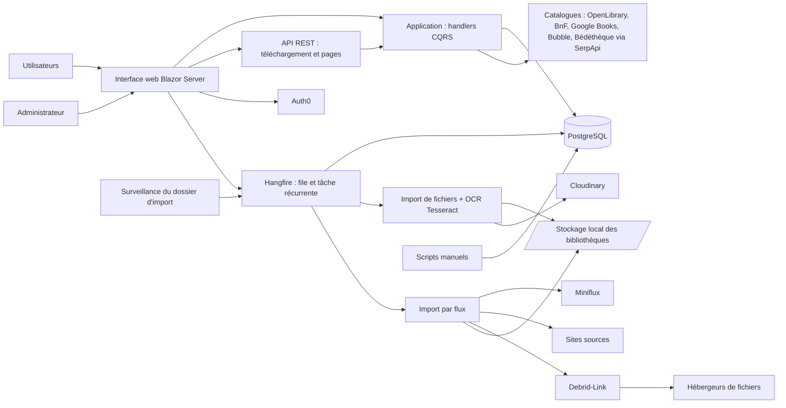

# Contexte système

Produit par `/re-discover` (commit `631720b`, 2026-10-17). Vue métier de la plateforme : composants, base de données partagée et tiers. Aucune règle n'est encore extraite.

## Composants

| Composant | Finalité métier en une ligne | Confiance | Détails |
|---|---|---|---|
| Livres | Cataloguer les bandes dessinées (physiques ou numériques), les ranger en bibliothèques, les lire en ligne et suivre les dates de lecture | Moyenne | `Application/Books/` |
| Bibliothèques | Regrouper les livres par collection nommée (type, tri, icône) | Moyenne | `Application/Libraries/` |
| Import de fichiers | Transformer les archives déposées dans un dossier (cbz, cbr, zip, rar, pdf) en livres numériques, avec détection d'ISBN par OCR | Moyenne | `Web/Services/FileWatcherService.cs`, `Application/ImportJobs/` |
| Import par flux | Récupérer automatiquement les sorties repérées dans un lecteur de flux (articles favoris), arbitrer les doublons puis télécharger les fichiers | Moyenne | `Application/FeedImports/`, ADR 0019 |
| Recherche de métadonnées | Pré-remplir la fiche d'un livre à partir de catalogues externes | Moyenne | `Application/ComicInfoSearch/` |
| Statistiques | Donner une vue chiffrée de la collection et de la lecture | Faible | `Application/Statistics/` |
| Utilisateurs et authentification | Identifier les utilisateurs via Auth0 et distinguer les administrateurs | Élevée | `Web/Program.cs:182-191` |
| Paramètres et administration | Activer/désactiver des fonctionnalités et régler les niveaux de journal à chaud | Élevée | `Domain/Settings/FeatureToggle.cs:5-14` |
| Stockage de fichiers et services image | Stocker les fichiers de bibliothèque, traiter les images, héberger les couvertures | Moyenne | `Persistence/LocalStorage/`, `Persistence/Services/` |
| Exploitation | Surveiller la santé, planifier les tâches de fond, refuser le démarrage si une dépendance manque | Élevée | `Web/Program.cs:288` |
| Scripts utilitaires | Opérations de reprise de données (import en masse, URLs Bédéthèque, couvertures) | Faible | `scripts/` |

## Diagramme de contexte

## Interactions

| De | Vers | Mécanisme | Raison métier | Preuve |
|---|---|---|---|---|
| Interface web | Auth0 | OIDC | Authentifier les utilisateurs | `Web/Program.cs:182-191` |
| Interface web | Hangfire | Mise en file | Exécuter les imports hors de la requête | `Web/Program.cs:52-59` |
| Tâche récurrente | Miniflux | REST | Récupérer les entrées favorites de la catégorie configurée | `Web/Services/FeedImportSyncJob.cs:23`, `Web/Program.cs:286` |
| Import par flux | Debrid-Link | REST | Obtenir des liens de téléchargement directs | `Web/Infrastructure/DebridLinkClient.cs` |
| Surveillance de dossier | File d'import | Fichier → tâche | Importer automatiquement les archives déposées | `Web/Program.cs:265` |
| Recherche de métadonnées | Catalogues externes | REST / HTML | Pré-remplir les fiches | `Web/Program.cs:84-156` |
| Livres | Cloudinary | API | Héberger les couvertures | `Web/appsettings.json` clé `Cloudinary` |
| Administrateur | Tableau Hangfire | HTTP | Superviser les tâches (rôle Admin requis) | `Web/Infrastructure/HangfireAuthorizationFilter.cs:7-12`, `Web/Program.cs:336` |
| Sondes | Dépendances | HTTP `/health` | Santé du système | `Web/Program.cs:349` |

## Processus de bout en bout candidats

| ID proposé | Processus | Point d'entrée probable | Composants |
|---|---|---|---|
| P-001 | Ajout d'un livre (manuel, formulaire, scan ISBN) avec recherche de métadonnées | `/books/add/form`, `/books/add/scan`, `/books/add/manual` | Livres, Recherche, Stockage |
| P-002 | Import d'une archive déposée dans le dossier surveillé | `Web/Services/FileWatcherService.cs` | Import de fichiers, Stockage, Livres |
| P-003 | Import par flux : synchronisation, analyse, arbitrage, téléchargement | Tâche `feed-import-sync` | Import par flux, Import de fichiers |
| P-004 | Lecture d'un livre et suivi de la progression | `/books/{BookId}/read` | Livres |
| P-005 | Déplacement d'un livre entre bibliothèques | Boîte de dialogue de déplacement | Livres, Bibliothèques, Stockage |
| P-006 | Scan ISBN d'une bibliothèque entière | `StartLibraryIsbnScanCommandHandler` | Livres, Import de fichiers |
| P-007 | Activation d'une fonctionnalité par un administrateur | `/settings` | Paramètres, Exploitation |

## Questions ouvertes de la découverte

Personne n'étant disponible pour répondre, l'option par défaut a été retenue et est consignée ici (à reprendre par `/re-coverage` dans la liste consolidée).

| ID | Question | Option retenue par défaut |
|---|---|---|
| Q-DISC-001 | Le préfixe « UI » et un seul composant d'interface suffisent-ils, alors que le modèle distingue front-office et back-office ? | Une seule interface ; les parcours seront rangés dans `05-user-journeys/front-office/` (utilisateur) et `back-office/` (administrateur) |
| Q-DISC-002 | Les trois programmes de `scripts/` font-ils partie du périmètre fonctionnel ? | Inclus comme composant de faible priorité (Faible confiance) |
| Q-DISC-003 | Les valeurs de production (fonctionnalités activées, hôtes autorisés, intervalle de synchronisation) sont-elles celles de `Web/appsettings.json` ? | Oui par défaut ; `appsettings.Production.json` et `appsettings.Staging.json` à relire lors de l'extraction |
| Q-DISC-004 | Les couches Domain/Application/Persistence doivent-elles être extraites par domaine fonctionnel plutôt que par couche ? | Par domaine fonctionnel (le dépôt n'a pas d'unités déployables multiples) |
| Q-DISC-005 | Les processus de fond (Hangfire) sont-ils tous actifs en production ? | Actifs, sauf `FeedImport` désactivé par défaut |

## Constats notables

- Monolithe unique : un seul processus Web héberge UI, API, tâches de fond et surveillance de dossier.
- Base unique PostgreSQL ; migration depuis Neon documentée (`docs/MIGRATION-POSTGRESQL.md`, ADR 0003). Le nom `NeonConnectionUnitTests` subsiste dans la configuration (`Web/appsettings.json`).
- Documentation existante dans `docs/` et `Analysis.md`, non lue ici afin de garder l'extraction fondée sur le code.
