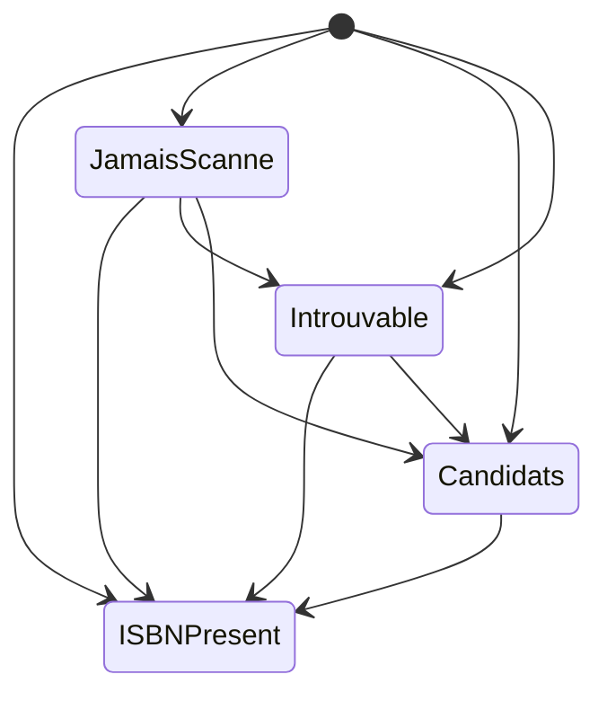

# ENT-Book — Livre

**Statut :** Brouillon · **Composant propriétaire :** Livres (`livres`) · **Stocké dans :** `Books` (socle commun), `PhysicalBooks`, `DigitalBooks` (un livre est de l'un des deux types)

## Définition

Un **livre** est un album de bande dessinée du catalogue d'un utilisateur, rangé dans une et une seule bibliothèque. Il existe en deux variantes exclusives : le **livre physique** (exemplaire papier possédé) et le **livre numérique** (archive lisible en ligne, avec un fichier stocké sur le serveur). Les deux partagent la même fiche descriptive (série, titre, ISBN, tome, auteurs, éditeur…).

## Identifiants

| Identifiant | Signification métier | Source |
|---|---|---|
| Identifiant du livre (GUID) | Identité technique du livre, générée à la création | `Domain/Books/PhysicalBook.cs:23`, `Domain/Books/DigitalBook.cs:115` |
| ISBN (normalisé) | Identifiant international ; sert de clé de détection de doublon à la création et à la modification | `Application/Books/Create/CreateBookCommandHandler.cs:36-43`, `Application/Books/Update/UpdateBookCommandHandler.cs:47-53` |

## Attributs clés (métier uniquement)

| Attribut (nom métier) | Signification | Valeurs / format autorisés | Colonne / champ | Source |
|---|---|---|---|---|
| Bibliothèque | Collection qui contient le livre | Obligatoire, une seule | `LibraryId` | `Domain/Books/Book.cs:8` |
| Série | Titre de la série | Obligatoire à la création ; 200 caractères max | `Serie` | `Domain/Books/Book.cs:12`, `Domain/Books/BookConstants.cs:5` |
| Titre | Titre de l'album | Obligatoire à la création ; 200 caractères max | `Title` | `Domain/Books/Book.cs:14`, `Domain/Books/BookConstants.cs:6` |
| ISBN | Identifiant international | Obligatoire pour un livre physique ; facultatif pour un livre numérique ; 20 caractères max | `ISBN` | `Domain/Books/PhysicalBook.cs:15`, `Domain/Books/PhysicalBook.cs:39-40`, `Persistence/ApplicationDbContext.cs:56` |
| Numéro de tome | Position dans la série | Entier, 1 par défaut | `VolumeNumber` | `Domain/Books/Book.cs:18` |
| Image de couverture | Lien de la couverture | 500 caractères max | `ImageLink` | `Domain/Books/Book.cs:20`, `Domain/Books/BookConstants.cs:8` |
| Auteurs | Auteurs de l'album | Texte, 200 caractères max | `Authors` | `Domain/Books/Book.cs:22`, `Domain/Books/BookConstants.cs:9` |
| Éditeurs | Éditeurs de l'album | Texte, 200 caractères max | `Publishers` | `Domain/Books/Book.cs:24`, `Domain/Books/BookConstants.cs:10` |
| Date de publication | Date de parution | Date, facultative | `PublishDate` | `Domain/Books/Book.cs:26` |
| Nombre de pages | Pagination déclarée | Entier, facultatif | `NumberOfPages` | `Domain/Books/Book.cs:28` |
| Chemin du fichier (numérique) | Emplacement de l'archive dans le dossier de la bibliothèque | Obligatoire, 500 caractères max | `FilePath` | `Domain/Books/DigitalBook.cs:7`, `Domain/Books/DigitalBook.cs:104-110` |
| Taille du fichier (numérique) | Taille de l'archive | Strictement positive à la création | `FileSize` | `Domain/Books/DigitalBook.cs:9`, `Domain/Books/DigitalBook.cs:108` |
| Dernière page lue (numérique) | Position de reprise de lecture (indice de page à partir de zéro) | Entier ≥ 0 | `LastReadPage` | `Domain/Books/DigitalBook.cs:12`, `Domain/Books/DigitalBook.cs:56-65` |
| Réglages du lecteur (numérique) | Mise en page, défilement, sens de lecture choisis pour ce livre | Valeurs définies des trois listes (voir Données de référence) | `ReaderLayout`, `ReaderScrolling`, `ReadingDirection` | `Domain/Books/DigitalBook.cs:15-21`, `Domain/Books/DigitalBook.cs:67-78` |
| ISBN candidats (numérique) | ISBN lus sur les pages quand plusieurs ont été trouvés ; l'utilisateur choisit | Liste de textes non vides, sans doublon | `IsbnCandidates` | `Domain/Books/DigitalBook.cs:23-25`, `Domain/Books/DigitalBook.cs:34-45` |
| Date du dernier scan ISBN (numérique) | Moment où les pages ont été analysées ; vide si jamais | Date UTC | `IsbnScannedAt` | `Domain/Books/DigitalBook.cs:27-28` |

## Cycle de vie

Le livre n'a pas de colonne de statut. Seul l'**état du scan ISBN** d'un livre numérique est dérivé de ses données (jamais stocké) : `Domain/Books/IsbnScanState.cs:17-30`.

| État de départ | État d'arrivée | Déclencheur / qui | Règles | Source (où l'état change) |
|---|---|---|---|---|
| (création) | ISBN présent | Import d'archive dont l'ISBN est connu | — | `Domain/Books/DigitalBook.cs:119` |
| (création) | Jamais scanné | Import d'archive sans résultat de scan (scan désactivé ou non abouti) | — | `Application/ImportJobs/Process/ProcessImportJobCommandHandler.cs:416-430` |
| (création) | Candidats | Import d'archive où le scan lit plusieurs ISBN | — | `Application/ImportJobs/Process/ProcessImportJobCommandHandler.cs:425-429` |
| (création) | Introuvable | Import d'archive où le scan n'a lu aucun ISBN | — | `Application/ImportJobs/Process/ProcessImportJobCommandHandler.cs:425-429` |
| Jamais scanné / Introuvable / Candidats | ISBN présent | Un seul ISBN lu sur les pages : il est attribué au livre | — | `Application/Books/IsbnScan/BookIsbnScan.cs:42-43`, `Domain/Books/Book.cs:80-90` |
| Jamais scanné / Introuvable | Introuvable | Scan sans résultat | — | `Application/Books/IsbnScan/BookIsbnScan.cs:42` |
| Jamais scanné / Introuvable / Candidats | Candidats | Scan avec plusieurs ISBN | — | `Application/Books/IsbnScan/BookIsbnScan.cs:48`, `Domain/Books/DigitalBook.cs:34-45` |
| Candidats | ISBN présent | L'utilisateur choisit l'ISBN (ou modifie la fiche avec un ISBN) : les candidats sont effacés | — | `Domain/Books/Book.cs:58-77`, `Domain/Books/DigitalBook.cs:47-54` |

Le déplacement entre bibliothèques n'est pas un changement d'état mais un changement de rattachement : refusé si l'identifiant de bibliothèque est vide ou identique (`Domain/Books/Book.cs:36-44`), si le type de bibliothèque cible ne correspond pas (`Application/Books/Move/MoveBookCommandHandler.cs:56`) ; le fichier d'un livre numérique est déplacé avant la mise à jour de la base (`Domain/Books/DigitalBook.cs:80-96`).

## Relations

| Entité liée | Relation (métier) | Cardinalité |
|---|---|---|
| [ENT-Library](library.md) | Le livre est rangé dans une bibliothèque du même type que lui | n livres → 1 bibliothèque |
| [ENT-ReadingDate](reading-date.md) | Un livre peut avoir plusieurs lectures datées et notées | 1 livre → 0..n lectures |
| [ENT-ImportJob](import-job.md) | Un livre numérique est le résultat d'une tâche d'import terminée (référence logique, sans contrainte en base) | 1 tâche → 0..1 livre |
| [ENT-FeedImportDecision](feed-import-decision.md) | Une décision d'import par flux peut désigner le livre déjà présent (doublon) | 0..n décisions → 0..1 livre |

## Contraintes et règles résidant en base

- BR-DB-007 : la suppression d'une bibliothèque supprime ses livres.
- BR-DB-008 : la suppression d'un livre supprime ses dates de lecture.
- BR-DB-010 : longueurs maximales des champs de la fiche.
- BR-DB-013 : un livre est soit physique soit numérique (une ligne de sous-type par livre).
- Unicité de l'ISBN : **aucune contrainte en base** ; contrôle applicatif seulement, voir D-DOM-002.
- Index de recherche approchée sur le titre et la série (technique) : `Persistence/Migrations/20260321120000_AddTrigramIndexesForBooksSearch.cs:13-21`.

## Données de référence

| Liste | Valeurs | Source |
|---|---|---|
| Mise en page du lecteur | Largeur de page (défaut), Page seule, Deux pages | `Domain/Books/ReaderSettings.cs:6-16` |
| Défilement du lecteur | Continu (défaut), Page par page | `Domain/Books/ReaderSettings.cs:18-25` |
| Sens de lecture | Gauche à droite (défaut), Droite à gauche (mangas) | `Domain/Books/ReaderSettings.cs:27-33` |

Les valeurs sont enregistrées sous forme de nombres : l'ordre ne doit pas changer (`Domain/Books/ReaderSettings.cs:3`).

## Commentaires du produit
