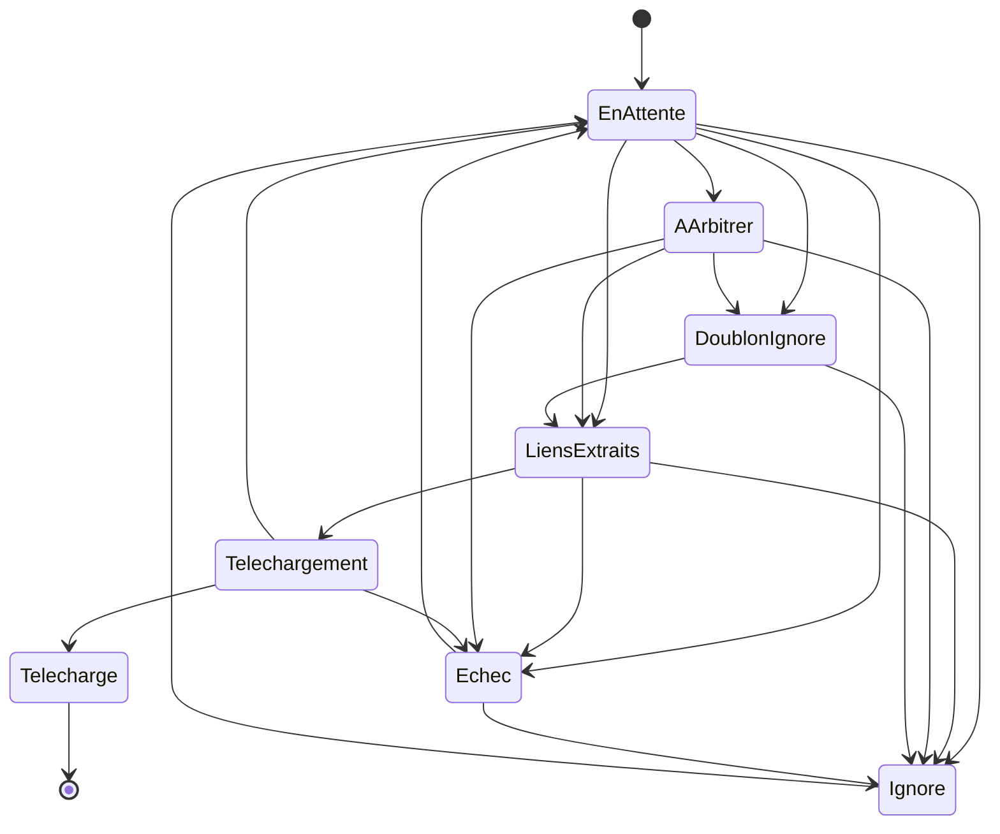

# ENT-FeedImportDecision — Décision d'import par flux

**Statut :** Brouillon · **Composant propriétaire :** Import par flux (`import-flux`) · **Stocké dans :** `FeedImportDecisions` (historique dans `FeedImportDecisionEvents`)

## Définition

Une **décision d'import par flux** enregistre le sort réservé à un livre repéré dans un article favori du lecteur de flux (Miniflux) : analyse de l'article, liens de téléchargement trouvés, doublon éventuel, téléchargement ou abandon. Un article peut contenir plusieurs livres : chaque livre a sa propre décision (même article, rang différent). Chaque changement de statut est tracé dans un historique.

## Identifiants

| Identifiant | Signification métier | Source |
|---|---|---|
| Identifiant de la décision (GUID) | Identité technique | `Domain/FeedImports/FeedImportDecision.cs:95` |
| Utilisateur + entrée Miniflux + rang | Unique : un livre d'un article n'est enregistré qu'une fois par utilisateur. Rang 0 = la décision créée depuis l'entrée ; 1..n = les autres livres du même article | `Persistence/ApplicationDbContext.cs:125`, `Domain/FeedImports/FeedImportDecision.cs:16-17` |

## Attributs clés (métier uniquement)

| Attribut (nom métier) | Signification | Valeurs / format autorisés | Colonne / champ | Source |
|---|---|---|---|---|
| Propriétaire | Utilisateur concerné | Obligatoire | `UserId` | `Domain/FeedImports/FeedImportDecision.cs:12`, `Domain/FeedImports/FeedImportDecision.cs:75` |
| Entrée Miniflux | Identifiant de l'article chez Miniflux | Strictement positif | `MinifluxEntryId` | `Domain/FeedImports/FeedImportDecision.cs:14`, `Domain/FeedImports/FeedImportDecision.cs:76` |
| Titre de l'article | Libellé informatif | Si absent, l'adresse de l'article ; tronqué à 500 caractères (jamais rejeté) | `EntryTitle` | `Domain/FeedImports/FeedImportDecision.cs:85-90` |
| Adresse de l'article | Page source | Adresse absolue http ou https, 2000 caractères max | `EntryUrl` | `Domain/FeedImports/FeedImportDecision.cs:77-81` |
| Série, titre, tome analysés | Livre reconnu dans l'article | Série 200, titre 300 caractères max, tome entier | `ParsedSerie`, `ParsedTitle`, `ParsedVolume` | `Domain/FeedImports/FeedImportConstants.cs:7-8`, `Domain/FeedImports/FeedImportDecision.cs:459-465` |
| Liens de téléchargement | Candidats (chacun avec ses miroirs) extraits de l'article | JSON ; chaque candidat doit avoir au moins un miroir | `Links` | `Domain/FeedImports/FeedImportDecision.cs:449-457`, `Domain/FeedImports/DownloadMirror.cs:4` |
| Miroir retenu | Lien effectivement téléchargé | 2000 caractères max | `ChosenMirror` | `Domain/FeedImports/FeedImportDecision.cs:300` |
| Livre apparié | Livre déjà présent détecté comme doublon (certain ou probable) | Identifiant de livre | `MatchedBookId` | `Domain/FeedImports/FeedImportDecision.cs:35` |
| Tâche d'import | Tâche créée par le dépôt du fichier téléchargé | Identifiant de tâche | `ImportJobId` | `Domain/FeedImports/FeedImportDecision.cs:37`, `Domain/FeedImports/FeedImportDecision.cs:301` |
| Statut | Voir Cycle de vie | Neuf valeurs | `Status` | `Domain/FeedImports/FeedImportDecisionStatus.cs:4-15` |
| Nature d'arbitrage | Pourquoi l'utilisateur doit trancher | Aucun / Liens ambigus / Doublon probable | `ArbitrationKind` | `Domain/FeedImports/FeedImportArbitrationKind.cs:4-9` |
| Motif et auteur de la décision | Dernière raison (1000 caractères max) et qui a décidé (automatique ou utilisateur) | — | `Reason`, `DecidedBy` | `Domain/FeedImports/FeedImportDecision.cs:467-476`, `Domain/FeedImports/FeedImportDecidedBy.cs:3-7` |
| Étape et message d'erreur | Cause de l'échec | 100 et 2000 caractères max | `ErrorStep`, `ErrorMessage` | `Domain/FeedImports/FeedImportDecision.cs:423-424` |

## Cycle de vie

Une décision est créée au statut En attente (`Domain/FeedImports/FeedImportDecision.cs:101`) par la synchronisation (`Application/FeedImports/Sync/SyncFeedImportsCommandHandler.cs:109`) ; les décisions sœurs (rang ≥ 1) sont créées à l'analyse, à partir de la décision de rang 0 encore en attente (`Domain/FeedImports/FeedImportDecision.cs:132-166`, `Application/FeedImports/Analyze/AnalyzeFeedImportDecisionCommandHandler.cs:136`).

| État de départ | État d'arrivée | Déclencheur / qui | Règles | Source (où l'état change) |
|---|---|---|---|---|
| (création) | En attente | Article favori synchronisé depuis Miniflux | BR-DB-003 | `Domain/FeedImports/FeedImportDecision.cs:68-112`, `Application/FeedImports/Sync/SyncFeedImportsCommandHandler.cs:109` |
| En attente / À arbitrer | Liens extraits | Analyse : liens regroupés sans doublon ni ambiguïté | — | `Domain/FeedImports/FeedImportDecision.cs:168-181`, `Application/FeedImports/Analysis/FeedImportAnalysisRules.cs:44` |
| En attente / À arbitrer | À arbitrer | Analyse : liens ambigus ou doublon probable | — | `Domain/FeedImports/FeedImportDecision.cs:183-207`, `Application/FeedImports/Analysis/FeedImportAnalysisRules.cs:41`, `Application/FeedImports/Analysis/FeedImportAnalysisRules.cs:62`, `Application/FeedImports/Analyze/AnalyzeFeedImportDecisionCommandHandler.cs:163` |
| En attente / À arbitrer | Doublon ignoré | Analyse : doublon certain | — | `Domain/FeedImports/FeedImportDecision.cs:209-232`, `Application/FeedImports/Analysis/FeedImportAnalysisRules.cs:39` |
| À arbitrer (doublon probable) | Liens extraits | L'utilisateur confirme « pas un doublon » | — | `Domain/FeedImports/FeedImportDecision.cs:234-245`, `Application/FeedImports/Arbitrate/ResolveFeedImportArbitrationCommandHandler.cs:32` |
| À arbitrer (doublon probable avec livre apparié) | Doublon ignoré | L'utilisateur confirme le doublon | — | `Domain/FeedImports/FeedImportDecision.cs:247-259`, `Application/FeedImports/Arbitrate/ResolveFeedImportArbitrationCommandHandler.cs:33` |
| Doublon ignoré / À arbitrer (doublon probable) | Liens extraits | L'utilisateur force le téléchargement (un seul candidat requis) | — | `Domain/FeedImports/FeedImportDecision.cs:324-327`, `Domain/FeedImports/FeedImportDecision.cs:357-368`, `Application/FeedImports/Manage/ManageFeedImportDecisionCommandHandler.cs:32` |
| Liens extraits | Téléchargement | Lancement du téléchargement via Debrid-Link | — | `Domain/FeedImports/FeedImportDecision.cs:261-270`, `Application/FeedImports/Download/DownloadFeedImportDecisionCommandHandler.cs:80` |
| Téléchargement | Téléchargé (final) | Fichier déposé dans la bibliothèque cible ; l'import se suit ensuite sur la page Import | — | `Domain/FeedImports/FeedImportDecision.cs:288-305`, `Application/FeedImports/Download/DownloadFeedImportDecisionCommandHandler.cs:272` |
| Téléchargement | Téléchargement (inchangé) | Échec d'un miroir : tracé dans l'historique, les autres miroirs restent possibles | — | `Domain/FeedImports/FeedImportDecision.cs:272-286`, `Application/FeedImports/Download/DownloadFeedImportDecisionCommandHandler.cs:154`, `Application/FeedImports/Download/DownloadFeedImportDecisionCommandHandler.cs:174` |
| En attente / Liens extraits / À arbitrer / Téléchargement | Échec | Erreur d'analyse (hôte non autorisé, page indisponible, aucun lien autorisé) ou de téléchargement ; refusé depuis un statut final | — | `Domain/FeedImports/FeedImportDecision.cs:411-428`, `Application/FeedImports/Analyze/AnalyzeFeedImportDecisionCommandHandler.cs:65`, `Application/FeedImports/Analyze/AnalyzeFeedImportDecisionCommandHandler.cs:75`, `Application/FeedImports/Analyze/AnalyzeFeedImportDecisionCommandHandler.cs:84`, `Application/FeedImports/Download/DownloadFeedImportDecisionCommandHandler.cs:300` |
| En attente / À arbitrer | Échec (liens conservés) | Liens trouvés mais non téléchargeables automatiquement : gardés pour un téléchargement manuel | — | `Domain/FeedImports/FeedImportDecision.cs:431-447`, `Application/FeedImports/Analyze/AnalyzeFeedImportDecisionCommandHandler.cs:196` |
| En attente / Liens extraits / À arbitrer / Doublon ignoré / Échec | Ignoré | L'utilisateur ignore l'entrée | — | `Domain/FeedImports/FeedImportDecision.cs:309-313`, `Domain/FeedImports/FeedImportDecision.cs:345-355`, `Application/FeedImports/Manage/ManageFeedImportDecisionCommandHandler.cs:33` |
| Échec / Ignoré / Téléchargement interrompu depuis plus d'une heure | En attente | L'utilisateur relance : liens conservés, doublon revérifié | — | `Domain/FeedImports/FeedImportDecision.cs:332-334`, `Domain/FeedImports/FeedImportDecision.cs:371-380`, `Domain/FeedImports/FeedImportConstants.cs:17`, `Application/FeedImports/Manage/ManageFeedImportDecisionCommandHandler.cs:47` |
| Liens extraits / À arbitrer / Doublon ignoré / Échec / Ignoré (un seul candidat) | En attente | L'utilisateur corrige série, titre, tome : l'analyse repart | — | `Domain/FeedImports/FeedImportDecision.cs:315-319`, `Domain/FeedImports/FeedImportDecision.cs:330`, `Domain/FeedImports/FeedImportDecision.cs:382-400`, `Application/FeedImports/Manage/CorrectFeedImportDecisionCommandHandler.cs:34` |

Le statut « Importé » n'est affecté nulle part : il est conservé pour ne pas décaler les valeurs enregistrées (`Domain/FeedImports/FeedImportDecisionStatus.cs:12`) et masqué dans les filtres de l'écran (`Web/Models/FeedImportDecisionViewModel.cs:79`). Voir Q-DOM-001.

Suppression : permise sauf pendant un téléchargement en cours (moins d'une heure depuis la dernière mise à jour) ; la tâche d'import d'une décision téléchargée est contrôlée par l'appelant (`Domain/FeedImports/FeedImportDecision.cs:336-338`).

## Relations

| Entité liée | Relation (métier) | Cardinalité |
|---|---|---|
| [ENT-User](user.md) | La décision appartient à un utilisateur (référence logique, sans clé étrangère) | n décisions → 1 utilisateur |
| [ENT-Book](book.md) | Peut désigner le livre existant détecté comme doublon (référence logique) | n décisions → 0..1 livre |
| [ENT-ImportJob](import-job.md) | Après téléchargement, désigne la tâche d'import créée (référence logique) | 0..1 décision → 1 tâche |
| Historique de la décision | Chaque changement de statut y est consigné (statut précédent, nouveau statut, auteur, description 1000 caractères max, date) | 1 décision → n événements |

## Contraintes et règles résidant en base

- BR-DB-003 : unicité utilisateur + entrée + rang.
- BR-DB-004 : détection des modifications concurrentes.
- BR-DB-009 : la suppression d'une décision supprime son historique.

## Données de référence

| Liste | Valeurs | Source |
|---|---|---|
| Statut | En attente, Liens extraits, À arbitrer, Doublon ignoré, Téléchargement, Téléchargé, Importé (inutilisé), Ignoré, Échec | `Domain/FeedImports/FeedImportDecisionStatus.cs:6-14` |
| Nature d'arbitrage | Aucune, Liens ambigus, Doublon probable | `Domain/FeedImports/FeedImportArbitrationKind.cs:6-8` |
| Auteur de la décision | Automatique, Utilisateur | `Domain/FeedImports/FeedImportDecidedBy.cs:5-6` |

Les statuts et natures d'arbitrage sont enregistrés comme nombres : ajouter à la fin, ne jamais réordonner (`Domain/FeedImports/FeedImportDecisionStatus.cs:3`, `Domain/FeedImports/FeedImportArbitrationKind.cs:3`).

## Commentaires du produit
