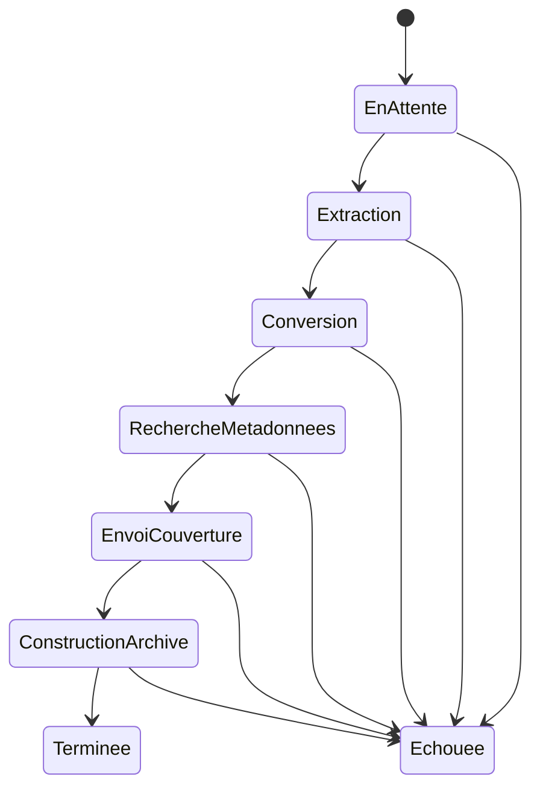

# ENT-ImportJob — Tâche d'import

**Statut :** Brouillon · **Composant propriétaire :** Import de fichiers (`import-fichiers`) · **Stocké dans :** `ImportJobs`

## Définition

Une **tâche d'import** suit le traitement d'une archive de bande dessinée (cbz, cbr, zip, rar, pdf) déposée pour une bibliothèque numérique, depuis l'attente jusqu'à la création du livre numérique ou l'échec. Elle porte un statut, la progression de la conversion des images et, en cas d'échec, l'étape et le message d'erreur.

## Identifiants

| Identifiant | Signification métier | Source |
|---|---|---|
| Identifiant de la tâche (GUID) | Identité technique | `Domain/ImportJobs/ImportJob.cs:60` |
| Chemin du fichier d'origine | Un même fichier ne peut avoir qu'une tâche non terminée à la fois | `Persistence/ApplicationDbContext.cs:87-90` |

## Attributs clés (métier uniquement)

| Attribut (nom métier) | Signification | Valeurs / format autorisés | Colonne / champ | Source |
|---|---|---|---|---|
| Nom du fichier d'origine | Nom de l'archive déposée | Non vide, 260 caractères max | `OriginalFileName` | `Domain/ImportJobs/ImportJob.cs:50`, `Domain/ImportJobs/ImportJobConstants.cs:5` |
| Chemin du fichier d'origine | Emplacement de l'archive déposée | Non vide, 500 caractères max | `OriginalFilePath` | `Domain/ImportJobs/ImportJob.cs:51`, `Domain/ImportJobs/ImportJobConstants.cs:6` |
| Taille du fichier d'origine | Taille de l'archive | Strictement positive | `OriginalFileSize` | `Domain/ImportJobs/ImportJob.cs:52` |
| Bibliothèque cible | Bibliothèque numérique où le livre sera créé | Obligatoire | `LibraryId` | `Domain/ImportJobs/ImportJob.cs:24`, `Domain/ImportJobs/ImportJob.cs:53` |
| Livre créé | Livre numérique résultant | Renseigné à la fin de l'import | `DigitalBookId` | `Domain/ImportJobs/ImportJob.cs:26`, `Domain/ImportJobs/ImportJob.cs:133` |
| Statut | Étape courante | Voir Cycle de vie | `Status` | `Domain/ImportJobs/ImportJob.cs:28` |
| Date de création / de fin | Début et fin du traitement | Date UTC ; la fin est renseignée seulement en cas de succès | `CreatedAt`, `CompletedAt` | `Domain/ImportJobs/ImportJob.cs:30-32`, `Domain/ImportJobs/ImportJob.cs:134` |
| Étape et message d'erreur | Cause de l'échec | Étape 100 caractères max ; message 2000 caractères max | `ErrorStep`, `ErrorMessage` | `Domain/ImportJobs/ImportJobConstants.cs:7-8`, `Domain/ImportJobs/ImportJob.cs:115-116` |
| Progression de la conversion | Images converties sur le total à convertir | Entiers | `ConvertedImagesCount`, `TotalImagesToConvert` | `Domain/ImportJobs/ImportJob.cs:72-76` |

## Cycle de vie

Les huit statuts sont dans `Domain/ImportJobs/ImportJobStatus.cs:3-13`. Le passage d'un statut au suivant se fait un cran à la fois, dans l'ordre : `Domain/ImportJobs/ImportJob.cs:90-96`. Terminée (Completed) et Échouée (Failed) sont définitives : toute autre transition est refusée (`Domain/ImportJobs/ImportJob.cs:80-88`).

| État de départ | État d'arrivée | Déclencheur / qui | Règles | Source (où l'état change) |
|---|---|---|---|---|
| (création) | En attente | Dépôt d'un fichier (surveillance de dossier ou import manuel) | BR-DB-001 | `Application/ImportJobs/Create/CreateImportJobCommandHandler.cs:61`, `Domain/ImportJobs/ImportJob.cs:65` |
| En attente | Extraction | Début du traitement par la file de tâches | — | `Application/ImportJobs/Process/ProcessImportJobCommandHandler.cs:160` |
| Extraction | Conversion | Images extraites | — | `Application/ImportJobs/Process/ProcessImportJobCommandHandler.cs:206` |
| Conversion | Recherche de métadonnées | Images converties | — | `Application/ImportJobs/Process/ProcessImportJobCommandHandler.cs:252` |
| Recherche de métadonnées | Envoi de la couverture | Métadonnées trouvées (ou absentes) | — | `Application/ImportJobs/Process/ProcessImportJobCommandHandler.cs:329` |
| Envoi de la couverture | Construction de l'archive | Couverture envoyée | — | `Application/ImportJobs/Process/ProcessImportJobCommandHandler.cs:364` |
| Construction de l'archive | Terminée | Livre numérique créé et enregistré ; seule l'étape « Construction de l'archive » peut terminer | — | `Application/ImportJobs/Process/ProcessImportJobCommandHandler.cs:432`, `Domain/ImportJobs/ImportJob.cs:127-134` |
| Toute étape non définitive | Échouée | Erreur d'une étape, exception inattendue | — | `Application/ImportJobs/Process/ProcessImportJobCommandHandler.cs:462`, `Application/ImportJobs/Process/ProcessImportJobCommandHandler.cs:481`, `Domain/ImportJobs/ImportJob.cs:102-118` |
| Étape intermédiaire (reprise) | Échouée | Nouvelle exécution d'une tâche restée bloquée dans une étape intermédiaire | — | `Application/ImportJobs/Process/ProcessImportJobCommandHandler.cs:34-45` |
| Toute étape non définitive (y compris En attente) | Échouée | Action manuelle « marquer comme échouée » par le propriétaire de la bibliothèque | — | `Application/ImportJobs/ForceFail/ForceFailImportJobCommandHandler.cs:25-31` |
| En attente | Échouée | Dépôt du fichier dans le dossier d'import impossible lors d'un import par flux | — | `Application/FeedImports/Download/DownloadFeedImportDecisionCommandHandler.cs:268` |

## Relations

| Entité liée | Relation (métier) | Cardinalité |
|---|---|---|
| [ENT-Library](library.md) | La tâche importe vers une bibliothèque numérique (référence logique, sans clé étrangère en base) | n tâches → 1 bibliothèque |
| [ENT-Book](book.md) | Une tâche terminée désigne le livre numérique créé (référence logique) | 1 tâche → 0..1 livre |
| [ENT-FeedImportDecision](feed-import-decision.md) | Une décision téléchargée désigne la tâche créée par le dépôt du fichier | 0..1 décision → 1 tâche |

## Contraintes et règles résidant en base

- BR-DB-001 : un seul import non terminé par fichier source.
- BR-DB-002 : détection des modifications concurrentes.
- BR-DB-011 : longueurs maximales (voir aussi `Persistence/ApplicationDbContext.cs:81-84`).
- Si l'enregistrement de la fin d'import échoue après le déplacement du fichier, le fichier est supprimé et la tâche reste dans l'étape « Construction de l'archive » jusqu'à la prochaine exécution : voir D-DOM-005.

## Données de référence

| Statut | Signification | Source |
|---|---|---|
| En attente | En attente de traitement | `Domain/ImportJobs/ImportJobStatus.cs:5` |
| Extraction | Extraction des images de l'archive ou du PDF | `Domain/ImportJobs/ImportJobStatus.cs:6` |
| Conversion | Conversion des images en WebP | `Domain/ImportJobs/ImportJobStatus.cs:7` |
| Recherche de métadonnées | Recherche via Bédéthèque et mise à jour de `ComicInfo.xml` | `Domain/ImportJobs/ImportJobStatus.cs:8` |
| Envoi de la couverture | Envoi de la couverture chez Cloudinary | `Domain/ImportJobs/ImportJobStatus.cs:9` |
| Construction de l'archive | Construction de l'archive cbz finale | `Domain/ImportJobs/ImportJobStatus.cs:10` |
| Terminée | Import réussi | `Domain/ImportJobs/ImportJobStatus.cs:11` |
| Échouée | Import en échec | `Domain/ImportJobs/ImportJobStatus.cs:12` |

## Commentaires du produit
