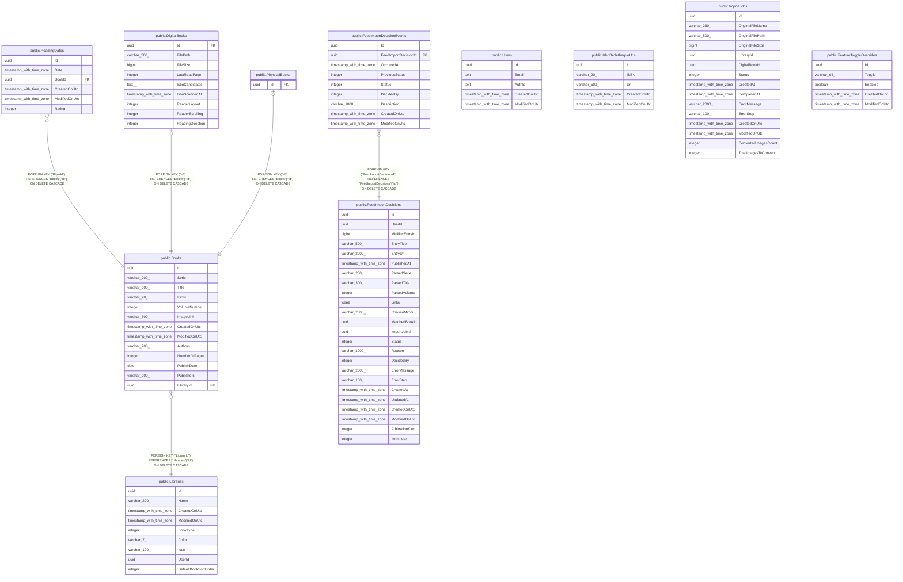

# mycomics

## Tables

| Name                                                                  | Columns | Comment                                                                                                                                                                                                | Type       |
| --------------------------------------------------------------------- | ------- | ------------------------------------------------------------------------------------------------------------------------------------------------------------------------------------------------------ | ---------- |
| [public.Libraries](public.Libraries.md)                               | 9       | Bibliothèque d'un utilisateur, qui regroupe uniquement des BD physiques ou uniquement des BD numériques.                                                                                               | BASE TABLE |
| [public.Users](public.Users.md)                                       | 5       | Utilisateur de l'application.                                                                                                                                                                          | BASE TABLE |
| [public.Books](public.Books.md)                                       | 13      | Données communes à tous les livres (BD). Chaque ligne est spécialisée par une ligne de PhysicalBooks ou de DigitalBooks de même Id.                                                                    | BASE TABLE |
| [public.ReadingDates](public.ReadingDates.md)                         | 6       | Lecture d'un livre par l'utilisateur, avec la note donnée à cette occasion.                                                                                                                            | BASE TABLE |
| [public.DigitalBooks](public.DigitalBooks.md)                         | 9       | Spécialisation d'un livre numérique (fichier dans une bibliothèque numérique) ; même Id que la ligne de Books.                                                                                         | BASE TABLE |
| [public.PhysicalBooks](public.PhysicalBooks.md)                       | 1       | Spécialisation d'un livre physique (possédé sur papier) ; même Id que la ligne de Books, sans colonne propre.                                                                                          | BASE TABLE |
| [public.IsbnBedethequeUrls](public.IsbnBedethequeUrls.md)             | 5       | Cache de l'URL de la fiche Bedetheque associée à un ISBN.                                                                                                                                              | BASE TABLE |
| [public.ImportJobs](public.ImportJobs.md)                             | 15      | Traitement d'import d'un fichier de BD numérique déposé, suivi étape par étape jusqu'à la création du livre numérique.                                                                                 | BASE TABLE |
| [public.FeedImportDecisions](public.FeedImportDecisions.md)           | 24      | Décision d'import automatique issue d'un article d'un flux Miniflux (un article peut contenir plusieurs livres, donc plusieurs décisions) ; suit l'analyse, l'arbitrage éventuel et le téléchargement. | BASE TABLE |
| [public.FeedImportDecisionEvents](public.FeedImportDecisionEvents.md) | 9       | Historique des changements d'état d'une décision d'import de flux.                                                                                                                                     | BASE TABLE |
| [public.FeatureToggleOverrides](public.FeatureToggleOverrides.md)     | 5       | Valeurs d'activation de fonctionnalités choisies dans la page Paramètres ; elles remplacent la valeur de la configuration (appsettings / variables d'environnement) tant qu'elles existent.            | BASE TABLE |

## Relations

---

> Generated by [tbls](https://github.com/k1LoW/tbls)
