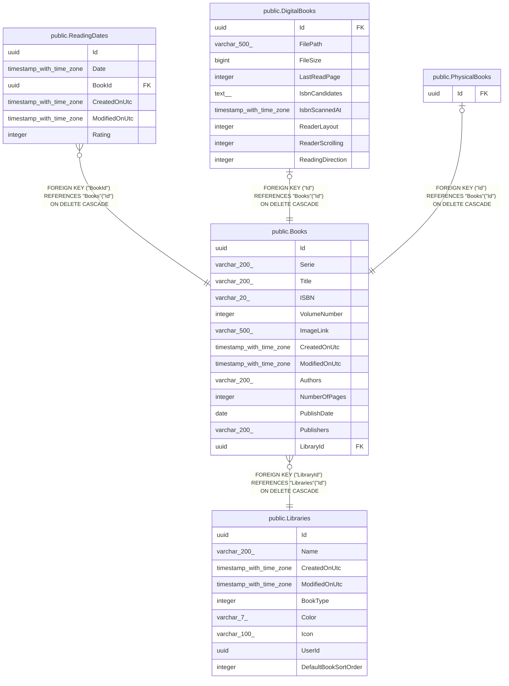

# public.Books

## Description

Données communes à tous les livres (BD). Chaque ligne est spécialisée par une ligne de PhysicalBooks ou de DigitalBooks de même Id.

## Columns

| Name          | Type                     | Default  | Nullable | Children                                                                                                                                    | Parents                                 | Comment                                                                                                                    |
| ------------- | ------------------------ | -------- | -------- | ------------------------------------------------------------------------------------------------------------------------------------------- | --------------------------------------- | -------------------------------------------------------------------------------------------------------------------------- |
| Id            | uuid                     |          | false    | [public.ReadingDates](public.ReadingDates.md) [public.DigitalBooks](public.DigitalBooks.md) [public.PhysicalBooks](public.PhysicalBooks.md) |                                         |                                                                                                                            |
| Serie         | varchar(200)             |          | false    |                                                                                                                                             |                                         | Nom de la série à laquelle appartient la BD.                                                                               |
| Title         | varchar(200)             |          | false    |                                                                                                                                             |                                         |                                                                                                                            |
| ISBN          | varchar(20)              |          | true     |                                                                                                                                             |                                         | ISBN du livre. Peut être vide pour une BD numérique dont l'ISBN n'est pas encore connu ; obligatoire pour une BD physique. |
| VolumeNumber  | integer                  |          | false    |                                                                                                                                             |                                         | Numéro du tome dans la série (1 par défaut).                                                                               |
| ImageLink     | varchar(500)             |          | false    |                                                                                                                                             |                                         | Lien de l'image de couverture.                                                                                             |
| CreatedOnUtc  | timestamp with time zone |          | false    |                                                                                                                                             |                                         |                                                                                                                            |
| ModifiedOnUtc | timestamp with time zone |          | true     |                                                                                                                                             |                                         |                                                                                                                            |
| Authors       | varchar(200)             | ''::text | false    |                                                                                                                                             |                                         | Auteurs de la BD.                                                                                                          |
| NumberOfPages | integer                  |          | true     |                                                                                                                                             |                                         | Nombre de pages (facultatif).                                                                                              |
| PublishDate   | date                     |          | true     |                                                                                                                                             |                                         | Date de publication.                                                                                                       |
| Publishers    | varchar(200)             | ''::text | false    |                                                                                                                                             |                                         | Éditeurs de la BD.                                                                                                         |
| LibraryId     | uuid                     |          | false    |                                                                                                                                             | [public.Libraries](public.Libraries.md) | Bibliothèque qui contient le livre.                                                                                        |

## Constraints

| Name                         | Type        | Definition                                                               |
| ---------------------------- | ----------- | ------------------------------------------------------------------------ |
| FK_Books_Libraries_LibraryId | FOREIGN KEY | FOREIGN KEY ("LibraryId") REFERENCES "Libraries"("Id") ON DELETE CASCADE |
| PK_Books                     | PRIMARY KEY | PRIMARY KEY ("Id")                                                       |

## Indexes

| Name               | Definition                                                                    |
| ------------------ | ----------------------------------------------------------------------------- |
| PK_Books           | CREATE UNIQUE INDEX "PK_Books" ON public."Books" USING btree ("Id")           |
| IX_Books_LibraryId | CREATE INDEX "IX_Books_LibraryId" ON public."Books" USING btree ("LibraryId") |

## Relations

---

> Generated by [tbls](https://github.com/k1LoW/tbls)
