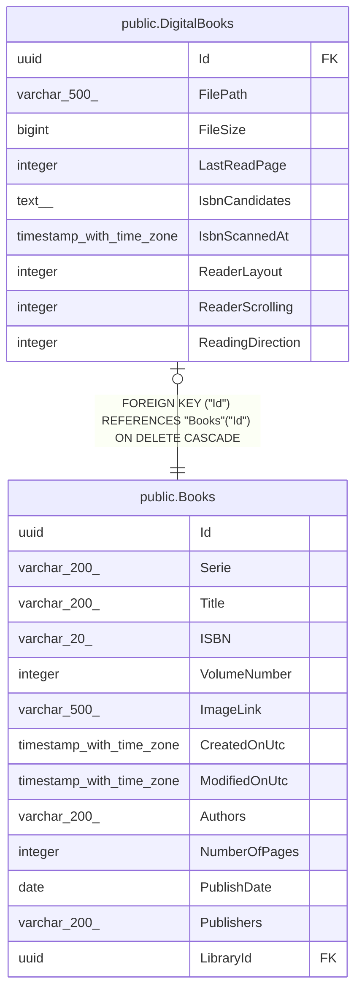

# public.DigitalBooks

## Description

Spécialisation d'un livre numérique (fichier dans une bibliothèque numérique) ; même Id que la ligne de Books.

## Columns

| Name             | Type                     | Default               | Nullable | Children | Parents                         | Comment                                                                                                                                                                           |
| ---------------- | ------------------------ | --------------------- | -------- | -------- | ------------------------------- | --------------------------------------------------------------------------------------------------------------------------------------------------------------------------------- |
| Id               | uuid                     |                       | false    |          | [public.Books](public.Books.md) |                                                                                                                                                                                   |
| FilePath         | varchar(500)             | ''::character varying | false    |          |                                 | Chemin du fichier de la BD dans le stockage de la bibliothèque.                                                                                                                   |
| FileSize         | bigint                   | 0                     | false    |          |                                 | Taille du fichier, en octets.                                                                                                                                                     |
| LastReadPage     | integer                  | 0                     | false    |          |                                 | Index (à partir de 0) de la dernière page affichée dans le lecteur.                                                                                                               |
| IsbnCandidates   | text[]                   | ARRAY[]::text[]       | false    |          |                                 | ISBN lus sur les pages du livre quand plusieurs ont été trouvés et qu'aucun n'a pu être attribué automatiquement ; l'utilisateur choisit le bon. Vidé dès que le livre a un ISBN. |
| IsbnScannedAt    | timestamp with time zone |                       | true     |          |                                 | Date de la dernière recherche d'ISBN dans les pages du livre ; vide si elle n'a jamais été faite.                                                                                 |
| ReaderLayout     | integer                  | 0                     | false    |          |                                 | Disposition des pages dans le lecteur : 0 = Pleine largeur (défilement vertical), 1 = Page seule en pleine hauteur, 2 = Deux pages côte à côte en pleine hauteur.                 |
| ReaderScrolling  | integer                  | 0                     | false    |          |                                 | Défilement du lecteur : 0 = Continu (un seul défilement vertical), 1 = Page par page (tape, balayage ou flèches).                                                                 |
| ReadingDirection | integer                  | 0                     | false    |          |                                 | Sens de lecture : 0 = De gauche à droite, 1 = De droite à gauche (mangas : la page suivante est à gauche).                                                                        |

## Constraints

| Name                     | Type        | Definition                                                    |
| ------------------------ | ----------- | ------------------------------------------------------------- |
| FK_DigitalBooks_Books_Id | FOREIGN KEY | FOREIGN KEY ("Id") REFERENCES "Books"("Id") ON DELETE CASCADE |
| PK_DigitalBooks          | PRIMARY KEY | PRIMARY KEY ("Id")                                            |

## Indexes

| Name            | Definition                                                                        |
| --------------- | --------------------------------------------------------------------------------- |
| PK_DigitalBooks | CREATE UNIQUE INDEX "PK_DigitalBooks" ON public."DigitalBooks" USING btree ("Id") |

## Relations

---

> Generated by [tbls](https://github.com/k1LoW/tbls)
