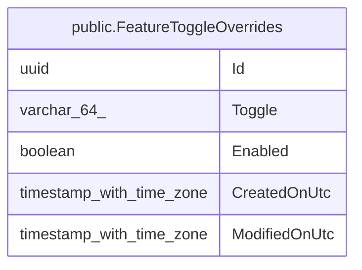

# public.FeatureToggleOverrides

## Description

Valeurs d'activation de fonctionnalités choisies dans la page Paramètres ; elles remplacent la valeur de la configuration (appsettings / variables d'environnement) tant qu'elles existent.

## Columns

| Name          | Type                     | Default | Nullable | Children | Parents | Comment                                                                                                                                                                                                                                                                                                                                                                   |
| ------------- | ------------------------ | ------- | -------- | -------- | ------- | ------------------------------------------------------------------------------------------------------------------------------------------------------------------------------------------------------------------------------------------------------------------------------------------------------------------------------------------------------------------------- |
| Id            | uuid                     |         | false    |          |         |                                                                                                                                                                                                                                                                                                                                                                           |
| Toggle        | varchar(64)              |         | false    |          |         | Fonctionnalité concernée, stockée par son nom : FeedImport (synchronisation Miniflux et téléchargements automatiques), IsbnOcr (lecture de l'ISBN sur les pages des livres importés), Bedetheque (recherche Bedetheque via SerpApi), Bnf (recherche catalogue BnF), GoogleBooks (recherche Google Books), OpenLibrary (recherche OpenLibrary), Bubble (recherche Bubble). |
| Enabled       | boolean                  |         | false    |          |         | Vrai si la fonctionnalité est activée, faux si elle est désactivée.                                                                                                                                                                                                                                                                                                       |
| CreatedOnUtc  | timestamp with time zone |         | false    |          |         |                                                                                                                                                                                                                                                                                                                                                                           |
| ModifiedOnUtc | timestamp with time zone |         | true     |          |         |                                                                                                                                                                                                                                                                                                                                                                           |

## Constraints

| Name                      | Type        | Definition         |
| ------------------------- | ----------- | ------------------ |
| PK_FeatureToggleOverrides | PRIMARY KEY | PRIMARY KEY ("Id") |

## Indexes

| Name                             | Definition                                                                                                       |
| -------------------------------- | ---------------------------------------------------------------------------------------------------------------- |
| PK_FeatureToggleOverrides        | CREATE UNIQUE INDEX "PK_FeatureToggleOverrides" ON public."FeatureToggleOverrides" USING btree ("Id")            |
| IX_FeatureToggleOverrides_Toggle | CREATE UNIQUE INDEX "IX_FeatureToggleOverrides_Toggle" ON public."FeatureToggleOverrides" USING btree ("Toggle") |

## Relations

---

> Generated by [tbls](https://github.com/k1LoW/tbls)
