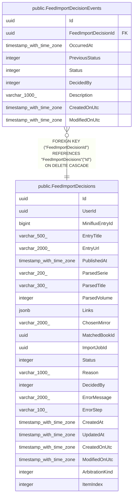

# public.FeedImportDecisionEvents

## Description

Historique des changements d'état d'une décision d'import de flux.

## Columns

| Name                 | Type                     | Default | Nullable | Children | Parents                                                     | Comment                                                                                                                                                                                                                                                   |
| -------------------- | ------------------------ | ------- | -------- | -------- | ----------------------------------------------------------- | --------------------------------------------------------------------------------------------------------------------------------------------------------------------------------------------------------------------------------------------------------- |
| Id                   | uuid                     |         | false    |          |                                                             |                                                                                                                                                                                                                                                           |
| FeedImportDecisionId | uuid                     |         | false    |          | [public.FeedImportDecisions](public.FeedImportDecisions.md) | Décision concernée.                                                                                                                                                                                                                                       |
| OccurredAt           | timestamp with time zone |         | false    |          |                                                             | Date de l'événement.                                                                                                                                                                                                                                      |
| PreviousStatus       | integer                  |         | true     |          |                                                             | État précédent (mêmes valeurs que FeedImportDecisions.Status) ; vide pour l'événement de création.                                                                                                                                                        |
| Status               | integer                  |         | false    |          |                                                             | Nouvel état (mêmes valeurs que FeedImportDecisions.Status : 0 = En attente d'analyse, 1 = Liens extraits, 2 = En attente d'arbitrage, 3 = Doublon ignoré, 4 = Téléchargement en cours, 5 = Téléchargé, 6 = Importé (non utilisé), 7 = Ignoré, 8 = Échec). |
| DecidedBy            | integer                  |         | false    |          |                                                             | Auteur de l'événement : 0 = Automatique, 1 = Utilisateur.                                                                                                                                                                                                 |
| Description          | varchar(1000)            |         | false    |          |                                                             | Raison ou description de l'événement.                                                                                                                                                                                                                     |
| CreatedOnUtc         | timestamp with time zone |         | false    |          |                                                             |                                                                                                                                                                                                                                                           |
| ModifiedOnUtc        | timestamp with time zone |         | true     |          |                                                             |                                                                                                                                                                                                                                                           |

## Constraints

| Name                                                            | Type        | Definition                                                                                    |
| --------------------------------------------------------------- | ----------- | --------------------------------------------------------------------------------------------- |
| FK_FeedImportDecisionEvents_FeedImportDecisions_FeedImportDeci~ | FOREIGN KEY | FOREIGN KEY ("FeedImportDecisionId") REFERENCES "FeedImportDecisions"("Id") ON DELETE CASCADE |
| PK_FeedImportDecisionEvents                                     | PRIMARY KEY | PRIMARY KEY ("Id")                                                                            |

## Indexes

| Name                                             | Definition                                                                                                                                |
| ------------------------------------------------ | ----------------------------------------------------------------------------------------------------------------------------------------- |
| PK_FeedImportDecisionEvents                      | CREATE UNIQUE INDEX "PK_FeedImportDecisionEvents" ON public."FeedImportDecisionEvents" USING btree ("Id")                                 |
| IX_FeedImportDecisionEvents_FeedImportDecisionId | CREATE INDEX "IX_FeedImportDecisionEvents_FeedImportDecisionId" ON public."FeedImportDecisionEvents" USING btree ("FeedImportDecisionId") |

## Relations

---

> Generated by [tbls](https://github.com/k1LoW/tbls)
