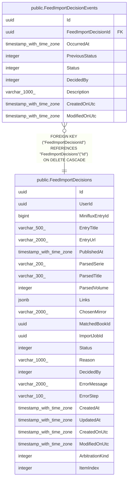

# public.FeedImportDecisions

## Description

Décision d'import automatique issue d'un article d'un flux Miniflux (un article peut contenir plusieurs livres, donc plusieurs décisions) ; suit l'analyse, l'arbitrage éventuel et le téléchargement.

## Columns

| Name            | Type                     | Default | Nullable | Children                                                              | Parents | Comment                                                                                                                                                                                                                                                                                                                                                               |
| --------------- | ------------------------ | ------- | -------- | --------------------------------------------------------------------- | ------- | --------------------------------------------------------------------------------------------------------------------------------------------------------------------------------------------------------------------------------------------------------------------------------------------------------------------------------------------------------------------- |
| Id              | uuid                     |         | false    | [public.FeedImportDecisionEvents](public.FeedImportDecisionEvents.md) |         |                                                                                                                                                                                                                                                                                                                                                                       |
| UserId          | uuid                     |         | false    |                                                                       |         | Utilisateur pour lequel l'article a été enregistré.                                                                                                                                                                                                                                                                                                                   |
| MinifluxEntryId | bigint                   |         | false    |                                                                       |         | Identifiant de l'article dans Miniflux.                                                                                                                                                                                                                                                                                                                               |
| EntryTitle      | varchar(500)             |         | false    |                                                                       |         | Titre de l'article (tronqué si besoin ; l'URL à défaut de titre).                                                                                                                                                                                                                                                                                                     |
| EntryUrl        | varchar(2000)            |         | false    |                                                                       |         | URL de l'article.                                                                                                                                                                                                                                                                                                                                                     |
| PublishedAt     | timestamp with time zone |         | true     |                                                                       |         | Date de publication de l'article.                                                                                                                                                                                                                                                                                                                                     |
| ParsedSerie     | varchar(200)             |         | true     |                                                                       |         | Série déduite du titre de l'article.                                                                                                                                                                                                                                                                                                                                  |
| ParsedTitle     | varchar(300)             |         | true     |                                                                       |         | Titre du livre déduit du titre de l'article.                                                                                                                                                                                                                                                                                                                          |
| ParsedVolume    | integer                  |         | true     |                                                                       |         | Numéro de tome déduit du titre de l'article.                                                                                                                                                                                                                                                                                                                          |
| Links           | jsonb                    |         | true     |                                                                       |         | Liste JSON des candidats de téléchargement trouvés dans l'article, chacun avec ses miroirs (URL et hôte).                                                                                                                                                                                                                                                             |
| ChosenMirror    | varchar(2000)            |         | true     |                                                                       |         | Miroir utilisé pour le téléchargement.                                                                                                                                                                                                                                                                                                                                |
| MatchedBookId   | uuid                     |         | true     |                                                                       |         | Livre existant détecté comme doublon (certain ou probable).                                                                                                                                                                                                                                                                                                           |
| ImportJobId     | uuid                     |         | true     |                                                                       |         | Import créé lorsque le fichier téléchargé a été déposé.                                                                                                                                                                                                                                                                                                               |
| Status          | integer                  |         | false    |                                                                       |         | État de la décision : 0 = En attente d'analyse, 1 = Liens extraits, 2 = En attente d'arbitrage, 3 = Doublon ignoré (BD déjà présente), 4 = Téléchargement en cours, 5 = Téléchargé (fichier déposé ; l'import se suit ensuite via ImportJobs), 6 = Importé (valeur non utilisée, conservée pour ne pas décaler les valeurs), 7 = Ignoré par l'utilisateur, 8 = Échec. |
| Reason          | varchar(1000)            |         | false    |                                                                       |         | Raison de l'état courant de la décision.                                                                                                                                                                                                                                                                                                                              |
| DecidedBy       | integer                  |         | false    |                                                                       |         | Auteur de la dernière décision : 0 = Automatique, 1 = Utilisateur.                                                                                                                                                                                                                                                                                                    |
| ErrorMessage    | varchar(2000)            |         | true     |                                                                       |         | Message d'erreur en cas d'échec.                                                                                                                                                                                                                                                                                                                                      |
| ErrorStep       | varchar(100)             |         | true     |                                                                       |         | Étape à laquelle la décision a échoué.                                                                                                                                                                                                                                                                                                                                |
| CreatedAt       | timestamp with time zone |         | false    |                                                                       |         | Date d'enregistrement de l'article (identique pour les livres d'un même article).                                                                                                                                                                                                                                                                                     |
| UpdatedAt       | timestamp with time zone |         | false    |                                                                       |         | Date du dernier changement d'état.                                                                                                                                                                                                                                                                                                                                    |
| CreatedOnUtc    | timestamp with time zone |         | false    |                                                                       |         |                                                                                                                                                                                                                                                                                                                                                                       |
| ModifiedOnUtc   | timestamp with time zone |         | true     |                                                                       |         |                                                                                                                                                                                                                                                                                                                                                                       |
| ArbitrationKind | integer                  | 0       | false    |                                                                       |         | Raison de l'arbitrage demandé à l'utilisateur : 0 = Aucun, 1 = Liens ambigus (regroupement en miroirs/livres incertain), 2 = Doublon probable (correspondance proche mais non certaine dans une bibliothèque).                                                                                                                                                        |
| ItemIndex       | integer                  | 0       | false    |                                                                       |         | Rang du livre dans l'article, 0 pour la décision créée depuis l'entrée Miniflux, 1 à n pour les autres livres du même article.                                                                                                                                                                                                                                        |

## Constraints

| Name                   | Type        | Definition         |
| ---------------------- | ----------- | ------------------ |
| PK_FeedImportDecisions | PRIMARY KEY | PRIMARY KEY ("Id") |

## Indexes

| Name                                                    | Definition                                                                                                                                                           |
| ------------------------------------------------------- | -------------------------------------------------------------------------------------------------------------------------------------------------------------------- |
| PK_FeedImportDecisions                                  | CREATE UNIQUE INDEX "PK_FeedImportDecisions" ON public."FeedImportDecisions" USING btree ("Id")                                                                      |
| IX_FeedImportDecisions_UserId_Status                    | CREATE INDEX "IX_FeedImportDecisions_UserId_Status" ON public."FeedImportDecisions" USING btree ("UserId", "Status")                                                 |
| IX_FeedImportDecisions_UserId_MinifluxEntryId_ItemIndex | CREATE UNIQUE INDEX "IX_FeedImportDecisions_UserId_MinifluxEntryId_ItemIndex" ON public."FeedImportDecisions" USING btree ("UserId", "MinifluxEntryId", "ItemIndex") |

## Relations

---

> Generated by [tbls](https://github.com/k1LoW/tbls)
